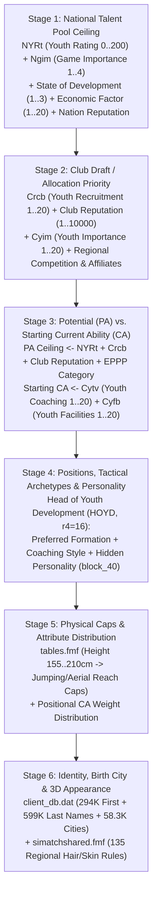

# Football Manager 26 — Internal Game Logics & Simulation Mechanics Reference

> **Repository:** [`fm-toolkit`](../)  
> **Scope:** Complete reverse-engineered reference of **10 core internal simulation logics** in Football Manager 26 (`v26.2.0` / Build `2620`), extracted directly from `.fmf` / `.jsb` engine archives (`simatch.fmf`, `training.fmf`, `tables.fmf`, `simatchshared.fmf`, `editor.fmf`), pre-game master databases (`client_db.dat`, `server_db.dat`, `.edt`), IL2CPP symbols (`global-metadata.dat`, `il2cpp.usym`), and `.fm` save containers (`game_db.dat`).

---

## Table of Contents

1. [Youth Intake & Newgen Generation Pipeline (`NYRt`, `Crcb`, `Cytv`, `Cyfb`, `HOYD`)](#1-youth-intake--newgen-generation-pipeline)
2. [AI Team Selection & Squad Rotation Engine (`weights.jsb` — 4 Profiles × 40 `TSF_*` Factors)](#2-ai-team-selection--squad-rotation-engine-weightsjsb)
3. [Match Rating Calculation Engine (`player_ratings_data.jsb` — `6.70` Base & 52 Actions)](#3-match-rating-calculation-engine-player_ratings_datajsb)
4. [Weekly Training Engine (`training.fmf` — 44 Session Attribute Weights & Physical/Happiness Effects)](#4-weekly-training-engine-trainingfmf)
5. [Player Progression, CA Growth, Coaching Star Formula & Aging Mechanics](#5-player-progression-ca-growth-coaching-star-formula--aging-mechanics)
6. [Match Engine: Expected Goals (`xG`), Spatial Momentum (`48` Rules) & Quick Match Engine (`QME`)](#6-match-engine-expected-goals-xg-spatial-momentum--quick-match-engine-qme)
7. [Dual-Formation Engine: Out-Of-Possession (`OOP`) 24-Zone Grid & 10 Tactical Styles](#7-dual-formation-engine-out-of-possession-oop-24-zone-grid--10-tactical-styles)
8. [Medical Centre & Injury Simulation Engine (`server_db.dat` — 136 Injuries)](#8-medical-centre--injury-simulation-engine-server_dbdat)
9. [Sugar Daddy Tycoons, Board Takeovers, International Treaties & Transfer Valuation Logic](#9-sugar-daddy-tycoons-board-takeovers-international-treaties--transfer-valuation-logic)
10. [Squad Dynamics, Mentoring Groups & Hidden `PersonBlock` Relationships](#10-squad-dynamics-mentoring-groups--hidden-personblock-relationships)

---

## 1. Youth Intake & Newgen Generation Pipeline

Every season, FM generates new academy cohorts (**Newgens / Regens**) through a deterministic **6-stage hierarchical pipeline** governed by parameters in `editor.fmf` (`Frame #045: nation.xml` and `Frame #032: club.xml`), `server_db.dat`, `client_db.dat`, `shared/tables.fmf`, and `simatchshared.fmf`.

### 1.1 Stage 1 — National Talent Pool Ceiling (`nation.xml` & `server_db.dat`)
Before any club receives a player, the nation's overall youth quality curve is bounded by five national parameters (`editor.fmf` `Frame #045` & `client_db.dat` `Frame #11`):

| FourCC / Field | Range / Enum | Engine Role |
| :--- | :---: | :--- |
| **`NYRt` (`Youth Rating`)** | `0 .. 200` | Base national talent ceiling (referenced in `global-metadata.dat` as `DebugNationYouthRatingTableReference`). |
| **`Ngim` (`Game Importance`)** | `1 .. 4` | `1 = Very Important`, `2 = Important`, `3 = Fairly Unimportant`, `4 = Unimportant`. Any value worse than `1` severely penalizes the upper tail of the nation's PA distribution even if `NYRt` is high. |
| **`State of Development`** | `1 .. 3` | `1 = Developed`, `2 = Developing`, `3 = Third World`. Modulates baseline infrastructure efficiency and starting CA readiness. |
| **`Economic Factor` & `Nfap`** | `1 .. 20` | National economic strength (`offset +19` in `client_db.dat` `Frame #11`) and `FA Financial Power` (`Nfap`). |
| **`Nation Reputation`** | `1 .. 10000` | Dynamic national football reputation (evolves over time as clubs/national teams perform in continental competitions). |

**Sample National Parameters from `client_db.dat` (`2620`):**

| Nation | State of Development | Economic Factor (`1..20`) | Game Importance (`Ngim`) | Years to Gain Nationality |
| :--- | :--- | :---: | :--- | :---: |
| **England** (`id=139`) | `Developed (1)` | `19` | `Very Important (1)` | `5` |
| **France** (`id=143`) | `Developed (1)` | `19` | `Very Important (1)` | `5` |
| **Italy** (`id=150`) | `Developed (1)` | `18` | `Very Important (1)` | `10` |
| **Germany** (`id=145`) | `Developed (1)` | `19` | `Important (2)` | `8` |
| **Spain** (`id=170`) | `Developed (1)` | `17` | `Important (2)` | `10` |
| **Brazil** (`id=189`) | `Developing (2)` | `16` | `Very Important (1)` | `4` |
| **Argentina** (`id=187`) | `Developing (2)` | `16` | `Very Important (1)` | `2` |
| **Colombia** (`id=191`) | `Developing (2)` | `13` | `Very Important (1)` | `5` |
| **Türkiye** (`id=173`) | `Developed (1)` | `10` | `Very Important (1)` | `5` |
| **United States** (`id=120`) | `Developed (1)` | `20` | `Important (2)` | `5` |

### 1.2 Stage 2 & Stage 3 — Club Allocation (`PA`) vs. Starting Readiness (`CA`)
In `editor.fmf` (`Frame #032: club.xml`), four distinct `1..20` club attributes govern academy output, each targeting a different part of the pipeline:

| FourCC | Editor / UI Field (`1..20`) | Primary Effect on Youth Intake |
| :--- | :--- | :--- |
| **`Crcb`** | **Youth Recruitment** | **Controls `PA` (Potential Ability) & Priority:** Determines the club's reach and priority in capturing the highest-PA prospects from the national pool (and foreign affiliate pools). Competes directly against nearby clubs with high **Club Reputation**. |
| **`Cytv`** | **Youth Coaching** *(Junior Coaching)* | **Controls Starting `CA` (Current Ability):** Determines how developed the 15/16-year-old prospect already is on the day they generate in the intake. |
| **`Cyfb`** | **Youth Facilities** | **Controls Post-Intake Youth Growth (and secondary Starting `CA`):** Governs how rapidly U18/U19 players convert their remaining `PA` into `CA` while training at the academy. |
| **`Cyim`** | **Youth Importance** | **Board Youth Philosophy (`1..20`):** Weighs how heavily the board prioritizes academy upgrades and youth intake investment. |

* **English EPPP Academy Grades (`eng_youth_grades.edt`):** In England, 95 clubs have permanent EPPP Academy Category ratings (`Category 1..4`) in `shared/data/database/db/2620/edt/permanent/eng_youth_grades.edt` that further cap or boost youth recruitment tiers.
* **Foreign Feeder / Affiliate Pipelines (`club.xml` IDs `312826` & `510183`):** Clubs with `"Youth Players Training"` (`312826`) or `"Regional Academy"` (`510183`) affiliations can draw dual-nationality newgens evaluated against the **affiliate nation's `NYRt` pool**.

### 1.3 Stage 4 — Head of Youth Development (`HOYD`, `r4 = 16`) Influence
The staff member assigned to **Provides Youth Development Information** (typically the **Head of Youth Development**, `job_role_id = 16` in `constants.py`) shapes the intake cohort in four ways:
1. **December Preview vs. March/April Intake (`global-metadata.dat`):**
   - `ExecuteDecemberDecentYouthCandidatesCountDecentYouthCandidatesListDecimalDecimal` and `YouthCandidatesPositionPreviewReference` generate the mid-season position/grade preview (`A..F`), while `RankedYouthCandidatesReference` finalizes the spring intake.
2. **Positional Distribution (`Preferred Formation`):**
   - The cohort's positions are sampled from the HOYD's **Preferred Formation** (e.g., a HOYD preferring a narrow `5-3-2` will rarely produce pure `AML/AMR` wingers, whereas a `4-2-3-1` HOYD regularly produces wide forwards and `#10`s).
3. **Personality & Hidden Attribute Inheritance (`block_40`):**
   - Roughly `20–30%` of generated prospects inherit their hidden personality vector (`Professionalism`, `Determination`, `Ambition`, `Pressure`, `Temperament`, `Sportsmanship`, `Loyalty`) from the HOYD's `26`-byte `block_40` hidden staff attributes.
4. **Coaching Style Bias (`translation_id=242543`):**
   - The HOYD's `Coaching Style` (*Attacking, Defending, Fitness, Technical, Mental, General*) tilts initial attribute points toward that category.

### 1.4 Stage 5 & Stage 6 — Physical Height Caps (`tables.fmf`) & Ethnic Appearance (`simatchshared.fmf`)
1. **Height-to-Jumping & Aerial Reach Hard Caps (`shared/data/shared/tables.fmf`):**
   - Once a newgen's height (`cm`) is rolled, `height_to_jumping_reach.jsb` and `height_to_aerial_reach.jsb` enforce hard `min_value` / `max_value` bounds (internal `0..100` scale, divide by `5` for `1..20`):

| Height Bracket (`cm`) | Jumping Reach Min..Max (`0..100` \| `1..20`) | Aerial Reach Min..Max (`0..100` \| `1..20`) |
| :--- | :---: | :---: |
| **`155 – 165 cm`** | `0 .. 12` (`0.0 .. 2.4`) | `4 .. 16` (`0.8 .. 3.2`) |
| **`165 – 170 cm`** | `8 .. 36` (`1.6 .. 7.2`) | `8 .. 40` (`1.6 .. 8.0`) |
| **`170 – 175 cm`** | `12 .. 48` (`2.4 .. 9.6`) | `12 .. 48` (`2.4 .. 9.6`) |
| **`175 – 180 cm`** | `24 .. 60` (`4.8 .. 12.0`) | `20 .. 60` (`4.0 .. 12.0`) |
| **`180 – 185 cm`** | `36 .. 76` (`7.2 .. 15.2`) | `36 .. 76` (`7.2 .. 15.2`) |
| **`185 – 190 cm`** | `52 .. 84` (`10.4 .. 16.8`) | `48 .. 84` (`9.6 .. 16.8`) |
| **`190 – 195 cm`** | `60 .. 92` (`12.0 .. 18.4`) | `60 .. 92` (`12.0 .. 18.4`) |
| **`195 – 200 cm`** | `68 .. 96` (`13.6 .. 19.2`) | `68 .. 96` (`13.6 .. 19.2`) |
| **`200 – 210 cm`** | `80 .. 100` (`16.0 .. 20.0`) | `72 .. 100` (`14.4 .. 20.0`) |

2. **Name Pools, Birth City & 3D Appearance (`client_db.dat` & `simatchshared.fmf`):**
   - Names are drawn from `client_db.dat` `Frame #17` (`294,103` First Names) and `Frame #18` (`599,900` Surnames) matching the player's language/ethnicity.
   - Birth cities are sampled from `client_db.dat` `Frame #02` (`58,349` Cities) weighted by `local_region_id` proximity to the club and `inhabitants_bracket`.
   - Hair length, hair colour, and skin tone are generated via `simatchshared.fmf` `Frame #074` (`player_hair_length_colour_config_data.jsb`, `135` regional/ethnic probability rules).

---

## 2. AI Team Selection & Squad Rotation Engine (`weights.jsb`)

In `shared/data/simatch.fmf` (`Frame #223`: `weights.jsb`, `6,547` bytes), FM26 defines the exact linear scoring weights used by AI managers (and the **"Quick Pick"** assistant button) across **4 Team Picking Styles (`TPS_*`)** and **40 Team Selection Factors (`simatchshared::TSF_*`)**.

For every candidate player and every slot in the formation, the engine sums `weight * normalized_factor_score`:

| Team Selection Factor (`simatchshared::TSF_*`) | `TPS_FIRST_TEAM_PICKING` *(Full Strength)* | `TPS_SLIGHTLY_RESERVE_PICKING` *(Light Rotation)* | `TPS_SEMI_RESERVE_PICKING` *(Cup / Heavy Rotation)* | `TPS_TOTAL_RESERVE_PICKING` *(Dead Rubber / Youth)* | What It Measures |
| :--- | :---: | :---: | :---: | :---: | :--- |
| **`TSF_HUMAN_SELECTION`** | `+500` | `+500` | `+500` | `+500` | Locked in slot by human manager |
| **`TSF_CUP_KEEPER`** | `+310` | `+310` | `+310` | `+310` | Designated Cup Goalkeeper promise/role |
| **`TSF_DECLARED_FOR_RESERVES`** | `+170` | `+160` | `+150` | `+140` | First-team player made available for reserves |
| **`TSF_POSITION_ABILITY`** | **`+150`** | **`+150`** | **`+130`** | **`+130`** | Positional familiarity (`1..20` at slot) + ability |
| **`TSF_CA` (Current Ability)** | **`+120`** | **`+100`** | **`+90`** | **`+90`** | Player's Current Ability (`CA`) |
| **`TSF_EXTRA_ADJ`** | `+110` | `+110` | `+110` | `+110` | Tactical / opposition specific adjustment |
| **`TSF_LAST_RATINGS`** | **`+95`** | **`+90`** | **`+80`** | **`+60`** | Recent 5-match average rating |
| **`TSF_PA` (Potential Ability)** | **`+90`** | **`+100`** | **`+110`** | **`+120`** | Player's Potential Ability (`PA` / perceived PA) |
| **`TSF_CONDITION`** | `+80` | `+80` | `+80` | `+80` | Current physical condition (`0..10000`) |
| **`TSF_POSITION_ABILITY_IN_ROLE`** | `+80` | `+70` | `+70` | `+70` | Suitability for the specific Tactical Role |
| **`TSF_OLYMPIC_U23`** | `+65` | `+45` | `+25` | `+15` | U23 eligibility boost |
| **`TSF_POSITION_TACTICAL_FAMILARITY`** | `+60` | `+60` | `+60` | `+60` | Tactical familiarity in role/duty |
| **`TSF_CAPTAINCY`** | `+40` | `+30` | `+15` | `+10` | Club Captain / Vice-Captain status |
| **`TSF_REPUTATION`** | `+35` | `+20` | `+10` | `+10` | Player Reputation (`1..10000`) |
| **`TSF_STAR_PLAYER`** | `+35` | `+35` | `+25` | `+15` | Star Player / Key Player status |
| **`TSF_DISLIKE_BY_NON_PLAYER`** | `+35` | `+35` | `+35` | `+25` | Manager personal preference / dislike modifier |
| **`TSF_FORM`** | `+25` | `+20` | `+15` | `+15` | Overall season form streak |
| **`TSF_MATCH_RATING_TIME_ON`** | `+25` | `+25` | `+25` | `+25` | Minutes-weighted match rating |
| **`TSF_PPMS`** | `+25` | `+25` | `+25` | `+25` | Player Traits (`PPM`) synergy with role |
| **`TSF_BOOST_LOW_MATCH_FITNESS`** | `+20` | `+35` | `+45` | **`+60`** | Boost to build match sharpness for rusty players |
| **`TSF_LOAN_TERMS`** | `+20` | `+20` | `+20` | `+20` | Loan agreement playing-time clauses |
| **`TSF_MATCH_FITNESS`** | `+20` | `+15` | `+15` | `+15` | Current match sharpness |
| **`TSF_PLAYING_SIDE_PREFERENCE`** | `+20` | `+20` | `+15` | `+15` | Preferred foot / side of pitch (`L/R`) |
| **`TSF_AGREED_PLAYING_TIME`** | `+15` | `+15` | `+15` | `+15` | Squad status playing-time expectation |
| **`TSF_BOOST_SUBSTITUTE`** | `+15` | `+35` | `+35` | `+35` | Bench rotation boost |
| **`TSF_FOOTBALL_PROMISES`** | `+15` | `+30` | `+30` | `+30` | Active playing-time / youth development promises |
| **`TSF_MORALE`** | `+15` | `+10` | `+10` | `+5` | Player morale level |
| **`TSF_NEED_MATCH_XP`** | **`+15`** | **`+55`** | **`+75`** | **`+95`** | Development need for competitive minutes |
| **`TSF_UNHAPPINESS`** | `+15` | `+15` | `+15` | `+15` | Playing-time unhappiness pressure |
| **`TSF_USE_INSIDE_FOOTED_WINGER`** | `+10` | `+10` | `+10` | `+10` | Inverted foot preference for inside roles |
| **`TSF_INTEGRATION`** | `+5` | `+5` | `0` | `0` | New signing squad integration |
| **`TSF_YOUNG_PLAYERS`** | **`+5`** | **`+15`** | **`+25`** | **`+50`** | Direct youth player selection bonus |
| **`TSF_VIRTUAL`** | `-50` | `-50` | `-50` | `-50` | Penalty against greyed-out virtual players |
| **`TSF_UPCOMING_SUSPENSION`** | **`-90`** | **`-100`** | **`-130`** | **`-150`** | Penalty when 1 yellow card away from a ban |
| **`TSF_REST_PROMISES`** | **`-190`** | **`-210`** | **`-230`** | **`-250`** | Penalty when promised a rest |
| **`TSF_ALLOWED_MINS`** | **`-250`** | **`-250`** | **`-250`** | **`-250`** | Medical Centre / physio playing-time restriction |

> **Key Takeaway:** Why do AI managers sometimes keep playing an out-of-form veteran over a high-PA wonderkid in league matches? Because in `TPS_FIRST_TEAM_PICKING`, `TSF_CA (+120) + TSF_REPUTATION (+35) + TSF_STAR_PLAYER (+35) + TSF_CAPTAINCY (+40) = +230` outweighs `TSF_PA (+90) + TSF_YOUNG_PLAYERS (+5) + TSF_NEED_MATCH_XP (+15) = +110`. In cup/reserve fixtures (`TPS_TOTAL_RESERVE_PICKING`), the polarity flips: `TSF_PA (+120) + TSF_NEED_MATCH_XP (+95) + TSF_YOUNG_PLAYERS (+50) = +265`!

---

## 3. Match Rating Calculation Engine (`player_ratings_data.jsb`)

In `shared/data/simatch.fmf` (`Frame #118`: `player_ratings_data.jsb`, `348,584` bytes), FM26 stores 6 historical versions of the match rating formula, culminating in active version **`v26.4.10.1`**.

### 3.1 Base Value (`6.70`) & The 90-Minute Decay (`90min Adjuster`)
1. Every player steps onto the pitch with **`start_value = 6700`** (**`6.70`** on the `1.00..10.00` scale, where `1000` points = `1.00` rating point).
2. As minutes elapse, the engine applies a continuous linear decay called **`90min Adjuster`** (ranging from **`-440` (`-0.44`)** for central defenders/midfielders up to **`-940` (`-0.94`)** for certain attacking/wide profiles, and **`-720` (`-0.72`)** for goalkeepers).
   - **Why does a striker who touches the ball 5 times and does nothing finish with a `6.1` rating?** Because starting from `6.70`, playing 90 minutes with zero positive actions subtracts `~0.60..0.70` via the `90min Adjuster`!
   - **How do normal players stay around `6.70–7.00` without scoring?** By accumulating routine positive actions: each completed pass adds `+5` to `+7` (`100` passes = `+0.50..+0.70`), each tackle won adds `+40..+56` (`+0.04..+0.056`), and each interception adds `+25..+70` (`+0.025..+0.07`).

### 3.2 Complete 52-Action Delta Table Across Positional Profiles (`v26.4.10.1`)
Below are the exact point deltas (`100` = `0.10` match rating) across representative role profiles in `player_ratings_data.jsb`:

| Match Event / Statistic (`coefficients`) | Profile `#00` *(Goalkeeper)* | Profile `#01` *(Defender)* | Profile `#05` *(Full-Back / WB)* | Profile `#10` *(Midfielder / Playmaker)* | Profile `#15` *(Winger / Forward)* | Rating Impact (`÷ 1000`) |
| :--- | :---: | :---: | :---: | :---: | :---: | :--- |
| **`start_value` (Starting Rating)** | `6700` | `6700` | `6700` | `6700` | `6700` | **`6.70` Base** |
| **`90min Adjuster` (Per 90 Mins Played)** | `-720` | `-520` | `-440` | `-600` | `-700` | `-0.44` to `-0.72` |
| **`Goals`** | `+600` | `+500` | `+500` | `+550` | `+500` | **`+0.50` to `+0.60`** |
| **`Good Goal Adder` / `Great Goal Adder`** | `+100 / +200` | `+100 / +200` | `+100 / +200` | `+100 / +200` | `+100 / +200` | `+0.10` / `+0.20` |
| **`Decisive Goal` / `Decisive Late Goal`** | `+350 / +400` | `+350 / +400` | `+350 / +400` | `+350 / +400` | `+350 / +400` | **`+0.35` / `+0.40`** |
| **`Cumulative Goal Bonus` (2nd+ Goal)** | `+300` | `+300` | `+300` | `+300` | `+300` | `+0.30` |
| **`Goals minus xG × 100 (only if negative)`** | `+4` | `+4` | `+4` | `+4` | `+4` | Underperforming xG penalty (`-0.04` per `0.10` xG missed) |
| **`Assists` / `Cumulative Assist Bonus`** | `+300 / +200` | `+300 / +200` | `+300 / +200` | `+350 / +200` | `+350 / +200` | **`+0.30..+0.35` / `+0.20`** |
| **`Key Passes` / `Open Play xA (×100)`** | `+30 / +7` | `+30 / +7` | `+30 / +7` | `+30 / +7` | `+30 / +7` | `+0.03` per KP |
| **`Passes Completed` / `Passes Incomplete`** | `+7 / 0` | `+5 / -15` | `+7 / -21` | `+7 / -14` | `+7 / -21` | `+0.005..+0.007` / `-0.014..-0.021` |
| **`Crosses Completed` / `Crosses Incompleted`** | `+40 / -8` | `+40 / -8` | `+40 / -8` | `+40 / -8` | `+40 / -8` | `+0.04` / `-0.008` |
| **`Shots` / `Shots On Target`** | `+30 / +20` | `+30 / +20` | `+30 / +20` | `+30 / +20` | `+30 / +20` | `+0.03` / `+0.02` |
| **`Dribbles` / `Times Was Fouled`** | `+20 / +30` | `+20 / +30` | `+20 / +30` | `+20 / +30` | `+20 / +30` | `+0.02` / `+0.03` |
| **`Tackles Won` / `Tackles Lost`** | `+40 / -20` | `+56 / -20` | `+40 / -20` | `+40 / -20` | `+40 / -20` | `+0.04..+0.056` / `-0.02` |
| **`Interceptions` / `Blocks` / `Clearances`** | `+50 / +50 / 0` | `+70 / +50 / +30` | `+50 / +50 / +10` | `+25 / +50 / +10` | `+25 / +50 / +10` | `+0.025..+0.07` |
| **`Aerial Duels Won` / `Aerial Duels Lost`** | `+20 / -20` | `+20 / -20` | `+20 / -20` | `+20 / -20` | `+20 / -20` | `+0.02` / `-0.02` |
| **`Fouls Committed`** | `-40` | `-40` | `-40` | `-40` | `-40` | `-0.04` |
| **`Mistakes Leading to Goals` / `Own Goal`** | `-300 / -300` | `-300 / -300` | `-300 / -300` | `-300 / -300` | `-300 / -300` | **`-0.30`** |
| **`Clean Sheet`** | **`+500`** | **`+300`** | `+75` | `+25` | `+75` | **`+0.50` GK / `+0.30` DEF** |
| **`Saves` / `Good Save` / `Great Save`** | `+100/+200/+400` | `0` | `0` | `0` | `0` | `+0.10` / `+0.30` / `+0.50` total |
| **`Penalties Scored` / `Penalties Missed`** | `+350 / -200` | `+350 / -200` | `+350 / -200` | `+350 / -200` | `+350 / -200` | `+0.35` / `-0.20` |
| **`Penalties Saved Adder`** | **`+450`** | `0` | `0` | `0` | `0` | **`+0.45`** (plus save bonus) |
| **`Keeper less than 5 shot boost`** | `+125` | `0` | `0` | `0` | `0` | `+0.125` quiet-game GK floor |
| **`Yellow Card` / `2nd Yellow` / `Red Card`** | `-50/-100/-300` | `-50/-100/-300` | `-50/-100/-300` | `-50/-100/-300` | `-50/-100/-300` | `-0.05` / `-0.10` / `-0.30` |
| **`Team Goals For` / `Team Goals Conceded`** | `+50 / -100` | `+50 / -100` | `+50 / -100` | `+50 / -100` | `+50 / -100` | `+0.05` per GF / `-0.10` per GA |

### 3.3 Team Expectation Multiplier (`expected_score_data`)
When a team significantly outperforms pre-match odds (`Exceed Significant with Win` or `Exceed Significant with Draw`), positive rating deltas (`rating - 6700 > 0`) are multiplied by **`1200 / 1000 = 1.20×`** (`1.10×` for `Exceed with Win/Draw`).

---

## 4. Weekly Training Engine (`training.fmf`)

In `data/game_simulation/training.fmf`, FM26 stores the complete mathematical model for weekly training across **4 `.jsb` tables**:
- `Frame #001` (`training_item_effects.jsb`): `62` individual/team training items with exact `condition`, `fatigue`, `injuries`, `sharpness`, `happiness`, and `tacticalfamiliarity` deltas.
- `Frame #002` (`training_schedule_templates.jsb`): `164` Full-Time weekly schedule templates (`day1..day7 × session1, session2, extra`).
- `Frame #003` (`training_schedule_templates_fmc.jsb`): `136` Part-Time / Youth schedule templates.
- `Frame #004` (`training_sessions_weights.jsb`): **All `44` Weekly Training Sessions** with their `primary` (`60%` or `100%`), `secondary` (`20%` or `40%`), and `tertiary` (`20%`) attribute targets and `tactical_familiarity` categories.

### 4.1 Complete Table of All 44 Weekly Training Sessions (`training_sessions_weights.jsb`)

| Category | Session Name | Max/Wk | Primary Weight & Attributes Targeted | Secondary (`20–40%`) / Tertiary (`20%`) | Tactical Familiarity |
| :--- | :--- | :---: | :--- | :--- | :--- |
| **General** | **Team Overall** | `7` | **`100%`:** All 38 technical, mental, physical & GK attributes | — | All 8 Tactical Areas |
| **General** | **Team Outfield** | `7` | **`60%`:** 21 Outfield Technical & Mental attributes | **`40%`:** GK Unit Roles | All 8 Tactical Areas |
| **General** | **Team Attacking** | `7` | **`60%`:** `Cro, Dri, Fin, Fir, Hea, Lon, Pas, Tec, Cmp, Fla, OtB, Vis` | **`20%`:** Defending (`Hea, Mar, Tck...`) / **`20%`:** GK | `Creative Freedom` |
| **General** | **Team Possession** | `7` | **`60%`:** `Dri, Fir, Pas, Tec, Ant, Cmp, Dec, OtB, Tea, Vis` | **`20%`:** Defending / **`20%`:** `Pas, Cmp, Cnt, Dec, Vis, Fir` | `Passing Style`, `Tempo` |
| **General** | **Team Defending** | `7` | **`60%`:** `Hea, Mar, Tck, Tec, Agg, Ant, Cnt, Dec, Pos, Tea, Wor` | **`20%`:** Attacking / **`20%`:** GK | `Trigger Press`, `Marking` |
| **General** | **Team Tactical** | `7` | **`100%`:** `Ant, Cmp, Cnt, Dec, OtB, Pos, Tea, Vis` | — | `Role/Duty`, `Mentality`, `Width` |
| **General** | **Team Physical** | `7` | **`100%`:** `Acc, Agi, Bal, Jum, Nat, Pac, Sta, Str, Wor, Aer` | — | — |
| **General** | **Team Goalkeeping** | `7` | **`60%`:** `Aer, Agi, Ant, Cmd, Com, Cnt, Dec, Han, Kic, 1v1, Pos, Ref` | **`20%`:** Offensive Roles / **`20%`:** Defensive Roles | — |
| **Physical** | **Physical Endurance** | `7` | **`100%`:** `Stamina`, `Natural Fitness`, `Work Rate` | — | — |
| **Physical** | **Physical Resistance** | `7` | **`100%`:** `Balance`, `Jumping Reach`, `Strength`, `Work Rate`, `Aerial Reach` | — | — |
| **Physical** | **Physical Quickness** | `7` | **`100%`:** `Acceleration`, `Agility`, `Pace` | — | — |
| **Physical** | **Physical Recovery** | `7` | **`100%`:** Reduces `Injury Proneness` risk, restores `Condition` & reduces `Jadedness` | — | — |
| **Match Prep** | **Match Tactics** | `3` | **`100%`:** `Decisions`, `Teamwork` | — | All 8 Tactical Areas |
| **Match Prep** | **Match Practice** | `2` | **`100%`:** `Offensive, Defensive & Goalkeeping Unit Roles` | — | All 8 Tactical Areas |
| **Match Prep** | **Match Review Analysis** | `3` | — *(Pure tactical familiarity recovery)* | — | All 8 Tactical Areas |
| **Attacking** | **Unit Attacking Wings** | `7` | **`60%`:** `Ant, Cro, Dri, Fin, Hea, OtB, Tec` | **`20%`:** `Hea, Mar, Ant, Dec, Pos` / **`20%`:** GK | `Passing Style`, `Creative Freedom` |
| **Attacking** | **Unit Attacking Patient** | `7` | **`60%`:** `Fin, Fir, Pas, Tec, Cmp, Dec, Fla, OtB, Vis, Tea` | **`20%`:** `Mar, Tck, Agg, Ant, Dec, Pos` / **`20%`:** GK | `Passing Style`, `Creative Freedom` |
| **Attacking** | **Unit Attacking Direct** | `7` | **`60%`:** `Dri, Fin, Fir, Lon, Pas, Tec, Ant, OtB, Vis` | **`20%`:** `Mar, Tck, Ant, Cnt, Pos, Tea` / **`20%`:** GK | `Passing Style`, `Creative Freedom` |
| **Attacking** | **Unit Attacking Overlap** | `7` | **`60%`:** `Cro, Dri, Fin, Lon, Ant, OtB` | **`20%`:** `Hea, Mar, Tck, Cnt, Pos` / **`20%`:** GK Roles | `Passing Style`, `Creative Freedom` |
| **Defending** | **Unit Defending Engaged** | `7` | **`60%`:** `Mar, Tck, Agg, Ant, Dec, Pos` | **`20%`:** Patient Attacking / **`20%`:** GK | `Trigger Press`, `Marking` |
| **Defending** | **Unit Defending Unengaged** | `7` | **`60%`:** `Mar, Tck, Ant, Cnt, Pos, Tea` | **`20%`:** Direct Attacking / **`20%`:** GK | `Trigger Press`, `Marking` |
| **Defending** | **Unit Defending Wide** | `7` | **`60%`:** `Hea, Mar, Ant, Dec, Pos` | **`20%`:** Wings Attacking / **`20%`:** GK | `Trigger Press`, `Marking` |
| **Defending** | **Unit Defending From the Front** | `7` | **`60%`:** `Hea, Mar, Tck, Cnt, Pos` | **`20%`:** `Cro, Dri, Fin, Lon, Ant, OtB` / **`20%`:** GK Roles | `Trigger Press`, `Marking` |
| **Tactical** | **Attacking Shadow Play** | `7` | **`60%`:** `Ant, Cmp, Dec, OtB, Tea` | **`20%`:** `Ant, Cnt, Dec, Pos, Tea` / **`20%`:** GK Mental | `Role/Duty`, `Mentality`, `Width` |
| **Tactical** | **Defensive Shadow Play** | `7` | **`60%`:** `Ant, Cnt, Dec, Pos, Tea` | **`20%`:** `Ant, Cmp, Dec, OtB, Tea` / **`20%`:** GK Mental | `Role/Duty`, `Mentality`, `Width` |
| **Technical** | **Chance Conversion** | `7` | **`60%`:** `Finishing, Heading, Long Shots, Technique, Anticipation, Composure` | **`20%`:** Def Roles / **`20%`:** GK Roles | — |
| **Technical** | **Chance Creation** | `7` | **`60%`:** `Crossing, Passing, Technique, Decisions, Flair, Off The Ball, Vision` | **`20%`:** Def Roles / **`20%`:** GK Roles | — |
| **Technical** | **Ball Retention** | `7` | **`60%`:** `First Touch, Anticipation, Composure, Decisions, Teamwork` | **`20%`:** Defending / **`20%`:** GK Roles | — |
| **Technical** | **Ball Distribution** | `7` | **`60%`:** `Dribbling, Passing, Decisions, Vision, Teamwork` | **`20%`:** Defending / **`20%`:** GK Distribution | — |
| **Technical** | **Transition - Press** | `7` | **`40%` (Att) + `40%` (Def):** `Fir, Pas, Tck, Ant, Agg, Dec, Tea, Wor` | **`20%`:** GK Roles | — |
| **Technical** | **Transition - Restrict** | `7` | **`40%` (Att) + `40%` (Def):** `Pas, Tck, Ant, Cnt, Mar, Pos, Tea` | **`20%`:** GK Roles | — |
| **Technical** | **Ground Defence** | `7` | **`60%`:** `Marking, Tackling, Technique, Concentration, Positioning` | **`20%`:** Off Roles / **`20%`:** GK Roles | — |
| **Technical** | **Aerial Defence** | `7` | **`60%`:** `Heading, Marking, Technique, Concentration, Positioning` | **`20%`:** Off Roles / **`20%`:** GK Roles | — |
| **Technical** | **Play From the Back** | `7` | **`60%` (Def) + `20%` (Off):** `Dri, Fir, Pas, Cmp, Fla, Vis, Tea` | **`20%`:** `Fir, Kic, Pas, Thr, Vis` | — |
| **Goalkeeping** | **Shot Stopping / Handling / 1v1 / Distribution** | `7` | **`60%`:** GK Core (`1v1, Ref, Ant, Pos, Agi` / `Han, Aer, Cnt, Bal` / `1v1, Rus, Ant, Dec, Acc` / `Fir, Kic, Pas, Thr, Cmp, Vis`) | **`20%`:** Off Roles / **`20%`:** Def Roles | — |
| **Set Pieces** | **Set Pieces Routines / Penalty Taking** | `7` | **`60%`:** `Set Piece Takers, Fre, Cor, LTh, Tec` / `Pen, Cmp` | **`20%`:** `Hea, Mar, Ant, Cnt, OtB, Pos` / **`20%`:** GK | — |
| **Extra** | **Team Bonding / Community Outreach** | `1` | **`100%`:** `Teamwork` (`Team Bonding` also gives **`+3 Happiness`** and **`+1 Fatigue recovery`**) | — | — |

### 4.2 Special Session Condition, Fatigue, Injury & Happiness Modifiers (`training_item_effects.jsb`)

| Special Session Item | Condition Effect | Fatigue Recovery | Injury Prevention | Match Sharpness | Player Happiness | Tactical Familiarity |
| :--- | :---: | :---: | :---: | :---: | :---: | :---: |
| **`Team Rest`** | **`+2`** *(Restores)* | **`+3`** *(Best recovery)* | `0` | `-3` *(Drops)* | `+1` | `0` |
| **`Team Recovery`** | **`+1`** *(Restores)* | **`+2`** *(Recovers)* | **`+3`** *(Prevents injuries)* | `-1` | `+1` | `0` |
| **`Match Prep Match Practice`** | `-3` *(Drains)* | `-1` *(Tires)* | `-3` *(Higher risk)* | **`+2`** *(Sharpens)* | **`+3`** *(Players love it)* | **`+2`** |
| **`Extra Curricular Team Bonding`** | `0` | `+1` | `0` | `0` | **`+3`** *(Boosts morale)* | `0` |
| **`Team Travel`** | `0` | `-1` | `0` | `-1` | `-1` | `0` |

---

## 5. Player Progression, CA Growth, Coaching Star Formula & Aging Mechanics

### 5.1 How a Player Converts `PA` into `CA`
A player's monthly progression roll is governed by five interacting factors:
1. **Remaining Potential Gap (`PA - CA`) & Age Bracket:**
   - **Ages `15–18`:** Driven primarily by **Training Quality** (`Training Facilities 1..20`, `Youth Facilities 1..20`, and Coaching Star Ratings) plus U18/Reserve match sharpness.
   - **Ages `18–23`:** Requires **Competitive First-Team Minutes** (`TSF_NEED_MATCH_XP`) against opponents with sufficient **League/Match Reputation**, combined with high **Match Ratings (`>= 7.00`)**.
   - **Ages `24+`:** Physical growth plateaus; technical and mental attributes (`Anticipation`, `Decisions`, `Positioning`, `Composure`, `Leadership`) continue to progress up to the player's peak.
2. **Hidden Personality Vector (`block_40` / Pre-Game `people_db.dat` 8 Hidden Bytes):**
   - **`Professionalism` (`1..20`):** The #1 multiplier on training attendance, work ethic, and post-30 physical preservation.
   - **`Ambition` (`1..20`):** Drives rapid CA growth when playing at a high-reputation club or seeking a step up.
   - **`Determination` (`1..20`):**Visible `1..20` attribute acting as a secondary multiplier on both training progression and in-match comeback resilience.
3. **CA Attribute Weight Redistribution ([`formulas.py`](../fm26save/formulas.py)):**
   - Every attribute costs a specific number of `CA` points per positional weight (e.g., `Acceleration`, `Pace`, `Decisions`, and primary positional skills have the highest `CA` weight; `Flair`, `Long Throws`, `Aggression`, and `Natural Fitness` cost `0` `CA` points).
   - Training a new position decreases the available per-attribute `CA` budget slightly because versatility increases the player's positional `CA` multiplier, whereas unfocused training (`Team Overall`) spreads `CA` gains thinly across all 38 attributes.

### 5.2 Coaching Star Rating Formula (`staff.py` & `enrichment.py`)
In [`enrichment.py`](../fm26save/enrichment.py) and `game_db.dat`, every coach has visible coaching attributes plus hidden `block_40` attributes (`1..100` scale, divide by `5` for `1..20`). Across all coaching categories, the **"DDB" core** (`Discipline + Determination + Motivating`) acts as the universal multiplier on the primary category attribute(s):
- **Fitness (Quickness / Strength):** `9 * Fitness + 2 * (Discipline + Determination + Motivating)` (Max = `300`, every `30` pts = `0.5★`, `>= 270` = `5.0★`).
- **Goalkeeping (Shot Stopping / Handling / Distribution):** `6 * GK_Primary + 2 * (Discipline + Determination + Motivating)`.
- **Tactical / Ball Control / Defending / Attacking / Possession:** Weighted sum of `6 * Primary_Category + 3 * Secondary_Category + 2 * (Discipline + Determination + Motivating)`.

---

## 6. Match Engine: Expected Goals (`xG`), Spatial Momentum & Quick Match Engine (`QME`)

### 6.1 Expected Goals (`xG`) Logistic Regression (`simatch.fmf` Frames `#090..#100`, `v26.1.4.1`)
Every shot in the 3D/2D match engine is classified into one of **11 mutually exclusive shot types** and scored via a fixed-point (`10^7`) logistic regression model:
$$z = b_0 + \sum_{i=1}^{k} b_i x_i, \qquad \text{xG} = \sigma(z) = \frac{1}{1 + e^{-z}}$$

| Shot Category (`.jsb`) | Scaled Intercept ($b_0 = \text{raw} / 10^7$) | Base Conversion $\sigma(b_0)$ | Key Spatial & Contextual Features ($x_i$) |
| :--- | :---: | :---: | :--- |
| **`penalties`** | **`+1.1984673`** | **`76.825%`** | Constant (`0` spatial features — every penalty has **`0.7683 xG`**) |
| **`open_goal_volleys`** | `-1.0279187` | `26.349%` | Distance, angle, ball height, horizontal speed, defender proximity |
| **`open_goal_regular`** | `-1.0867306` | `25.224%` | Distance, angle, ball speed, pressure, weaker foot |
| **`obscured_volleys`** | `-1.1122386` | `24.745%` | Distance, angle, congestion blocker count, volley height |
| **`volleys`** | `-1.1265032` | `24.481%` | Distance, angle, ball height, pressure, body orientation |
| **`regular` (Open Play Foot)** | `-1.2095895` | `22.977%` | Distance, angle to goal mouth, GK position, defender pressure |
| **`obscured_regular`** | `-1.4375833` | `19.192%` | Distance, angle, defenders in shot cone |
| **`open_goal_headers`** | `-1.5907703` | `16.928%` | Distance, angle, cross speed, jump contest |
| **`headers`** | `-2.8524565` | `5.455%` | Distance, angle, aerial pressure, GK distance |
| **`obscured_headers`** | `-3.2111593` | `3.875%` | Distance, angle, crowded box blockers |
| **`free_kicks` (Direct FK)** | `-0.4340446` | `39.316%` *(before distance decay)* | Distance (`m`), wall angle, central/wide offset |

### 6.2 Spatial Match Momentum Engine (`simatch.fmf` Frame `#113`: `momentum_weightings_data.jsb`)
Match momentum is tracked on a continuous scale using **`48` Event × Pitch Zone rules** across `4` pitch zones (`OWN_AREA`, `DEFENSIVE_HALF`, `ATTACKING_HALF`, `OPPOSITION_AREA`):
- **Highest Positive Momentum Events:** `GOAL (+50)`, `SHOT_WOODWORK (+20)`, `PENALTY_SAVED (+20)`, `RED_CARD_OPPONENT (+20)`, `SHOT_ON_TARGET (+10)`, `CORNER_WON (+6)`, `KEY_PASS_IN_OPPOSITION_AREA (+6)`, `TACKLE_WON_IN_ATTACKING_HALF (+5)`.
- **Highest Negative Momentum Events:** `GOAL_CONCEDED (-50)`, `RED_CARD (-20)`, `PENALTY_MISSED (-20)`, `MISTAKE_IN_OWN_AREA (-10)`, `DISPOSSESSED_IN_OWN_HALF (-6)`.

### 6.3 Quick Match Engine (`QME` — Background Unrendered Matches, `simatch.fmf` Frames `#119–#120`)
When simulating matches in other leagues or when using **"Instant Result"**, FM26 uses the **Quick Match Engine (`QME`)**:
- `qme_stat_relevant_attribute_data.jsb` (`Frame #120`) maps **22 match stat categories** directly to relevant player attributes (`1..20`), e.g.:
  - `GOALS` $\leftarrow$ `Finishing, Composure, Off The Ball, Technique, Heading`
  - `ASSISTS` / `CHANCES_CREATED` $\leftarrow$ `Passing, Vision, Crossing, Technique, Decisions, Flair`
  - `TACKLES` $\leftarrow$ `Tackling, Anticipation, Aggression, Decisions, Positioning, Pace`
  - `INTERCEPTIONS` $\leftarrow$ `Anticipation, Positioning, Decisions, Concentration, Acceleration`
  - `AERIAL_DUELS` $\leftarrow$ `Jumping Reach, Heading, Strength, Bravery, Aggression`
- `qme_distribution_data.jsb` (`Frame #119`, `585,551` bytes) then samples exact match counts from **3,137 Normal, Binned, and Zero-Inflated probability distributions** calibrated by role, mentality, and team CA differential.

---

## 7. Dual-Formation Engine: Out-Of-Possession (`OOP`) 24-Zone Grid & 10 Tactical Styles

FM26 introduced a native **Dual-Formation Engine** separating **In-Possession (`50` roles / `93` Role×Duty combinations)** from **Out-Of-Possession (`39` `OP*` roles)**:
1. **`oop_attributes_scoring.jsb` (`simatch.fmf` Frame `#114`):** Evaluates how well a player fits each of the `39` Out-Of-Possession roles (`OPGK` through `OPCF_P` Pressing Center Forward and `OPCF_T` Tracking Center Forward) using bitmask-indexed attribute lists.
2. **`oop_pitch_proximity_scores.jsb` (`simatch.fmf` Frame `#115`, `95,708` bytes):** Divides the pitch into an **`8 × 3 = 24` spatial zone grid** (`8` longitudinal slices from own goal line to opponent goal line × `3` lateral channels: Left, Center, Right). For all `118` `(Position, Role)` combinations, it defines the exact target `(x, y)` shift across all `24` ball zones (`2,832` spatial rules).
3. **`tactical_styles.xml` (`simatch.fmf` Frame `#192`):** Defines the `10` official tactical styles (`Control Possession`, `Tiki-Taka`, `Vertical Tiki-Taka`, `Wing Play`, `Route One`, `Fluid Counter-Attack`, `Direct Counter-Attack`, `Gegenpress`, `Catenaccio`, `Park the Bus`) along with their highlighted core player attributes and `101` binary `.tac` dual-formation presets (`Frames #121..#222`).

---

## 8. Medical Centre & Injury Simulation Engine (`server_db.dat`)

In `shared/data/database/db/2620/2620_fm/server_db.dat` (`Frame #08`, `6,550` bytes), FM26 defines the exact **48-byte binary simulation struct for all `136` injuries** (cross-referenced with `lang_update_db.dat` `Frame #08` `8_12.dat`):

| Offset in 48B Struct | Type | Field | Simulation Role |
| :---: | :---: | :--- | :--- |
| `+1` | `u8` | `category_code` | Injury medical category (muscular, ligament, bone fracture, viral/illness, impact) |
| `+2` | `u8` | `body_part_code` | Affected anatomical part (hamstring, knee, ankle, groin, calf, back, head, etc.) |
| `+3` | `u8` | `is_physical_injury` | `1` = physical trauma/strain, `0` = illness/systemic |
| `+4..+6` | `u16` | `min_days` | Minimum base recovery duration in days |
| `+6..+8` | `u16` | `extra_days` | Random additional recovery window (`actual_days = min_days + rand(0, extra_days)`, scaled by Medical Staff & age) |
| `+8..+12` | `2×u16` | `inactivity_min / extra` | Days completely unable to train before protective/light rehabilitation |
| `+12..+14` | `u16` | `match_sharpness_drop_pct` | Percentage drop in Match Sharpness (`10..100%`) |
| `+14` | `u8` | `treatment_type_code` | Allows/forbids painkilling injections vs. specialist vs. club physio |
| `+15` | `u8` | `is_recurring` | If `1`, permanently increases recurrence risk on that `body_part_code` |
| `+16` | `u8` | `is_contagious` | If `1` (e.g., *Flu, Virus, Food Poisoning, Chest Infection*), triggers the `"Send Home"` vs. `"Treat at Club"` contagion check |
| `+18..+26` | `2×f32` | `occurrence_ratio / base_occurrence` | Relative probability weight when an injury event is rolled in match or training |
| `+30` | `u8` | `severity_tier` | Severity tier (`1..6`, where `6` can reduce `Natural Fitness`, `Acceleration`, `Pace`, and `CA` ceiling) |

---

## 9. Sugar Daddy Tycoons, Board Takeovers, International Treaties & Transfer Valuation Logic

### 9.1 Permanent Club Ownership & Takeover Rules (`.edt` Files)
In `shared/data/database/db/2620/edt/permanent/`:
1. **`sugardaddy.edt` (`14` Clubs):** Defines four distinct owner cash-injection behaviors:
   - **`FRONT_END`** *(e.g., PSG, Man City, Newcastle, Como, Al-Hilal, Al-Nassr, Al-Ittihad, Al-Ahli)*: Proactively pumps massive transfer/wage budgets every summer and increases commercial sponsorship deals.
   - **`BACK_END`** *(e.g., Chelsea, Aston Villa, Brighton, Hoffenheim)*: Intervenes primarily at the end of the financial year to clear operating debt and maintain high budgets without artificial sponsorship inflation.
   - **`UNDERWRITER`**: Silently clears end-of-season debt so the club never enters administration, without inflating transfer budgets.
   - **`UNDERWRITER_NO_INCREASE`**: Covers losses once until ownership status decays.
2. **`valid_takeovers_only.edt` (`69` Rules):** Restricts board takeovers by nation/club (e.g., `NO_RICH_INDIVIDUAL_TAKEOVER` enforcing Germany's `50+1` fan-ownership rule, or `PARTIAL_MEMBER_ELECTION` for socio-owned clubs like Real Madrid, Barcelona, Benfica, and Athletic Bilbao).
3. **`transfer_embargo.edt` (`35` Clubs):** Pre-configured FIFA/federation transfer bans with exact start and end dates.

### 9.2 International Treaties & Work Permit Exemptions (`client_db.dat` Frame `#00`)
`client_db.dat` `Frame #00` (`table_0.dat`) defines the **6 international free-movement / foreign-player exemption agreements**:
1. **European Union (`EU`)**
2. **European Economic Area (`EEA`)**
3. **OACPS (`Cotonou Agreement` — African, Caribbean, and Pacific Group of States):** Grants non-foreign / domestic-quota status to players from `79` ACP countries in leagues that incorporate Cotonou labour rules (such as Spain, France, Italy, and Germany).
4. **Mercosur** & **Andean Community** (South American regional exemptions).
5. **Overseas Territories**.

### 9.3 Empirical Transfer Value & Wage Model (`formulas.py`)
In [`formulas.py`](../fm26save/formulas.py), cross-sectional regression across all active `.fm` save contracts confirms that a player's **Market Value** and **Wage Demand** are log-linear functions of:
$$\ln(\text{Value}) = \beta_0 + \beta_1 \text{CA} + \beta_2 \max(0, \text{PA} - \text{CA}) + \beta_3 \text{Age} + \beta_4 \text{Age}^2 + \beta_5 \text{ClubRep} + \beta_6 \text{ContractYearsLeft}$$
- **Contract Length Multiplier:** Players with `< 12` months remaining lose `35–65%` of their market value (`Bosman` decay), whereas a fresh 5-year contract (`1,825` days) adds a `+25–45%` valuation premium.
- **League & Club Reputation Ceiling:** Two identical `CA=145` players will differ by `4×–8×` in market value if one plays in a `Reputation ~9000` Premier League club (`Economic Factor = 19`) and the other in a `Reputation ~6000` league (`Economic Factor = 10`).

---

## 10. Squad Dynamics, Mentoring Groups & Hidden `PersonBlock` Relationships

### 10.1 Dressing Room Hierarchy & Social Groups (`dynamics_manager.dat`)
1. **Hierarchy Pyramid (`4` Tiers):**
   - **Team Leaders** $\rightarrow$ **Highly Influential** $\rightarrow$ **Influential** $\rightarrow$ **Other Players**.
   - Scored from: **Time at Club (Tenure)** + **Leadership (`1..20`)** + **Age** + **Current Ability (`CA`) & Squad Status (`Star / Important Player`)** + **Captaincy**.
2. **Social Groups:**
   - Clustered automatically by **Shared Spoken Languages** (`client_db.dat` `Frame #13`: `252` Languages), **Nationality / Region**, **Age Bracket**, and **Hidden Personality Compatibility (`block_40`)**.

### 10.2 Mentoring Groups (`mentoring_manager.dat`)
A valid mentoring group requires **at least `3` players** training in the **same squad unit** (First Team):
- **Who Can Mentor Whom:** A mentor must have **higher Hierarchy status** (*Team Leader / Highly Influential*), **Age `>= 24`** (or significantly higher tenure/reputation), and play in the **same training unit** (`Goalkeeping`, `Defensive`, or `Attacking`) as the mentee.
- **What Transfers:** Mentees aged **`<= 23`** gradually shift their hidden `Professionalism`, `Determination`, `Ambition`, `Pressure`, `Temperament`, and `Sportsmanship` toward the group's highest-hierarchy leader, and can also acquire or lose **Player Traits (`PPMs`)**.

### 10.3 Hidden `PersonBlock` Relationships (`enrichment.py` & `constants.py`)
Inside `game_db.dat`, every `PersonBlock` (`18 bytes` per entry) stores bilateral relationship records (`target_person_id`, `rel_major`, `rel_sub`, `intensity 1..100` at byte `+16`):
- `(1, 1)` = **Favoured Personnel (Player / Teammate)**
- `(2, 1)` = **Favoured Personnel (Manager / Coach / Mentor)**
- `(4, 2)` = **Disliked Person / Rivalry**
- `(1, 4)` = **Idol / Club Legend**
- `(5, 3)` = **Family Relation (Brother / Father / Son)** — also generated rarely (~`1%` chance) during **Youth Intake** when a long-serving player or club icon is at the club!
