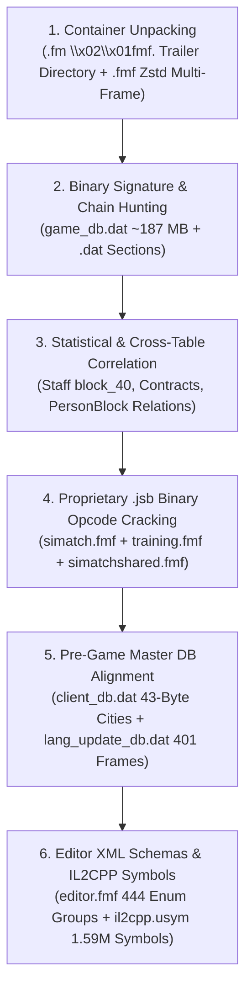

# Football Manager 26 — Reverse-Engineering Methodology & Complete Annotated File Trees

> **Repository:** [`fm-toolkit`](../)  
> **Scope:** Complete step-by-step reverse-engineering methodology and annotated file/archive trees for:
> 1. **Football Manager 26 Game Installation Files** (`C:\Program Files (x86)\Steam\steamapps\common\Football Manager 26`)
> 2. **Football Manager 26 Save Container (`.fm`)** (`81` Zstandard `.dat`/`.cmt` sections + `.apm`/`.scm` match telemetry)
> 3. **`fm-toolkit` (`fm26save`) Python Library Architecture**

---

## Part 1: Step-by-Step Reverse-Engineering Methodology (`How It Was Done`)

Our reverse engineering of Football Manager 26 combines **six complementary binary analysis techniques**, building on a vendored and extended copy of **[`rhiever/fmsave` v0.6.0](https://github.com/rhiever/fmsave)** (MIT License) for the 28-table `_core/` layer and extending it with `.fmf` / `.jsb` / `.dat` game-archive extractors, unknown-field decoders, and extra-section scanners.



---

### 1.1 Phase 1 — Unpacking the `.fm` (`\x02\x01fmf.`) and `.fmf` Zstandard Multi-Frame Containers
1. **`.fm` Save Container (`\x02\x01fmf.` Header + Zstandard Trailer Directory):**
   - Both `.fm` save files and `.fmf` game archives share the 6-byte magic signature `02 01 66 6D 66 2E` (`\x02\x01fmf.`), implemented in [`_core/_container.py`](../fm26save/_core/_container.py#L189-L291) and wrapped by [`FM26Container`](../fm26save/container.py).
   - **26-Byte Outer Header (`HEADER_LEN = 26`):**
     - Bytes `0..6`: `02 01 66 6D 66 2E` (`\x02\x01fmf.`)
     - Bytes `6..9`: `00 00 00`
     - Bytes `9..17` (`<Q` `u64`): `directory_offset_rel` — relative offset such that **`trailer_offset = 9 + directory_offset_rel`** points to the trailer header at the end of the `.fm` file.
     - Bytes `17..22`: `04 00 00 00 00`
     - Bytes `22..26` (`<I` `u32`): `content_end_rel` — relative end of the compressed content stream (`trailer_offset == 26 + content_end_rel` when there is no gap).
   - **Zstandard-Compressed Trailer Directory (`_parse_directory`):**
     - At `trailer_offset`, a **9-byte trailer header** (`\x02\x01fmf.\x08\x00\x00`) precedes the Zstandard directory stream at **`trailer_offset + 9`**.
     - Decompressing the Zstandard stream at `trailer_offset + 9` yields the directory buffer: it starts at offset `0` with a length-prefixed `save_name` (`<I` `name_len` + UTF-8 bytes), followed by a `4`-byte `u32` (`directory_version`) and `<I` `entry_count`.
     - Each directory entry contains a length-prefixed section `name` (`<I` `len` + UTF-8 bytes), a `1`-byte flag (`has_sub_name = 1` for `.dat` entries, followed by `<I` `sub_len` + `sub_name` + `4` metadata bytes), and a **40-byte fixed tail (`5 × u64` = `<5Q`)** ([`_core/_container.py`](../fm26save/_core/_container.py#L257-L291)):
       1. `relative_offset` (`u64` — byte offset relative to `HEADER_LEN = 26`, so **`frame_offset = 26 + relative_offset`** points directly to the section's `28 B5 2F FD` Zstandard frame)
       2. `compressed_size` (`u64`)
       3. `decompressed_size` (`u64`)
       4. `first_trailing_value` (`u64`)
       5. `second_trailing_value` (`u64`)
   - Note on Inner Table Magic (`tad.`): Once a section or `.dat` database table is decompressed, Sports Interactive binary database tables (`44` of the `64` `.dat` sections) begin with `03 01 74 61 64 2E` (`\x03\x01tad.`, i.e., little-endian `.dat`).
2. **`.fmf` & `.dat` Game Installation Archives (`simatch.fmf`, `editor.fmf`, `media.fmf`, `client_db.dat`, `lang_update_db.dat`, `server_db.dat`):**
   - Game archives either begin directly with `02 01 66 6D 66 2E` (`base = 0` for `.fmf`) or follow a 12-byte outer database wrapper (`base = 12` for `client_db.dat`, `lang_update_db.dat`, `server_db.dat`).
   - At `base + 9`, a `<Q` (`u64`) pointer `ptr` gives the trailer directory Zstd frame offset `toff = base + 9 + ptr` (where a 4-byte frame size prefix precedes `28 B5 2F FD`).
   - [`read_fmf_directory()`](../fm26save/formulas.py#L1680-L1730) decompresses the trailer directory and recursively walks the length-prefixed folder tree (`_fmf_walk_folder`) to recover the exact relative path, `offset`, `compressed_size`, and `uncompressed_size` of every embedded file. [`extract_fmf_frames()`](../fm26save/formulas.py#L1733-L1774) uses this directory table first (avoiding false-positive `28 B5 2F FD` byte matches inside compressed payloads such as `basic_people_db.dat`) and falls back to raw Zstd magic scanning for headerless multi-frame streams.

---

### 1.2 Phase 2 — Signature & Pointer-Chain Discovery in `game_db.dat` (`~88–187 MB`)
Unlike SQLite databases, `game_db.dat` is a serialized C++ object graph where records have **variable-length sub-blocks** (histories, relationships, clauses, tactical chains). Fixed-stride table scanning fails whenever an optional sub-block is present. The `_core/` reader layer (vendored from `rhiever/fmsave` v0.6.0) solves this via:
1. **Universal Entity ID Pairs (`<II` `db_id, uid`):**
   - Core entities in `game_db.dat` store a sequential internal `db_id` (`u32`) immediately followed by their persistent global `uid` (`u32`).
2. **FM Binary Date Encoding (`<H` `day_of_year` + `<H` `year`):**
   - Dates are stored as `day_of_year` and `year` (with `(1, 1900)` serving as the null-date sentinel). Scanning for valid date windows anchors birth dates, contract start/expiry dates, and fixture timestamps ([`_core/_scan.py`](../fm26save/_core/_scan.py), [`_core/readers/_common.py`](../fm26save/_core/readers/_common.py)).
3. **Structural Anchor Chains ([`fm26save/_core/readers/`](../fm26save/_core/readers) & [`fm26save/_core/_layouts/`](../fm26save/_core/_layouts)):**
   - **Players ([`PlayerRecordLayout`](../fm26save/_core/_layouts/__init__.py#L317), [`players.py`](../fm26save/_core/readers/players.py)):** Located via the `1..100` attribute block, `CA/PA` ability header, and positional familiarity block (`GK..ST` on a `1..20` scale).
   - **Staff ([`staff.py`](../fm26save/_core/readers/staff.py)):** Located by walking three distinct headers (`locate_contracted_header`, `locate_listed_header`, `locate_human_header`) and anchoring on the `ability_base` offset.
   - **Finances & Facilities ([`finances.py`](../fm26save/_core/readers/finances.py), [`facilities.py`](../fm26save/_core/readers/facilities.py)):** Located by walking the variable-length financial history chain (`locate_finance_chain`) to reach the post-chain attendance and facility bytes.

---

### 1.3 Phase 3 — Solving "Unknown" Save Binary Fields via Statistical & Cross-Table Correlation
On top of `_core/`, [`fm26save/enrichment.py`](../fm26save/enrichment.py) and [`fm26save/constants.py`](../fm26save/constants.py) decode additional fields:
1. **Staff `r4` Role ID (`u8`) & `block_40` (`26` Hidden `1..100` Attribute Slots):**
   - In `staff.py`, `s.unknown["r4"]` (`0..88`) is cross-tabulated against `s.list_indexes` (which index into `staff_lists` per club: `0` = Medical, `1` = Coaching, `2` = Recruitment/Scouting). Empirically across `4,283` staff records (`constants.STAFF_ROLE_MAP`), codes `12` (Physio), `38` (Youth Physio), `40` (Youth Sports Scientist), `46` (Head Physio / Club Doctor), `48` (Head of Sports Science), and `50` (Sports Scientist) map to `Medical (0)`; codes `14` (Scout), `44` (Chief Scout), `58` (Director of Football), `86` (Recruitment Analyst), and `88` (Chief Recruitment Analyst) map to `Recruitment/Scouting (2)`; and codes `2` (Assistant Manager), `16` (Manager), `20` (Coach), `22` (Fitness Coach), `26` (Goalkeeping Coach), `34` (Youth Coach), `60` (Head of Youth Development), and `64` (Set Piece Coach) map to `Coaching/Management (1)`.
   - At `ability_base + 40`, `_read_ability_block()` ([`staff.py`](../fm26save/_core/readers/staff.py#L455-L499)) reads a `26`-byte array (`block_40`) whose raw bytes are multiples of `5` in `1..100` (`(val + 2) // 5` $\rightarrow$ `1..20`). While the 26-byte block is 100% verified as a `1..100` (`5`-step) staff attribute array, individual slot labels in `STAFF_BLOCK40_FIELDS` are assigned via role-cluster statistical peaks (heuristic slot mapping).
2. **Contract `money_a`, `money_b`, `money_c` (`i32`) and `e12..e39`:**
   - Across `39,842` contracts in `Project_Super_Lig.fm`, `money_a` (`signing_or_loyalty_fee`) is non-zero in `61.4%` (`24,480 / 39,842`) of contracts (unconditional median `5.0%` of annual wage across all contracts; conditional median `18.5%` among non-zero contracts), `money_b` (`agent_fee`) is non-zero in `29.2%` (`11,615 / 39,842`) of contracts (conditional median `5.2%` of annual wage), and `money_c` is non-zero in `2.6%` (`1,053 / 39,842`) of contracts (`package_bonus`).
   - Field `e12` (`u16`) holds `1900` (FM's null-date sentinel `(1, 1900)`) in `38.6%` (`15,362 / 39,842`) of contracts and an active contract reference/option year (`2012..2030`) in the remaining `61.4%` (`24,480 / 39,842`). Both [`Contract.option_or_reference_year`](../fm26save/_core/models/contracts.py#L282-L285) and [`decode_contracts_enriched()`](../fm26save/enrichment.py#L181-L199) map `e12 <= 1900` to `None`.
3. **`PersonBlock` `16`-Byte Relationship Entries (`sentinel = 0xFF`):**
   - Inside each `PersonBlock` ([`_core/_layouts/fm26_26_3_2.py`](../fm26save/_core/_layouts/fm26_26_3_2.py#L459-L468) and [`_core/readers/persons.py`](../fm26save/_core/readers/persons.py#L61-L66)), a variable-length array of `16`-byte relation entries (`ref` `u32` at `+0`, `kind` `u8` at `+10`, `role` `u8` at `+11`, `qualifier` `u8` at `+12`, `sentinel = 0xFF` at `+15`) is stored:
     - `(8, 9)` $\rightarrow$ **Second Nationality** (`ref` = `nation_id`; `qualifier == 100` held, `15` eligible),
     - `(8, 70)` $\rightarrow$ **Home-Grown Nation** (`ref` = `nation_id`),
     - `(1, 72)` $\rightarrow$ **Home-Grown Club** (`ref` = `club_index`, resolved via `club_index.uid_by_club_index`),
     - `(1, 3)` $\rightarrow$ **Favoured Club** (`ref` = `club_index`),
     - `(1, 4)` $\rightarrow$ **Disliked Club** (`ref` = `club_index`),
     - `(3, 1)` $\rightarrow$ **Favoured Person** (`ref` = `pindex`, resolved via `player_records.position_by_pindex` $\rightarrow$ `player.uid`),
     - `(3, 2)` $\rightarrow$ **Disliked Person** (`ref` = `pindex`, resolved via `player_records.position_by_pindex` $\rightarrow$ `player.uid`),
     - `(7, 18)` $\rightarrow$ **Spoken Language ID** with proficiency (`1..100` / `1..20`) in `qualifier`,
     - `(4, 67)` / `(4, 25)` / `(4, 56)` $\rightarrow$ **Birth / Residence / Cultural Region or City ID**.
4. **Differential Save Analysis (`diff_saves`):**
   - Comparing `career_before.fm` and `career_after.fm` across all 81 sections isolated the exact sections that mutate during a single in-game progression step (`game_db.dat`, `fixture_details.dat`, `news.dat`, `injury_table.dat`, `CompetitionHistory.dat`, etc.).

---

### 1.4 Phase 4 — Reverse-Engineering the Proprietary `.jsb` (Binary JSON) Format
In FM26, Sports Interactive compiled Match Engine and Training `.json` configurations into a proprietary recursive tag-byte binary format (`.jsb`) inside `simatch.fmf`, `tables.fmf`, `training.fmf`, and `simatchshared.fmf`.
Every `.jsb` value begins with a single tag byte `b` split into two nibbles:
- **Low nibble (`kind = b & 0x0F`):** Value type code (`0x00..0x0A`)
- **High nibble (`hi = (b >> 4) & 0x0F`):** Compact inline count (`hi - 1` for containers/strings when `hi > 0`) or inline small integer (`hi - 8` for numeric types when `hi > 0`). When `hi == 0`, an explicit `<I` (`u32`) count or full-width numeric payload immediately follows `b`.

Below is the exact specification implemented in [`parse_jsb()`](../fm26save/formulas.py#L1577-L1655), verified with `end_offset == len(frame_bytes)` across all `.jsb` frames in `simatch.fmf`, `tables.fmf`, `training.fmf`, and `simatchshared.fmf`:

| `kind = b & 0x0F` | High Nibble (`hi = b >> 4`) == `0` | High Nibble (`hi = b >> 4`) > `0` | Decoded Python Type & Payload Layout |
| :--- | :--- | :--- | :--- |
| **`0x0A`** (`Object`) | Next `4B` `<I` = `count` | `count = hi - 1` (`0..14` keys) | **`dict[str, Any]`** — Reads `count` entries: `1B` `key_len` + UTF-8 `key` + recursive `parse_jsb(val)` |
| **`0x09`** (`Array`) | Next `4B` `<I` = `count` | `count = hi - 1` (`0..14` items) | **`list[Any]`** — Reads `count` elements via recursive `parse_jsb(val)` |
| **`0x08`** (`String`) | Next `4B` `<I` = `slen` | `slen = hi - 1` (`0..14` bytes) | **`str`** — UTF-8 string of `slen` bytes |
| **`0x02`** (`Int32`) | Next `4B` `<i` (`int32`) | Inline `val = hi - 8` (`-7..+7`) | **`int`** — Used for fixed-point engine parameters (e.g., `xG` coefficients, `QME` means/variances, `start_value = 6700`) |
| **`0x04`** (`UInt32`) | Next `4B` `<I` (`uint32`) | Inline `val = hi - 8` | **`int`** — Unsigned 32-bit integer (e.g., `RolePosition` bitmasks up to $2^{31}-1$) |
| **`0x05`** (`UInt64`) | Next `8B` `<Q` (`uint64`) | Inline `val = hi - 8` | **`int`** — Unsigned 64-bit integer (e.g., `RolePosition` bitmasks $2^{32}..2^{45}$ in `oop_attributes_scoring.jsb`) |
| **`0x06`** (`Float32`) | Next `4B` `<f` (`float32`) | Inline `float(hi - 8)` | **`float`** — IEEE-754 single-precision float |
| **`0x07`** (`Float64`) | Next `8B` `<d` (`float64`) | Inline `float(hi - 8)` | **`float`** — IEEE-754 double-precision float |
| **`0x01`** (`Bool`) | `False` | `bool(hi - 8 if hi >= 8 else hi)` | **`bool`** — Boolean literal |
| **`0x00`** (`Zero`) | `0` (`1` byte total) | `0` (`1` byte total) | **`int` (`0`)** — 1-byte zero literal (heavily used in `qme_distribution_data.jsb` `Frame #119` and `configs/coefficient_output_*.jsb`) |

---

### 1.5 Phase 5 — Cracking `client_db.dat` (`32` Frames) & `lang_update_db.dat` (`401` Frames)
To resolve every `city_id`, `club_uid`, `competition_uid`, and `injury_id` in FM26 without external tools:
1. We unpacked `shared/data/database/db/2620/2620_fm/client_db.dat` (**`32` Zstd frames** = `31` `*.dat` data frames `#00..#30` + `1` trailer directory frame `#31`), `lang_update_db.dat` (**`401` Zstd frames** = **`25` languages × `16` localized tables** `#000..#399` + `1` trailer directory frame `#400`, where frames `#00..#15` are Language `8` = English `8_*.dat`), and `server_db.dat` (**`78` Zstd frames** = `77` data tables `#00..#76` + `1` trailer directory frame `#77`).
2. Every table frame starts with a **12-byte header**: `03 01 'tad.' 90 0E` (`8` bytes) + `<I` `record_count` (`4` bytes), and ends with a `10`-byte table trailer (`22` header/trailer bytes total).
3. In `client_db.dat` `Frame #02` (`client_db/table_2.dat` in the trailer directory, `58,349` records, `2,509,029` B decompressed), `(2,509,029 - 22) / 58,349 = 43.0000` bytes per record!
4. Using `Trabzonspor` (`club.city_id = 8002` in `.fm` saves) and `Gençlerbirliği` (`club.city_id = 7998`), we inspected record `8002` and record `7998` in `table_2.dat` and verified the exact **43-byte city record layout** ([`_parse_lang_cities_and_coords()`](../fm26save/game_files.py#L821-L869)):
   - `offset +0..+3` (`3B`): Record header flags
   - `offset +3..+7` (`<f` `float32`): **Latitude** (`41.00145` for Trabzon `#8002`, `39.92077` for Ankara `#7998`)
   - `offset +7..+11` (`<f` `float32`): **Longitude** (`39.71780` for Trabzon `#8002`, `32.85411` for Ankara `#7998`)
   - `offset +11` (`u8`): **City Attraction (`1..20`)** (`12` for Trabzon, `19` for Ankara)
   - `offset +12..+16` (`<I` `u32`): **`nation_id`** (`173` = Türkiye)
   - `offset +16..+20` (`<I` `u32`): **`local_region_id`** (`251` = Black Sea / Trabzon, `253` = Central Anatolia / Ankara)
   - `offset +20..+22` (`<H` `u16`): **`altitude_ft`** — Elevation in **feet** (`121 ft` for Trabzon, `2,853 ft` $\approx 870\text{ m}$ for Ankara, `6,012 ft` $\approx 1,832\text{ m}$ for Sumbawanga)
   - `offset +22` (`u8`): **`inhabitants_bracket`** (population bracket code)
   - `offset +27..+29` (`<H` `u16`): **`weather_profile_id`**
   - `offset +32..+36` (`<I` `u32`): **`db_city_id`** — Verified **`db_city_id == idx` for `58,349 / 58,349` (`100.0%`)** of cities!
   - `offset +36..+40` (`<I` `u32`): **`db_uid`** — Verified **`db_uid == lang_uid` for `58,349 / 58,349` (`100.0%`)** of cities against `lang_update_db.dat` `Frame #03` (`8_2.dat`)!

---

## Part 2: Complete Annotated File Tree — FM26 Game Installation Directory

Below is the complete reverse-engineered directory tree of the Football Manager 26 installation (`C:\Program Files (x86)\Steam\steamapps\common\Football Manager 26`), detailing what each archive and internal frame contains:

```text
C:\Program Files (x86)\Steam\steamapps\common\Football Manager 26\
│
├── fm.exe                                      # Unity/IL2CPP Bootstrapper Executable
├── GameAssembly.dll                            # (~190+ MB) Compiled Native x64 C++/IL2CPP Game Engine Binary
│
├── fm_Data\
│   └── il2cpp_data\
│       ├── il2cpp.usym                         # (38.54 MB) Magic 'sym-' v2 Symbol Table: 1,593,548 native RVA -> C# symbol/line mappings
│       └── Metadata\
│           └── global-metadata.dat             # (15.58 MB) Magic 0xFAB11BAF v31: All C# class, method, enum & string literals (CA/PA, xG, QME, Value)
│
├── shared\
│   └── data\
│       ├── simatch.fmf                         # (1.42 MB -> 6,294,462 B decompressed, 224 files + 1 Trailer Directory) MASTER MATCH ENGINE ARCHIVE
│       │   ├── [Frame  #000]                   # simatch/events/match_events.xml (139,346 B) — Match event definitions and commentary triggers
│       │   ├── [Frame  #001]                   # simatch/events/match_sounds.cfg (10,602 B) — Match audio event configuration
│       │   ├── [Frames #002..#089]             # 8 Earlier Versions of the 11 Shot-Type xG Models (.jsb):
│       │   │                                   #   23_1_1_9 (#002..#012), 23_7_0_5 (#013..#023), 23_9_9_1 (#024..#034), 24_1_2_3 (#035..#045),
│       │   │                                   #   24_5_2_2 (#046..#056), 25_0_0_4 (#057..#067), 25_0_5_13 (#068..#078), 26_0_5_1 (#079..#089)
│       │   ├── [Frames #090..#100]             # Active 26_1_4_1 Expected Goals (xG) Logistic Regression Models (11 Shot Types, .jsb):
│       │   │   ├── #090: free_kicks            #   raw_intercept =  -43,404,507 ( -4.340451 at 1e7) | 5 spatial/angle coefficients
│       │   │   ├── #091: headers               #   raw_intercept = -285,245,658 (-28.524566 at 1e7) | 7 spatial/height/visibility coefficients
│       │   │   ├── #092: obscured_headers      #   raw_intercept = -321,115,868 (-32.111587 at 1e7) | 7 coefficients
│       │   │   ├── #093: obscured_regular      #   raw_intercept = -143,758,299 (-14.375830 at 1e7) | 6 coefficients
│       │   │   ├── #094: obscured_volleys      #   raw_intercept = -111,223,868 (-11.122387 at 1e7) | 7 coefficients
│       │   │   ├── #095: open_goal_headers     #   raw_intercept = -159,077,046 (-15.907705 at 1e7) | 7 coefficients
│       │   │   ├── #096: open_goal_regular     #   raw_intercept = -108,673,064 (-10.867306 at 1e7) | 6 coefficients
│       │   │   ├── #097: open_goal_volleys     #   raw_intercept = -102,791,850 (-10.279185 at 1e7) | 7 coefficients
│       │   │   ├── #098: penalties             #   raw_intercept =  +11,984,673 ( +1.198467 at 1e7 -> sigma(z) = 76.825% conversion probability)
│       │   │   ├── #099: regular               #   raw_intercept = -120,959,039 (-12.095904 at 1e7) | 6 coefficients
│       │   │   └── #100: volleys               #   raw_intercept = -112,650,254 (-11.265025 at 1e7) | 7 coefficients
│       │   ├── [Frame  #101]                   # simatch/expected_goals/expected_goals_model_config.xml (261 B) — Active xG model version selector
│       │   ├── [Frames #102..#112]             # simatch/expected_goals/configs/coefficient_output_*.jsb — 11 zeroed template xG coefficient files
│       │   ├── [Frame  #113]                   # simatch/momentum/momentum_weightings_data.jsb (5,222 B) — 48 Spatial Event × Pitch Zone Momentum rules
│       │   ├── [Frame  #114]                   # simatch/out_of_possession/oop_attributes_scoring.jsb (2,115 B) — 39 Out-Of-Possession RolePosition bitmasks
│       │   ├── [Frame  #115]                   # simatch/out_of_possession/oop_pitch_proximity_scores.jsb (93,429 B) — 118 (Position, Role) × 24 spatial zones
│       │   ├── [Frame  #116]                   # simatch/physics/ball/ball_physics_22_0_5_0.bta (3,277,236 B) — Pre-computed binary ball physics / trajectory table
│       │   ├── [Frame  #117]                   # simatch/physics/ball_physics_config.xml (223 B) — Ball physics version configuration
│       │   ├── [Frame  #118]                   # simatch/player_ratings/player_ratings_data.jsb (340,752 B) — 6 versions (2120..2400), start_value=6700 (6.70), 30 role profiles × 52 actions
│       │   ├── [Frame  #119]                   # simatch/qme/qme_distribution_data.jsb (571,829 B) — 3,137 Poisson/Normal/Binned/Zero stat distributions for Quick Match Engine
│       │   ├── [Frame  #120]                   # simatch/qme/qme_stat_relevant_attribute_data.jsb (1,608 B) — 22 stat_type -> relevant_attributes mappings for Quick Match Engine
│       │   ├── [Frames #121..#191]             # simatch/tactics/*.tac (\x03\x01cat.) & *.stra (\x03\x01rts.) Tactical & Set-Piece Strategy Presets
│       │   ├── [Frame  #192]                   # simatch/tactics/tactical_styles.xml (42,190 B) — All 10 Tactical Styles (Gegenpress, Tiki-Taka, Catenaccio, etc.) & key attributes
│       │   ├── [Frames #193..#222]             # simatch/tactics/*.tac (\x03\x01cat.) Remaining Dual-Formation Presets (90 .tac + 11 .stra = 101 total binary tactical files)
│       │   ├── [Frame  #223]                   # simatch/team_selection/weights.jsb (6,547 B) — AI Team Selection WEIGHTS: 4 TPS_* profiles × 40 TSF_* factors
│       │   └── [Frame  #224]                   # Trailer Directory Index (10,275 B)
│       │
│       ├── shared\
│       │   └── tables.fmf                      # (3 files + 1 Trailer Directory) PHYSICAL HEIGHT & JUMPING/AERIAL REACH TABLES
│       │       ├── [Frame  #000]               # tables/aerial_reach.jsb (3,721 B) — female_data (23 heights 147..199 cm) & male_data (23 heights 158..210 cm) -> poor..good (1..20)
│       │       ├── [Frame  #001]               # tables/config.xml (112 B)
│       │       ├── [Frame  #002]               # tables/jumping_reach.jsb (3,242 B) — female_data (23 heights 147..195 cm) & male_data (17 heights 161..200 cm) -> poor..good (1..20)
│       │       └── [Frame  #003]               # Trailer Directory Index
│       │
│       ├── simatchshared.fmf                   # (75 files + 1 Trailer Directory) SHARED MATCH & NEWGEN APPEARANCE ARCHIVE
│       │   ├── [Frames #000..#073]             # Kit/Hair/Skin RGB colour palettes & 3D crowd/stadium shared configs
│       │   ├── [Frame  #074]                   # player_hair_length_colour_config_data.jsb — 135 Newgen hair/appearance probability rules by region/ethnicity
│       │   └── [Frame  #075]                   # Trailer Directory Index
│       │
│       ├── editor.fmf                          # (105 XML files + 1 Trailer Directory, ~2.1 MB decompressed) INTERNAL FOURCC DATABASE SCHEMAS & ENUMS
│       │   ├── [Frame  #032]                   # club.xml (7,495 lines) — 595 FourCC properties for Clubs ('club')
│       │   ├── [Frame  #033]                   # comp.xml — 297 FourCC properties for Competitions ('comp')
│       │   ├── [Frame  #035]                   # contract_offer.xml — 66 FourCC properties for Contract Offers ('CntF')
│       │   ├── [Frame  #039]                   # injury.xml (519 lines) — 29 FourCC properties for Injuries ('inju')
│       │   ├── [Frame  #045]                   # nation.xml (3,890 lines) — 376 FourCC properties for Nations ('natc'), Youth Rating & Wage Tables
│       │   ├── [Frame  #046]                   # non player.xml — 150 FourCC properties for Staff/Non-Players ('nnpl')
│       │   ├── [Frame  #047]                   # official.xml — 16 FourCC properties for Referees/Officials ('offi')
│       │   ├── [Frame  #049]                   # person.xml (5,453 lines) — 396 FourCC properties for Persons ('pers')
│       │   ├── [Frame  #050]                   # player.xml (3,046 lines) — 291 FourCC properties for Players ('play': PCAB, PPAB, PRCA, PShN, PPMs)
│       │   ├── [Frame  #052]                   # stadium.xml — 76 FourCC properties for Stadiums ('stad')
│       │   ├── [Frame  #053]                   # stage.xml — 8 FourCC properties for Competition Stages ('stag')
│       │   ├── [Frame  #054]                   # team.xml — 11 FourCC properties for Teams ('team')
│       │   ├── [Frame  #056]                   # weather.xml — 94 FourCC properties for Weather Profiles ('weat')
│       │   ├── [Frame  #082]                   # db enums.xml — 444 Master Enum Groups (posm, role, squad status, tactics, transfer rules)
│       │   └── [Frame  #105]                   # Trailer Directory Index
│       │
│       ├── sicomps\
│       │   └── comps.dbc                       # (8.20 MB -> 74.46 MB decompressed, 1,442 files + 1 Trailer Directory) COMPILED COMPETITION RULES ARCHIVE
│       │       ├── [Frames #0000..#1441]       # 1,442 `\x03\x01cbd.` Binary TLV Competition Rule Sets (Leagues, Cups, Playoffs, Continental, TV Money)
│       │       └── [Frame  #1442]              # Trailer Directory Index
│       │
│       └── database\
│           └── db\
│               └── 2620\                       # OFFICIAL FM26 DATABASE (BUILD 2620)
│                   ├── 2620_fm\
│                   │   ├── client_db.dat       # (15.08 MB -> ~50.8 MB decompressed, 31 tables #00..#30 + 1 Trailer Directory #31) MASTER STRUCTURAL DATABASE
│                   │   │   ├── #00: simple_vars.dat            #   Database header variables (36 B)
│                   │   │   ├── #01: table_0.dat                #   3,884 Awards (299,090 B = 22B hdr/tail + 3,884 × 77B: Continent, Nation, Comp, Reputation, aid@+66, uid@+70)
│                   │   │   ├── #02: table_2.dat                #   58,349 Cities (2,509,029 B = 22B hdr/tail + 58,349 × 43B: Lat, Lon, Attraction, Nation, Region, Altitude_ft, cid@+32, uid@+36)
│                   │   │   ├── #03: table_3.dat                #   96,343 Clubs Primary Table (7,926,088 B: Nation, BasedNation, City, Gender, cid, uid)
│                   │   │   ├── #04: table_extra_3.dat          #   96,343 Clubs Extra Table (16,416,295 B: Extended club visual & kit records)
│                   │   │   ├── #05: table_25.dat               #   7,973 Competitions (1,012,593 B = 22B hdr/tail + 7,973 × 127B [rec #0 128B]: Nation, Continent, Level, Type, cid, uid)
│                   │   │   ├── #06: table_5.dat                #   7 Continents (260 B = 15B hdr + 7 × 35B: Regional Strength Factor f64, cid, uid)
│                   │   │   ├── #07: table_41.dat               #   173 Stage Flags / Rules (76,130 B)
│                   │   │   ├── #08: table_6.dat                #   136 Injuries (2,198 B = 22B hdr/tail + 136 × 16B: iid, uid)
│                   │   │   ├── #09: table_7.dat                #   180 Media Sources (18,049 B)
│                   │   │   ├── #10: table_8.dat                #   126 Records (5,248 B)
│                   │   │   ├── #11: table_10.dat               #   251 Nations (27,899 B: Continent, Region, Capital City, DevState, EconFactor, GameImp, nid, uid)
│                   │   │   ├── #12: table_9.dat                #   502 Languages Primary Table (41,922 B)
│                   │   │   ├── #13: table_extra_9.dat          #   502 Languages Extra Table (179,661 B)
│                   │   │   ├── #14..#16: name_table_0..2.dat   #   294,103 First / 599,900 Last / 94,088 Common Name ID Index Tables
│                   │   │   ├── #17: name_table_extra_0.dat     #   294,103 First Names String Pool (4,557,720 B: [name_id:u32][slen:u32][utf8_bytes:slen])
│                   │   │   ├── #18: name_table_extra_1.dat     #   599,900 Last / Surnames String Pool (9,655,009 B: [name_id:u32][slen:u32][utf8_bytes:slen])
│                   │   │   ├── #19: name_table_extra_2.dat     #   94,088 Common Names String Pool (1,800,690 B: [name_id:u32][slen:u32][utf8_bytes:slen])
│                   │   │   ├── #20: table_19.dat               #   28 Records (2,178 B)
│                   │   │   ├── #21: table_47.dat               #   2,527 Local Regions (111,144 B)
│                   │   │   ├── #22: table_21.dat               #   51,118 Stadiums (1,942,506 B = 22B hdr/tail + 51,118 × 38B: City@+5, OwnerClub@+9, Lat@+19, Lon@+23, sid@+27, uid@+31)
│                   │   │   ├── #23: table_22.dat               #   668 Records (8,706 B)
│                   │   │   ├── #24: table_23.dat               #   286 Stage Names (4,026 B; legacy copy at #27 table_for_old_save_23.dat)
│                   │   │   ├── #25: table_56.dat               #   6 International Agreements (100 B: EU, EEA, OACPS, Mercosur, Andean, Overseas)
│                   │   │   ├── #26: table_for_old_save_25.dat  #   7,973 Competitions Legacy Save Layout (980,701 B = 22B hdr/tail + 7,973 × 123B [rec #0 124B])
│                   │   │   ├── #28: table_27.dat               #   373 Weather Profiles (48,453 B)
│                   │   │   ├── #29: table_35.dat               #   924 Currencies / Descriptions (13,882 B)
│                   │   │   ├── #30: table_18.dat               #   1,683 Derbies (112,457 B)
│                   │   │   └── #31: Directory                  #   Trailer Directory Index
│                   │   │
│                   │   ├── lang_update_db.dat  # (3.55 MB, 25 Languages × 16 Tables = 400 files + 1 Trailer Directory) MASTER LOCALIZED NAMES DATABASE
│                   │   │   ├── #00: 8_9.dat    #   [Lang 8 = English] 251 Nations (13,532 B: uid, name, short_name, 3-letter code, nationality)
│                   │   │   ├── #01: 8_25.dat   #   [Lang 8 = English] 7,973 Competitions (553,418 B: uid, name, short_name, 3-letter code)
│                   │   │   ├── #02: 8_3.dat    #   [Lang 8 = English] 96,343 Clubs (7,234,952 B: uid, name, short_name, 6-letter, 3-letter, alt_short, nickname)
│                   │   │   ├── #03: 8_2.dat    #   [Lang 8 = English] 58,349 Cities (1,217,204 B: 0-based city_id 0..58348 -> uid, official city name)
│                   │   │   ├── #04: 8_5.dat    #   [Lang 8 = English] 7 Continents (652 B: uid, name, code, demonym, federation_name, federation_short)
│                   │   │   ├── #05: 8_6.dat    #   [Lang 8 = English] 136 Injuries (6,946 B: uid, name, sentence_name)
│                   │   │   ├── #06: 8_0.dat    #   [Lang 8 = English] 3,884 Awards (286,096 B: uid, name, short_name)
│                   │   │   ├── #07: 8_21.dat   #   [Lang 8 = English] 51,118 Stadiums (1,795,458 B: uid, name, alt_name)
│                   │   │   ├── #08: 8_23.dat   #   [Lang 8 = English] 286 Stage Names (9,764 B: uid, name, short_name, plural_name)
│                   │   │   ├── #09: 8_19.dat   #   [Lang 8 = English] Empty / Auxiliary Table (12 B)
│                   │   │   ├── #10: 8_35.dat   #   [Lang 8 = English] 186 Currencies / Descriptions (6,480 B)
│                   │   │   ├── #11: 8_7.dat    #   [Lang 8 = English] 180 Media Sources (4,381 B: uid, name)
│                   │   │   ├── #12: 8_47.dat   #   [Lang 8 = English] 2,527 Local Regions (68,535 B: uid, name, demonym)
│                   │   │   ├── #13: 8_18.dat   #   [Lang 8 = English] 1,683 Derbies (78,441 B: uid, name, short_name)
│                   │   │   ├── #14: 8_56.dat   #   [Lang 8 = English] 6 International Agreements (292 B: uid, name, abbreviation)
│                   │   │   ├── #15: 8person_names.dat # [Lang 8 = English] Person Names Override Header (12 B)
│                   │   │   ├── #16..#399       #   Remaining 24 Languages × 16 Tables (<lang>_<table>.dat)
│                   │   │   └── #400: Directory #   Trailer Directory Index
│                   │   │
│                   │   ├── server_db.dat       # (68.79 MB -> ~295 MB decompressed, 77 tables #00..#76 + 1 Trailer Directory #77) SERVER SIMULATION ATTRIBUTES DB
│                   │   │   ├── #03: table_3.dat  #   96,343 Clubs (Training/Youth/Corporate Facilities 1..20, Youth Coaching/Recruitment 1..20, Pro Status, Kits)
│                   │   │   ├── #06: table_5.dat  #   7 Continents (49 B/rec: Regional Strength Factor & Confederation Simulation Parameters)
│                   │   │   ├── #08: table_6.dat  #   136 Injuries (6,550 B = 22B hdr/tail + 136 × 48B: Category, BodyPart, MinDays, ExtraDays, SharpnessDrop%@+16, Occurrencef32, Severity, Contagious@+31)
│                   │   │   ├── #11: table_10.dat #   251 Nations (538,107 B: Reputation 1..10000, Dev State 1..3, Game Importance 1..4, Economic Factor 1..20, Youth Rating, Wage Tiers)
│                   │   │   └── #22: table_21.dat #   51,118 Stadiums (9,252,380 B = 22B hdr/tail + 51,118 × 181B: Capacity, Seating, Expansion, Pitch Length/Width dm, Build Year, Min/Max Pitch)
│                   │   │
│                   │   ├── basic_people_db.dat # (12.79 MB -> 60.15 MB decompressed) ALL 723,010 PRE-GAME PEOPLE SUMMARY DB (100% deterministic walk)
│                   │   │                       #   532,742 Players + 4,410 Player/Staff (84B: CA, PA including 6 PA=-10 & 22 PA=-95 wonderkids, Reps, Nation, Club, Gender)
│                   │   │                       #   174,504 Non-Player/Staff (84B) | 9,872 Officials/Referees (34B) | 1,482 Agents/Journalists (22B)
│                   │   ├── people_db.dat       # (76.55 MB -> 451.07 MB decompressed) Full Pre-Game People DB (60 attributes, 8 Hidden Personality bytes, Height/Weight, Names)
│                   │   ├── pl_hist_index.dat   # (8.35 MB decompressed) 1,044,008 pairs: 522,004 (uid -> hist_idx) + 522,004 (person_id -> hist_idx)
│                   │   ├── pl_hist_id.dat      # (8.35 MB decompressed) Indexed by hist_idx * 8 -> (head_byte_offset, tail_byte_offset) in pl_hist_dt.dat
│                   │   ├── pl_hist_dt.dat      # (102.93 MB -> 191.17 MB decompressed) 4,344,855 × 44-byte Singly-Linked List Player Career History Season Rows
│                   │   ├── non_pl_hist_dt.dat  # (14.40 MB -> 31.72 MB decompressed) Historical Staff Career Linked-List Nodes
│                   │   └── summary.dat         # (21 B decompressed) Master Database Build Metadata Header
│                   │
│                   ├── dbc\                    # Compiled Binary Database Rule Overrides (.dbc: fifa_wc26_squads.dbc, homegrown.dbc, saudi_manager_change.dbc, Licensing2.dbc)
│                   │   └── permanent\          # Licensing, competition structure & regional rule overrides
│                   │
│                   ├── lnc\
│                   │   └── all\                # 41 Plaintext Licensing & Name-Override Files (.lnc, 178 across all DB versions):
│                   │                           #   COMP_LONG_NAME_CHANGE, CLUB_LONG_NAME_CHANGE, CHANGE_PLAYER_NAME, FAKE_NATIONAL_TEAM, etc.
│                   │
│                   └── edt\
│                       └── permanent\          # 16 Plaintext Permanent Engine Rule Files (.edt / .ddt):
│                           ├── sugardaddy.edt              # 14 clubs with FRONT_END, BACK_END, or UNDERWRITER tycoon owners
│                           ├── eng_youth_grades.edt        # 95 English clubs with EPPP Youth Academy Category (1..4) ratings
│                           ├── valid_takeovers_only.edt    # 69 national board takeover restrictions (e.g., 50+1 NO_RICH_INDIVIDUAL_TAKEOVER)
│                           ├── transfer_embargo.edt        # 35 pre-configured club transfer embargoes
│                           ├── support_staff.edt           # 12 club backroom staff generation overrides
│                           ├── alliteration_adjectives.edt # 123 media headline alliteration rules per club
│                           └── ...                         # fake.edt, jpn_loans.edt, not_registered.edt, stadium_templates.edt, .ddt squads
│
└── data\
    └── game_simulation\
        ├── media.fmf                           # (2.25 MB -> ~65 MB decompressed, 649 XML files + 1 Trailer Directory)
        │   └── [Frames #000..#648]             # 3,934 Press Conference / Player Interaction Questions (QID_*), Answers (pcaa) & Backroom Advice (barl)
        ├── training.fmf                        # (5 files + 1 Trailer Directory) WEEKLY TRAINING SCHEDULE & ITEM EFFECTS ENGINE
        │   ├── [Frame  #000]                   # training/config.xml (112 B)
        │   ├── [Frame  #001]                   # training/training_item_effects.jsb — Training session attribute/injury/fatigue/condition effects
        │   ├── [Frame  #002]                   # training/training_schedule_templates.jsb — 164 Full-Time Weekly Schedules (day1..day7 × session1, session2, extra)
        │   ├── [Frame  #003]                   # training/training_schedule_templates_fmc.jsb — 136 Youth / Part-Time Weekly Schedules
        │   └── [Frame  #004]                   # training/training_sessions_weights.jsb — Session category weighting rules
        ├── filters.fmf                         # (2 XML files + 1 Trailer Directory; 445 <record> items) Scouting, player search & staff filter definitions
        ├── achievements.fmf                    # (1 XML file  + 1 Trailer Directory; 50 <record> items) Steam/Epic/Xbox achievement trigger definitions
        ├── leaderboards.fmf                    # (1 XML file  + 1 Trailer Directory; 28 <record> items) Leaderboard scoring definitions
        ├── settings.fmf                        # (9 XML files + 1 Trailer Directory; 10 <record> items) User & simulation preference schemas
        ├── store.fmf                           # (2 XML files + 1 Trailer Directory; 3 <record> items) In-game store item definitions
        ├── profanity_filter.fmf                # (2 text files + 1 Trailer Directory) Moderation wordlists (profane_words.txt, regular_words.txt)
        └── languages.fmf                       # (205.61 MB) Master .ltc UI localization string archive for 22+ languages
```

---

## Part 3: Complete Annotated File Tree — Inside an FM26 `.fm` Save Container

Every Football Manager 26 `.fm` save file is a `\x02\x01fmf.` multi-frame Zstandard archive (with a 26-byte outer header and a Zstandard-compressed trailer directory at `directory_offset`) containing **81 core sections (`64` `.dat` + `17` `.cmt`)** plus optional embedded match telemetry files:

```text
<SaveName>.fm (\x02\x01fmf. Multi-Frame Zstandard Container + Compressed Trailer Directory)
│
├── [1. Core Relational Database & Person Histories]
│   ├── game_db.dat                             # (~88–187 MB decompressed) Primary relational database:
│   │   ├── Clubs & Stadiums & Facilities       #   All clubs, finances, sponsorships, attendance, training/youth/corporate facilities
│   │   ├── Players                             #   All players, attributes (1..100), CA/PA, positions, contracts, PersonBlock relations
│   │   ├── Staff & Human Managers              #   All contracted/free/human staff, r4 job roles, 26 hidden block_40 (1..100) attributes
│   │   └── Competitions, Stages & Tables       #   Active competitions, stages, league standings, transfer windows, competition rules
│   ├── pl_hist_dt.dat                          # (~140–210 MB decompressed) Career season-by-season statistical history for all players
│   ├── pl_hist_id.dat                          # Player history head/tail byte-offset table into pl_hist_dt.dat
│   ├── pl_hist_index.dat                       # (uid, person_id) -> hist_idx lookup index for pl_hist_id.dat
│   ├── pl_hist_ls.dat                          # Player history loan/season auxiliary table
│   ├── non_pl_hist_dt.dat                      # (~20–35 MB decompressed) Career history for all non-players / staff
│   ├── non_pl_hist_id.dat                      # Staff history head/tail byte-offset table
│   └── non_pl_hist_index.dat                   # Staff history lookup index
│
├── [2. Tactics, Set Pieces, Training & Mentoring]
│   ├── tactics_man.dat                         # Active club tactical blocks, Starting XI + Bench selectors (pindex + 1), team instructions
│   ├── set_piece_manager.dat                   # Corner, free-kick, and throw-in routines and taker pools
│   ├── training_man.dat                        # Active weekly training schedules and individual role/attribute focus assignments
│   └── mentoring_manager.dat                   # Player mentoring groups and personality influence chains
│
├── [3. Transfers, Contracts, Agents & Scouting Shortlists]
│   ├── contract_man.dat                        # Active contract offers, renewal negotiations, and wage/bonus demands
│   ├── transfer_man.dat                        # Active transfer bids, loan offers, and future transfer clauses
│   ├── transfer_centre_man.dat                 # Transfer Centre tracking ledger for managed clubs
│   ├── shortlist_man.dat                       # Scouting shortlists, shortlisted player UIDs, and scouting priority flags
│   ├── agent_manager.dat                       # Player agents, client rosters, and agent fee/patience profiles
│   └── recruitment_focus_manager.dat           # Active scouting recruitment focuses (CA/PA ranges, age, positional targets)
│
├── [4. Fixtures, Match Schedules, Injuries & Discipline]
│   ├── fixture_details.dat                     # Detailed match fixture records, scores, attendances, and referee assignments
│   ├── injury_manager.dat                      # Active player injuries, recovery dates, and injury type codes
│   ├── disciplinary_manager.dat                # Active yellow/red card accumulations and competition bans
│   └── referees_manager.dat                    # Referee appointments and performance ratings
│
├── [5. Clubs, Board Takeovers, Hall of Fame & Dynamics]
│   ├── board_takeover_manager.dat              # Ongoing club board takeovers, tycoon/consortium buyers, and target clubs
│   ├── hall_of_fame.dat                        # Worldwide, national, and continental Hall of Fame manager rankings and trophy points
│   ├── job_centre.dat                          # Open manager/staff job vacancies and job security ratings
│   ├── dynamic_manager.dat                     # Squad hierarchy, social groups, dressing room atmosphere, and manager support
│   └── club_expectations.dat                   # Board club vision objectives and supporter expectations
│
├── [6. News, Media, Inbox & Press Conferences]
│   ├── news.dat                                # Generated in-game news articles, headlines, and entity cross-references
│   ├── mail_man.dat                            # Manager inbox messages and action items
│   ├── media_man.dat                           # Scheduled press conferences, tunnel interviews, and journalist relationships
│   └── social_network_man.dat                  # Social media / supporter feed reaction items
│
├── [7. International, Awards & Historical Ledgers]
│   ├── award_man.dat                           # Ballon d'Or, Player of the Year, Team of the Week/Season voting and winners
│   ├── CompetitionHistory.dat                  # Past winners and runners-up for every league and cup competition
│   └── international_man.dat                   # National team squad call-ups and international tournament pools
│
├── [8. Remaining Specialized Manager & Commentary Sections (`64` `.dat` + `17` `.cmt` = `81` Total)]
│   └── ...                                     # extra_data_man.dat, financial_fair_play_man.dat, draft_man.dat, 17 language *.cmt files, etc.
│
└── [9. Embedded Match Replays & Telemetry (Variable Count per Save)]
    ├── *.apm                                   # Full 3D match animation / physics replay streams for recent matches
    └── *.scm                                   # Match scorecard & key event summary streams
```

---

## Part 4: Complete Annotated File Tree — `fm-toolkit` Python Library (`fm26save`)

```text
fm-toolkit\
│
├── pyproject.toml                              # Package configuration (only external runtime dependency: `zstandard`)
├── README.md                                   # Complete English quickstart, API reference, attribution & CLI guide
│
├── docs\                                       # Complete English Technical & Reverse-Engineering Documentation Suite
│   ├── FM26_REVERSE_ENGINEERING_METHODOLOGY_AND_FILE_TREE.md   # (This document) Methodology & annotated file trees
│   ├── FM26_INTERNAL_GAME_LOGICS_AND_MECHANICS.md              # 22 core internal game logics (Youth Intake, AI Picking, Match Ratings, Training, xG/QME, etc.)
│   ├── FM26_REVERSE_ENGINEERING_SAVE_AND_GAME_FILES.md         # Unknown binary fields & all 12 game-file systems reference
│   ├── FM26_ENGINE_FORMULAS_AND_CALCULATIONS.md                # Official .fmf Engine Formulas & Empirical Save Estimators
│   ├── FM26_TACTICAL_ROLES_AND_BREAKDOWNS.md                   # 50 In-Possession roles (93 Role+Duty), 39 OP* roles, Dual-Roles & 11 Archetypes
│   └── FM26_SAVE_DATABASE_SCHEMA_AND_81_SECTIONS.md            # Complete schema of all 28 core tables & 81 .fm container sections
│
└── fm26save\
    ├── __init__.py                             # High-level `FM26Save` class, `open_save()`, and unified public API exports
    ├── cli.py                                  # CLI entrypoint (`info`, `enriched`, `extra`, `diff`, `export`, `roles`, `game-files`)
    ├── constants.py                            # `FM26_NATIONS` (226 mapped nations, IDs 1..249), `STAFF_ROLE_MAP`, `STAFF_BLOCK40_FIELDS`, `RELATION_PAIR_MAP`
    ├── container.py                            # `FM26Container` \x02\x01fmf. + Zstd 81-section unpacker & binary inspector
    ├── enrichment.py                           # Decoders for hidden staff attributes, contract bonuses, facilities, PersonBlock relations & lineups
    ├── extra_sections.py                       # Binary scanners/parsers for `hall_of_fame`, `board_takeovers`, `shortlists`, `offers`, `agents`, `news`
    ├── formulas.py                             # Official .fmf/.jsb formula loader (`parse_jsb`), 6D Role Breakdowns, CA/PA cost, & Value/Wage OLS models
    ├── game_files.py                           # Extractors for all 12 FM26 Installation Game-File Systems (`QME`, `Momentum`, `OOP Grid`, `xG`, `Editor XML`, `Master DB`, `Media`, `IL2CPP`, `People/History DB`, `.dbc/.lnc`, `Aux .fmf`, `Multi-Version 2300..2620`)
    ├── diff.py                                 # `diff_saves()` byte-level differential analyzer across all 81 `.fm` sections
    ├── exporter.py                             # Multi-format exporters for CSV (UTF-8-BOM), JSON, JSONL, and SQLite (`.db`)
    │
    └── _core\                                  # Vendored & extended 28-table binary database engine (from `rhiever/fmsave` v0.6.0, MIT License)
        ├── __init__.py                         # Core `Save` reader & `open()` with `strict=False` build compatibility
        ├── _container.py                       # `\x02\x01fmf.` 26-byte header & Zstandard trailer directory stream reader
        ├── _context.py                         # Lazy cross-table index & span cache (`club_index`, `player_records`, `own_club_record_spans`)
        ├── _scan.py                            # Low-level binary signature, date & marker-run scanners
        ├── _layouts\                           # Build-specific binary offset layouts (`__init__.py`, `fm26_26_3_2.py`, `_check.py`)
        ├── models\                             # 28 Typed Dataclass Models (`Player`, `Contract` with bonus properties, `Club`, `Staff`, etc.)
        └── readers\                            # 28 Binary Table Readers (`_common.py`, `players.py`, `persons.py`, `staff.py` with `block_40`, `contracts.py`, etc.)
```
