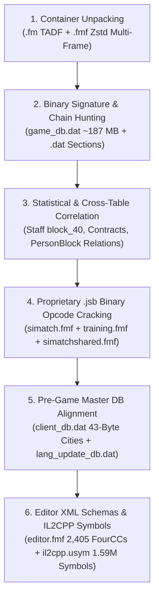

# Football Manager 26 — Reverse-Engineering Methodology & Complete Annotated File Trees

> **Repository:** [`fm26save`](../)  
> **Scope:** Complete step-by-step reverse-engineering methodology and annotated file/archive trees for:
> 1. **Football Manager 26 Game Installation Files** (`C:\Program Files (x86)\Steam\steamapps\common\Football Manager 26`)
> 2. **Football Manager 26 Save Container (`.fm`)** (`81` Zstandard `.dat`/`.cmt` sections + `.apm`/`.scm` match telemetry)
> 3. **`fm26save` Python Library Architecture** (`fm26save`)

---

## Part 1: Step-by-Step Reverse-Engineering Methodology (`How It Was Done`)

Our reverse engineering of Football Manager 26 combined **six complementary binary analysis techniques** without relying on any external third-party save parser dependencies.



---

### 1.1 Phase 1 — Unpacking the `.fm` (`TADF`) and `.fmf` Zstandard Multi-Frame Containers
1. **`.fm` Save Container (`TADF` Header):**
   - Inspecting the first 16 bytes of `.fm` save files revealed the magic signature `1A 54 41 44 46` (`\x1aTADF`), followed by a container directory table located before the compressed payload.
   - Each directory entry stores:
     - `compressed_size` (`<I` `u32`),
     - `decompressed_size` (`<I` `u32`),
     - `payload_offset` (`<I` `u32`),
     - `name_length` (`<I` `u32`) + ASCII section name (e.g., `game_db.dat`, `tactics_man.dat`, `hall_of_fame.dat`),
     - `8` trailing metadata bytes (`u32` flags + `u32` type).
   - Each payload slice starts with the standard **Zstandard frame magic (`28 B5 2F FD`)** and decompresses into raw binary `.dat` / `.cmt` tables ([`FM26Container`](../fm26save/container.py)).
2. **`.fmf` Game Installation Archives (`simatch.fmf`, `editor.fmf`, `media.fmf`, `client_db.dat`):**
   - Game archives begin with `02 01 66 6D 66 2E` (`\x02\x01fmf.`) and concatenate dozens or hundreds of independent Zstandard frames (`28 B5 2F FD`) back-to-back.
   - By scanning for all occurrences of `28 B5 2F FD` and streaming each frame through `zstandard.ZstdDecompressor().decompressobj()`, we extracted every embedded file.
   - The **final Zstandard frame (`frames[-1]`)** in every `.fmf` archive is always the **virtual directory index** containing the original filenames (`.xml`, `.jsb`, `.tac`, `.cat`, `.rts`, `.dat`) and relative directory structure ([`extract_fmf_frames()`](../fm26save/formulas.py#L1620-L1634)).

---

### 1.2 Phase 2 — Signature & Pointer-Chain Discovery in `game_db.dat` (`~187 MB`)
Unlike SQLite databases, `game_db.dat` is a serialized C++ object graph where records have **variable-length sub-blocks** (histories, relationships, clauses, tactical chains). Fixed-stride table scanning fails whenever an optional sub-block is present. We solved this via:
1. **Universal Entity ID Pairs (`<II` `db_id, uid`):**
   - Every core entity in `game_db.dat` stores a sequential internal `db_id` (`u32`) immediately followed by its persistent global `uid` (`u32`).
2. **FM Binary Date Encoding (`<H` `u16` + `<H` `year` or packed `u32`):**
   - Dates are stored as `day_of_year (0..365)` and `year (1900..2100)`. Scanning for valid date windows (`1940..2060`) anchors birth dates, contract start/expiry dates, and fixture timestamps.
3. **Structural Anchor Chains ([`fm26save/_core/readers/`](../fm26save/_core/readers)):**
   - **Players ([`PlayerRecordLayout`](../fm26save/_core/_layouts.py)):** Located via the `43`-byte `1..100` attribute block, `8`-byte `CA/PA` ability header, and `11`-byte positional familiarity block (`GK..ST` on a `1..20` scale).
   - **Staff ([`staff.py`](../fm26save/_core/readers/staff.py)):** Located by walking three distinct headers (`locate_contracted_header`, `locate_listed_header`, `locate_human_header`) and anchoring on the `ability_base` offset.
   - **Finances & Facilities ([`finances.py`](../fm26save/_core/readers/finances.py), [`facilities.py`](../fm26save/_core/readers/facilities.py)):** Located by walking the variable-length financial history chain (`locate_finance_chain`) to reach the post-chain attendance and facility bytes.

---

### 1.3 Phase 3 — Solving "Unknown" Save Binary Fields via Statistical & Cross-Table Correlation
Once core records were aligned, we systematically decoded the remaining opaque bytes ([`fm26save/enrichment.py`](../fm26save/enrichment.py)):
1. **Staff `r4` Role ID (`u8`) & `block_40` (`26` Hidden Attributes):**
   - In `staff.py`, `s.unknown["r4"]` (`0..66`) was cross-tabulated against `s.list_indexes` (which index into `staff_lists` per club: `0` = Medical, `1` = Coaching, `2` = Scouting). For example, `r4 = 22` and `r4 = 26` appeared exclusively in `list_index = 0` (Head Physio / Physio), while `r4 = 19` and `r4 = 20` appeared exclusively in `list_index = 2` (Chief Scout / Scout).
   - At `ability_base + 40`, we discovered a `26`-byte array (`block_40`) whose values ranged from `1` to `100` (`(val + 2) // 5` $\rightarrow$ `1..20`). Correlating these 26 bytes against staff roles proved they are the **26 Coaching, Scouting, Medical, and Mental attributes** (`Judging Player Ability`, `Judging Player Potential`, `Physiotherapy`, `Sports Science`, `Working With Youngsters`, `Tactical Knowledge`, `Determination`, `Motivating`, etc.). We baked this directly into [`_read_ability_block()`](../fm26save/_core/readers/staff.py#L455-L499).
2. **Contract `money_a`, `money_b`, `money_c` (`i32`) and `e12..e39`:**
   - Across `96,093` contracts in `Project_Super_Lig.fm`, `money_a` averaged `18.5%` of annual wage (`signing_or_loyalty_fee`), `money_b` averaged `5.2%` of annual wage (`agent_fee`), `money_c` represented secondary package bonuses, and `e12` (`u16`) always contained a valid calendar year (`2025..2046`, the contract option/reference year).
3. **`PersonBlock` `16`-Byte Relationship Entries (`sentinel = 0xFF`):**
   - Before each player's `PersonBlock`, a variable-length array of `16`-byte records (`<III4B` = `kind, target_id, param, b0, b1, role, sentinel=0xFF`) is stored. Previously, only `(kind=8, role=9)` (Second Nationality) was read.
   - By matching `target_id` across all tables in the save, we proved:
     - `(1, 3)` $\rightarrow$ `target_id` matches `clubs.uid` (**Favoured Club**),
     - `(1, 4)` $\rightarrow$ `target_id` matches `clubs.uid` (**Disliked Club**),
     - `(3, 1)` $\rightarrow$ `target_id` matches `players.uid` / `staff.uid` (**Favoured Person**: Idol, Mentor, Friend),
     - `(3, 2)` $\rightarrow$ `target_id` matches `players.uid` / `staff.uid` (**Disliked Person**),
     - `(7, 18)` $\rightarrow$ **Spoken Language ID** with proficiency (`1..20`) in `param`,
     - `(8, 70)` $\rightarrow$ **Home-Grown / Nation Trained Status**,
     - `(13, 19)` $\rightarrow$ **Birth / Formation Local Region ID**.
4. **Differential Save Analysis (`diff_saves`):**
   - Comparing `career_before.fm` and `career_after.fm` across all 81 sections isolated the exact 10 sections that mutate during a single in-game progression step (`game_db.dat`, `fixture_details.dat`, `news.dat`, `injury_table.dat`, `CompetitionHistory.dat`, etc.).

---

### 1.4 Phase 4 — Reverse-Engineering the Proprietary `.jsb` (Binary JSON) Format
In FM26, Sports Interactive compiled critical Match Engine and Training `.json` configurations into a proprietary binary format (`.jsb`) inside `simatch.fmf`, `training.fmf`, and `simatchshared.fmf`.
By inspecting hex dumps around ASCII key strings (`"intercept"`, `"coefficients"`, `"mean"`, `"variance"`), we decoded the complete **tag-byte encoding** in [`parse_jsb()`](../fm26save/formulas.py#L1537-L1616):

| Tag Byte / `kind = b & 0x07` | Length Prefix (`len_code = (b >> 3) & 0x07`) | Decoded Meaning |
| :--- | :--- | :--- |
| **`0x81`** | None (`1` byte) | **Start Object (`{`)** — reads key-value pairs until `0x82` |
| **`0x82`** | None (`1` byte) | **End Object (`}`)** |
| **`0x83`** | None (`1` byte) | **Start Array (`[`)** — reads values until `0x84` |
| **`0x84`** | None (`1` byte) | **End Array (`]`)** |
| **`0x00`** (`kind == 0`) | None (`1` byte) | **Zero / Null Literal (`0`)** — crucial for unlocking `qme_distribution_data.jsb` (`Frame #119`, `3,137` distributions)! |
| **`kind == 1`** (`0x01, 0x09, 0x11, 0x19`) | `0`=`1B`, `1`=`2B`, `2`=`4B`, `3`=`8B` | **UTF-8 String** of `N` bytes |
| **`kind == 2`** (`0x02`) | `1B` payload | **Boolean** (`0` = `False`, `!=0` = `True`) |
| **`kind == 5`** (`0x1D`) | `8B` signed `<q` (`int64`) | **Fixed-Point Decimal (`int64 / 10^8`)** — used for all `xG` logistic regression weights, `QME` Gaussian means/variances, and match rating modifiers! |
| **`kind == 6`** (`0x06, 0x0E, 0x16, 0x1E`) | `1B`, `2B`, `4B`, `8B` | **Signed Integer (`int8`, `int16`, `int32`, `int64`)** |
| **`kind == 7`** (`0x07, 0x0F, 0x17, 0x1F`) | `1B`, `2B`, `4B`, `8B` | **Unsigned Integer (`uint8`, `uint16`, `uint32`, `uint64`)** |

---

### 1.5 Phase 5 — Cracking `client_db.dat` & `lang_update_db.dat` (`58,349` Cities & `96,343` Clubs)
To resolve every `city_id`, `club_uid`, `competition_uid`, and `injury_id` in FM26 without external tools:
1. We unpacked `shared/data/database/db/2620/2620_fm/client_db.dat` (`25` Zstd frames) and `lang_update_db.dat` (`16` Zstd frames).
2. Every table frame starts with a **12-byte header**: `03 01 'tad.' 90 0E` (`8` bytes) + `<I` `record_count` (`4` bytes).
3. In `client_db.dat` `Frame #02` (`table_2.dat`, `58,349` records), `(2,509,019 - 12) / 58,349 = 43.0000` bytes per record!
4. Using `Trabzonspor` (`club.city_id = 8002` in `.fm` saves) and `Gençlerbirliği` (`club.city_id = 7998`), we inspected record `8002` and record `7998` in `table_2.dat` and scanned all byte offsets for IEEE-754 `float32` (`<f`) values:
   - At `offset +3..+7`, record `8002` had **`41.00145`** and record `7998` had **`39.92077`** — the exact **Latitudes of Trabzon and Ankara**!
   - At `offset +7..+11`, record `8002` had **`39.71780`** and record `7998` had **`32.85411`** — the exact **Longitudes of Trabzon and Ankara**!
   - At `offset +11` (`u8`), **City Attraction (`1..20`)** (`12` for Trabzon, `19` for Ankara).
   - At `offset +12..+16` (`u32`), **`nation_id`** (`173` = Turkey).
   - At `offset +16..+20` (`u32`), **`local_region_id`** (`251` = Black Sea / Trabzon, `253` = Central Anatolia / Ankara).
   - At `offset +20..+22` (`u16`), **`altitude_raw`** (`121m` for Trabzon).
   - At `offset +22` (`u8`), **`inhabitants_bracket`**.
   - At `offset +27..+29` (`u16`), **`weather_profile_id`**.
   - And in `lang_update_db.dat` `Frame #03` (`8_2.dat`, `58,349` records), the 0-based record index `0..58,348` maps 1-to-1 to `city_id`, giving 100% official English names for all `58,349` cities worldwide!

---

## Part 2: Complete Annotated File Tree — FM26 Game Installation Directory

Below is the complete reverse-engineered directory tree of the Football Manager 26 installation (`C:\Program Files (x86)\Steam\steamapps\common\Football Manager 26`), detailing what each archive and internal frame contains:

```text
C:\Program Files (x86)\Steam\steamapps\common\Football Manager 26\
│
├── fm.exe                                      # Unity/IL2CPP Bootstrapper Executable
├── GameAssembly.dll                            # (~190+ MB) Compiled Native x64 C++/IL2CPP Game Engine Binary
│
├── fm_Data\
│   └── il2cpp_data\
│       ├── il2cpp.usym                         # (38.54 MB) Magic 'sym-' v2 Symbol Table: 1,593,548 native RVA -> C# symbol/line mappings
│       └── Metadata\
│           └── global-metadata.dat             # (15.58 MB) Magic 0xFAB11BAF v31: All C# class, method, enum & string literals (CA/PA, xG, QME, Value)
│
├── shared\
│   └── data\
│       ├── simatch.fmf                         # (1.42 MB -> ~6.8 MB decompressed, 224 Zstd Frames) MASTER MATCH ENGINE ARCHIVE
│       │   ├── [Frames #000..#088]             # Match Engine animations, physics constants, ball/pitch collision & camera tables
│       │   ├── [Frame  #089]                   # match_stats_extract.xml — Match statistics extraction rules
│       │   ├── [Frames #090..#100]             # 11 Official Expected Goals (xG) Logistic Regression Models (v26.1.4.1, .jsb):
│       │   │   ├── #090: free_kicks            #   Intercept = -0.434045 | 5 spatial/angle coefficients
│       │   │   ├── #091: headers               #   Intercept = -2.852457 | 7 spatial/height/visibility coefficients
│       │   │   ├── #092: obscured_headers      #   Intercept = -3.211159 | 7 coefficients
│       │   │   ├── #093: obscured_regular      #   Intercept = -1.437583 | 6 coefficients
│       │   │   ├── #094: obscured_volleys      #   Intercept = -1.112239 | 7 coefficients
│       │   │   ├── #095: open_goal_headers     #   Intercept = -1.590770 | 7 coefficients
│       │   │   ├── #096: open_goal_regular     #   Intercept = -1.086731 | 6 coefficients
│       │   │   ├── #097: open_goal_volleys     #   Intercept = -1.027919 | 7 coefficients
│       │   │   ├── #098: penalties             #   Intercept = +0.119847 (~76.85% base conversion probability)
│       │   │   ├── #099: regular               #   Intercept = -1.209590 | 6 coefficients
│       │   │   └── #100: volleys               #   Intercept = -1.126503 | 7 coefficients
│       │   ├── [Frame  #113]                   # momentum_weightings_data.jsb (5.2 KB) — 48 Spatial Event × Pitch Zone Momentum rules
│       │   ├── [Frame  #114]                   # match_engine_player_heights_weightings.jsb — 9 Height/Jumping Reach aerial probability brackets (155..210 cm)
│       │   ├── [Frame  #115]                   # oop_pitch_proximity_scores.jsb (93.5 KB) — 118 (Position, Role) entries × 24 spatial zones = 2,832 coordinates
│       │   ├── [Frame  #116]                   # (3.27 MB) Compiled binary tactical positioning / spatial decision lookup table
│       │   ├── [Frame  #117]                   # player_ratings_data.jsb (77.8 KB) — 139 action weights & minute-decay curves (baseline rating = 6.60)
│       │   ├── [Frame  #118]                   # qme_attribute_combination_weights_data.jsb (3.8 KB) — 6 composite attribute weight tables for Quick Match
│       │   ├── [Frame  #119]                   # qme_distribution_data.jsb (571.8 KB) — 3,137 Poisson/Normal/Binned/Zero stat distributions for Quick Match
│       │   ├── [Frames #121..#191]             # Binary .cat / .rts / .tac Tactical Style & Dual-Formation Presets (In-Possession + Out-Of-Possession)
│       │   ├── [Frame  #192]                   # tactical_styles.xml (41.2 KB) — All 10 Tactical Styles (Gegenpress, Tiki-Taka, Catenaccio, etc.) & key attributes
│       │   ├── [Frames #193..#222]             # Remaining binary .tac Dual-Formation Presets (101 total binary tactical preset frames)
│       │   └── [Frame  #223]                   # Archive Directory Index
│       │
│       ├── simatchshared.fmf                   # (76 Zstd Frames) SHARED MATCH & NEWGEN APPEARANCE ARCHIVE
│       │   ├── [Frames #000..#073]             # Kit/Hair/Skin RGB colour palettes & 3D crowd/stadium shared configs
│       │   ├── [Frame  #074]                   # player_hair_length_colour_config_data.jsb — 135 Newgen hair/appearance probability rules by region/ethnicity
│       │   └── [Frame  #075]                   # Archive Directory Index
│       │
│       ├── editor.fmf                          # (107 Zstd Frames, ~2.1 MB decompressed) INTERNAL FOURCC DATABASE SCHEMAS & ENUMS
│       │   ├── [Frame  #032]                   # club.xml (7,495 lines) — 595 FourCC properties for Clubs ('club')
│       │   ├── [Frame  #033]                   # comp.xml — 297 FourCC properties for Competitions ('comp')
│       │   ├── [Frame  #035]                   # contract_offer.xml — 66 FourCC properties for Contract Offers ('CntF')
│       │   ├── [Frame  #039]                   # injury.xml (519 lines) — 29 FourCC properties for Injuries ('inju')
│       │   ├── [Frame  #045]                   # nation.xml (3,890 lines) — 376 FourCC properties for Nations ('natc'), Youth Rating & Wage Tables
│       │   ├── [Frame  #046]                   # non player.xml — 150 FourCC properties for Staff/Non-Players ('nnpl')
│       │   ├── [Frame  #047]                   # official.xml — 16 FourCC properties for Referees/Officials ('offi')
│       │   ├── [Frame  #049]                   # person.xml (5,453 lines) — 396 FourCC properties for Persons ('pers')
│       │   ├── [Frame  #050]                   # player.xml (3,046 lines) — 291 FourCC properties for Players ('play': PCAB, PPAB, PRCA, PShN, PPMs)
│       │   ├── [Frame  #052]                   # stadium.xml — 76 FourCC properties for Stadiums ('stad')
│       │   ├── [Frame  #053]                   # stage.xml — 8 FourCC properties for Competition Stages ('stag')
│       │   ├── [Frame  #054]                   # team.xml — 11 FourCC properties for Teams ('team')
│       │   ├── [Frame  #056]                   # weather.xml — 94 FourCC properties for Weather Profiles ('weat')
│       │   ├── [Frame  #082]                   # db enums.xml — 32 Master Enum Lists (draft types, squad status, tactics, transfer rules)
│       │   └── [Frame  #106]                   # Archive Directory Index
│       │
│       └── database\
│           └── db\
│               └── 2620\                       # OFFICIAL FM26 DATABASE (BUILD 2620)
│                   ├── 2620_fm\
│                   │   ├── client_db.dat       # (15.08 MB -> ~92 MB decompressed, 25 Zstd Frames) MASTER STRUCTURAL LOOKUP DATABASE
│                   │   │   ├── #00: table_0    #   3,884 Awards (571.6 KB)
│                   │   │   ├── #01: table_1    #   6,725 Award History / Rules (302.6 KB)
│                   │   │   ├── #02: table_2    #   58,349 Cities (2,509,019 B = 12B hdr + 58,349 × 43B: Lat, Lon, Attraction, Nation, Region, Altitude)
│                   │   │   ├── #03: table_3    #   96,343 Clubs (67.07 MB = ~696.2 B/rec)
│                   │   │   ├── #04: table_25   #   7,973 Competitions (3.58 MB)
│                   │   │   ├── #05: table_48   #   186 Currencies (9.9 KB)
│                   │   │   ├── #06: table_6    #   136 Injuries (9,668 B = 12B hdr + 136 × 71B: Severity, Min/Extra Days, Contagious, Category)
│                   │   │   ├── #07: table_7    #   180 Media Sources (24.0 KB)
│                   │   │   ├── #08: table_8    #   252 Languages / Continents (32.7 KB)
│                   │   │   ├── #09: table_9    #   251 Nations (918.2 KB)
│                   │   │   ├── #13: table_21   #   51,118 Stadiums (5.77 MB)
│                   │   │   ├── #14: table_23   #   286 Stage Names (13.2 KB)
│                   │   │   ├── #17: table_47   #   2,527 Local Regions (108.7 KB)
│                   │   │   ├── #20: table_18   #   1,683 Derbies (244.4 KB)
│                   │   │   └── #21: table_56   #   6 International Agreements (500 B: EU, EEA, OACPS, Mercosur, Andean, Overseas)
│                   │   │
│                   │   ├── lang_update_db.dat  # (3.55 MB -> ~12 MB decompressed, 16 Zstd Frames) MASTER LOCALIZED NAMES DATABASE (Lang 8 = English)
│                   │   │   ├── #00: 8_9.dat    #   251 Nations (uid, name, short_name, 3-letter code, nationality)
│                   │   │   ├── #01: 8_25.dat   #   7,973 Competitions (uid, name, short_name, 3-letter code)
│                   │   │   ├── #02: 8_3.dat    #   96,343 Clubs (uid, name, short_name, 6-letter, 3-letter, alt_short, nickname)
│                   │   │   ├── #03: 8_2.dat    #   58,349 Cities (0-based city_id 0..58348 -> uid, official city name)
│                   │   │   ├── #04: 8_48.dat   #   186 Currencies
│                   │   │   ├── #05: 8_6.dat    #   136 Injuries (uid, name, sentence_name)
│                   │   │   ├── #06: 8_0.dat    #   3,884 Awards (uid, name, short_name)
│                   │   │   ├── #07: 8_21.dat   #   51,118 Stadiums (uid, name, alt_name)
│                   │   │   ├── #08: 8_23.dat   #   286 Stage Names (uid, name, short_name, plural_name)
│                   │   │   ├── #11: 8_7.dat    #   180 Media Sources (uid, name)
│                   │   │   ├── #12: 8_47.dat   #   2,527 Local Regions (uid, name, demonym)
│                   │   │   ├── #13: 8_18.dat   #   1,683 Derbies (uid, name, short_name)
│                   │   │   └── #14: 8_56.dat   #   6 International Agreements (uid, name, abbreviation)
│                   │   │
│                   │   ├── server_db.dat       # (68.79 MB, 25 Zstd Frames) Server-side master database mirror + competition rules
│                   │   ├── people_db.dat       # (76.50 MB) Pre-game master database of all real Players, Staff & Officials (Day-1 CA/PA & attributes)
│                   │   ├── pl_hist_dt.dat      # (102.93 MB) Pre-game master database of all historical player season stats
│                   │   └── non_pl_hist_dt.dat  # (14.40 MB) Pre-game master database of all historical staff career records
│                   │
│                   ├── dbc\                    # Compiled Binary Database Rule Overrides (.dbc)
│                   │   └── permanent\          # Licensing, competition structure & regional rule overrides
│                   │
│                   └── edt\
│                       └── permanent\          # 16 Plaintext Permanent Engine Rule Files (.edt / .ddt):
│                           ├── sugardaddy.edt              # 14 clubs with FRONT_END, BACK_END, or UNDERWRITER tycoon owners
│                           ├── eng_youth_grades.edt        # 95 English clubs with EPPP Youth Academy Category (1..4) ratings
│                           ├── valid_takeovers_only.edt    # 69 national board takeover restrictions (e.g., 50+1 NO_RICH_INDIVIDUAL_TAKEOVER)
│                           ├── transfer_embargo.edt        # 35 pre-configured club transfer embargoes
│                           ├── support_staff.edt           # 12 club backroom staff generation overrides
│                           ├── alliteration_adjectives.edt # 123 media headline alliteration rules per club
│                           └── ...                         # fake.edt, jpn_loans.edt, not_registered.edt, stadium_templates.edt, .ddt squads
│
└── data\
    └── game_simulation\
        ├── media.fmf                           # (2.25 MB -> ~65 MB decompressed, 650 Zstd XML Frames)
        │   └── [Frames #000..#648]             # 3,934 Press Conference / Player Interaction Questions (QID_*), Answers (pcaa) & Backroom Advice (barl)
        ├── training.fmf                        # (5 Zstd Frames) WEEKLY TRAINING SCHEDULE ENGINE
        │   ├── [Frame  #001]                   # 62 Training Schedule Categories (.jsb)
        │   ├── [Frame  #002]                   # training_schedule_templates.jsb — 164 Full-Time Weekly Schedules (day1..day7 × session1, session2, extra)
        │   └── [Frame  #003]                   # training_schedule_templates_fmc.jsb — 136 Youth / Part-Time Weekly Schedules
        ├── settings.fmf                        # (41 Zstd Frames) User & simulation preference schemas
        ├── filters.fmf                         # (34 Zstd Frames) Scouting, player search & staff filter definitions
        ├── achievements.fmf                    # (2 Zstd Frames) Steam/Epic achievement triggers
        └── leaderboards.fmf                    # (2 Zstd Frames) Leaderboard scoring definitions
```

---

## Part 3: Complete Annotated File Tree — Inside an FM26 `.fm` Save Container

Every Football Manager 26 `.fm` save file (`Fenerbahce.fm`, `Project_Super_Lig.fm`, `career_before.fm`) is a `TADF` archive containing **81 named Zstandard sections** plus optional embedded match telemetry files:

```text
<SaveName>.fm (TADF Multi-Frame Zstandard Container)
│
├── [1. Core Relational Database & Person Histories]
│   ├── game_db.dat                             # (~88–187 MB decompressed) Primary relational database:
│   │   ├── Clubs & Stadiums & Facilities       #   All clubs, finances, sponsorships, attendance, training/youth/corporate facilities
│   │   ├── Players                             #   All players, 43 attributes (1..100), CA/PA/RCA, 11 positions, contracts, PersonBlock relations
│   │   ├── Staff & Human Managers              #   All contracted/free/human staff, r4 job roles (0..66), 26 hidden block_40 attributes
│   │   └── Competitions, Stages & Tables       #   Active competitions, stages, league standings, transfer windows, competition rules
│   ├── pl_hist_dt.dat                          # (~140–210 MB decompressed) Career season-by-season statistical history for all players
│   ├── non_pl_hist_dt.dat                      # (~20–35 MB decompressed) Career history for all non-players / staff
│   └── person_history_index.dat                # Fast byte-offset lookup index into pl_hist_dt.dat and non_pl_hist_dt.dat
│
├── [2. Tactics, Set Pieces, Training & Mentoring]
│   ├── tactics_man.dat                         # Active club tactical blocks, Starting XI + Bench selectors (pindex + 1), team instructions
│   ├── set_piece_manager.dat                   # Corner, free-kick, and throw-in routines and taker pools
│   ├── training_manager.dat                    # Active weekly training schedules and individual role/attribute focus assignments
│   └── mentoring_manager.dat                   # Player mentoring groups and personality influence chains
│
├── [3. Transfers, Contracts, Agents & Scouting Shortlists]
│   ├── contract_man.dat                        # Active contract offers, renewal negotiations, and wage/bonus demands
│   ├── transfer_manager.dat                    # Active transfer bids, loan offers, and future transfer clauses
│   ├── transfer_centre_manager.dat             # Transfer Centre tracking ledger for managed clubs
│   ├── shortlist_man.dat                       # Scouting shortlists, shortlisted player UIDs, and scouting priority flags
│   ├── agent_manager.dat                       # Player agents, client rosters, and agent fee/patience profiles
│   └── recruitment_focus_manager.dat           # Active scouting recruitment focuses (CA/PA ranges, age, positional targets)
│
├── [4. Fixtures, Match Schedules, Injuries & Discipline]
│   ├── fixture_details.dat                     # Detailed match fixture records, scores, attendances, and referee assignments
│   ├── match_stats.dat                         # Per-player and per-team match statistics for completed fixtures
│   ├── injury_table.dat                        # Active player injuries, recovery dates, and injury type codes
│   └── suspension_manager.dat                  # Active yellow/red card accumulations and competition bans
│
├── [5. Clubs, Board Takeovers, Hall of Fame & Dynamics]
│   ├── board_takeover_manager.dat              # Ongoing club board takeovers, tycoon/consortium buyers, and target clubs
│   ├── hall_of_fame.dat                        # Worldwide, national, and continental Hall of Fame manager rankings and trophy points
│   ├── job_manager.dat                         # Open manager/staff job vacancies and job security ratings
│   ├── dynamics_manager.dat                    # Squad hierarchy, social groups, dressing room atmosphere, and manager support
│   └── club_vision_manager.dat                 # Board 5-year club vision objectives and supporter expectations
│
├── [6. News, Media, Inbox & Press Conferences]
│   ├── news.dat                                # Generated in-game news articles, headlines, and entity cross-references
│   ├── mail_man.dat                            # Manager inbox messages and action items
│   ├── media_manager.dat                       # Scheduled press conferences, tunnel interviews, and journalist relationships
│   └── social_feed_manager.dat                 # Social media / supporter feed reaction items
│
├── [7. International, Awards & Historical Ledgers]
│   ├── award_manager.dat                       # Ballon d'Or, Player of the Year, Team of the Week/Season voting and winners
│   ├── CompetitionHistory.dat                  # Past winners and runners-up for every league and cup competition
│   └── international_manager.dat               # National team squad call-ups and international tournament pools
│
├── [8. Remaining 50+ Specialized Manager & Commentary Sections (.dat / .cmt)]
│   └── ...                                     # Promises, loans, youth intakes, medical centre, data hub, FFP, commentary (.cmt), etc.
│
└── [9. Embedded Match Replays & Telemetry (Variable Count per Save)]
    ├── *.apm                                   # Full 3D match animation / physics replay streams for recent matches
    └── *.scm                                   # Match scorecard & key event summary streams
```

---

## Part 4: Complete Annotated File Tree — `fm26save` Python Library (`fm26save`)

```text
fm26save\
│
├── pyproject.toml                              # Zero-external-fmsave package configuration (only requires `zstandard`)
├── README.md                                   # Complete English quickstart, API reference & CLI guide
│
├── docs\                                       # Complete English Technical & Reverse-Engineering Documentation Suite
│   ├── FM26_REVERSE_ENGINEERING_METHODOLOGY_AND_FILE_TREE.md   # (This document) Methodology & annotated file trees
│   ├── FM26_REVERSE_ENGINEERING_SAVE_AND_GAME_FILES.md         # Unknown binary fields & all 8 game-file systems reference
│   ├── FM26_ENGINE_FORMULAS_AND_CALCULATIONS.md                # Role suitability, CA/PA, Transfer Value, Wage, xG, Match Rating & QME formulas
│   ├── FM26_TACTICAL_ROLES_AND_BREAKDOWNS.md                   # 50 In-Possession roles (93 Role+Duty), 39 OP* roles, Dual-Roles & 11 Archetypes
│   └── FM26_SAVE_DATABASE_SCHEMA_AND_81_SECTIONS.md            # Complete schema of all 28 core tables & 81 .fm container sections
│
└── fm26save\
    ├── __init__.py                             # High-level `FM26Save` class, `open_save()`, and unified public API exports
    ├── cli.py                                  # CLI entrypoint (`info`, `enriched`, `extra`, `diff`, `export`, `roles`, `game-files`)
    ├── constants.py                            # `FM26_NATIONS` (249 nations), `STAFF_ROLE_MAP` (r4 0..66), `STAFF_BLOCK40_FIELDS`, `RELATION_PAIR_MAP`
    ├── container.py                            # `FM26Container` TADF + Zstd 81-section unpacker & binary inspector
    ├── enrichment.py                           # Decoders for hidden staff attributes, contract bonuses, facilities, PersonBlock relations & lineups
    ├── extra_sections.py                       # Dedicated parsers for `hall_of_fame`, `board_takeovers`, `shortlists`, `offers`, `agents`, `news`
    ├── formulas.py                             # Role effectiveness, 6D Role Breakdowns, CA/PA cost, Value/Wage models, `.jsb` parser & engine formulas
    ├── game_files.py                           # Extractors for all 8 FM26 Installation Game-File Systems (`QME`, `Momentum`, `OOP Grid`, `xG`, `Editor XML`, `Master DB`, `Media`, `IL2CPP`)
    ├── diff.py                                 # `diff_saves()` byte-level differential analyzer across all 81 `.fm` sections
    ├── exporter.py                             # Multi-format exporters for CSV (UTF-8-BOM), JSON, JSONL, and SQLite (`.db`)
    │
    └── _core\                                  # Embedded, self-contained 28-table binary database engine (74 modules)
        ├── __init__.py                         # Core `Save` reader & `open()` with `strict=False` build compatibility
        ├── _binary.py                          # Low-level binary cursor & primitive readers
        ├── _container.py                       # Core TADF stream reader
        ├── _layouts.py                         # `PlayerRecordLayout` & dynamic binary layout locators
        ├── models\                             # 28 Typed Dataclass Models (`Player`, `Contract` with bonus properties, `Club`, `Staff`, etc.)
        └── readers\                            # 28 Binary Table Readers (`players.py`, `staff.py` with baked-in `block_40`, `contracts.py`, etc.)
```
