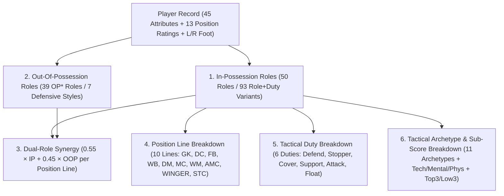

# Football Manager 26 — Multi-Dimensional Tactical Role Breakdown Reference

> **Repository:** [`fm26save`](../)  
> **Core Module:** [`fm26save/formulas.py`](../fm26save/formulas.py)  
> **Primary Functions:** [`analyze_player_role_breakdown()`](../fm26save/formulas.py#L1247-L1398), [`calculate_role_effectiveness()`](../fm26save/formulas.py#L1092-L1168), [`calculate_oop_role_effectiveness()`](../fm26save/formulas.py#L1171-L1228), [`get_role_catalog_breakdown()`](../fm26save/formulas.py#L1401-L1443)

---

## 1. Overview of FM26's Dual-Role Tactical Architecture

Football Manager 26 introduces a **Dual-Formation / Dual-Role tactical engine** (confirmed in `global-metadata.dat` via `InPossessionRole` and `OutOfPossessionRole` enums, and in `simatch.fmf` via `oop_attributes_scoring.jsb`, `oop_pitch_proximity_scores.jsb`, and embedded dual-formation `.tac` files such as `4-2-4 DM Wide _ 4-4-2 2DM.tac`).

To evaluate any player completely, `fm26save` breaks down role suitability across **6 orthogonal dimensions**:

---

## 2. Dimension 1: In-Possession Roles & Duties Catalog (`50` Roles, `93` Variants)

### 2.1 Duty Attribute Modifiers (`DUTY_ATTRIBUTE_DELTAS`)
When a role switches between duties, FM26 promotes specific attributes to **Key (`x2.0`)** or adds them to **Preferable (`x1.0`)**:

| Duty | Promoted to Key (`x2.0`) | Added to Preferable (`x1.0`) | Tactical Behavior |
| :--- | :--- | :--- | :--- |
| **`Defend`** | `positioning`, `concentration`, `marking` | `tackling`, `anticipation` | Holds shape, prioritizes rest-defense and screening |
| **`Stopper`** | `aggression`, `bravery`, `decisions`, `strength` | `heading`, `jumping_reach` | Steps out of the back line to engage ball-carriers early |
| **`Cover`** | `anticipation`, `decisions`, `pace`, `acceleration` | `concentration`, `positioning` | Drops deeper behind the defensive line to sweep through-balls |
| **`Support`** | `teamwork`, `decisions`, `passing` | `first_touch`, `work_rate`, `stamina` | Balances progression, link-up play, and box-to-box support |
| **`Attack`** | `off_the_ball`, `dribbling`, `acceleration` | `finishing`, `flair`, `composure`, `pace` | Breaks lines, attacks the penalty box, and takes higher risks |
| **`Float`** | `off_the_ball`, `vision`, `flair`, `decisions` | `composure`, `agility`, `first_touch` | Roams freely between half-spaces to overload pockets (`Trequartista`) |

---

### 2.2 Complete In-Possession Role Catalog by Position Line

| Position Line | Role Key | Role Name | Archetype | Available Duties | Foot Alignment | Core Key Attributes (`x2.0`) |
| :--- | :--- | :--- | :--- | :--- | :---: | :--- |
| **`GK`** | `goalkeeper` | Goalkeeper | `Traditional_GK` | `Defend` | `either` | `aerial_reach`, `command_of_area`, `communication`, `handling`, `kicking`, `reflexes`, `concentration`, `positioning`, `agility` |
| **`GK`** | `sweeper_keeper` | Sweeper Keeper | `Sweeper_ModernGK` | `Defend`, `Support`, `Attack` | `either` | `reflexes`, `rushing_out`, `command_of_area`, `kicking`, `one_on_ones`, `anticipation`, `composure`, `concentration`, `decisions`, `positioning`, `agility` |
| **`GK`** | `no_nonsense_goalkeeper` | No-Nonsense Goalkeeper | `Traditional_GK` | `Defend` | `either` | `aerial_reach`, `command_of_area`, `communication`, `handling`, `kicking`, `reflexes`, `concentration`, `positioning` |
| **`DC`** | `central_defender` | Central Defender | `Destroyer_Stopper` | `Defend`, `Stopper`, `Cover` | `either` | `heading`, `marking`, `tackling`, `positioning`, `jumping_reach`, `strength` |
| **`DC`** | `ball_playing_defender` | Ball-Playing Defender | `Playmaker` | `Defend`, `Stopper`, `Cover` | `either` | `heading`, `marking`, `passing`, `tackling`, `composure`, `decisions`, `positioning`, `jumping_reach`, `strength` |
| **`DC`** | `no_nonsense_centre_back` | No-Nonsense Centre-Back | `Destroyer_Stopper` | `Defend`, `Stopper`, `Cover` | `either` | `heading`, `marking`, `tackling`, `bravery`, `positioning`, `jumping_reach`, `strength` |
| **`DC`** | `wide_centre_back` | Wide Centre-Back | `BoxToBox_Engine` | `Defend`, `Support`, `Attack` | `same_side` | `heading`, `marking`, `tackling`, `positioning`, `jumping_reach`, `pace`, `stamina`, `strength` |
| **`DC`** | `overlapping_centre_back` | Overlapping Centre-Back | `Wide_Byline` | `Support`, `Attack` | `same_side` | `crossing`, `dribbling`, `marking`, `passing`, `tackling`, `off_the_ball`, `positioning`, `work_rate`, `acceleration`, `pace`, `stamina` |
| **`DC`** | `libero` | Libero | `Playmaker` | `Support`, `Attack` | `either` | `dribbling`, `first_touch`, `marking`, `passing`, `tackling`, `technique`, `composure`, `decisions`, `positioning`, `teamwork`, `vision`, `acceleration`, `agility` |
| **`FB`** | `full_back` | Full-Back | `Cover_Holding` | `Defend`, `Support`, `Attack` | `same_side` | `marking`, `tackling`, `anticipation`, `concentration`, `positioning`, `teamwork`, "work_rate", `stamina` |
| **`FB`** | `no_nonsense_full_back` | No-Nonsense Full-Back | `Destroyer_Stopper` | `Defend` | `same_side` | `marking`, `tackling`, `anticipation`, `bravery`, `concentration`, `positioning`, `teamwork`, `strength` |
| **`FB`** | `inverted_full_back` | Inverted Full-Back | `Cover_Holding` | `Defend` | `same_side` | `heading`, `marking`, `tackling`, `positioning`, `jumping_reach`, `strength` |
| **`FB`** | `inverted_wing_back` | Inverted Wing-Back | `Inverted_Inside` | `Defend`, `Support`, `Attack` | `inverted` | `first_touch`, `passing`, `tackling`, `decisions`, `off_the_ball`, `positioning`, `teamwork`, `work_rate`, `stamina` |
| **`WB`** | `wing_back` | Wing-Back | `Wide_Byline` | `Defend`, `Support`, `Attack` | `same_side` | `crossing`, `dribbling`, `marking`, `tackling`, `off_the_ball`, `teamwork`, `work_rate`, `acceleration`, `pace`, `stamina` |
| **`WB`** | `playmaking_wing_back` | Playmaking Wing-Back | `Playmaker` | `Support`, `Attack` | `either` | `first_touch`, `passing`, `tackling`, `technique`, `composure`, `decisions`, `off_the_ball`, `teamwork`, `vision`, `work_rate`, `stamina` |
| **`WB`** | `advanced_wing_back` | Advanced Wing-Back | `Wide_Byline` | `Attack` | `same_side` | `crossing`, `dribbling`, `first_touch`, `technique`, `flair`, `off_the_ball`, `work_rate`, `acceleration`, `agility`, `pace`, `stamina` |
| **`DM`** | `defensive_midfielder` | Defensive Midfielder | `Cover_Holding` | `Defend`, `Support` | `either` | `tackling`, `anticipation`, `concentration`, `positioning`, `teamwork` |
| **`DM`** | `anchor_man` | Anchor Man | `Cover_Holding` | `Defend` | `either` | `marking`, `tackling`, `anticipation`, `composure`, `concentration`, `decisions`, `positioning` |
| **`DM`** | `half_back` | Half-Back | `Cover_Holding` | `Defend` | `either` | `marking`, `passing`, `tackling`, `anticipation`, `composure`, `concentration`, `decisions`, `positioning`, `teamwork` |
| **`DM`** | `ball_winning_midfielder` | Ball-Winning Midfielder | `Destroyer_Stopper` | `Defend`, `Support` | `either` | `tackling`, `aggression`, `anticipation`, `bravery`, `teamwork`, `work_rate`, `stamina` |
| **`DM`** | `deep_lying_playmaker` | Deep-Lying Playmaker | `Playmaker` | `Defend`, `Support` | `either` | `first_touch`, `passing`, `technique`, `composure`, `decisions`, `teamwork`, `vision` |
| **`DM`** | `regista` | Regista | `Playmaker` | `Support` | `either` | `first_touch`, `passing`, `technique`, `composure`, `decisions`, `flair`, `off_the_ball`, `teamwork`, `vision` |
| **`DM`** | `segundo_volante` | Segundo Volante | `BoxToBox_Engine` | `Support`, `Attack` | `either` | `finishing`, `long_shots`, `marking`, `passing`, `tackling`, `anticipation`, `off_the_ball`, `positioning`, `work_rate`, `pace`, `stamina` |
| **`MC`** | `central_midfielder` | Central Midfielder | `BoxToBox_Engine` | `Defend`, `Support`, `Attack` | `either` | `first_touch`, `passing`, `tackling`, `decisions`, `teamwork` |
| **`MC`** | `box_to_box_midfielder` | Box-to-Box Midfielder | `BoxToBox_Engine` | `Support` | `either` | `passing`, `tackling`, `off_the_ball`, `teamwork`, `work_rate`, `stamina` |
| **`MC`** | `box_to_box_playmaker` | Box-to-Box / Roaming Playmaker | `Playmaker` | `Support` | `either` | `dribbling`, `first_touch`, `passing`, `technique`, `anticipation`, `composure`, `decisions`, `off_the_ball`, `teamwork`, `vision`, `work_rate`, `acceleration`, `stamina` |
| **`MC`** | `mezzala` | Mezzala | `Inverted_Inside` | `Support`, `Attack` | `either` | `dribbling`, `passing`, `technique`, `decisions`, `off_the_ball`, `vision`, `work_rate`, `acceleration` |
| **`MC`** | `wide_central_midfielder` | Carrilero / Wide CM | `Cover_Holding` | `Support` | `either` | `first_touch`, `passing`, `tackling`, `decisions`, `positioning`, `teamwork`, `work_rate`, `stamina` |
| **`WM`** | `wide_midfielder` | Wide Midfielder | `BoxToBox_Engine` | `Defend`, `Support`, `Attack` | `same_side` | `crossing`, `passing`, `tackling`, `decisions`, `teamwork`, `work_rate`, `stamina` |
| **`WM`** | `wide_playmaker` | Wide Playmaker | `Playmaker` | `Support`, `Attack` | `inverted` | `dribbling`, `first_touch`, `passing`, `technique`, `composure`, `decisions`, `off_the_ball`, `teamwork`, `vision` |
| **`AMC`** | `attacking_midfielder` | Attacking Midfielder | `Playmaker` | `Support`, `Attack` | `either` | `dribbling`, `first_touch`, `long_shots`, `passing`, `technique`, `anticipation`, `decisions`, `flair`, `off_the_ball`, `vision` |
| **`AMC`** | `advanced_playmaker` | Advanced Playmaker | `Playmaker` | `Support`, `Attack` | `either` | `first_touch`, `passing`, `technique`, `composure`, `decisions`, `off_the_ball`, `teamwork`, `vision` |
| **`AMC`** | `shadow_striker` | Shadow Striker | `Scorer` | `Attack` | `either` | `dribbling`, `finishing`, `first_touch`, `anticipation`, `composure`, `off_the_ball`, `acceleration` |
| **`AMC`** | `channel_midfielder` | Channel Midfielder | `BoxToBox_Engine` | `Support`, `Attack` | `either` | `dribbling`, `first_touch`, `passing`, `technique`, `anticipation`, `decisions`, `off_the_ball`, `vision`, `work_rate`, `acceleration`, `pace`, `stamina` |
| **`AMC`** | `enganche` | Enganche | `Playmaker` | `Support` | `either` | `first_touch`, `passing`, `technique`, `composure`, `decisions`, `vision` |
| **`AMC`** | `trequartista` | Trequartista | `Playmaker` | `Attack`, `Float` | `either` | `dribbling`, `first_touch`, `passing`, `technique`, `composure`, `decisions`, `flair`, `off_the_ball`, `vision`, `acceleration` |
| **`WINGER`** | `winger` | Winger | `Wide_Byline` | `Support`, `Attack` | `same_side` | `crossing`, `dribbling`, `technique`, `off_the_ball`, `acceleration`, `pace` |
| **`WINGER`** | `inside_forward` | Inside Forward | `Inverted_Inside` | `Support`, `Attack` | `inverted` | `dribbling`, `finishing`, `first_touch`, `technique`, `off_the_ball`, `acceleration`, `agility`, `pace` |
| **`WINGER`** | `inverted_winger` | Inverted Winger | `Inverted_Inside` | `Support`, `Attack` | `inverted` | `crossing`, `dribbling`, `passing`, `technique`, `off_the_ball`, `acceleration`, `agility` |
| **`WINGER`** | `defensive_winger` | Defensive Winger | `Pressing_Harrier` | `Defend`, `Support` | `same_side` | `crossing`, `dribbling`, `marking`, `tackling`, `aggression`, `anticipation`, `off_the_ball`, `positioning`, `teamwork`, `work_rate`, `acceleration`, `stamina` |
| **`WINGER`** | `wide_target_man` | Wide Target Forward | `Target_Outlet` | `Support`, `Attack` | `either` | `heading`, `bravery`, `off_the_ball`, `teamwork`, `work_rate`, `jumping_reach`, `strength` |
| **`WINGER`** | `wide_forward` | Raumdeuter / Wide Forward | `Scorer` | `Attack` | `either` | `finishing`, `first_touch`, `anticipation`, `composure`, `concentration`, `decisions`, `off_the_ball`, `balance` |
| **`STC`** | `advanced_forward` | Advanced Forward | `Scorer` | `Attack` | `either` | `dribbling`, `finishing`, `first_touch`, `technique`, `composure`, `off_the_ball`, `acceleration` |
| **`STC`** | `poacher` | Poacher | `Scorer` | `Attack` | `either` | `finishing`, `first_touch`, `anticipation`, `composure`, `off_the_ball` |
| **`STC`** | `target_forward` | Target Forward | `Target_Outlet` | `Support`, `Attack` | `either` | `heading`, `bravery`, `teamwork`, `jumping_reach`, `strength` |
| **`STC`** | `deep_lying_forward` | Deep-Lying Forward | `Target_Outlet` | `Support`, `Attack` | `either` | `first_touch`, `passing`, `technique`, `composure`, `decisions`, `off_the_ball`, `teamwork` |
| **`STC`** | `pressing_forward` | Pressing Forward | `Pressing_Harrier` | `Defend`, `Support`, `Attack` | `either` | `aggression`, `anticipation`, `bravery`, `decisions`, `teamwork`, `work_rate`, `acceleration`, `pace`, `stamina` |
| **`STC`** | `complete_forward` | Complete Forward | `Scorer` | `Support`, `Attack` | `either` | `dribbling`, `finishing`, `first_touch`, `heading`, `long_shots`, `passing`, `technique`, `anticipation`, `composure`, `decisions`, `off_the_ball`, `vision`, `acceleration`, `agility`, `jumping_reach`, `pace`, `strength` |
| **`STC`** | `false_nine` | False Nine | `Playmaker` | `Support` | `either` | `dribbling`, `first_touch`, `passing`, `technique`, `composure`, `decisions`, `off_the_ball`, `teamwork`, `vision`, `acceleration`, `agility` |
| **`STC`** | `channel_forward` | Channel Forward | `Scorer` | `Attack` | `either` | `dribbling`, `finishing`, `first_touch`, `anticipation`, `composure`, `off_the_ball`, `work_rate`, `acceleration`, `pace`, `stamina` |

---

## 3. Dimension 2: Out-Of-Possession (`OP*`) Role Catalog (`39` Roles across `7` Defensive Styles)

Decoded from `global-metadata.dat` (`OutOfPossessionRole`) and `simatch.fmf` (`oop_attributes_scoring.jsb`):

| Defensive / Transition Style (`oop_style`) | Out-Of-Possession Roles (`OP*`) | Core Key Attributes (`x2.0`) |
| :--- | :--- | :--- |
| **1. `Standard_Shape`** (Balanced Zonal Block) | `OPGoalkeeper`, `OPCentreBack`, `OPFullBack`, `OPDefensiveMidfielder`, `OPCentralMidfielder`, `OPAtackingMidfielder`, `OPWideMidfielder`, `OPWinger`, `OPCentreForward` | `positioning`, `marking`, `tackling`, `anticipation`, `concentration`, `teamwork` |
| **2. `Stopper_Aggressive`** (Front-Foot Step-Out) | `OPStoppingCentreBack`, `OPStoppingWideCentreBack` | `tackling`, `heading`, `aggression`, `bravery`, `decisions`, `strength`, `jumping_reach` |
| **3. `Cover_Sweeper`** (Deep Line Sweeping & Dropping) | `OPSweeperKeeper`, `OPCoveringCentreBack`, `OPCoveringWideCentreBack`, `OPDroppingDefensiveMidfielder` | `anticipation`, `decisions`, `positioning`, `concentration`, `acceleration`, `pace`, `marking`, `rushing_out` (GK) |
| **4. `High_Pressing`** (Counter-Press & Harrying) | `OPPressingFullBack`, `OPPressingWingBack`, `OPPressingDefensiveMidfielder`, `OPPressingCentralMidfielder`, `OPTrackingCentreForward` | `tackling`, `aggression`, `anticipation`, `bravery`, `work_rate`, `teamwork`, `acceleration`, `pace`, `stamina` |
| **5. `Screening_Holding`** (Passing Lane Blockers) | `OPLineKeeper`, `OPHoldingFullBack`, `OPHoldingWingBack`, `OPScreeningDefensiveMidfielder`, `OPScreeningCentralMidfielder` | `marking`, `anticipation`, `concentration`, `decisions`, `positioning`, `teamwork` |
| **6. `Wide_Cover_Tracking`** (Flank Doubling & Runner Tracking) | `OPWideCentreBack`, `OPWingBack`, `OPWideCoverDefensiveMidfielder`, `OPWideCoverCentralMidfielder`, `OPTrackingAtackingMidfielder`, `OPTrackingWideMidfielder`, `OPTrackingWinger` | `marking`, `tackling`, `positioning`, `concentration`, `teamwork`, `work_rate`, `acceleration`, `pace`, `stamina` |
| **7. `Central_Counter_Outlet` & `Splitting_Wide_Outlet`** (Rest-Attack Counter Stations) | `OPCentralOutletMidfielder`, `OPSplittingOutletAtackingMidfielder`, `OPWideOutletWideMidfielder`, `OPInvertingOutletWinger`, `OPWideOutletWinger`, `OPCentralOutletCentreForward`, `OPSplittingOutletCentreForward` | `off_the_ball`, `anticipation`, `acceleration`, `pace`, `agility`, `dribbling`, `first_touch`, `composure`, `finishing` / `crossing` |

---

## 4. Dimension 3–6: Sub-Category, Archetype & Bottleneck Diagnostics

For every player and role, [`calculate_role_effectiveness()`](../fm26save/formulas.py#L1092-L1168) and [`analyze_player_role_breakdown()`](../fm26save/formulas.py#L1247-L1398) compute:
1. **`key_vs_preferable_breakdown`:** Separate averages for Key (`x2.0`) vs. Preferable (`x1.0`) attributes and the percentage weight share of Key attributes (`key_weight_share_pct`).
2. **`category_breakdown_20`:** Weighted `1..20` sub-scores across `technical`, `mental`, `physical`, and `goalkeeping` pillars.
3. **`strengths_top3_key` & `bottlenecks_low3_key`:** Pinpoints the exact 3 Key attributes elevating the player in that role and the 3 weakest Key attributes acting as a ceiling/bottleneck.
4. **`by_archetype` (`11` Tactical Archetypes):**Separates `best_effective_score_100` (which includes position familiarity) from `best_raw_aptitude_20` (pure attribute fit, revealing hidden positional retraining candidates!).
