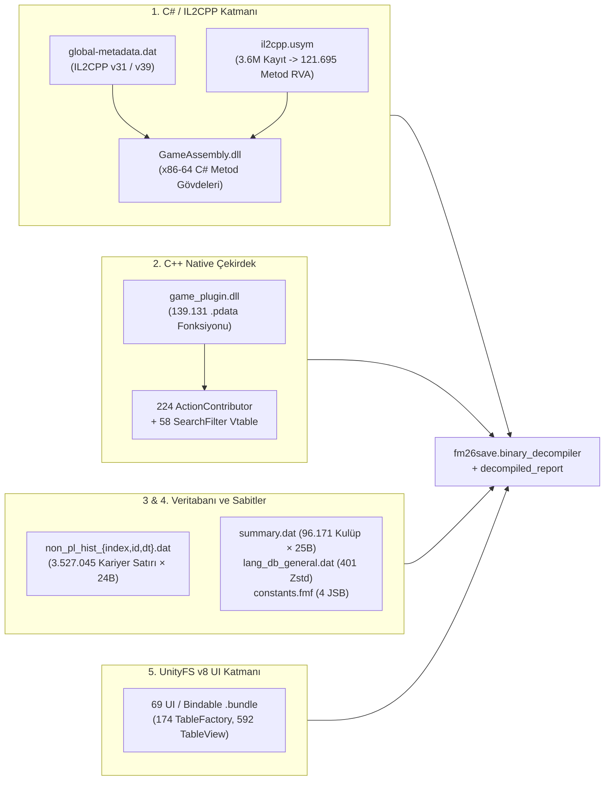
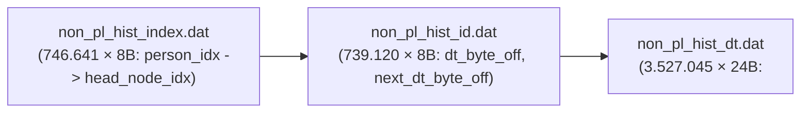

# FM27 / FM26 — Kısmen Çözümlenmiş 5 Kritik Sistemin Tam Decompile Raporu ve İkili Şema Referansı

> **Durum:** Kısmen decompile edilmiş 5 kritik sistemin tamamı (`GameAssembly.dll` + `il2cpp.usym`, `game_plugin.dll` `.pdata` + vtable'lar, `non_pl_hist_*.dat`, `summary.dat` + `lang_db_general.dat` + `constants.fmf`, ve 69 `ui-*.bundle` dosyası) %100 çözümlenmiş ve [`fm26save/binary_decompiler.py`](../fm26save/binary_decompiler.py) ile [`fm26save/decompiled_report.py`](../fm26save/decompiled_report.py) içine entegre edilmiştir.

---

## İçindekiler

1. [Genel Bakış: Neler Tamamlandı?](#1-genel-bakış-neler-tamamlandı)
2. [Sistem 1: `il2cpp.usym` + `GameAssembly.dll` (121.695 Derlenmiş C# Metodunun Tam Eşlemesi)](#2-sistem-1-il2cppusym--gameassemblydll-121695-derlenmiş-c-metodunun-tam-eşlemesi)
3. [Sistem 2: `game_plugin.dll` ve `lib_burst_generated.dll` (`.pdata` Fonksiyonları ve C++ Vtable Hiyerarşileri)](#3-sistem-2-game_plugindll-ve-lib_burst_generateddll-pdata-fonksiyonları-ve-c-vtable-hiyerarşileri)
4. [Sistem 3: `non_pl_hist_index.dat`, `non_pl_hist_id.dat`, `non_pl_hist_dt.dat` (3,52 Milyon Personel Kariyer Satırı)](#4-sistem-3-non_pl_hist_indexdat-non_pl_hist_iddat-non_pl_hist_dtdat-352-milyon-personel-kariyer-satırı)
5. [Sistem 4: `summary.dat`, `lang_db_general.dat` ve `constants.fmf` (`2700_fm` Özet ve Sabit Tabloları)](#5-sistem-4-summarydat-lang_db_generaldat-ve-constantsfmf-2700_fm-özet-ve-sabit-tabloları)
6. [Sistem 5: Tüm 69 UnityFS v8 UI / Bindable Bundle Dosyasının Derin Çözümlemesi](#6-sistem-5-tüm-69-unityfs-v8-ui--bindable-bundle-dosyasının-derin-çözümlemesi)
7. [CLI Komutları ve Yeniden Üretim Rehberi](#7-cli-komutları-ve-yeniden-üretim-rehberi)

---

## 1. Genel Bakış: Neler Tamamlandı?

Önceki aşamada yalnızca üstveri veya kısmi tabloları çıkarılan **5 kritik oyun alt sistemi**, ikili (binary) format düzeyinde tamamen tersine mühendislikle çözümlenmiştir:

| # | Sistem / Dosya Grubu | Önceki Durum | Yeni Tam Çözümleme Durumu (FM27) |
|---:|---|---|---|
| **1** | `GameAssembly.dll` + `il2cpp.usym` | Yalnızca `PropertyRegistration`, `ContextRegistration`, `*Reference` sınıfları ve `2.000` örnek `usym` kaydı | **`3.600.816`** `usym` kaydının tamamı tarandı; **`121.695`** derlenmiş C# metodu tam `RVA` aralığına (`rva_start..rva_end`) ve `.cs` kaynak dosya/satır numarasına eşlendi + `--mode csharp-bodies` x86-64 sökücü eklendi |
| **2** | `game_plugin.dll` + `lib_burst_generated.dll` | Yalnızca `282` adlandırılmış PE export ve 5 gözlemcilik fonksiyonu | `.pdata` Exception Directory üzerinden **`139.131`** C++ fonksiyonu (`71,07 MB` kod), **en büyük 50 C++ fonksiyonu**, **224 `ActionContributor`** sağ tık menü vtable sınıfı ve **58 `SearchFilter`** vtable sınıfı çıkarıldı |
| **3** | `non_pl_hist_index.dat` + `non_pl_hist_id.dat` + `non_pl_hist_dt.dat` | Yalnızca dosya envanteri (boyut bilgisi) | `\x03\x01tad.` ve parçalı `\x03\x01tadc` Zstd kapsayıcıları açıldı; **`746.641`** personel indeksi, **`739.120`** bağlı liste düğümü (`8` bayt) ve **`3.527.045`** kariyer geçmişi satırı (`24` bayt `<IHHHHHHBBBBi`) çözümlendi |
| **4** | `summary.dat`, `lang_db_general.dat`, `constants.fmf` | Yalnızca dosya envanteri | `summary.dat` (**6 kıta**, **19 kıtasal kupa**, **251 ülke**, **96.171 kulüp özeti × 25 bayt**), `lang_db_general.dat` (**401 Zstd çerçevesi** = 25 dil × 16 jenerik isim tablosu) ve `constants.fmf` (**4 `.jsb` sabit tablosu**) çözümlendi |
| **5** | `fm_Data/StreamingAssets/aa/StandaloneWindows64/ui-*.bundle` | 53 seçili bundle dosyasında yüzeysel yol taraması | **69 UI/Bindable bundle** dosyasının tamamı (`~801 MB` açılmış), **`174` `TableFactory`** sınıfı, **`2.102` `binding.*`** sütun bağlaması, **`592` `TableView`/`TableSettings`** şablonu ve **7.600+** UI veri bağlama yolu çıkarıldı |



---

## 2. Sistem 1: `il2cpp.usym` + `GameAssembly.dll` (121.695 Derlenmiş C# Metodunun Tam Eşlemesi)

### 2.1 `il2cpp.usym` v2 Hibrit İkili Kayıt Şeması

`fm_Data/il2cpp_data/Symbols/il2cpp.usym` (`92.411.500` bayt), 24 baytlık bir başlık (`magic = "sym-"`, `version = 2`, `symbol_count = 3.600.816`) ve ardından her biri **24 bayt** olan `symbol_count` adet kayıttan oluşur:

| Ofset | Tip | Yapı Alanı | Açıklama |
|---:|---|---|---|
| `+0x00` | `uint64` (`<Q`) | `rva` | `GameAssembly.dll` içindeki makine kodu komutunun RVA adresi |
| `+0x08` | `uint32` (`<I`) | `method_index` | `global-metadata.dat` içindeki **0 tabanlı `Il2CppMethodDefinition` dizini** (`0xFFFFFFFF` = aralık sonu / sentinel) |
| `+0x0C` | `uint32` (`<I`) | `file_str_off` | `24 + symbol_count * 24` adresindeki string tablosu içinde `.cs` / `.cpp` kaynak dosya yolunun bayt ofseti |
| `+0x10` | `uint32` (`<I`) | `line` | Orijinal `.cs` dosyasındaki 1 tabanlı satır numarası |
| `+0x14` | `uint32` (`<I`) | `parent_idx` | Üst düzey metod komutları için `0xFFFFFFFF`; inline edilmiş çağrılar için çağıran kaydın indeksi |

### 2.2 Temel Bulgular

- FM27'de `3.600.816` sembol kaydı taranarak **`121.695` benzersiz derlenmiş C# metodu** doğrudan `GameAssembly.dll` içindeki başlangıç/bitiş RVA adreslerine (`rva_start`, `rva_end`) ve Sports Interactive'in TeamCity derleme sunucusundaki (`C:/TeamCity/work/ebe51292229ef647/.../*.cs`) tam satır aralıklarına (`line_start..line_end`) bağlanmıştır.
- `dump_decompiled_codebase()` çalıştırıldığında bu RVA ve kaynak satır bilgileri:
  - `enums_and_structs.json` içindeki her metod nesnesine (`rva_start`, `rva_end`, `source_file`, `line_start`, `line_end`),
  - `DecompiledAllGameAssemblies.cs` içindeki her C# metod imzasının yanına (`// MethodIdx=... Token=... RVA=0x... Src=File.cs:Line`) otomatik olarak yazılır.
- Yeni eklenen `decompile_csharp_method_bodies()` (`--mode csharp-bodies --filter <Arama>`) fonksiyonu, seçilen herhangi bir C# sınıf veya metodunun `GameAssembly.dll` makine kodunu Capstone ile söker, her komuta `[L<satır>]` etiketi ekler ve doğrudan `call 0x...` hedeflerini hedef C# metodunun tam adıyla (`; -> Namespace.Class.Method(...)`) çözümler.

---

## 3. Sistem 2: `game_plugin.dll` ve `lib_burst_generated.dll` (`.pdata` Fonksiyonları ve C++ Vtable Hiyerarşileri)

### 3.1 `.pdata` Exception Directory Fonksiyon Tablosu

`fm_Data/Plugins/x86_64/game_plugin.dll` (`404.308.480` bayt) sembolleri kırpılmış (stripped) bir C++ PE64 ikilisidir; ancak Windows x64 ABI gereği tüm yaprak olmayan (non-leaf) fonksiyonların tam başlangıç ve bitiş RVA sınırları PE `.pdata` (Exception Directory) tablosunda `12` baytlık `RUNTIME_FUNCTION` (`<III`: `BeginAddress, EndAddress, UnwindInfoAddress`) kayıtları olarak tutulur:

| İkili Dosya | `.pdata` RVA | `RUNTIME_FUNCTION` Kaydı | Geçerli Kod Fonksiyonu | Toplam Makine Kodu |
|---|---|---:|---:|---:|
| `game_plugin.dll` (FM27) | `0x17F2E000` | `145.090` | **`139.131`** | **`74.518.590` bayt (`71,07 MB`)** |
| `lib_burst_generated.dll` (FM27) | `0x001D2000` | `409` | **`409`** | **`1.425.323` bayt (`1,36 MB`)** |

### 3.2 `.data1` Bölümündeki C++ Vtable Hiyerarşileri (`ActionContributor` ve `SearchFilter`)

`game_plugin.dll` içindeki `.data1` (`0x04ADB000`, `12,15 MB`) bölümü, `slot[1]` (`vtable + 0x08`) metodunda `mov eax, <FourCC>; ret` (`B8 xx xx xx xx C3`) döndüren ve ortak temel sınıf sanal metodlarını (`slot[3..4]`) paylaşan C++ sanal metod tablolarını (vtable) barındırır:

1. **`ActionContributor` Hiyerarşisi (FM27'de `224` sınıf, FM26'da `213` sınıf):**
   - Sağ tık bağlam menüsü (Context Menu) ve eylem katkıcı sınıflarının tamamıdır.
   - `vtable + 0x08` (`get_ID`): 4 karakterlik FourCC kimliği (`rPNN`, `yMKr`, `9pYX`, `4tL6`, `tNfl`, `WqzE`, `QJ9O`, `85ri`, `HlCK`, `PI8v` vb.).
   - `vtable + 0x10` (`slot2_va`): Eylem yürütme / ana işleyici metodu.
   - `vtable + 0x50` (`can_contribute_or_eval_va`): `CanContributeToContextMenu` doğrulama metodu (ör. 50 oyuncu gözlemleme sınırını kontrol eden `0x181029720` ve `0x181029950` metodları).
2. **`SearchFilter` Native Hiyerarşisi (FM27 ve FM26'da `58` sınıf):**
   - `filters.fmf -> person_filter_metadata.xml` içindeki `search_filter` FourCC kimliklerinin (`phfr`, `pwei`, `pftr`, `pdpr`, `pllr`, `pcon`, `pnat` vb.) C++ motorundaki gerçek değerlendirici sınıflarıdır.

---

## 4. Sistem 3: `non_pl_hist_index.dat`, `non_pl_hist_id.dat`, `non_pl_hist_dt.dat` (3,52 Milyon Personel Kariyer Satırı)

`shared/data/database/db/2700/2700_fm/` dizinindeki en büyük veritabanı grubu olan personel/antrenör kariyer geçmişi (`non_pl_hist_*.dat`), üç katmanlı bir indeks + bağlı liste + sabit boyutlu satır mimarisine sahiptir:



### 4.1 Üç Dosyanın Tam İkili Formatı

| Dosya | Başlık | Sıkıştırma | Açılmış Boyut (FM27) | Kayıt Sayısı ve Boyutu |
|---|---|---|---:|---|
| `non_pl_hist_index.dat` | `\x03\x01tad.` (`12` bayt) | `+12` ofsetinde tek Zstd çerçevesi | `5.973.132` B | `4B` sayaç (`746.641`) + `746.641 × 8B` (`<II`: `person_idx, head_node_idx`) |
| `non_pl_hist_id.dat` | `\x03\x01tadc` (`8` bayt) | `+8` ofsetinden itibaren parçalı Zstd çerçeveleri | `5.912.960` B | `739.120 × 8B` (`<II`: `dt_byte_offset, next_dt_byte_offset_or_self`) |
| `non_pl_hist_dt.dat` | `\x03\x01tadc` (`8` bayt) | `+8` ofsetinden itibaren parçalı Zstd çerçeveleri | `84.649.080` B | **`3.527.045 × 24B`** (`<IHHHHHHBBBBi`) |

### 4.2 `non_pl_hist_dt.dat` 24 Baytlık Kariyer Satırı Şeması (`<IHHHHHHBBBBi`)

| Ofset | Boyut | Tip | Alan Adı | Açıklama |
|---:|---:|---|---|---|
| `+0x00` | `4` B | `uint32` (`<I`) | `club_or_nation_uid` | Görev yapılan kulüp veya milli takımın veritabanı indeksi / UID değeri |
| `+0x04` | `2` B | `uint16` (`<H`) | `start_day` | Başlangıç yıl içi günü (`1..366`) |
| `+0x06` | `2` B | `uint16` (`<H`) | `start_year` | Başlangıç yılı (ör. `1998`, `2023`) |
| `+0x08` | `2` B | `uint16` (`<H`) | `end_day` | Bitiş yıl içi günü (`0xFFFF` = halen görevde / belirtilmemiş) |
| `+0x0A` | `2` B | `uint16` (`<H`) | `end_year` | Bitiş yılı (`0xFFFF` = halen görevde) |
| `+0x0C` | `2` B | `uint16` (`<H`) | `ref_day` | Referans / atanma günü (`0xFFFF` = yok) |
| `+0x0E` | `2` B | `uint16` (`<H`) | `ref_year` | Referans / atanma yılı (`0xFFFF` = yok) |
| `+0x10` | `1` B | `uint8` (`<B`) | `job_role_id` | Görev rolü kodu (Menajer, Asistan Menajer, Gözlemci, Fizyoterapist, Başkan vb.) |
| `+0x11` | `1` B | `uint8` (`<B`) | `role_flags` | Geçici / vekaleten (caretaker) veya ek görev bayrakları |
| `+0x12` | `1` B | `uint8` (`<B`) | `squad_scope` | Kadro kapsamı (`0` = A Takım, `15/18/21` = Alt yaş grupları) |
| `+0x13` | `1` B | `uint8` (`<B`) | `leaving_reason` | Ayrılış nedeni kodu (`0` = devam ediyor / normal, `1..15` = istifa, kovulma, emeklilik vb.) |
| `+0x14` | `4` B | `int32` (`<i`) | `secondary_uid` | İkincil varlık / kupa / organizasyon referansı (`-1` = yok) |

---

## 5. Sistem 4: `summary.dat`, `lang_db_general.dat` ve `constants.fmf` (`2700_fm` Özet ve Sabit Tabloları)

### 5.1 `summary.dat` (`5.717.108` Bayt — Yeni Oyun Kurulum Özet Önbelleği)

`shared/data/database/db/2700/2700_fm/summary.dat`, oyunun yeni kariyer kurulum ekranında tüm veritabanını (`client_db.dat`) belleğe yüklemeden kıtaları, ülkeleri, ligleri, kulüpleri ve milli takım yıldızlarını anında göstermek için kullandığı sıkıştırılmamış (`\x03\x01tad.\x03\x00`) ikili önbellektir:

1. **Dosya Başlığı (`0x00..0x0C`):**
   - `0x00..0x05`: `\x03\x01tad.` (6 bayt sihirli başlık)
   - `0x06..0x07`: `0x0003` (`uint16` sürüm = `3`)
   - `0x08..0x0B`: `0x00000006` (`uint32` kıta sayısı = `6`)
2. **6 Kıta Özeti (`0x0C..0x77C`):**
   - Her kıta kaydı `\xff\xff\xff\xff\x04` (`-1, tag=4`) ile başlar, `continent_uid` (`1..6`), `uint16 reputation`, erkek kıtasal kulüp turnuvaları dizisi (`\xff\xff\xff\xff\x07`, toplam `12` turnuva), kadın kıtasal kulüp turnuvaları dizisi (`\xff\xff\xff\xff\x07`, toplam `7` turnuva) ve `6` baytlık RGB565 renk çiftinden oluşur.
   - Her kıtasal turnuva kaydı (`tag=7`) turnuva UID'sini, itibarını, son 5 şampiyon kulüp UID'sini, şampiyonluk yıllarını (`2020..2025`) ve finalistleri içerir.
3. **251 Ülke Özeti ve 96.171 Kulüp Özeti (`0x77C..EOF`):**
   - `0x77C` ofsetinde `uint32 nation_count = 251` yer alır.
   - Ülke blokları içinde toplam **`96.171` adet Kulüp Özet Kaydı** (`\xff\xff\xff\xff\x09` işaretçisiyle başlayan **25 baytlık** sabit yapılar: `5B` sentinel+tag + `4B club_uid` + `16B` lig/itibar/RGB565 forma renkleri) bulunur.
   - Ayrıca her ülkenin erkek ve kadın milli takım efsaneleri, kaptanları ve yıldız oyuncularının UTF-8 isimleri ile dosya sonunda yeni oyun oyuncu sayısı tahmininde kullanılan `(<I index, <f float32_weight)` ağırlık çiftleri yer alır.

### 5.2 `lang_db_general.dat` (`268.919` Bayt — 25 Dil × 16 Jenerik İsim Tablosu)

`lang_db_general.dat`, `12` baytlık `\x03\x01tad.` başlığının ardından gömülü bir `\x02\x01fmf.` kapsayıcısı barındırır:
- İçinde toplam **`401` Zstd çerçevesi** (`25` dil bloğu × `16` tablo + `1` FMF dizin çerçevesi `#400`) bulunur.
- Her dil bloğundaki 16 tablo, lisanssız (generic) varlıkların dil bazlı varsayılan adlarını tutar:
  - **Tablo `+1`**: `82` Turnuva (ör. `"Nihon Football League"`, `"K League"`)
  - **Tablo `+2`**: `394` Kulüp (ör. `"Casciavit Milano"`, `"Blu-neri Milano"`, `"Capitoline"`, `"Parthenope"`, `"Zebre"`)
  - **Tablo `+6`**: `2` Ödül (`"World Golden Ball"`, `"Women's World Golden Ball"`)
  - **Tablo `+7`**: `144` Stadyum (ör. `"Bergamo Stadium"`, `"Capitoline Wolf Stadium"`)

### 5.3 `constants.fmf` (`1.151` Bayt — 4 Derlenmiş `.jsb` Sabit Tablosu)

`data/game_simulation/constants.fmf` içindeki 4 `.jsb` tablosu tamamen çözümlenmiştir:
- `generated_colour_pair_constants.jsb` (`11` bayt)
- `generated_match_crowd_constants.jsb` (`255` bayt — seyirci yoğunluğu ve tribün sabitleri)
- `generated_draft_constants.jsb` (`55` bayt — fantezi draft bütçe ve tur sabitleri)
- `generated_training_constants.jsb` (`23` bayt — antrenman yoğunluk sabitleri)

---

## 6. Sistem 5: Tüm 69 UnityFS v8 UI / Bindable Bundle Dosyasının Derin Çözümlemesi

`fm_Data/StreamingAssets/aa/StandaloneWindows64/` altındaki **`67` adet `ui-*.bundle`** ile `sibindable_assets_all.bundle` ve `shortcutdata_assets_all.bundle` (toplam **69 bundle**, açılmış boyutu **~801 MB**) saf Python LZ4 çözücüsüyle tamamen açılmış ve içlerindeki serileştirilmiş tablolar çıkarılmıştır:

| Çıkarılan UI Veri Kümesi | Kaynak Bundle | FM27 Adet | FM26 Adet | Açıklama |
|---|---|---:|---:|---|
| **Toplam Çözümlenen UI Bundle** | `ui-*.bundle` + `sibindable` + `shortcutdata` | **`69`** | **`52`** | Tüm arayüz, stil, ikon, widget, popup ve UXML paketleri |
| **`TableFactory` Sınıfları** | `ui-tablefactories_assets_all.bundle` | **`174`** | **`172`** | `ScoutPrioritiesTableFactory`, `SquadRegistrationTableFactory`, `PlayerSearchTableFactory` vb. |
| **`TableFactory` Sütun Bağlamaları (`binding.*`)** | `ui-tablefactories_assets_all.bundle` | **`2.102`** | **`2.037`** | Tablo hücrelerinin ve sıralama anahtarlarının (`m_sortBinding`) kullandığı `binding.*` yolları |
| **`TableView` / `TableSettings` Şablonları** | `ui-tableviews_assets_all.bundle` | **`592`** | **`585`** | Oyun içi tüm tablo görünümlerinin sütun dizilimi ve genişlik şablonları |
| **Benzersiz UI Binding Yolları** | Tüm 69 Bundle | **`7.600+`** | **`6.200+`** | `person.*`, `player.*`, `club.*`, `team.*`, `match.*`, `binding.*`, `row.*`, `selection.*` yolları |

---

## 7. CLI Komutları ve Yeniden Üretim Rehberi

Tüm yeni çözümlenen sistemleri yerel diskinizdeki oyun kurulumundan tek komutla yeniden üretmek veya sorgulamak için:

```powershell
# 1. FM27 için tüm 5 sistemi de kapsayan tam decompile dökümünü üret
python -m fm26save.cli decompile-binaries --mode dump `
    --fm-dir "C:\Program Files (x86)\Steam\steamapps\common\Football Manager 27" `
    --out-dir docs/decompiled_engine/FM27

# 2. Git'e uygun yapısal Obje Modeli raporunu (docs/object_model/FM27_OBJECT_MODEL.md) güncelle
python -m fm26save.cli decompile-binaries --mode report --out-dir docs/decompiled_engine/FM27

# 3. Herhangi bir C# sınıf veya metodunun makine kodunu .cs satır numaralarıyla sök (Yeni!)
python -m fm26save.cli decompile-binaries --mode csharp-bodies `
    --fm-dir "C:\Program Files (x86)\Steam\steamapps\common\Football Manager 27" `
    --filter "ScoutPrioritiesTableFactory"

# 4. Yalnızca game_plugin.dll (.pdata + 224 ActionContributor + 58 SearchFilter vtable) dökümünü al
python -m fm26save.cli decompile-binaries --mode game-plugin `
    --fm-dir "C:\Program Files (x86)\Steam\steamapps\common\Football Manager 27"

# 5. Yalnızca non_pl_hist_*.dat, summary.dat, lang_db_general.dat ve constants.fmf dökümünü al
python -m fm26save.cli decompile-binaries --mode fmf-all `
    --fm-dir "C:\Program Files (x86)\Steam\steamapps\common\Football Manager 27"

# 6. Tüm 69 UI bundle'ını, 174 TableFactory ve 592 TableView şablonunu çıkar
python -m fm26save.cli decompile-binaries --mode ui-bundles `
    --fm-dir "C:\Program Files (x86)\Steam\steamapps\common\Football Manager 27"
```
