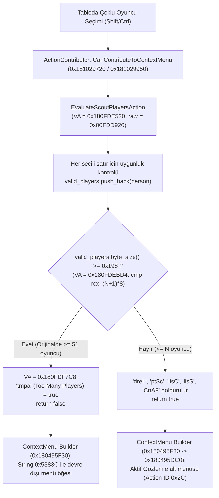

# FM27 — Çoklu Oyuncu Seçiminde 50 Oyuncu Gözlemleme Sınırı: Analiz ve Çözüm

> **Durum:** Kök neden tespit edildi, `game_plugin.dll` üzerinde yama uygulandı ve bayt düzeyinde doğrulandı (7.11.2026).
> **Oyun:** Football Manager 27 (`fm_Data\Plugins\x86_64\game_plugin.dll`, 404.308.480 bayt)
> **Araç:** [`fm26save/ui_patches.py`](../fm26save/ui_patches.py) (`scout-player-limit` yaması) ve [`fm26save/cli.py`](../fm26save/cli.py) (`patch-ui` alt komutu)

---

## İçindekiler

1. [Sorun](#1-sorun)
2. [Kısa cevap (TL;DR)](#2-kısa-cevap-tldr)
3. [Hızlı kullanım](#3-hızlı-kullanım)
4. [Kök neden: `game_plugin.dll` tersine mühendislik analizi](#4-kök-neden-game_plugindll-tersine-mühendislik-analizi)
5. [Alt akış güvenliği: Neden sınırı yükseltmek çökme yaratmaz?](#5-alt-akış-güvenliği-neden-sınırı-yükseltmek-çökme-yaratmaz)
6. [Teknik yama detayları ve çapa (anchor) doğrulaması](#6-teknik-yama-detayları-ve-çapa-anchor-doğrulaması)
7. [İlgili diğer 50 oyuncu sınırları (Squad Planner)](#7-ilgili-diğer-50-oyuncu-sınırları-squad-planner)

---

## 1. Sorun

FM27'de **Oyuncu Merkezi / Oyuncu Veritabanı / Kısa Liste (Shortlist)** gibi oyuncu tablolarında çoklu seçim (`Shift+Tık` veya `Ctrl+A`) yapıldığında:
- **En fazla 50 oyuncu** seçildiğinde sağ tık menüsünden **Gözlemle / Rapor İste (Scout Player(s))** işlemi başlatılabiliyor.
- **51 veya daha fazla** gözlemlenebilir oyuncu seçildiğinde ise gözlemleme seçeneği devre dışı kalıyor ve toplu gözlemleme yapılamıyor.

---

## 2. Kısa cevap (TL;DR)

50 oyuncu sınırı Unity C# arayüz katmanında (`GameAssembly.dll` veya `.bundle` dosyalarında) **değil**, doğrudan C++ oyun motoru eklentisi olan **`fm_Data\Plugins\x86_64\game_plugin.dll`** içindeki **`EvaluateScoutPlayersAction`** (`VA = 0x180FDE520`, dosya ofseti `0x00FDD920`) fonksiyonunda sabit kodlanmıştır (hardcoded).

Fonksiyon seçili satırları tek tek kontrol ederken gözlemlenmeye uygun her `Person*` işaretçisini (8 bayt) yığın üzerindeki dinamik bir `std::vector<Person*>` vektörüne (`[rbp - 0x20]`) ekler ve hemen ardından vektörün bayt uzunluğunu (`rcx = end - begin = oyuncu_sayısı * 8`) **`0x198` (`408 = 51 × 8` bayt)** ile karşılaştırır:

```asm
0x180fdebcc: 48 8b 4d e8          mov  rcx, qword ptr [rbp - 0x18]   ; valid_players.end()
0x180fdebd0: 48 2b 4d e0          sub  rcx, qword ptr [rbp - 0x20]   ; rcx = valid_players.size() * 8
0x180fdebd4: 48 81 f9 98 01 00 00 cmp  rcx, 0x198                    ; 0x198 = 408 = (50 + 1) * 8 bayt
0x180fdebdb: 0f 83 e7 0b 00 00    jae  0x180fdf7c8                   ; oyuncu_sayısı >= 51 ise İPTAL ET!
```

`rcx >= 0x198` (`oyuncu_sayısı >= 51`) olduğunda kod `0x180FDF7C8` adresine atlar, bağlam sözlüğüne (Context Dictionary) FourCC **`'tmpa'` (`0x746D7061`, *Too Many Players Action*) = `true`** yazar ve oyuncu listesini (`'dreL'`) doldurmadan `false` döner.

`0x00FDDFD7` dosya ofsetindeki (`VA = 0x180FDEBD7`) 32-bitlik sabit değer `0x00000198` (`51 * 8`), **`(hedef_oyuncu_sınırı + 1) * 8`** (varsayılan `5000` oyuncu için `5001 * 8 = 40008 = 0x00009C48`) olarak değiştirildiğinde sınır güvenli biçimde kalkar.

---

## 3. Hızlı kullanım

Oyunu kapatın ve repo kök dizininde aşağıdaki komutları çalıştırın:

```powershell
# Mevcut yamaları ve durumlarını görüntüle
python -m fm26save.ui_patches list
python -m fm26save.ui_patches status scout-player-limit

# Yamayı doğrula (dosyaya yazmadan test et)
python -m fm26save.ui_patches apply scout-player-limit --dry-run

# Yamayı uygula (varsayılan: 5000 oyuncu sınırı, otomatik .bak yedeği alır)
python -m fm26save.ui_patches apply scout-player-limit

# Özel bir oyuncu sınırı belirleyerek uygula (ör. 10000 oyuncu)
python -m fm26save.ui_patches apply scout-player-limit --max-players 10000

# Orijinal 50 oyuncu sınırına (game_plugin.dll.bak yedeğine) geri dön
python -m fm26save.ui_patches restore scout-player-limit
```

Aynı komutları ana CLI üzerinden de çalıştırabilirsiniz:

```powershell
python -m fm26save.cli patch-ui status  scout-player-limit
python -m fm26save.cli patch-ui apply   scout-player-limit --max-players 5000
python -m fm26save.cli patch-ui restore scout-player-limit
```

---

## 4. Kök neden: `game_plugin.dll` tersine mühendislik analizi

### 4.1 Sağ tık menüsü `ActionContributor` mimarisi

FM27 motorunda tablo satırlarına sağ tıklandığında hangi eylemlerin (Gözlemle, Kısa Listeye Ekle, Karşılaştır vb.) çıkacağına `ActionContributor` alt sınıfları karar verir. `game_plugin.dll` içinde Gözlemcilik (Scouting) ile ilgili 5 adet `ActionContributor` sınıfı bulunur:

| Sınıf (FourCC) | Vtable VA | `CanContributeToContextMenu` (`vtable + 0x50`) | Açıklama |
|---|---|---|---|
| `WqzE` (`0x57717A45`) | `0x184CD0498` | `0x181029720` (`raw = 0x01028B20`) | Kulüp / İlan Gözlemciliği (Club Recruitment Scouting) |
| `QJ9O` (`0x514A394F`) | `0x184CD0568` | `0x181029720` (`raw = 0x01028B20`) | Kulüp Oyuncu Gözlemciliği |
| `85ri` (`0x38357269`) | `0x184CD0648` | `0x181029950` (`raw = 0x01028D50`) | Milli Takım Gözlemciliği (National Team Pool) |
| `HlCK` (`0x486C434B`) | `0x184CD0728` | `0x181029720` (`raw = 0x01028B20`) | Kısa Liste / Oyuncu Merkezi Gözlemciliği |
| `PI8v` (`0x50493876`) | `0x184CD0838` | `0x181029720` (`raw = 0x01028B20`) | Arama / Veritabanı Gözlemciliği |

Hem `0x181029720` (`0x1810298FF` adresindeki `call`) hem de `0x181029950` (`0x181029A48` adresindeki `call`) seçili satırları doğrulamak için aynı çekirdek fonksiyonu çağırır: **`0x180FDE520`** (`EvaluateScoutPlayersAction`).



### 4.2 `EvaluateScoutPlayersAction` (`0x180FDE520`) içindeki döngü ve FourCC bayrakları

`0x180FDE520` fonksiyonu:
1. Yığın (stack) üzerinde iki adet dinamik `std::vector` başlatır:
   - `[rbp - 0x20]` (`begin` = `[rbp - 0x20]`, `end` = `[rbp - 0x18]`, `cap` = `[rbp - 0x10]`): Gözlemlenmeye uygun `Person*` işaretçilerinin vektörü (`8` bayt / eleman).
   - `[rbp - 0x58]` (`begin` = `[rbp - 0x58]`, `end` = `[rbp - 0x50]`): Seçili satır indeksleri vektörü.
2. `0x180FDE610 .. 0x180FDEBE4` döngüsünde seçili her kaydı (`r12`) inceler:
   - Oyuncu zaten gözlemleniyorsa `[rbp]` sayacını (`'AlSC'`) artırır.
   - Oyuncu gözlemlenmeye uygunsa gözlemleme maliyetini (`0x180FDEA3E: add dword ptr [rbp + 0x1c], eax`) toplar ve `0x1800C2E10` (`std::vector::push_back`) ile `Person*` işaretçisini `[rbp - 0x20]` vektörüne ekler (`0x180FDEA57`).
   - Döngünün sonunda (`0x180FDEBCC`) vektördeki eleman sayısını kontrol eder:

```asm
; VA = 0x180FDEBCC | Raw Offset = 0x00FDDFCC
0x180fdebcc: 48 8b 4d e8          mov  rcx, qword ptr [rbp - 0x18]   ; rcx = valid_players.end()
0x180fdebd0: 48 2b 4d e0          sub  rcx, qword ptr [rbp - 0x20]   ; rcx = byte_len (count * 8)
0x180fdebd4: 48 81 f9 98 01 00 00 cmp  rcx, 0x198                    ; 0x198 = 408 = 51 * 8
0x180fdebdb: 0f 83 e7 0b 00 00    jae  0x180fdf7c8                   ; count >= 51 -> 'tmpa' bloğuna atla
0x180fdebe1: inc  r15
0x180fdebe4: jmp  0x180fde610
```

Fonksiyonun çıkışında bağlam sözlüğüne (`rsi`) yazılan FourCC özellikleri şunlardır:

| FourCC | Hex | Tür | Açıklama |
|---|---|---|---|
| `'tmpa'` | `0x746D7061` | `bool` | **Too Many Players Action** — `count >= 51` olduğunda `true` (`1`) yapılır (`0x180FDF840`) ve işlem iptal edilir |
| `'dreL'` | `0x6472654C` | `list` | Gözlemlenecek oyuncu referansları listesi (`DatabaseRecordList`) |
| `'ptSc'` | `0x70745363` | `list` | Gözlemlenecek `Person*` listesi (*Players To Scout*) |
| `'lisC'` | `0x6C697343` | `list` | Kulüp bazlı gözlemleme listesi |
| `'lisS'` | `0x6C697353` | `list` | Gözlemleme kapsam listesi |
| `'CnAF'` | `0x436E4146` | `bool` | **Can Afford** — Gözlemcilik bütçesi toplam maliyete (`[rbp + 0x1c]`) yetiyor mu? |
| `'CnSH'` | `0x436E5348` | `bool` | Kısa listeye eklenebilir mi? (*Can Shortlist*) |
| `'AlSC'` | `0x416C5343` | `bool` | Seçili oyuncuların tamamı zaten gözlemleniyor mu? (*Already Scouted*) |
| `'NoSc'` | `0x4E6F5363` | `bool` | Kulüpte aktif gözlemci yok mu? (*No Scouts*) |
| `'NPSc'` | `0x4E505363` | `bool` | Gözlemleme havuzu dışında mı? |

---

## 5. Alt akış güvenliği: Neden sınırı yükseltmek çökme yaratmaz?

Sınırın kaldırılması veya yükseltilmesi durumunda alt akıştaki (downstream) tüm fonksiyonların sabit boyutlu bir yığın dizisi (fixed-size stack buffer) kullanıp kullanmadığı tek tek disassemble edilerek doğrulandı:

1. **`EvaluateScoutPlayersAction` (`0x180FDE520`):**
   - `[rbp - 0x20]` (`valid_players`) ve `[rbp - 0x58]` (`indices`) standart `std::vector` yapılarıdır ve `0x1800C2E10` üzerinden heap üzerinde dinamik büyür.
   - `0x180FDEC0A .. 0x180FDF130` arasındaki `'dreL'`, `'ptSc'`, `'lisC'` ve `'lisS'` inşa döngüleri `begin` (`[rbp - 0x20]`) ile `end` (`[rbp - 0x18]`) arasında işaretçi aritmetiğiyle döner; sabit dizi boyutu yoktur.
2. **Gözlemcilik Sağ Tık Menüsü Oluşturucusu (`0x180495F30` ve `0x180495DC0`):**
   - `0x180496058` adresinde `'tmpa'` bayrağını kontrol eder; `'tmpa' == false` olduğunda `'ptSc'` ve `'dreL'` listelerini referans olarak alt menü öğelerine (`0x180495DC0`, Action ID `0x2c`, `'AsDU'` = görev süresi) bağlar.
3. **Gözlemcilik Eylem Yürütücüleri (`0x1804A5620` ve `0x1804A5D30`, Action ID `0x2c`):**
   - Kullanıcı sağ tık menüsünden gözlemleme süresini seçip tıkladığında `'dreL'` (`0x6472654C`) vektörünü alır (`begin = [rax]`, `end = [rax + 8]`) ve `add rbp, 8; cmp rbp, rdi` döngüsüyle tüm oyuncular için gözlemleme görevini başlatır. Herhangi bir üst sınır kontrolü veya sabit boyutlu tampon yoktur.

> **Performans ve Oyun İçi Bütçe Notu:**
> - Tek seferde binlerce oyuncuyu gözlemlemeye göndermek, her oyuncu için gözlemleme maliyeti (`'CnAF'`) ve gözlemci iş yükü oluşturur. Gözlemcilik bütçeniz yetersizse oyun `'CnAF' = false` nedeniyle bütçe uyarısı verebilir.
> - Varsayılan sınır **`5000`** oyuncu olarak ayarlanmıştır; ihtiyaca göre `--max-players` ile `1` ile `100000` arasında herhangi bir değere ayarlanabilir.

---

## 6. Teknik yama detayları ve çapa (anchor) doğrulaması

| Özellik | Değer |
|---|---|
| Hedef dosya | `fm_Data\Plugins\x86_64\game_plugin.dll` |
| Orijinal boyut | `404.308.480` bayt |
| Orijinal SHA1 (`.bak`) | `c474ab463cc31d5b4e7de5842e1b7354bca74cf3` |
| Yamalı SHA1 (`max_players=5000`) | `0b58902c80a3f08e47cd01b39d92260e3bfe99da` |
| Fonksiyon başlangıcı | `VA = 0x180FDE520` (`raw = 0x00FDD920`) |
| Çapa (Anchor) adresi | `VA = 0x180FDEBCC` (`raw = 0x00FDDFCC`, 11 bayt: `48 8b 4d e8 48 2b 4d e0 48 81 f9`) |
| Yamalanan `imm32` adresi | `VA = 0x180FDEBD7` (`raw = 0x00FDDFD7`, 4 bayt `uint32_le`) |
| Sonek (Suffix) doğrulaması | `VA = 0x180FDEBDB` (`raw = 0x00FDDFDB`, 2 bayt: `0f 83`) |
| Orijinal `imm32` değeri | `0x00000198` (`408` = `(50 + 1) * 8`, baytlar: `98 01 00 00`) |
| Yamalı `imm32` değeri (`5000`) | `0x00009C48` (`40008` = `(5000 + 1) * 8`, baytlar: `48 9c 00 00`) |

11 baytlık `48 8b 4d e8 48 2b 4d e0 48 81 f9` komut dizisi, 404 MB'lık `game_plugin.dll` içinde **yalnızca tek bir noktada (`0x00FDDFCC`)** geçmektedir. Bu sayede `fm26save/ui_patches.py`:
1. Küçük oyun güncellemelerinde ofset kaysa bile komutu otomatik olarak bulur.
2. Yama zaten uygulanmış olsa bile mevcut `max_players = (imm32 / 8) - 1` değerini okuyup raporlar ve farklı bir `--max-players` değerine doğrudan güncelleyebilir.

---

## 7. İlgili diğer 50 oyuncu sınırları (Squad Planner)

Araştırma sırasında `game_plugin.dll` içindeki tüm `ActionContributor` sınıflarında `50` / `51` (`0x32` / `0x33` / `0x190` / `0x198`) sabitleri taranmış ve bir başka noktada daha 50 oyuncu sınırı bulunduğu belgelenmiştir:

- **Kadro Planlayıcı (Squad Planner — `ActionContributor [71] / [73]`):**
  - `VA = 0x180FC64EA` (`raw = 0x00FC58EA`): `cmp rdi, 0x33` (`51`)
  - Bir Kadro Planlayıcı mevki kutucuğuna (`'posn'`, `'SPPT'`) aynı anda **50'den fazla oyuncu** eklenmeye çalışıldığında `'disa'` (*disabled*) bayrağını `true` yapar. Bu kontrol yalnızca Kadro Planlayıcı mevki listelerine aittir; gözlemcilik (Scouting) sistemini etkilemez.
