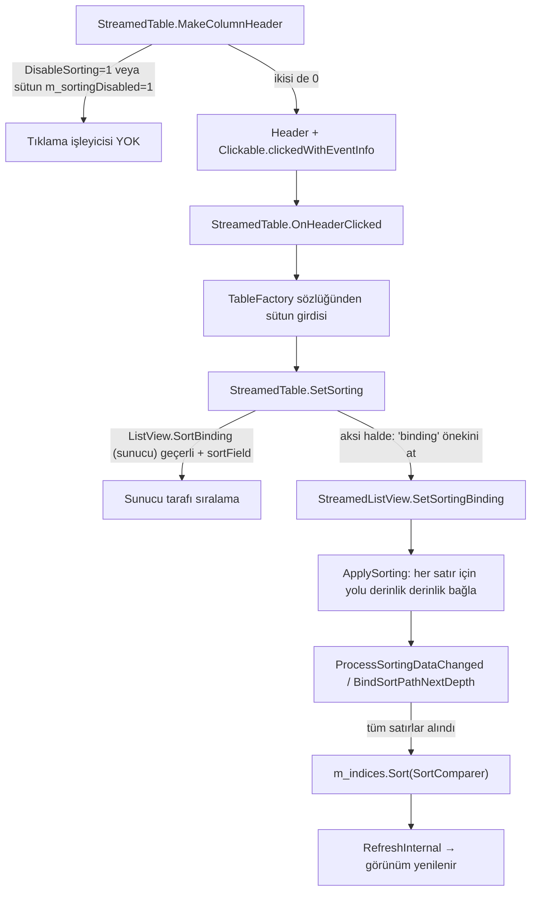

# FM27 — Gözlemcilik Öncelikleri Listesinde Sıralama (Sorting) Sorunu: Analiz ve Düzeltme

> **Durum:** Kök neden bulundu. Düzeltme uygulandı ve dosya düzeyinde doğrulandı (5.11.2026). Oyun içinde test edilmesi bekleniyor.
> **Oyun:** Football Manager 27 (`GameAssembly.dll` 59.361.792 bayt, 2.11.2026; Unity `6000.3.18f1-custom`)
> **Araç:** [`fm26save/ui_patches.py`](../fm26save/ui_patches.py) + [`fm26save/unity_bundle.py`](../fm26save/unity_bundle.py)
> **Araştırma arşivi:** [`docs/research/scouting_priorities_sorting/`](./research/scouting_priorities_sorting/README.md)

---

## İçindekiler

1. [Sorun](#1-sorun)
2. [Kısa cevap (TL;DR)](#2-kısa-cevap-tldr)
3. [Hızlı kullanım](#3-hızlı-kullanım)
4. [Kök neden: ayrıntılar](#4-kök-neden-ayrıntılar)
5. [SI.Bindable sıralama mimarisi (IL2CPP tersine mühendislik)](#5-sibindable-sıralama-mimarisi-il2cpp-tersine-mühendislik)
6. [Düzeltmenin teknik uygulanışı (UnityFS / LZ4)](#6-düzeltmenin-teknik-uygulanışı-unityfs--lz4)
7. [Riskler ve sınırlamalar](#7-riskler-ve-sınırlamalar)
8. [Araştırma süreci ve dersler](#8-araştırma-süreci-ve-dersler)
9. [Yöntem ve araçlar (tekrar üretilebilirlik)](#9-yöntem-ve-araçlar-tekrar-üretilebilirlik)
10. [Ek A — FM26 referans verileri](#ek-a--fm26-referans-verileri)

---

## 1. Sorun

FM27'de **Transfer → Oyuncu Veritabanı** gibi listelerde sütun başlığına tıklayınca sıralama çalışıyor. **Gözlemcilik → Gözlemci Öncelikleri** altındaki oyuncu listesinde ise başlığa tıklamak hiçbir şey yapmıyor.

## 2. Kısa cevap (TL;DR)

Gözlemci Öncelikleri tablosunun arayüz tanımında (UXML, `ScoutPrioritiesBlock`) tablo seviyesinde **`DisableSorting = 1`** ayarı var. `StreamedTable` bu ayar `1` olduğunda sütun başlıklarına **tıklama işleyicisi bağlamıyor**. Sorun sütunlarda değil: bütün sütunların sıralama tanımı ve görünüm ayarları sıralamaya izin veriyor.

Düzeltme bu tek baytı `1 → 0` yapmaktır. Bayt LZ4HC ile sıkıştırılmış bir Unity Addressables bundle'ının içinde olduğu için yalnızca ilgili blok yeniden sıkıştırılıyor. Sonuçta açılmış veri orijinalden **sadece bu 1 baytta** farklı.

Sports Interactive sıralamayı büyük olasılıkla **bilerek** kapattı. Bu listede satır sırası gözlem önceliği demek ve sürükle-bırak ile değiştiriliyor (`MovedItemBinding`). Ayrıntılar için [Riskler](#7-riskler-ve-sınırlamalar) bölümüne bakın.

## 3. Hızlı kullanım

Oyunu kapatın, sonra repo kökünde:

```powershell
pip install lz4                                            # yalnızca yama yazmak için gerekir
python -m fm26save.ui_patches list                         # mevcut yamalar
python -m fm26save.ui_patches status scout-priorities-sorting
python -m fm26save.ui_patches apply  scout-priorities-sorting --dry-run   # sadece doğrula
python -m fm26save.ui_patches apply  scout-priorities-sorting             # .bak yedeği alır, yazar
python -m fm26save.ui_patches restore scout-priorities-sorting            # orijinale dön
# Farklı kurulum yolu:  --fm-dir "D:\SteamLibrary\steamapps\common\Football Manager 27"
```

- İlk yazmadan önce bir kez `<bundle>.bak` yedeği oluşturulur; `restore` bu yedeği geri kopyalar.
- **Oyun güncellemesi** veya Steam'in **"Oyun dosyalarının bütünlüğünü doğrula"** seçeneği orijinal dosyayı geri getirir. Bu durumda `apply` komutunu tekrar çalıştırın.
- Araç yamalanacak baytı sabit ofsetle değil, **çapa (anchor) dizgesiyle** de doğrular: `Team.ScoutPriorities.SpecificallyScoutedPlayerMove`. Güncellemeyle ofset kayarsa baytı yeniden bulur. Beklenmeyen bir içerik görürse hiçbir şey yazmadan çıkar.

**Bu makinede uygulanan durum (5.11.2026):**

| | Değer |
|---|---|
| Yamalı dosya | `…\Football Manager 27\fm_Data\StreamingAssets\aa\StandaloneWindows64\ui-visualtreeassets_assets_globalvisualtreeassetpreload.bundle` |
| Orijinal SHA1 (`.bak`) | `f90e1712551338b4edfbaa9ae425e88a4bb8b126` (3.732.226 bayt) |
| Yamalı SHA1 | `d87cbaa5c32bc2c15cacf7be59c5519d23b64d68` (3.732.225 bayt) |

## 4. Kök neden: ayrıntılar

### 4.1 İlgili varlıklar (FM27)

| Varlık | Konum | Not |
|---|---|---|
| `ScoutPrioritiesBlock` (VisualTreeAsset, PathID `2056832882284531458`) | `ui-visualtreeassets_assets_globalvisualtreeassetpreload.bundle`, Obj 2477 | Gözlemci Öncelikleri ana tablosu |
| `tile-states-scout-priorities` (Obj 1803) | aynı bundle | Küçük karo (tile) görünümü, aynı listeyi gösterir |
| `ScoutPrioritiesTableSettings` (Obj 727) | `ui-tableviews_assets_all.bundle` | Sütun görünümü |
| `ScoutPrioritiesTileTable` (Obj 154) | `ui-tableviews_assets_all.bundle` | Karo tablosu görünümü |
| `PlayerTableFactory` (GUID `49c25af415c53814d8d3ed658d867204`, Obj 28) | `ui-tablefactories_assets_all.bundle` | Sütun hücreleri ve sıralama yolları (622 satır) |

> FM26'dan farklı olarak FM27'de bu liste artık `SpecificallyScoutedPersonTableFactory` kullanmıyor. **Oyuncu Veritabanı ile aynı `PlayerTableFactory`** kullanılıyor ve satırlar doğrudan oyuncu.

### 4.2 `ScoutPrioritiesBlock` → `StreamedTable/UxmlSerializedData` (varsayılan olmayan alanlar)

| Alan | Değer |
|---|---|
| `name` | `table` |
| `Binding` | `Team.ScoutPriorities.SpecificallyScoutedPlayers` |
| `FixedElementSize` | `36.0` |
| `SelectedItemsBinding` | `Team.ScoutPriorities.SelectedPlayers` |
| `InitFunction` | `f93b92def36a8474fa5798233a6a3fb8` (`StreamedTable_CreateColumnsFromTableViewCollection`) |
| `HeaderCellAsset` | `f45d19f7c2614ae4782f06ccd001fbb1` (Oyuncu Veritabanı ile aynı) |
| `FactoryAsset` | `49c25af415c53814d8d3ed658d867204` (`PlayerTableFactory`) |
| `ResizeColumnWidthsToFit` | `1` |
| `MovedItemBinding` | `Team.ScoutPriorities.SpecificallyScoutedPlayerMove` |
| **`DisableSorting`** | **`1`** ← kök neden (sıkıştırılmamış ofset `0x1194584`) |

### 4.3 Sütunlar ve sıralama yolları (`PlayerTableFactory`)

`ScoutPrioritiesTableSettings` içindeki tüm sütunlarda `m_sortingDisabled = 0`:

| Sütun ID | `m_sortBinding` | Sunucu sıralama eklentisi | Sıralanabilir mi? |
|---|---|---|---|
| `inf` | `binding.PlayerStatusSortOrder` | `1349412449` | ✅ |
| `drag-column` | *(boş)* | – | ❌ (sürükleme tutamacı) |
| `name` | `binding.surname` | `1851878757` | ✅ |
| `age` | `binding.DateOfBirth` | `825565216` | ✅ |
| `nation` | `binding.nation.name` | `1315856756` | ✅ |
| `club` | `binding.club.name` | `825630752` | ✅ |
| `scouted-best-position-and-role` | `binding.positioncombined` | – | ✅ |
| `recommendation-grade-only` | `binding.PlayerReportForContextTeam.OverallReportGradeInfo.Grade` | – | ✅ |
| `assigned-staff` | *(boş)* | – | ❌ |
| `progress-remaining` | *(boş)* | – | ❌ |
| `assigment-length` | *(boş)* | – | ❌ |
| `transfer-value` | `binding.transfervaluerange.SortValue` | `1228237142` | ✅ |

## 5. SI.Bindable sıralama mimarisi (IL2CPP tersine mühendislik)

Aşağıdaki zincir FM26 `GameAssembly.dll` üzerinde capstone ile disassemble edilerek çıkarıldı. RVA'lar FM26'ya aittir. Kod `com.si.bindable` paketinin ortak kodu olduğundan mantık FM27'de aynıdır; FM27 `Player.log` yığın izleri de aynı sınıf ve metod adlarını gösteriyor.



| Adım | FM26 RVA | Ayrıntı |
|---|---|---|
| `StreamedTable.MakeColumnHeader` | `0x015eac30` | `sortingDisabled = this.DisableSorting (+0x9b8) \|\| view.TryGetConfig(col).m_columnMetadata.m_sortingDisabled (+0x18→+0x11)`; `false` ise tıklama delegesi oluşturulup `Header..ctor`'a verilir |
| Tıklama lambdası | `0x0160bb80` | `OnHeaderClicked(column, shift = evt.modifiers & 1)` |
| `StreamedTable.OnHeaderClicked` | `0x015ec910` | Mevcut sıralama listesinde (`+0x8e0`) sütunu arar; yön değiştirir veya fabrikadan (`+0x988`→`+0x38`) girdi alıp `SetSorting` çağırır |
| `StreamedTable.SetSorting(List)` | `0x015efce0` | `ListView.SortBinding (+0x788)` geçerliyse sunucu sıralaması (`entry.m_sortField +0x50`); değilse `entry.m_sortBinding (+0x48)` içinden `"binding"` (StringLiteral) önekini `Bindings.GetProperties` ile atar |
| `StreamedListView.SetSortingBinding` | `0x015a9ae0` | `m_sortings (+0x738)` güncellenir, seçim korunur |
| `StreamedListView.ApplySorting` | `0x015a4260` | `depth = CountOf('.') + 1`; satır başına `SetupRow` |
| `ProcessSortingDataChanged` | `0x015a8cb0` | Ara derinlikte değer `SI.Bindable.NullReference` ise nihai kabul edilir, değilse `BindSortPathNextDepth`; tüm satırlar gelince sayaç `+0x600 == Count` olur |
| `OnSortingDataChanged` | `0x015a7ff0` | `m_indices (+0x568).Sort(m_sortComparer)` + yenileme |
| `SortComparer.Compare` | `0x015a3d30` | `NullReference` sona, `string` → `EmbeddedDataUtilities.CompareText`, diğerleri → `IComparable.CompareTo` |
| `VirtualisedList.Reorderable (+0x5c1)` | – | Yalnızca `OnStartItemDrag/OnItemDrag/OnEndItemDrag` içinde okunur; sıralamayı engellemez |

Ana veri yapıları (IL2CPP metadata, `SI.Bindable`):
- `ColumnConfiguration { m_columnID, m_columnMetadata }`
- `ColumnMetadata { m_required, m_sortingDisabled, m_widthOverride, m_minWidthOverride, m_titleTranslationIdOverride, m_applicableBreakpoints, m_optionalConfigCondition }`
- `StreamedTableView { m_viewName, m_requirements, m_optionalConfigCondition, m_tableConfig, …, m_configLookup, … }`

## 6. Düzeltmenin teknik uygulanışı (UnityFS / LZ4)

1. **Bundle biçimi:** `UnityFS` v8, başlık bayrakları `0x243` (BlocksInfo LZ4HC, blok+dizin birleşik, `0x200` = BlocksInfo sonrası 16 bayt hizalama). 219 adet 128 KiB'lık LZ4HC depolama bloğu var.
2. **Konum:** Sıkıştırılmamış ofset `0x1194584` → **blok 140** (`u_off = 0x1180000`, göreli `0x14584`, sıkıştırılmış 19.110 bayt).
3. **Yerinde düzenleme mümkün değil:** `trace_lz4_byte` ile bakıldığında bu bayt bir LZ4 *literal* değil, bir **geri referans eşleşmesinden** (`offset 12996, length 11`) üretiliyor. Bu yüzden sıkıştırılmış veride tek bayt değiştirmek yetmiyor.
4. **Yeniden oluşturma:** Blok 140 açıldı, bayt `0` yapıldı ve LZ4HC (seviye 12) ile yeniden sıkıştırıldı (19.110 → 19.109 bayt). BlocksInfo içindeki ilgili `compressedSize` güncellendi, BlocksInfo yeniden LZ4HC ile sıkıştırıldı, başlıktaki `size / cBlocksInfo / uBlocksInfo` alanları yeniden yazıldı. Diğer 218 blok bayt bayt aynı kopyalandı.
5. **Doğrulama:** Yeni dosya tamamen açılıp orijinalle karşılaştırıldı. Uzunluk aynı, fark listesi tam olarak `[0x1194584]`. Bu kontrol başarısız olursa araç hiçbir şey yazmıyor.
6. **Katalog:** Addressables `catalog.bin` içinde bu bundle için metin halinde `Crc` alanı bulunmadı. Dosya adı katalogda hash'li ad olarak geçiyor. CRC denetimi yapılıp yapılmadığı **kesin olarak doğrulanmadı** (bkz. Riskler).

## 7. Riskler ve sınırlamalar

> [!WARNING]
> - **Sürükle-bırak ile öncelik:** Bu listede satır sırası gözlem önceliğidir (`MovedItemBinding = …SpecificallyScoutedPlayerMove`). Liste bir sütuna göre sıralıyken sürükle-bırak yaparsanız yeni öncelik görünen sıraya göre değil kaynak sıraya göre yazılabilir. Önceliği değiştirmeden önce ekranı yeniden açın, yani sıralamasız görünüme dönün.
> - **CRC/bütünlük:** Addressables bundle CRC denetimi yapıyorsa ekran veya bundle yüklenmeyebilir. Böyle olursa `python -m fm26save.ui_patches restore scout-priorities-sorting` ile geri alın.
> - **Güncellemeler:** Yama, bir oyun güncellemesi veya Steam doğrulamasından sonra kaybolur. `apply` ile yeniden uygulayın.
> - **Sıralanamayan sütunlar:** Atanan gözlemci, kalan ilerleme, görev süresi ve sürükleme sütunlarının fabrikada sıralama yolu yok. Bunlar yama sonrasında da sıralanmaz.
> - **Çevrimiçi kullanım:** Yama yalnızca yerel arayüz verisini değiştirir, kayıt dosyasına veya oyun mantığına dokunmaz.

## 8. Araştırma süreci ve dersler

| Aşama | Ne yapıldı | Sonuç |
|---|---|---|
| 1 | FM26 bundle'larında `ScoutPrioritiesBlock`, `SpecificallyScoutedPersonTableFactory` ve table view'lar çözümlendi | FM26'da `DisableSorting = 0`; sütunlar çok katmanlı yollar (`binding.player.name`) |
| 2 | FM26 `GameAssembly.dll` + `global-metadata.dat` ile `StreamedTable`/`StreamedListView` sıralama zinciri, `Bindings`, `*Reference` sınıfları (`ScoutPlayerPrioritiesReference` `'wy4A'`, `SpecificallyScoutedPersonReference` `'J1Ct'`) ve 8.225 özellik adı çözüldü | Genel mekanizmada engelleyici bir şey yok |
| 3 | capstone ile `MakeColumnHeader` gating'i ve `ColumnMetadata.m_sortingDisabled` bulundu | Kapılar: tablo `DisableSorting` + sütun `m_sortingDisabled` |
| 4 | Analizin **yanlış kurulum (FM26)** üzerinde yapıldığı fark edildi; `Football Manager 27` klasörü ayrıca var | Bütün kontroller FM27'de tekrarlandı |
| 5 | FM27'de 582 bundle tarandı; ilgili UXML `ui-visualtreeassets_assets_globalvisualtreeassetpreload.bundle` içinde bulundu | **`DisableSorting = 1`** |
| 6 | Bayt LZ4 eşleşmesinden geldiği için blok bazlı yeniden sıkıştırma ile yama yapıldı, `.bak` alındı ve doğrulandı | Uygulandı |

**Dersler**
- `resolve_fm_install_dir()` birden fazla kurulum varsa ilk bulduğunu (FM26) seçiyor. FM27 çalışmalarında `--fm-dir` parametresini veya arşivdeki `use_fm27.py` yönlendirmesini kullanın.
- FM27 Addressables yapısı FM26'dan farklı: UXML'ler `ui-visualtreeassets_*preload` bundle'larında, tablo fabrikaları ve görünümleri ayrı bundle'larda.
- Bu tür "arayüz özelliği çalışmıyor" sorunlarında önce **UXML serileştirilmiş alanlarını** karşılaştırmak (`DisableSorting`, `SortBinding`, `ServerSortBinding`…) en hızlı yol.

## 9. Yöntem ve araçlar (tekrar üretilebilirlik)

| Araç | Amaç |
|---|---|
| [`fm26save/unity_bundle.py`](../fm26save/unity_bundle.py) | UnityFS okuma, açma, cerrahi bayt yaması ve LZ4 literal/eşleşme izleme |
| [`fm26save/ui_patches.py`](../fm26save/ui_patches.py) | Yama kayıt defteri + CLI (`list/status/apply/restore`, `--dry-run`, `--fm-dir`) |
| [`fm26save/binary_decompiler.py`](../fm26save/binary_decompiler.py) | `global-metadata.dat`, `GameAssembly.dll` (PropertyRegistration, `*Reference`), UnityFS açma |
| [`research/…/scripts/cs_disasm.py`](./research/scouting_priorities_sorting/scripts/cs_disasm.py) | capstone ile metod adlı x64 disassembler (`pip install capstone`) |
| [`research/…/scripts/meta_usage.py`](./research/scouting_priorities_sorting/scripts/meta_usage.py) | IL2CPP v31 metadata usage çözücü (`Il2CppMetadataRegistration` bulup tip ve string literal çözer) |
| [`research/…/scripts/decode_all_props_and_table.py`](./research/scouting_priorities_sorting/scripts/decode_all_props_and_table.py) | `PropertyRegistration.Initialise` → 8.225 FourCC ↔ özellik adı, `*Reference` özellik tabloları |
| [`research/…/scripts/fm27_scout_priorities_uxml.py`](./research/scouting_priorities_sorting/scripts/fm27_scout_priorities_uxml.py) | FM27 UXML `StreamedTable` alanlarını döker |
| [`research/…/scripts/fm27_find_factory.py`](./research/scouting_priorities_sorting/scripts/fm27_find_factory.py), [`fm27_tableviews_factories.py`](./research/scouting_priorities_sorting/scripts/fm27_tableviews_factories.py) | Fabrika sütunları, sıralama yolları ve table view `m_sortingDisabled` |
| [`research/…/scripts/tableview_sorting_disabled.py`](./research/scouting_priorities_sorting/scripts/tableview_sorting_disabled.py) | 809 table view içinde sıralaması kapalı sütun envanteri |

Araştırma betiklerinin tamamı (634 dosya) ve seçilmiş çıktılar [`docs/research/scouting_priorities_sorting/`](./research/scouting_priorities_sorting/README.md) altında arşivlendi.

---

## Ek A — FM26 referans verileri

FM26'da (`Football Manager 26\`, `GameAssembly.dll` 53.639.168 bayt) aynı ekran farklı kurulmuş:

- `ui-recruitment_assets_all.bundle` → `ScoutPrioritiesBlock` (Obj 229) ve `-Small` (Obj 263): `DisableSorting = 0`, `Reorderable = 1`, `DragCellID = drag-column`, `DragEvents = Team.ScoutPriorities.itemmoved`, `FactoryAsset = SpecificallyScoutedPersonTableFactory (399c0aa9…)`.
- `SpecificallyScoutedPersonTableFactory` sıralama yolları: `binding.player.name`, `binding.player.division.name`, `binding.player.positioncombined`, `binding.player.ClubRecruitmentReport.OverallReportGradeInfo.Grade`, `binding.Scout.Name`, `binding.player.transfervaluerange.SortValue`, `binding.player.age`, `binding.player.playerstatus`.
- `ScoutPrioritiesTable` (Obj 766) / `-Small` (Obj 791): tüm sütunlarda `m_sortingDisabled = 0`.
- ViewModel referans tipleri (FourCC → özellikler):
  - `ScoutPlayerPrioritiesReference` `'wy4A'`: `SelectedPlayers`, `SpeakTo`, `SpecificallyScoutedPlayers`, `SpecificallyScoutedPlayersCount`
  - `ScoutTeamPrioritiesReference` `'Dbwi'`: `SelectedTeams`, `SpecificallyScoutedTeams`, `SpecificallyScoutedTeamsCount`
  - `SpecificallyScoutedPersonReference` `'J1Ct'`: `Player`(→`IPlayerReference`), `Priority`, `Scout`(→`PersonReference`), `ScoutDuration`, `ScoutAssignmentMatchesLeft`, `ScoutAssignmentDaysLeft`, `ScoutAssignmentActive`
  - `SpecificallyScoutedTeamReference` `'KLCS'`: `Team`, `Priority`, `Scout`
- `StreamedTable.UxmlSerializedData.Deserialize` `0x015f36b0`, `StreamedListView.UxmlSerializedData.Deserialize` `0x015b0b50`, `PropertyRegistration.Initialise` `0x003e4f30..0x004c5d06`.
