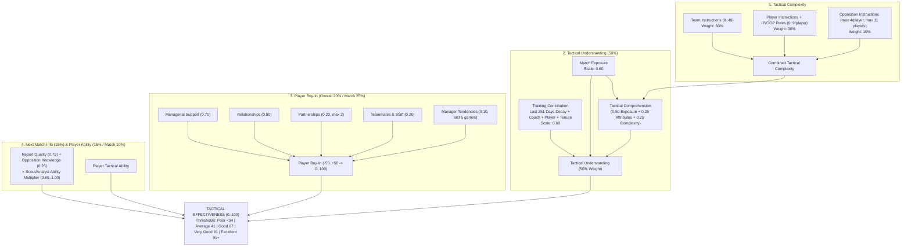

# Football Manager 27 (`FM27`) vs Football Manager 26 (`FM26`): Complete Algorithmic, Mathematical, Match Engine, Database & Binary (`.fm` / `.fmf` / `IL2CPP`) Differences Report

> **Scope & Methodology:** This report is based on a byte-level reverse-engineering comparison between the full installation trees of `C:\Program Files (x86)\Steam\steamapps\common\Football Manager 26` (`1,037` files, `7.55 GB`, DB `2620`) and `C:\Program Files (x86)\Steam\steamapps\common\Football Manager 27` (`1,279` files, `8.16 GB`, DB `2700`, Build `27.0.0+2486695`), as well as empirical `.fm` career save files (`Project_Super_Lig.fm` vs `Mahmut Çakar - Galatasaray.fm`).
>
> This document builds directly upon all 6 core FM26 reference reports in this repository and demonstrates—with exact equations, coefficients, and binary memory offsets—how every subsystem changed (or remained identical) in FM27:
> 1. [FM26_ENGINE_FORMULAS_AND_CALCULATIONS.md](./FM26_ENGINE_FORMULAS_AND_CALCULATIONS.md)
> 2. [FM26_INTERNAL_GAME_LOGICS_AND_MECHANICS.md](./FM26_INTERNAL_GAME_LOGICS_AND_MECHANICS.md)
> 3. [FM26_REVERSE_ENGINEERING_SAVE_AND_GAME_FILES.md](./FM26_REVERSE_ENGINEERING_SAVE_AND_GAME_FILES.md)
> 4. [FM26_REVERSE_ENGINEERING_METHODOLOGY_AND_FILE_TREE.md](./FM26_REVERSE_ENGINEERING_METHODOLOGY_AND_FILE_TREE.md)
> 5. [FM26_SAVE_DATABASE_SCHEMA_AND_81_SECTIONS.md](./FM26_SAVE_DATABASE_SCHEMA_AND_81_SECTIONS.md)
> 6. [FM26_TACTICAL_ROLES_AND_BREAKDOWNS.md](./FM26_TACTICAL_ROLES_AND_BREAKDOWNS.md)

---

## 1. Executive Summary: The 10 Core Systems Changed from FM26 to FM27

| # | System / Sub-Engine | FM26 Baseline (Reference Report) | FM27 State (`v27.0.0+2486695`) | Impact Severity |
| :--- | :--- | :--- | :--- | :--- |
| **1** | **Tactical Familiarity $\rightarrow$ Tactical Effectiveness & Complexity Engine** | Classic `Tactical Familiarity` bars; no tactical complexity penalty ([Report 1](./FM26_ENGINE_FORMULAS_AND_CALCULATIONS.md)) | **Brand-New Engine:** Added `simatch/constants/generated_tactical_complexity_constants.jsb`, `generated_tactical_effectiveness_constants.jsb`, and `generated_training_contribution_constants.jsb`, assigning `0..3` complexity scores (`Tactical Complexity`) to every team/player/opposition instruction and every IP/OOP role, feeding a `0..100` `Tactical Effectiveness` formula. | **REVOLUTIONARY (New Engine)** |
| **2** | **Weekly Training Engine (`training.fmf`)** | `44` sessions, `3` units (`Offensive`, `Defensive`, `Goalkeeping`), `60%/20%/20%` split, separate `session_item_effects.jsb` ([Report 2](./FM26_INTERNAL_GAME_LOGICS_AND_MECHANICS.md)) | **Rebuilt from Scratch:** `59` sessions, `6` categories (`training_session_categories.jsb`), **`4` coaching units** (`attacking`, `midfield`, `defensive`, `goalkeeping`), physical/morale effects embedded directly per session, `8` new **Tactical Understanding** and `9` new **Match Preparation** sessions. `Natural Fitness` removed from Conditioning sessions! | **REVOLUTIONARY (Rewritten)** |
| **3** | **Expected Goals (`xG`) Logistic Regression Models (`simatch.fmf`)** | Active model `26_1_4_1` (`9` version folders); Penalty xG = `76.83%` ([Report 1](./FM26_ENGINE_FORMULAS_AND_CALCULATIONS.md), [Report 3](./FM26_REVERSE_ENGINEERING_SAVE_AND_GAME_FILES.md)) | Active model **`26_8_4_34`** (`11` version folders; 4 legacy FM23/24 models removed, 6 new `26_8_*` models added). Shot angle (`angle_shot_to_goal`) reward increased by `+66.8%`, blocker count penalty (`norm_players_between`) increased by **`+61.5%` to `+113%`**! Penalty xG = **`82.68%`**. | **HIGH (Recalibrated)** |
| **4** | **Player Match Rating (`player_ratings_data.jsb`)** | Active version `v26.4.10.1`; `40` `RolePosition` bitmasks sharing `30` `role_data` tables ([Report 1](./FM26_ENGINE_FORMULAS_AND_CALCULATIONS.md)) | Active version **`v26.4.29.8`**; 5 previously shared roles split into **`35` independent `role_data` profiles**. Per-action points (`Goals`, `Assists`, `Tackles`, etc.) are unchanged, but **`90min Adjuster` was rebalanced across `36 / 40` roles** (`+0.10` to `+0.27` rating buff for midfielders/wingers/full-backs; `-0.01` to `-0.17` nerf for strikers/centre-backs/keepers). | **MEDIUM-HIGH** |
| **5** | **Quick Match Engine (`QME` — `qme_distribution_data.jsb`)** | `3,137` probability distributions (`midfielder_centre`: only `66`, `goalkeeper`: `59`) ([Report 3](./FM26_REVERSE_ENGINEERING_SAVE_AND_GAME_FILES.md)) | **`3,420` probability distributions (`+283`)**: `midfielder_centre` expanded `66` $\rightarrow$ **`263` (`+197`)** and `goalkeeper` `59` $\rightarrow$ **`110` (`+51`)**, fixing central midfielder and goalkeeper stat anomalies in background-simulated matches. | **MEDIUM** |
| **6** | **Physics, Momentum, OOP Proximity Grid & Aerial Reach** | `ball_physics_22_0_5_0.bta`, `momentum_weightings_data.jsb`, `oop_attributes_scoring.jsb`, `oop_pitch_proximity_scores.jsb`, `tables.fmf` ([Report 1](./FM26_ENGINE_FORMULAS_AND_CALCULATIONS.md), [Report 6](./FM26_TACTICAL_ROLES_AND_BREAKDOWNS.md)) | **100% Byte-for-Byte (`SHA-256`) Identical!** Ball physics, 48 spatial momentum rules, 39 OOP role attribute scorings, `118 × 24` OOP proximity matrix, and jumping/aerial reach tables are unchanged. Tactical style `.stra` presets upgraded from `rts.B B` (`v2`) $\rightarrow$ **`rts.D D` (`v4`)**. | **UNCHANGED (except `.stra` v4)** |
| **7** | **New `constants.fmf` Archive, Crowd Atmosphere (`Crowd`) & `sianim`** | No `constants.fmf`; `10` JSON schemas under `sianim` ([Report 4](./FM26_REVERSE_ENGINEERING_METHODOLOGY_AND_FILE_TREE.md)) | New `data/game_simulation/constants.fmf` (`4` `.jsb`: `colour_pair`, `match_crowd`, `shuffle_draft`, `training`); database adds `TCct`/`ccrt`/`Lctd` (`Flares`, `Confetti`, `Flags`) crowd tendencies; `sianim` schemas expanded `10` $\rightarrow$ **`62` JSON files** (`+44` match animation schemas + `8` facial/skeleton schemas). | **HIGH** |
| **8** | **Media, Portal News Engine & OOP Loan Contracts (`media.fmf`)** | Portal irrelevant story multiplier `0.5`; loan agreements tracked IP position/role only ([Report 2](./FM26_INTERNAL_GAME_LOGICS_AND_MECHANICS.md)) | `portal_weights.xml` cuts irrelevant story weight by `80%` (`0.5` $\rightarrow$ `0.1`), adds a 3-article read threshold (`portal_min_read_news_count_to_add_object_to_profile = 3`) and `7500/8500` reputation gates. Loan player unhappiness now tracks **OOP (Out-Of-Possession) position & role violations (`topi=1050, 1051`)**! | **MEDIUM-HIGH** |
| **9** | **Master Database (`2700` vs `2620`) & Licensing (`.lnc`)** | `723,010` people (`495,248` men, `41,904` women), `96,343` clubs, `988,091` names, `31` `.lnc` files ([Report 3](./FM26_REVERSE_ENGINEERING_SAVE_AND_GAME_FILES.md)) | `701,095` people (`473,764` men, **`47,736` women `+5,832`**), **`100,432` clubs (`+4,089`)**, `8,084` competitions (`+111`), **`1,063,170` names (`+75,079`)**. `lang_db.dat` Club table adds 7th string field `CLTn` (`League Table Name`). `30` restrictive `.lnc` files removed—unlocking official licenses (`Inter`, `AC Milan`, `Lazio`, `Atalanta`, `World Cup`)! | **HIGH** |
| **10** | **`.fm` Save Container & `PersonBlock` Binary Shift** | `81` `.dat`/`.cmt` sections; `PersonBlockLayout` has `1` byte (`0x03`) at `birth+12`, `nation_id` at `+13`, `personality` at `+21` ([Report 5](./FM26_SAVE_DATABASE_SCHEMA_AND_81_SECTIONS.md)) | **`75` sections** (6 `.cmt` history sections removed, 11 `.dat` sections bumped in schema version). `PersonBlock` inside `game_db.dat` and `people_db.dat` inserts **1 byte (`0x01`) at `birth+13`** (`0x03` $\rightarrow$ `0x03 0x01`), shifting `nation_id` (`13` $\rightarrow$ `14`), `personality` (`21` $\rightarrow$ `22`), and all subsequent fields by **`+1` byte**! | **CRITICAL (For Parsers / Tools)** |

---

## 2. File Tree, Unity / IL2CPP / Burst Binary Architecture & `.jsb` Format Discovery

Reference: [FM26_REVERSE_ENGINEERING_METHODOLOGY_AND_FILE_TREE.md](./FM26_REVERSE_ENGINEERING_METHODOLOGY_AND_FILE_TREE.md).

### 2.1. Installation Tree & Native Binary Comparison (`FM26` vs `FM27`)

| Component / File Path | FM26 (`v26.x`) | FM27 (`v27.0.0+2486695`) | Delta / Technical Explanation |
| :--- | :---: | :---: | :--- |
| **Total Files / Size** | `1,037` files / `7.55 GB` | `1,279` files / `8.16 GB` | `+242` files, `+625 MB` |
| `GameAssembly.dll` (IL2CPP C# $\rightarrow$ C++ Build) | `53.64 MB` (`56,244,848 B`) | `59.36 MB` (`62,243,440 B`) | **`+5.72 MB` (`+10.7%`)** — New C# classes for Tactical Effectiveness, Training, Crowd atmosphere, and Fantasy Draft. |
| `fm_Data/il2cpp_data/il2cpp.usym` (Symbol Table) | `38.52 MB` (`1,593,548` records) | `87.25 MB` (`3,601,654` records) | **`+48.74 MB` (`+126.0%` / `2.26x` symbols)** — Line/address symbol mapping table more than doubled. |
| `fm_Data/il2cpp_data/Metadata/global-metadata.dat` | `15.59 MB` (**Metadata `v31`**) | `15.68 MB` (**Metadata `v39`**) | Unity IL2CPP Metadata upgraded from `v31` to **`v39`**; `131,460` $\rightarrow$ `149,560` ASCII identifiers (`+30,036` new). |
| `fm_Data/Plugins/x86_64/lib_burst_generated.dll` | `2.0 KB` (Empty Stub) | **`1.01 MB` (`1,059,840 B`)** | **Critical Performance Change:** **Unity Burst SIMD/Jobs compilation**, which was a stub in FM26, is now active in FM27 (accelerating cloth physics, crowd compute, and skeletal animation jobs via SIMD). |
| `fm_Data/Plugins/x86_64/game_plugin.dll` (Native C++ Engine) | `514.89 MB` | `433.99 MB` | **`-80.90 MB` (`-15.7%`)** — Compiler optimization and migration of subsystems into `GameAssembly.dll` / `Burst`. |
| `fm_Data/StreamingAssets/` | `LicensedData/` + `aa/StandaloneWindows64/` | `AddrData/` + `aa/StandaloneWindows64/` | Licensed asset bundles moved from `LicensedData` to **`AddrData`** (`61` bundles); `adboards_assets_all.bundle` expanded (`68.14 MB` $\rightarrow$ `123.77 MB`, `+81.6%`). |
| `shared/data/sianim/` (Animation & Skeleton Schemas) | `10` JSON files | **`62` JSON files (`+52`)** | Added `44` match action schemas (`gk_save_*`, `kick_rabona`, `kick_overhead`, `tackle_two_footed_lunge`, `handball`, `elbow`, etc.) + `8` manager facial/skeleton (`skeletons_dev_ui_data`) JSON files. |

### 2.2. New FM27 C# Classes & Subsystems Extracted from `global-metadata.dat` (`v39`)

In FM27's `global-metadata.dat` (`v39`), **`30,036` new identifiers** not present in FM26 were extracted. Key new engine modules include:
- **New Dynamic Crowd & Atmosphere Engine (`Crowd*`):**
  `CrowdAnimationController`, `CrowdBuffers`, `CrowdColorController`, `CrowdComputeShader`, `CrowdConfigCache`, `CrowdController`, `CrowdMood`, `CrowdMoodClipPlayable`, `CrowdMoodCommentaryMap`, `CrowdMoodConditionBuilder`, `CrowdMoodConditionFlags`, `CrowdMoodEvaluation`, `CrowdMoodReactionTriggerInfoName`, `CrowdPeopleController`, `CrowdPeopleSetClimate`, `CrowdPeopleSetRegion`, `CrowdPropData`, `ApplyCrowdCharacter`, `ApplyHomeCrowdThinning`, `CalculateCrowdMood`, `BondingWithCrowd`, `AnamorphicFlaresLuminance`, `Confetti`.
- **New Tactical & In-Match Synchronization Classes:**
  `CanSyncApplyNewTacticalChanges`, `ConfirmTacticalChangesID`, `CancelTacticalChangesID`, `ChangeFromTacticalTweakID`, `CloseTacticalChangesPanel`, `BuildUpStrategy`, `PlayThroughPress`, `MatchExposure`, `MatchFlashingCommentary`, `AttackBuildupExcitedAnticipation`.
- **New Fantasy Draft / Create-A-Club Event Architecture:**
  `CreateFantasyDraftGameEvent`, `ConfirmCreateAClubFantasyDraftEvent`, `ConfirmFantasyDraftRestrictions`, `ContinueFantasyDraftGameEvent`, `DraftAllocationValues`, `CheckDraftPositionAnimationTimer`.
- **New Contract, MLS & Player Interaction References:**
  `MlsAllocationRanking`, `ConvertPlayerBackToDp`, `ContractNegotiationPatienceReference`, `ContractAddOnActivatedNewsReference`, `AskPlayerAgentAboutGenerateMarketInterest`, `CheckPlayerReadiness`.

### 2.3. New Discovery in the `.jsb` (Binary JSON) Format: Inline `Float64` Tags (`0x27` and `0x37`)

In [`parse_jsb()`](../fm26save/formulas.py#L1577-L1656) inside [`fm26save/formulas.py`](../fm26save/formulas.py), `kind == 0x07` (`Float64`) reads an `8`-byte IEEE-754 `double` when `hi == 0` and returns an inline constant when `hi > 0`. Byte-level tracing across FM27's new `simatch/constants/*.jsb` files proved the exact inline encoding for `kind == 0x07`:
- `tag = 0x07` (`hi = 0`): Followed by an `8`-byte IEEE-754 `Float64` (`struct.unpack_from("<d", buf, pos)`).
- `tag = 0x17` (`hi = 1`): Inline **`0.0`**.
- `tag = 0x27` (`hi = 2`): Inline **`0.5`** (`(hi - 1) * 0.5`).
- `tag = 0x37` (`hi = 3`): Inline **`1.0`** (`(hi - 1) * 0.5`).

> [!IMPORTANT]
> This discovery mathematically proves that all weight vectors inside `generated_tactical_effectiveness_constants.jsb` sum to exactly **`1.00`** (`0.15 + 0.10 + 0.25 + 0.50 = 1.00` and `0.15 + 0.15 + 0.20 + 0.50 = 1.00`) and that the multiplier curves inside `generated_training_contribution_constants.jsb` plateau at an exact **`1.00`** (`0x37`) ceiling after `0.95` / `0.97`.

---

## 3. FM27's Biggest Algorithmic Innovation: The `Tactical Complexity`, `Tactical Effectiveness` & `Training Contribution` Engine

Reference: [FM26_ENGINE_FORMULAS_AND_CALCULATIONS.md](./FM26_ENGINE_FORMULAS_AND_CALCULATIONS.md) & [FM26_TACTICAL_ROLES_AND_BREAKDOWNS.md](./FM26_TACTICAL_ROLES_AND_BREAKDOWNS.md).

In FM26, no matter how many Team Instructions (`TI`), Player Instructions (`PI`), or complex roles (`Box-to-Box Playmaker`, `Overlapping CB`, `False Nine`, etc.) were stacked onto a tactic, there was no explicit engine-level **"Tactical Complexity Penalty" (`Tactical Complexity`)**.

**FM27** introduces the **Tactical Effectiveness (`0..100`)** system via **3 new `.jsb` constant files** in `shared/data/simatch.fmf` and `generated_training_constants.jsb` in `data/game_simulation/constants.fmf`:
1. `simatch/constants/generated_tactical_complexity_constants.jsb` (`3,880 B`)
2. `simatch/constants/generated_tactical_effectiveness_constants.jsb` (`2,600 B`)
3. `simatch/constants/generated_training_contribution_constants.jsb` (`1,716 B`)



### 3.1. Master Tactical Effectiveness Equations

The exact mathematical model extracted from `generated_tactical_effectiveness_constants.jsb`:

- **Baseline / Default Value (`DEFAULT_VALUE`):** `50` (on a `0..100` scale)
- **High Effectiveness Threshold (`THRESHOLD_HIGH_TACTICAL_EFFECTIVENESS`):** `80` (Achievement threshold: `80`)
- **Moderate Effectiveness Threshold (`THRESHOLD_MODERATE_TACTICAL_EFFECTIVENESS`):** `66`

**Overall Tactical Effectiveness (`Overall Weights` — Training / Tactics UI):**
$$\text{Effectiveness}_{\text{General}} = 0.50 \cdot U_{\text{tactical}} + 0.20 \cdot B_{\text{buy\_in}} + 0.15 \cdot A_{\text{ability}} + 0.15 \cdot I_{\text{next\_match}}$$

**Matchday Tactical Effectiveness (`Match Weights` — Active In-Match Engine Equation):**
$$\text{Effectiveness}_{\text{Match}} = 0.50 \cdot U_{\text{tactical}} + 0.25 \cdot B_{\text{buy\_in}} + 0.15 \cdot I_{\text{next\_match}} + 0.10 \cdot A_{\text{ability}}$$

> [!NOTE]
> On **matchday**, `PLAYER_ABILITY` weight drops from `15%` to `10%`, while **`PLAYER_BUY_IN` (players' belief in the tactic and support for the manager) increases from `20%` to `25%`!**

**Score Rating Thresholds (`Score Thresholds`, `0..100`):**

| Grade | Lower Bound (`0..100`) | In-Game Band |
| :--- | :---: | :--- |
| `VERY_POOR` | `0` | Very Poor (`0 – 15`) |
| `POOR` | `16` | Poor (`16 – 33`) |
| `BELOW_AVERAGE` | `34` | Below Average (`34 – 40`) |
| `AVERAGE` | `41` | Average (`41 – 50`) |
| `ABOVE_AVERAGE` | `51` | Above Average (`51 – 66`) |
| `GOOD` | `67` | Good (`67 – 80`) — *Moderate Threshold: `66`* |
| `VERY_GOOD` | `81` | Very Good (`81 – 90`) — *High Threshold: `80`* |
| `EXCELLENT` | `91` | Excellent (`91 – 100`) |

### 3.2. Sub-Component Formulas (`Comprehension`, `Buy-In`, `Next Match Information`)

1. **Combined Tactical Complexity (`Tactical Complexity`):**
   $$C_{\text{total}} = 0.60 \cdot C_{\text{team}} + 0.30 \cdot C_{\text{player}} + 0.10 \cdot C_{\text{opposition}}$$
   - Team Instructions Complexity (`C_team`): `MIN = 0`, `MAX = 49`, `DEFAULT = 1`.
   - Per-Player Complexity (`C_player` = IP Role + OOP Role + Player Instructions): `MIN = 0`, `MAX = 9`, `DEFAULT = 1`.
   - Opposition Instructions Complexity (`C_opposition`): `MAX_COMPLEXITY_PER_PLAYER = 4`, up to `MAX_PLAYERS_FOR_COMPLEXITY = 11` opposition players (`max = 44`).

2. **Tactical Comprehension & Tactical Understanding:**
   $$\text{Comprehension} = 0.50 \cdot E_{\text{match\_exposure}} + 0.25 \cdot A_{\text{player\_attributes}} + 0.25 \cdot (100 - C_{\text{total}}^{\text{norm}})$$
   $$\text{Understanding Scale}: \quad S_{\text{match\_exposure}} = 0.60, \quad S_{\text{training\_contribution}} = 0.60$$
   - Player tactical comprehension ceiling (`Player Ability Modifier`): For attribute average `<= 1`, `MAX_EFFECTIVENESS = 50`; for `<= 12`, `85`; for `>= 13`, `100`.

3. **Player Buy-In (`MIN = -50`, `MAX = +50`):**
   $$B_{\text{raw}} = 0.70 \cdot \text{ManagerialSupport} + 0.80 \cdot \text{Relationships} + 0.20 \cdot \text{Partnerships}_{\le 2} + 0.20 \cdot \text{TeammateAndStaff} + 0.10 \cdot \text{ManagerTendencies}_{\text{last 5 games}}$$
   - `MAX_PARNERSHIPS_TO_CONSIDER = 2` (at most 2 on-pitch partnership links per player are counted).
   - `GAMES_FOR_MANAGER_TENDENCIES_ANALYSIS = 5` (evaluates how faithfully the manager adhered to their promised tactical tendencies over the last 5 matches).

4. **Next Match Information:**
   $$I_{\text{next\_match}} = \left(0.75 \cdot Q_{\text{report}} + 0.25 \cdot K_{\text{opposition\_players}}\right) \times M_{\text{analyst\_ability}}$$
   - Chief Analyst / Scout Ability Multiplier ($M_{\text{analyst\_ability}}$):
     - Ability $\le 7 \implies 0.65\times$
     - Ability $\le 9 \implies 0.70\times$
     - Ability $\le 10 \implies 0.75\times$
     - Ability $\le 12 \implies 0.80\times$
     - Ability $\le 14 \implies 0.85\times$
     - Ability $\le 15 \implies 0.90\times$
     - Ability $\le 16 \implies 0.95\times$
     - Ability $18..20 \implies \mathbf{1.00\times}$

### 3.3. Complete Complexity (`0..3`) Tables for All Team Instructions, Roles & Player Instructions

Exact complexity scores extracted from `simatch/constants/generated_tactical_complexity_constants.jsb`:

#### A. Team Instructions (`TI`) Complexity Scores (`0..3`)

| Complexity Score | Team Instructions |
| :---: | :--- |
| **`3` (Very High)** | `Pressing Intensity: MUCH_HIGHER`, `Defensive Line: MUCH_HIGHER`, `Passing Directness: MUCH_SHORTER`, `Transition: COUNTER_PRESS`, `Build Up: PLAY_THROUGH_THE_PRESS`, `Creative Freedom: BE_MORE_DISCIPLINED`, `Attacking Transition: DOWN_THE_MIDDLE` |
| **`2` (High)** | `Pressing Intensity: HIGHER`, `Defensive Line: HIGHER`, `Defensive Line Step Up: HOLD_LINE`, `Tempo: MUCH_HIGHER`, `Transition: COUNTER`, `Final Third: WORK_BALL_INTO_BOX`, `Dribbling: RUN_AT_DEFENCE`, `Time Wasting: MORE_OFTEN` |
| **`1` (Standard)** | All other non-default team instructions (`DEFAULT_COMPLEXITY = 1`, e.g., `Tempo: HIGHER/LOWER`, `Width: WIDER/NARROWER`, `Low Crosses`, `Hit Early Crosses`, `Step Up More`, etc.) |
| **`0` (Zero Complexity)** | `Build Up: BYPASS_THE_PRESS`, `Line of Engagement: DEEPER`, `Pressing Trap: INSIDE`, `Pressing Trap: OUTSIDE` (plus all `STANDARD` / `BALANCED` / `NONE` settings) |

#### B. In-Possession (`IP`) Roles Complexity Scores (`0..3`)

| Complexity Score | In-Possession (`IP`) Roles (`35` Roles) |
| :---: | :--- |
| **`3` (Most Complex — 6 Roles)** | `ADVANCED_CENTRE_BACK`, `BOX_TO_BOX_PLAYMAKER`, `FALSE_NINE`, `FREE_ROLE` (*Trequartista*), `OVERLAPPING_CENTRE_BACK`, `PLAYMAKING_WING_BACK` |
| **`2` (High — 9 Roles)** | `ADVANCED_PLAYMAKER`, `BALL_PLAYING_CENTRE_BACK`, `BALL_PLAYING_GOALKEEPER`, `DEEP_LYING_FORWARD`, `HALF_BACK`, `INSIDE_FORWARD`, `INSIDE_WING_BACK`, `MIDFIELD_PLAYMAKER`, `PLAYMAKING_WINGER` |
| **`1` (Moderate — 15 Roles)** | `ADVANCED_WING_BACK`, `BOX_TO_BOX_MIDFIELDER`, `CENTRE_BACK`, `CHANNEL_FORWARD`, `CHANNEL_MIDFIELDER`, `DEEP_LYING_PLAYMAKER`, `GOALKEEPER`, `INSIDE_FULL_BACK`, `INSIDE_WINGER`, `POACHER`, `SECOND_STRIKER` (*Shadow Striker*), `TARGET_FORWARD`, `WIDE_CENTRAL_MIDFIELDER`, `WIDE_CENTRE_BACK`, `WIDE_FORWARD` |
| **`0` (Zero Complexity — 10 Roles)** | `ATTACKING_MIDFIELDER`, `CENTRAL_MIDFIELDER`, `CENTRE_FORWARD`, `DEFENSIVE_MIDFIELDER`, `FULL_BACK`, `NO_NONSENSE_CENTRE_BACK`, `NO_NONSENSE_GOALKEEPER`, `WIDE_MIDFIELDER`, `WING_BACK`, `WINGER` |

#### C. Out-Of-Possession (`OOP`) Roles Complexity Scores (`0..3`)

| Complexity Score | Out-Of-Possession (`OOP`) Roles (`40` Entries: `39` OOP Roles + `GOALKEEPER`) |
| :---: | :--- |
| **`3` (Most Complex — 1 Role)** | `DROPPING_DEFENSIVE_MIDFIELDER` (Defensive midfielder dropping between centre-backs) |
| **`2` (High — 10 Roles)** | `INSIDE_OUTLET_WINGER`, `PRESSING_CENTRAL_MIDFIELDER`, `PRESSING_DEFENSIVE_MIDFIELDER`, `PRESSING_FULL_BACK`, `PRESSING_WING_BACK`, `SPLITTING_OUTLET_ATTACKING_MIDFIELDER`, `SPLITTING_OUTLET_CENTRE_FORWARD`, `SWEEPER_KEEPER`, `WIDE_COVER_CENTRAL_MIDFIELDER`, `WIDE_COVER_DEFENSIVE_MIDFIELDER` |
| **`1` (Moderate — 18 Roles)** | `CENTRAL_OUTLET_ATTACKING_MIDFIELDER`, `CENTRAL_OUTLET_CENTRE_FORWARD`, `COVERING_CENTRE_BACK`, `COVERING_WIDE_CENTRE_BACK`, `GOALKEEPER`, `HOLDING_FULL_BACK`, `HOLDING_WING_BACK`, `SCREENING_CENTRAL_MIDFIELDER`, `SCREENING_DEFENSIVE_MIDFIELDER`, `STOPPING_CENTRE_BACK`, `STOPPING_WIDE_CENTRE_BACK`, `TRACKING_ATTACKING_MIDFIELDER`, `TRACKING_CENTRE_FORWARD`, `TRACKING_WIDE_MIDFIELDER`, `TRACKING_WINGER`, `WIDE_OUTLET_ATTACKING_MIDFIELDER`, `WIDE_OUTLET_CENTRE_FORWARD`, `WIDE_OUTLET_WINGER` |
| **`0` (Zero Complexity — 11 Roles)** | `ATTACKING_MIDFIELDER`, `CENTRAL_MIDFIELDER`, `CENTRE_BACK`, `CENTRE_FORWARD`, `DEFENSIVE_MIDFIELDER`, `FULL_BACK`, `LINE_KEEPER`, `WIDE_CENTRE_BACK`, `WIDE_MIDFIELDER`, `WING_BACK`, `WINGER` |

#### D. Player Instructions (`PI`) Complexity Scores (`0..3`)

- **Score `3`:** `Passing Risks: TAKE_MORE`, `Marking: SPECIFIC_PLAYER`.
- **Score `2`:** `Off The Ball: MOVE_INTO_CHANNELS`, `Cross To: TARGET_MAN`, `Marking: SPECIFIC_POSITION` / `TIGHTER`, `Pass Length: SHORTER`, `Attacking Runs: GET_FORWARD_OFTEN`, `Mobility: ROAM_FROM_POSITION`, `Pressing Intensity: HIGHER`.
- **Score `0`:** `Dribbling: RUN_WIDE_WITH_BALL`, `DistributionStyle: QUICK_DELIVERY`, `Pass Length: MORE_DIRECT`, and all `NONE` instructions.
- **Score `1`:** All other active individual player instructions (`Cut Inside With Ball`, `Stay Wider`, `Hold Position`, `Shoot Less Often`, `Tackle Harder`, etc.).

### 3.4. Training Contribution & Multi-Tactic Focus Split

`simatch/constants/generated_training_contribution_constants.jsb` calculates how much each tactical training session contributes to `Tactical Understanding` across 4 multipliers:

$$\text{SessionScore} = \text{BaseRecencyScore}(\Delta \text{days}) \times M_{\text{coach}} \times M_{\text{player}} \times M_{\text{tenure}} \times M_{\text{tactic\_focus}}$$

1. **Recency Decay Bands (`Club.SCORE_BANDS` vs `National.SCORE_BANDS`):**
   - **Club Teams (`MAX_DAYS_TO_CONSIDER = 251` days):**
     - Last `0..6` days (Week `1`): **`12` points**
     - `7..13` days (Week `2`): **`9` points**
     - `14..20` days (Week `3`): **`7` points**
     - `21..41` days (Weeks `4..6`): **`6` points**
     - `42..83` days (Weeks `7..12`): **`4` points**
     - `84..251` days (Weeks `13..36`): **`2` points**
   - **National Teams (`National.SCORE_BANDS`):** `<= 6` days: `12`, `<= 13` days: `9`, `<= 100` days: `7`, `<= 199` days: `6`, `<= 300` days: `4`, `<= 365` days: `2` (`TIME_AT_NATIONAL_TEAM_MODIFIER = 0.80`).
2. **Coach Quality Multiplier ($M_{\text{coach}}$):**
   - Coach Attribute $\le 8 \implies 0.75\times$; $\le 10 \implies 0.80\times$; $\le 12 \implies 0.85\times$; $\le 14 \implies 0.90\times$; $\le 16 \implies 0.95\times$; $18..20 \implies \mathbf{1.00\times}$.
3. **Player Tactical Ability Multiplier ($M_{\text{player}}$):**
   - Player Attribute $\le 8 \implies 0.70\times$; $\le 10 \implies 0.75\times$; $\le 12 \implies 0.80\times$; $13 \implies 0.85\times$; $14 \implies 0.87\times$; $15 \implies 0.90\times$; $16 \implies 0.95\times$; $17 \implies 0.97\times$; $18..20 \implies \mathbf{1.00\times}$.
4. **Squad Tenure Multiplier ($M_{\text{tenure}}$ — `TIME_AT_TEAM_SCORE_BANDS`):**
   - New signing (`0` weeks): **`0.60x`** (`40%` penalty!)
   - `4` weeks (`1` month): `0.65x`
   - `8` weeks (`2` months): `0.70x`
   - `26` weeks (`6` months): `0.75x`
   - `52` weeks (`1` year): `0.80x`
   - `78` weeks (`1.5` years): `0.85x`
   - `104` weeks (`2` years): `0.90x`
   - `130` weeks (`2.5` years): `0.95x`
   - `156+` weeks (`3+` years): **`1.00x`** (Full contribution!)
5. **Multi-Tactic Focus Split ($M_{\text{tactic\_focus}}$ — `Tactics Modifier`):**
   - Only 1 tactic slot filled: **`100%`** (`ONLY_FOCUS = 100`)
   - 2 tactic slots filled: Primary Tactic **`80%`**, Secondary Tactic **`20%`**
   - 3 tactic slots filled: Primary Tactic **`80%`**, 2nd and 3rd Tactics **`10%` + `10%`** (`TACTICAL_SELECTION_SIMILARITY_DROP_PER_POINT = 0.1`).

---

## 4. Match Engine (`simatch.fmf`): Expected Goals (`xG`), Player Match Ratings & `QME` Differences

Reference: [FM26_ENGINE_FORMULAS_AND_CALCULATIONS.md](./FM26_ENGINE_FORMULAS_AND_CALCULATIONS.md), [FM26_REVERSE_ENGINEERING_SAVE_AND_GAME_FILES.md](./FM26_REVERSE_ENGINEERING_SAVE_AND_GAME_FILES.md), and [FM26_TACTICAL_ROLES_AND_BREAKDOWNS.md](./FM26_TACTICAL_ROLES_AND_BREAKDOWNS.md).

### 4.1. Expected Goals (`xG`) Logistic Regression Models (`v26.1.4.1` $\rightarrow$ `v26.8.4.34`)

In FM27, 4 legacy FM23/FM24 versions under `simatch/expected_goals/models/` (`23_1_1_9`, `23_7_0_5`, `23_9_9_1`, `24_1_2_3`) were removed and 6 new versions (`26_8_0_45`, `26_8_1_41`, `26_8_2_32`, `26_8_4_1`, `26_8_4_27`, **`26_8_4_34`**) were added. The active logistic regression equation for each shot type is:

$$P(\text{Goal}) = \sigma(z) = \frac{1}{1 + \exp\left(-\left(\beta_0 + \sum_{i} \beta_i x_i\right)\right)}$$

The table below shows the **exact coefficient deltas (`÷ 10^7` scale)** between FM26 (`26_1_4_1`) and FM27 (`26_8_4_34`) across all 11 shot models:

| Shot Model (`shot_type`) | Feature / Parameter ($x_i$) | FM26 (`26_1_4_1`) | FM27 (`26_8_4_34`) | Delta ($\Delta$) | Match Engine Meaning & Impact |
| :--- | :--- | :---: | :---: | :---: | :--- |
| **`regular`** *(Open-Play Foot Shot)* | `intercept` ($\beta_0$) | `-12.095904` | `-10.914457` | **`+1.181446`** | Baseline intercept raised. |
| | `norm_players_between` | `-4.648780` | **`-7.507064`** | **`-2.858284`** | **Penalty for shooting through a crowded defensive block increased by `+61.5%`!** |
| | `norm_dist_closest_occluder` | `-1.136982` | **`-2.251772`** | **`-1.114790`** | Proximity impact of the closest pressing defender increased **`~2x`**. |
| | `angle_shot_to_goal` | `+1.751007` | **`+2.920393`** | **`+1.169386`** | **Central shot angle reward increased by `+66.8%`** (tight-angle shots heavily penalized). |
| | `angle_facing_to_goal` | `+0.949741` | `+1.299703` | `+0.349962` | Body orientation facing goal reward increased by `+36.8%`. |
| | `norm_dist_to_goal` | `+13.116148` | `+12.086996` | `-1.029152` | Distance curve rebalanced with the new intercept. |
| | `fraction_goal_visible` | `-2.044291` | `-3.911993` | `-1.867702` | Goal visibility interaction rescaled alongside `norm_players_between`. |
| **`obscured_regular`** *(Unsighted Shot)* | `intercept` ($\beta_0$) | `-14.193761` | `-13.435743` | `+0.758017` | Baseline intercept rebalanced. |
| | `norm_players_between` | `-6.709227` | **`-14.302428`** | **`-7.593201`** | **Blocker penalty on unsighted long shots increased `2.13x`!** |
| | `angle_shot_to_goal` | `+0.491085` | `+2.051583` | **`+1.560498`** | Unsighted tight-angle shots reduced to near-zero probability (`4.17x` angle weight). |
| **`open_goal_regular`** *(Open Goal Shot)* | `intercept` ($\beta_0$) | `-10.867306` | `-9.887705` | `+0.979601` | Open-goal conversion baseline raised. |
| | `fraction_goal_visible` | `+1.643816` | **`+3.346593`** | **`+1.702777`** | Open-goal visibility reward increased **`2.04x`**. |
| | `norm_players_between` | `-9.888863` | `-11.972373` | `-2.083511` | Goal-line defender presence penalty increased. |
| **`headers`** *(Headed Shots)* | `intercept` ($\beta_0$) | `-28.524566` | `-25.332894` | `+3.191672` | Rescaled jointly with the distance coefficient. |
| | `norm_dist_to_goal` | `+31.697461` | `+27.196705` | `-4.500756` | Distance sensitivity smoothed. |
| | `norm_height_of_ball` | `-1.273580` | **`-0.477202`** | **`+0.796378`** | **Ball height penalty on high crosses reduced by `62.5%`!** |
| | `angle_shot_to_goal` | `-0.305592` | **`+0.777786`** | **`+1.083377`** | Fixed FM26's negative angle anomaly, properly rewarding central headers. |
| **`volleys`** *(Volleys / Half-Volleys)* | `intercept` ($\beta_0$) | `-11.265025` | `-9.389367` | `+1.875658` | Clean volley baseline probability raised. |
| | `norm_players_between` | `-3.875609` | **`-6.973450`** | **`-3.097841`** | Penalty for volleying into a crowd increased by **`+79.9%`**. |
| | `angle_shot_to_goal` | `+1.294945` | `+2.372613` | `+1.077668` | Central volley angle reward increased by `+83.2%`. |
| **`obscured_volleys`** | `norm_players_between` | `-4.384438` | **`-14.009940`** | **`-9.625502`** | Unsighted volley blocker penalty increased **`3.2x`**. |
| **`open_goal_headers`** | `intercept` ($\beta_0$) | `-35.517033` | `-28.022915` | **`+7.494118`** | Fixed open-goal header misses. |
| **`open_goal_volleys`** | `fraction_goal_visible` | `+0.750516` | **`+4.264702`** | **`+3.514186`** | Open-goal visibility reward on volleys increased **`5.68x`**. |
| **`free_kicks`** *(Direct Free Kicks)* | `intercept` ($\beta_0$) | `-4.340451` | `-6.143693` | `-1.803242` | Long-range free-kick baseline lowered. |
| | `norm_dist_to_goal` | `+3.719425` | **`+6.203608`** | **`+2.484183`** | **Close-range edge-of-box free kicks significantly buffed in xG.** |
| | `norm_dist_closest_occluder` | `-7.081996` | `-4.761418` | `+2.320578` | Excessive wall distance penalty softened. |
| **`penalties`** *(Penalties)* | `intercept` ($\beta_0$) | `+1.198467` | **`+1.562949`** | **`+0.364482`** | **Penalty xG increased from $\sigma(1.1985) = 76.83\%$ to $\sigma(1.5629) = \mathbf{82.68\%}$!** |
| **`own_goals`** | `intercept` ($\beta_0$) | `0.0` | `0.0` | `0.0` | Unchanged (`0`). |

### 4.2. Player Match Rating Engine (`player_ratings_data.jsb`: `v26.4.10.1` $\rightarrow$ `v26.4.29.8`)

Reference: [FM26_ENGINE_FORMULAS_AND_CALCULATIONS.md](./FM26_ENGINE_FORMULAS_AND_CALCULATIONS.md) Section 5.

1. **Unchanged Core Architecture:**
   - Starting match rating (`start_value`): **`6700` (`6.70`)** — unchanged.
   - Expected score multipliers (`expected_score_data`): `1.20x` / `1.10x` — unchanged.
   - Per-action rating deltas across all 51 match events (`Goals`, `Assists`, `Key Passes`, `Tackles`, `Interceptions`, `Mistakes`, etc.) are **100% identical**.
2. **`role_data` Table Expansion (`30` $\rightarrow$ `35` Profiles):**
   - In FM26, `40` `RolePosition` bitmasks mapped onto `30` `role_data` tables (bitmasks `262144`, `524288`, `2147483648`, `2199023255552`, and `9007199254740992` shared tables `8, 10, 11`).
   - FM27 (`v26.4.29.8`) splits those 5 roles into dedicated tables (`indices 16, 17, 21, 24, 31`), expanding `role_data` from **`30` to `35` profiles**.
3. **`90min Adjuster` Rebalancing Across 40 Roles:**
   In FM26, midfielders, wingers, and full-backs often stagnated around `6.3 – 6.5` when they did not register a goal or assist due to harsh negative `90min Adjuster` values, while strikers and centre-backs enjoyed milder baselines. In FM27, **`90min Adjuster` was rebalanced across `36 / 40` roles**:

| Role Bitmask (`role`) | Position / Role Mapping | FM26 `90min Adjuster` | FM27 `90min Adjuster` | 90-Min Rating Delta (`÷1000`) | Direction |
| :--- | :--- | :---: | :---: | :---: | :---: |
| `4294967296` (`2^32`) | Specialized Playmaker / Midfield Role | `-850` | **`-580`** | **`+0.270` pts** | **Biggest Buff** |
| `128` (`2^7`) | `ML / MR` (Wide Midfielder) | `-1000` | **`-760`** | **`+0.240` pts** | **Huge Buff** |
| `274877906944` (`2^38`) | Wide Midfielder / Winger Role | `-940` | **`-700`** | **`+0.240` pts** | **Huge Buff** |
| `35184372088832` (`2^45`) | Attacking Midfielder / Winger Role | `-1090` | **`-860`** | **`+0.230` pts** | **Huge Buff** |
| `64` (`2^6`) & `562949953421312` | `MC` (Central Midfielder) | `-750` | **`-570`** | **`+0.180` pts** | **Major Buff** |
| `4503599627370496` (`2^52`) | Central / Box-to-Box Midfielder | `-740` | **`-570`** | **`+0.170` pts** | **Major Buff** |
| `2199023255552` (`2^41`) | Secondary Playmaker / Midfielder | `-810` | **`-650`** | **`+0.160` pts** | **Major Buff** |
| `36028797018963968` (`2^55`) | Winger / Inside Forward Role | `-790` | **`-630`** | **`+0.160` pts** | **Major Buff** |
| `134217728` (`2^27`) | Attacking / Free Role | `-865` | **`-730`** | **`+0.135` pts** | **Buff** |
| `8796093022208` (`2^43`) | Full-Back / Inverted Full-Back Role | `-600` | **`-470`** | **`+0.130` pts** | **Buff** |
| `144115188075855872` (`2^57`) | Defensive / Support Role | `-550` | **`-430`** | **`+0.120` pts** | **Buff** |
| `8` (`2^3`) | `SW / DC` Variant | `-800` | **`-690`** | **`+0.110` pts** | **Buff** |
| `512` (`2^9`) & `72057594037927936` | `AMC` (Attacking Midfielder Centre) | `-810` | **`-700`** | **`+0.110` pts** | **Buff** |
| `4` (`2^2`) & `65536` (`2^16`) | `DL / DR` (Full-Backs) | `-530` / `-600` | **`-430` / `-500`** | **`+0.100` pts** | **Buff** |
| `70368744177664` (`2^46`) | Winger (`AML / AMR`) Variant | `-720` | **`-630`** | **`+0.090` pts** | **Buff** |
| `131072` & `2251799813685248` | Midfielder / DM Variant | `-670` | **`-600`** | **`+0.070` pts** | **Buff** |
| `32` (`2^5`) & `281474976710656` | `DM` (Defensive Midfielder) | `-440` | **`-380`** | **`+0.060` pts** | **Buff** |
| `16` (`2^4`) & `34359738368` | `WBL / WBR` (Wing-Backs) | `-680` | **`-640`** | **`+0.040` pts** | **Buff** |
| `2` (`2^1`) | `DC` (Centre-Back) | `-520` | **`-530`** | **`-0.010` pts** | *Slight Nerf* |
| `2147483648` (`2^31`) | Special Role (New Table #21) | `-600` | **`-620`** | **`-0.020` pts** | *Slight Nerf* |
| `1` (`2^0`), `4096`, `524288` | `GK` (Goalkeeper) & Special Roles | `-720/-770/-600` | **`-750/-800/-630`** | **`-0.030` pts** | *Slight Nerf* |
| `2048` (`2^11`) | `STC` (Striker) | `-600` | **`-690`** | **`-0.090` pts** | **Nerf** |
| `18014398509481984` (`2^54`) | Poacher / Striker Role | `-690` | **`-860`** | **`-0.170` pts** | **Biggest Nerf** |

### 4.3. Quick Match Engine (`QME` — `simatch/qme_distribution_data.jsb`)

- Total statistical probability distributions increased from **`3,137` to `3,420` (`+283`)**:
  - `poisson`: `1,803` $\rightarrow$ **`2,005` (`+202`)**
  - `normal`: `630` $\rightarrow$ **`676` (`+46`)**
  - `binned`: `580` $\rightarrow$ **`620` (`+40`)**
  - `zero`: `124` $\rightarrow$ **`119` (`-5`)**
- **Why Did It Change?** In FM26, only `66` distributions were defined for `midfielder_centre` and `59` for `goalkeeper` (compared to `~200` for other positions). In FM27, **`midfielder_centre` expanded from `66` $\rightarrow$ `263` (`+197`)** and **`goalkeeper` from `59` $\rightarrow$ `110` (`+51`)** (plus `midfielder_right` `200` $\rightarrow$ `223` and `midfielder_left` `199` $\rightarrow$ `202`), eliminating stat generation gaps for central midfielders and goalkeepers in Quick Match Engine (`QME`) background-simulated matches.
- **Unchanged Engine Files (`100%` Byte-for-Byte Identical):**
  - `simatch/qme_stat_relevant_attribute_data.jsb` (`22` stat $\leftrightarrow$ attribute mappings)
  - `simatch/momentum_weightings_data.jsb` (`48` spatial momentum rules)
  - `simatch/oop_attributes_scoring.jsb` (`39` OOP role attribute weight tables)
  - `simatch/oop_pitch_proximity_scores.jsb` (`118 × 24` OOP pitch proximity score matrix)
  - `simatch/physics/ball_physics_22_0_5_0.bta` (`849 B`)
  - `simatch/weights.jsb` (`4 × 40` `TSF_*` AI team selection weights are numerically 100% identical; only the metadata key `"ME_VERSION"` was renamed to `"WEIGHTS_DATA_VERSION": 0`)
  - `data/game_simulation/tables.fmf` (`aerial_reach.jsb`, `jumping_reach.jsb`) and `shared/data/simatchshared.fmf` (`75` frames)
  - `simatch/tactics/*.tac` (`90` binary formation presets are identical; however, the `11` `.stra` tactical style vectors were upgraded from `rts.B B` (`v2`) to **`rts.D D` (`v4`)**).

---

## 5. Weekly Training Engine (`training.fmf`): Transition from 3 Units to 4 Units & `59` New Session Schemas

Reference: [FM26_ENGINE_FORMULAS_AND_CALCULATIONS.md](./FM26_ENGINE_FORMULAS_AND_CALCULATIONS.md) Section 7 and [FM26_REVERSE_ENGINEERING_SAVE_AND_GAME_FILES.md](./FM26_REVERSE_ENGINEERING_SAVE_AND_GAME_FILES.md).

In FM27, the `data/game_simulation/training.fmf` archive was completely redesigned:
- **Removed File:** `training/session_item_effects.jsb` (the legacy `62`-item physical/morale sub-component table) was removed; physical and morale deltas (`condition`, `fatigue`, `happiness`, `injuries`, `sharpness`) are now embedded directly inside each session definition in `training/training_sessions.jsb`.
- **New File Added:** `training/training_session_categories.jsb` (`6` primary training categories and weekly cap limits).
- **Coaching Units (`3` $\rightarrow$ `4` Units):** FM26's 3-unit model (`Offensive`, `Defensive`, `Goalkeeping`) with `primary/secondary/tertiary` (`60% / 20% / 20%`) splits was replaced by **4 direct unit buckets**:
  1. **`attacking`** *(Attacking Unit)*
  2. **`midfield`** *(Midfield Unit — NEW!)*
  3. **`defensive`** *(Defensive Unit)*
  4. **`goalkeeping`** *(Goalkeeping Unit)*

### 5.1. New Training Categories (`training_session_categories.jsb`)

| Category ID | Category Name (`name`) | Max Sessions / Week (`max_sessions_per_week`) | Per-Match Limit (`considers_limits_per_match`) | Role & Mechanical Impact |
| :---: | :--- | :---: | :---: | :--- |
| `1` | **`Match Preparation`** | **`9`** | `true` | Next-match tactical focus and set-piece sessions (`Sharpness +2`). |
| `2` | **`Tactical Understanding`** | **`16`** | `false` | Does not develop `CA` attributes; directly fills **Section 3's `Tactical Understanding` score**! |
| `3` | **`Footballing Development`** | **`21`** | `false` | Develops player attributes (`CA`) across all 4 coaching units (`Attacking, Midfield, Defensive, GK`). |
| `4` | **`Physical & Recovery`** | **`21`** | `false` | Conditioning, rest, recovery, and physical attribute (`Conditioning`) sessions. |
| `5` | **`Extra-Curricular`** | **`2`** | `false` | Team cohesion (`Team Bonding`), community outreach, and match travel (`Travel`). |
| `6` | **`Match`** | **`7`** | `false` | Weekly competitive/friendly match slots. |

### 5.2. Complete Parameter & Attribute Table for All `59` FM27 Training Sessions (`training_sessions.jsb`)

The tables below document all `59` training sessions in FM27 (up from `44` in FM26), including their exact physical/morale deltas (`condition`, `fatigue`, `happiness`, `injuries`, `sharpness`), weekly caps, and 4-unit attribute lists:

#### A. `Tactical Understanding` Sessions (`8` New Sessions — All `max = 8/week`)
> **Critical Mechanic:** The `attributes` arrays for all 8 of these sessions are **empty** (they do not train `CA`). Their sole purpose is to boost the squad's **Tactical Understanding (`Tactical Understanding` $\rightarrow$ `Tactical Effectiveness`)** multiplier with mild physical load (`cond: -1, fat: 0, hap: 0, inj: -1, shp: +1`).

| Session Name (`name`) | `cond` | `fat` | `hap` | `inj` | `shp` | Weekly Max | Tactical Dimension Fed |
| :--- | :---: | :---: | :---: | :---: | :---: | :---: | :--- |
| **`Passing Style`** | `-1` | `0` | `0` | `-1` | `+1` | `8` | Passing Directness & Tempo complexity |
| **`Build Up`** | `-1` | `0` | `0` | `-1` | `+1` | `8` | Build-Up (`Play Through / Bypass Press`) complexity |
| **`Chance Creation`** | `-1` | `0` | `0` | `-1` | `+1` | `8` | Final Third / Chance Creation complexity |
| **`In Possession Shape`** | `-1` | `0` | `0` | `-1` | `+1` | `8` | In-Possession (`IP`) formation & role transitions |
| **`Line of Engagement`** | `-1` | `0` | `0` | `-1` | `+1` | `8` | Line of Engagement & Defensive Line (`High/Mid/Low Block`) |
| **`Pressing Intensity`** | `-1` | `0` | `0` | `-1` | `+1` | `8` | Pressing Intensity (`Trigger Press` & `Prevent Short GK`) |
| **`Pressing Trap`** | `-1` | `0` | `0` | `-1` | `+1` | `8` | Pressing Traps (`Trap Inside / Trap Outside`) |
| **`Out Of Possession Shape`** | `-1` | `0` | `0` | `-1` | `+1` | `8` | Out-Of-Possession (`OOP`) formation & role structure |

#### B. `Match Preparation` Sessions (`9` Sessions — All `max = 1/week`, `cond: -1, fat: 0, hap: 0, inj: -1, shp: +2`)

| Session Name | `Attacking` Unit Attributes | `Midfield` Unit Attributes | `Defensive` Unit Attributes | `Goalkeeping` Unit Attributes |
| :--- | :--- | :--- | :--- | :--- |
| **`Press Avoidance`** | `Anticipation, Composure, Decisions, Off The Ball, Teamwork` | `Anticipation, Composure, Decisions, First Touch, Off The Ball, Passing, Teamwork, Vision` | `Anticipation, Composure, Concentration, Decisions, First Touch, Passing, Teamwork, Vision` | `Anticipation, Composure, Concentration, Decisions, Kicking, Passing, Throwing, Vision` |
| **`Ball Progression`** | `Anticipation, Decisions, Dribbling, First Touch, Off The Ball, Passing, Teamwork, Vision` | `Anticipation, Composure, Decisions, Dribbling, First Touch, Off The Ball, Passing, Teamwork, Vision` | `Anticipation, Composure, Decisions, Dribbling, First Touch, Off The Ball, Passing, Vision` | `Anticipation, Composure, Decisions, First Touch, Kicking, Passing, Throwing, Vision` |
| **`Final Third`** | `Anticipation, Composure, Decisions, Finishing, First Touch, Off The Ball, Teamwork, Vision` | `Anticipation, Composure, Crossing, Decisions, Finishing, First Touch, Long Shots, Off The Ball, Passing, Vision` | `Anticipation, Composure, Crossing, Decisions, Off The Ball, Passing, Teamwork, Vision` | `Anticipation, Command Of Area, Communication, Concentration, Kicking, One On Ones, Passing, Throwing` |
| **`Defensive Block`** | `Anticipation, Concentration, Decisions, Positioning, Teamwork, Work Rate` | `Anticipation, Concentration, Decisions, Marking, Positioning, Tackling, Teamwork, Work Rate` | `Anticipation, Concentration, Decisions, Marking, Positioning, Tackling, Teamwork, Work Rate` | `Anticipation, Command Of Area, Communication, Concentration, Decisions, Positioning` |
| **`Defensive Positioning`** | `Anticipation, Concentration, Decisions, Marking, Positioning, Teamwork` | `Anticipation, Concentration, Decisions, Marking, Positioning, Teamwork` | `Anticipation, Bravery, Concentration, Decisions, Heading, Marking, Positioning, Teamwork` | `Aerial Reach, Anticipation, Command Of Area, Communication, Concentration, Decisions, Positioning, Rushing Out` |
| **`Defensive Engagement`** | `Aggression, Anticipation, Bravery, Decisions, Marking, Tackling, Teamwork, Work Rate` | `Aggression, Anticipation, Bravery, Decisions, Marking, Positioning, Tackling, Teamwork, Work Rate` | `Aggression, Anticipation, Bravery, Composure, Decisions, Marking, Positioning, Tackling, Teamwork` | `Anticipation, Bravery, Command Of Area, Communication, Decisions, One On Ones, Positioning, Rushing Out` |
| **`Corners`** | `Anticipation, Bravery, Corners, Heading, Marking, Off The Ball, Positioning` | `Anticipation, Bravery, Corners, Heading, Marking, Off The Ball, Positioning` | `Anticipation, Bravery, Corners, Heading, Marking, Off The Ball, Positioning` | `Aerial Reach, Anticipation, Bravery, Catching, Command Of Area, Communication, High Balls, Positioning, Punching` |
| **`Free Kicks`** | `Anticipation, Bravery, Crossing, Free Kick Taking, Heading, Long Shots, Marking, Off The Ball, Positioning` | `Anticipation, Bravery, Crossing, Free Kick Taking, Heading, Long Shots, Marking, Off The Ball, Positioning` | `Anticipation, Bravery, Crossing, Free Kick Taking, Heading, Long Shots, Marking, Off The Ball, Positioning` | `Aerial Reach, Anticipation, Bravery, Catching, Command Of Area, Communication, High Balls, Positioning, Punching, Reflexes, Shot Stopping` |
| **`Penalties`** | `Composure, Penalty Taking` | `Composure, Penalty Taking` | `Composure, Penalty Taking` | `Agility, Anticipation, Composure, Concentration, Decisions, Reflexes, Shot Stopping` |

#### C. `Footballing Development` Sessions (`29` Sessions — All `max = 7/week`, `cond: -1, fat: -1, hap: +1, inj: -1, shp: 0` [except `Defensive Ball Work`: `shp: +1`])

| Session Group | Session Name (`name`) | Summary of Trained Attributes Across the 4 Units (`Attacking / Midfield / Defensive / Goalkeeping`) |
| :--- | :--- | :--- |
| **Individual** | **`Individual Development`** | Trains each player's selected `Individual Role / Attribute Focus` (general unit pools are empty; delegates to individual role focus). |
| **Ball Work (`3`)** | **`Attacking Ball Work`** | **Att:** `Dribbling, Finishing, First Touch, Flair, Heading, Off The Ball, Passing, Technique` \| **Mid:** `Crossing, Dribbling, First Touch, Flair, Long Shots, Off The Ball, Passing, Technique, Vision` \| **Def:** `Crossing, Dribbling, First Touch, Heading, Long Throws, Passing, Technique` \| **GK:** `First Touch, Kicking, Passing, Technique, Throwing` |
| | **`Defensive Ball Work`** *(`shp: +1`)* | **Att/Mid/Def:** `Aggression, Bravery, Heading, Marking, Positioning, Tackling, Work Rate` \| **GK:** `Aerial Reach, Bravery, Catching, Command Of Area, High Balls, One On Ones, Punching, Reflexes, Rushing Out, Shot Stopping` |
| | **`Possession Ball Work`** | **Att/Mid/Def:** `Agility, Balance, Composure, Decisions, Dribbling, First Touch, Off The Ball, Passing, Technique, Teamwork, Vision` \| **GK:** `Agility, Balance, Composure, Decisions, First Touch, Handling, Kicking, Passing, Reflexes, Technique, Throwing, Vision` |
| **Attacking Organization (`4`)** | **`Attacking - Balanced`** | **Att:** `Composure, Decisions, Dribbling, Finishing, First Touch, Flair, Off The Ball, Passing, Teamwork, Vision` \| **Mid:** `Composure, Crossing, Decisions, Dribbling, First Touch, Long Shots, Off The Ball, Passing, Teamwork, Vision` \| **Def:** `Composure, Decisions, First Touch, Off The Ball, Passing, Teamwork, Vision` \| **GK:** `Composure, Decisions, First Touch, Kicking, Passing, Throwing, Vision` |
| | **`Attacking - Patient`** | Patient probing and space creation (`Anticipation, Composure, Decisions, First Touch, Flair, Off The Ball, Passing, Teamwork, Technique, Vision`). |
| | **`Attacking - Direct`** | Vertical direct attacking (`Anticipation, Crossing, Decisions, Dribbling, Finishing, First Touch, Heading, Long Shots, Off The Ball, Passing, Teamwork, Vision`). |
| | **`Attacking - Wings`** | Wide combinations and box runs (`Crossing, Dribbling, Finishing, First Touch, Flair, Heading, Off The Ball, Passing, Teamwork, Technique`). |
| **Defensive Organization (`4`)** | **`Defending - Balanced`** | Balanced defending (`Anticipation, Bravery, Concentration, Decisions, Heading, Marking, Positioning, Tackling, Teamwork, Work Rate`). |
| | **`Defending - Engaged`** | High-pressing front-foot defending (`Aggression, Anticipation, Bravery, Concentration, Decisions, Marking, Positioning, Tackling, Teamwork, Work Rate` + GK `Rushing Out, One On Ones`). |
| | **`Defending - Disengaged`** | Deep block and spatial coverage (`Anticipation, Composure, Concentration, Decisions, Heading, Marking, Positioning, Teamwork`). |
| | **`Defending - Wide`** | Wide defending and cross prevention (`Anticipation, Bravery, Concentration, Decisions, Heading, Marking, Positioning, Tackling, Teamwork, Work Rate` + GK `Aerial Reach, High Balls`). |
| **Theory Shadow Play (`2`)** | **`Theory - Attacking Shadow Play`** | `Anticipation, Composure, Decisions, Off The Ball, Teamwork, Vision` (mental attacking development across all 4 units). |
| | **`Theory - Defensive Shadow Play`** | `Anticipation, Communication (GK), Concentration, Decisions, Positioning, Teamwork` (mental defensive development across all 4 units). |
| **Technical Specialization (`5`)** | **`Technical - Chance Creation`** | `Crossing, Decisions, Dribbling, First Touch, Flair, Off The Ball, Passing, Technique, Vision`. |
| | **`Technical - Chance Conversion`** | **Att:** `Composure, Decisions, Finishing, First Touch, Heading, Long Shots, Off The Ball, Technique` \| **GK:** `Agility, Handling, One On Ones, Positioning, Reflexes, Shot Stopping`. |
| | **`Technical - Ball Retention`** | `Balance, Composure, Concentration, Decisions, Dribbling, First Touch, Off The Ball, Passing, Shielding/Strength, Teamwork, Technique`. |
| | **`Technical - Ground Defence`** | `Aggression, Agility, Anticipation, Balance, Bravery, Decisions, Marking, Positioning, Tackling` \| **GK:** `Agility, Bravery, One On Ones, Positioning, Reflexes, Rushing Out, Shot Stopping`. |
| | **`Technical - Aerial Defence`** | `Aerial Reach (GK), Aggression, Anticipation, Balance, Bravery, Catching/High Balls/Punching (GK), Decisions, Heading, Jumping Reach, Marking, Positioning, Strength`. |
| **Transitions (`3`)** | **`Transition - Restrict`** | Post-loss counter-pressing / spatial restriction (`Aggression, Anticipation, Bravery, Concentration, Decisions, Marking, Positioning, Tackling, Teamwork, Work Rate`). |
| | **`Transition - Press`** | Ball recovery & high-intensity pressing (`Aggression, Anticipation, Bravery, Decisions, Marking, Positioning, Stamina, Tackling, Teamwork, Work Rate`). |
| | **`Transition - Progress`** | Fast counter-attacking progression (`Acceleration, Anticipation, Composure, Decisions, Dribbling, First Touch, Off The Ball, Passing, Pace, Teamwork, Vision`). |
| **Goalkeeping Focus (`5`)** | **`GK - Balanced`** | **GK:** `Aerial Reach, Agility, Catching, Command Of Area, Communication, Concentration, Decisions, First Touch, Handling, High Balls, Kicking, One On Ones, Passing, Positioning, Punching, Reflexes, Rushing Out, Shot Stopping, Throwing`. |
| | **`GK - Shot Stopping`** | **GK:** `Agility, Anticipation, Bravery, Concentration, Decisions, Handling, Positioning, Reflexes, Shot Stopping` (Outfield players: `Finishing, Long Shots, Technique`). |
| | **`GK - Handling`** | **GK:** `Aerial Reach, Agility, Catching, Command Of Area, Concentration, First Touch, Handling, High Balls, Punching, Technique`. |
| | **`GK - One On Ones`** | **GK:** `Acceleration, Agility, Anticipation, Bravery, Composure, Decisions, One On Ones, Positioning, Reflexes, Rushing Out, Shot Stopping` (Attackers: `Composure, Dribbling, Finishing, Off The Ball`). |
| | **`GK - Distribution`** | **GK:** `Composure, Decisions, First Touch, Kicking, Passing, Technique, Throwing, Vision`. |
| **Set Pieces (`2`)** | **`Set Pieces - Delivery`** | `Corners, Crossing, Free Kick Taking, Long Throws, Technique` + Penalty-box aerial attributes (`Heading, Jumping Reach, Off The Ball, Aerial Reach`). |
| | **`Set Pieces - Penalties`** | `Composure, Penalty Taking` \| **GK:** `Agility, Anticipation, Composure, Concentration, Decisions, Reflexes, Shot Stopping`. |

#### D. `Physical & Recovery`, `Extra-Curricular` & `Match` Sessions (`13` Sessions)

| Category | Session Name (`name`) | `cond` | `fat` | `hap` | `inj` | `shp` | Weekly Max | Trained Attributes & Key Changes |
| :--- | :--- | :---: | :---: | :---: | :---: | :---: | :---: | :--- |
| **Physical & Recovery** | **`Rest`** | `+3` | `+1` | `+2` | `0` | `-3` | `21` (`ignores_limits`) | Trains no attributes; full rest. |
| | **`Recovery`** | `+1` | `+2` | `+1` | `+1` | `-2` | `7` | Trains no attributes; reduces fatigue and injury risk. |
| | **`Light Conditioning`** | `-1` | `-1` | `-1` | `-2` | `-1` | `7` | Trains no attributes; light physical conditioning load. |
| | **`Conditioning`** | `-3` | `-2` | `-2` | `-2` | `-1` | `7` | `Acceleration, Agility, Balance, Jumping Reach, Pace, Stamina, Strength, Work Rate` (+ GK `Aerial Reach`). **IMPORTANT:** `Natural Fitness` (present in FM26) was **removed**! |
| | **`Heavy Conditioning`** | `-3` | `-3` | `-3` | `-2` | `-1` | `7` | Same 8 physical attributes (+ GK `Aerial Reach`); heavy pre-season workload. |
| | **`Rest (IM)` / `Recovery (IM)` / `Light Conditioning (IM)` / `Not Available`** | `0` | `0` | `0` | `0` | `0` | `21` / `7` | International Management (`IM`) and locked slot sessions (`4` separate session entries). |
| **Extra-Curricular** | **`Team Bonding`** | `+1` | `0` | **`+3`** | `0` | `-3` | `2` | Team cohesion and morale (`Happiness +3`). |
| | **`Community Outreach`** | `+1` | `0` | **`+3`** | `0` | `-3` | `2` | Community outreach event (`Happiness +3`). |
| | **`Travel`** | `+1` | `0` | `0` | `0` | `-3` | `21` (`ignores_limits`) | Away match travel slot. |
| **Match** | **`Match`** | `0` | `0` | `0` | `0` | `0` | `7` (`ignores_limits`) | Competitive / friendly match slot (`category = 6`). |

---

## 6. Gameplay, Media, Portal News Algorithm & Editor Schema Differences (`media.fmf`, `editor.fmf`, `simatch.fmf`)

### 6.1. Out-Of-Possession (`OOP`) Loan Contract Promises & Unhappiness Engine (`media.fmf`)
FM26 introduced the dual `IP / OOP` (In-Possession / Out-Of-Possession) formation system, but loan contract promises only tracked a player's single (`IP`) position and role. In FM27, additions across 4 XML files inside `data/game_simulation/media.fmf` expand loan tracking to cover **both `IP` and `OOP` formations**:
- `player loan unhappiness not played in agreed position.xml` (`+193` lines): Added topic `1050` (`OWN_PLAYER_INTERACTION_TOPIC_DROP_LOAN_UNHAPPINESS_NOT_PLAYING_IN_AGREED_OOP_POSITION`, `cmid = 39800`).
- `player loan unhappiness not played in agreed role.xml` (`+192` lines): Added topic `1051` (`OWN_PLAYER_INTERACTION_TOPIC_DROP_LOAN_UNHAPPINESS_NOT_PLAYING_IN_AGREED_OOP_ROLE`, `cmid = 40400`).
- `loan player out of position.xml` (`+306` lines) and `loan player out of role.xml` (`+306` lines): Added dialogue trees for the loaning manager to warn or recall a player when not fielded in the agreed **`OOP` position or `OOP` role**.

### 6.2. Portal News Feed Prioritization Algorithm (`media/portal/portal_weights.xml`)
One of the most frequent community complaints in FM26—*"irrelevant league and national team news cluttering the Portal screen"*—was resolved by recalibrating the `portal_weights.xml` coefficients:

| Portal Algorithm Parameter | FM26 Value | FM27 Value | Change & Algorithmic Impact |
| :--- | :---: | :---: | :--- |
| `portal_news_factor_irrelevant_story` | `0.50` | **`0.10`** | Score multiplier for irrelevant news **slashed by `80%`!** |
| `portal_news_factor_less_irrelevant_story` | `0.75` | **`0.50`** | Weight for low-relevance stories reduced by `33.3%`. |
| `portal_club_division_weight` | `0.60` | **`0.80`** | Weight for club news within the user's own division **increased by `+33.3%`**. |
| `portal_human_club_nation_national_team` | `0.40` | **`0.10`** | Host nation's national team news noise reduced by `75%`. |
| `portal_transfer_query_team_nation_weight` | *(None)* | **`0.001`** | Prevents irrelevant transfer rumors from appearing solely because clubs share a nation. |
| `portal_min_read_news_count_to_add_object_to_profile` | *(None)* | **`3`** | A club/player is not added to the user's interest profile until **at least `3` articles** about them are read. |
| `portal_boost_for_transfer_query_on_selected_news` | *(None)* | **`1.20`** | Applies a `1.20x` priority boost to clubs associated with transfer stories clicked by the user. |
| `portal_high_rep_person_rep_threshold` / `club_rep_threshold` | *(None)* | **`7500` / `8500`** | Defines global star person (`>= 7500`) and elite club (`>= 8500`) news thresholds (`cap = 2.0`). |

### 6.3. Database & In-Game Editor Schema Additions (`shared/data/editor.fmf`)
Changes across `25` XML schema files in `editor.fmf` directly explain the new fields added to the master database (`2700`) and save file (`.fm`) binary structures:
1. **`CLTn` (`club.xml`), `C2lt` (`club b team.xml`), `C3lt` (`club c team.xml`), `C4lt` (`club d team.xml`):** Added **`League Table Name`** (`is_client_field="true" is_language_field="true"`).
2. **`TCct` (`club.xml`, `national team container.xml`), `ccrt` (`comp.xml`), `Lctd` (`local region.xml`):** Added **`Crowd Tendencies`** (`multiple_enum`: `1 = Flares`, `2 = Confetti`, `4 = Flags`, etc.) governing match atmosphere.
3. **`Scnm` (`stadium.xml`):** Added **`Stadium Continental Name`** used in UEFA / FIFA competitions in place of sponsored stadium names.
4. **`N100` (`non player.xml`, `person filter.xml`):** Added **`"Have experienced leaders in squad"`** (`0..20` tendency for managers and directors of football).
5. **MLS `U22 Initiative Player (USA)` (`person.xml`):** Added `20 = U22 Initiative Player (USA)` to contract squad status enums; additionally made player height (`Phei`) editable in the In-Game Editor (`IGE`).
6. **Points Deduction Reasons (`pdrs` — `db enums.xml`) & Coefficient Controls (`CPdl` / `ChCf` — `comp ui.xml`):** Added `1 = Match Fixing`, `2 = Crowd Disorder`, `5 = Fielding Ineligible Player`, `6 = Violation of Budget Rules` points deduction reasons and `svfd` (`save_validation_findings_panel`).

---

## 7. Pre-Game Master Database (`2700` vs `2620`), Licensing (`.lnc`), Wonderkids (`PA`) & Süper Lig Squads

Reference: [FM26_REVERSE_ENGINEERING_SAVE_AND_GAME_FILES.md](./FM26_REVERSE_ENGINEERING_SAVE_AND_GAME_FILES.md) (Systems 6, 9, 10, and 12).

### 7.1. Master Database (`2620` vs `2700`) Binary Table Scale Comparison

| Database File / Zstd Frame | FM26 (`2620`) Record Count | FM27 (`2700`) Record Count | Delta ($\Delta$) | Technical Explanation |
| :--- | :---: | :---: | :---: | :--- |
| **`basic_people_db.dat` (Total People)** | `723,010` (`60.15 MB`) | **`701,095`** (`58.44 MB`) | `-21,915` | Retired/inactive lower-league records pruned. |
| ├─ **Male Players (`type=2, gender=0`)** | `495,248` | **`473,764`** | `-21,484` | Active professional/semi-professional pool optimized. |
| ├─ **Female Players (`type=2, gender=1`)** | `41,904` | **`47,736`** | **`+5,832` (`+13.9%`)** | **Women's football database expanded by `+13.9%`!** |
| ├─ **Staff / Non-Players (`type=3`)** | `174,504` | **`171,034`** | `-3,470` | Active staff roster updated. |
| ├─ **Referees / Officials (`type=5`)** | `9,872` | **`6,917`** | `-2,955` | Official pool streamlined. |
| └─ **Agents / Journalists (`type=6,7`)** | `1,482` | **`1,644`** | **`+162`** | Media and agent pool expanded. |
| **`client_db.dat` Frame `#03`: Clubs** | `96,343` | **`100,432`** | **`+4,089`** | **Surpassed 100,000 clubs (`1,266` clubs define a custom `CLTn` short table name).** |
| **`client_db.dat` Frame `#05`: Competitions** | `7,973` | **`8,084`** | **`+111`** | New youth, women's, and regional competitions. |
| **`client_db.dat` Frame `#22`: Stadiums** | `51,118` | **`52,406`** | **`+1,288`** | New stadiums and `Scnm` (continental name) support. |
| **`client_db.dat` Frame `#02`: Cities** | `58,349` | **`58,475`** | **`+126`** | Geographic coordinates and local regions (`3,884` $\rightarrow$ `3,902`) expanded. |
| **`client_db.dat` Frame `#23`: Derbies** | `668` | **`691`** | **`+23`** | `23` new local/national derbies added. |
| **`client_db.dat` Frame `#24`: Injuries** | `286` | **`288`** | **`+2`** | `2` new injury definitions added. |
| **`client_db.dat` Frame `#17+#18+#19`: Name Pool** | `988,091` | **`1,063,170`** | **`+75,079`** | First (`+27,562`), Last (`+45,056`), Common (`+2,461`) — expanding newgen diversity. |
| **`lang_db_general.dat` *(New File)*** | *(None)* | **`35.29 MB` (`176` frames)** | **NEW** | Multi-language general string table separated; `lang_db.dat` Frame `#2` schema bumped `0x0e90` $\rightarrow$ **`0x0ea9`** (`+CLTn` 7th string). |

### 7.2. Licensing Overhaul (`2700/lnc/all` vs `2620/lnc/all`)
- In FM26, `data/database/db/2620/lnc/all/` contained **`31` `.lnc` files** overriding unlicensed club, competition, and stadium names (`acmilan unlic 24.lnc`, `inter unlic 24.lnc`, `men lazio.lnc`, `men.atalanta.lnc`, `world cup comp.lnc`, `world cup 2026 stadiums.lnc`, `japanese names.lnc`, etc.).
- **In FM27, `30` of those `31` files were completely removed**, leaving only a `788`-byte `fake.lnc` (flags for the Japan National Team `116` and Germany Women's National Team `771`)! **AC Milan, Inter, Lazio, Atalanta (Men/Women/U23), and the FIFA World Cup / Stadiums** now appear under their official licensed names out of the box without requiring `.lnc` workarounds.

### 7.3. Negative `PA` (Dynamic Potential) Distribution & `-10` / `-95` Wonderkid Pool (`2620` vs `2700`)

| Dynamic `PA` Code | `PA` Range | FM26 (`2620`) Player Count | FM27 (`2700`) Player Count | Delta ($\Delta$) |
| :---: | :---: | :---: | :---: | :--- |
| **`-10`** | **`170 – 200`** | `6` | **`5`** | `-1` (`Endrick` and `Kennedy Fuller` moved to fixed PA; `Estêvão` and `Trinity Armstrong` moved to `-95`; **`Max Dowman`**, **`Lily Yohannes`**, and **`Valentina Pötzl`** promoted to `-10`!) |
| **`-95`** | **`160 – 190`** | `22` | **`27`** | **`+5`** (`Kenan Yıldız [PA 170]`, `Désiré Doué`, `Pau Cubarsí`, `Ethan Nwaneri`, `Marc Bernal` graduated to high fixed PA; replaced by a new cohort) |
| **`-9`** | **`150 – 180`** | `92` | **`101`** | **`+9`** |
| **`-85`** | **`140 – 170`** | `273` | **`289`** | **`+16`** |
| **`-8`** | **`130 – 160`** | `723` | **`731`** | **`+8`** |
| **`-75`** | **`120 – 150`** | `1,591` | **`1,462`** | `-129` |
| **`-7`** | **`110 – 140`** | `2,651` | **`2,616`** | `-35` |

#### FM27 (`2700`) All `PA = -10` (`170–200`) & Selected `PA = -95` (`160–190`) Wonderkids

| Player Name | Birth Year | Club (`2700`) | FM26 (`2620`) `CA / PA` | FM27 (`2700`) `CA / PA` | Summary of Changes |
| :--- | :---: | :--- | :---: | :---: | :--- |
| **Smilla Holmberg** *(F)* | `2006` | Arsenal WFC | `152 / -10` | **`152 / -10`** | Retained `-10` status at the top of the cohort. |
| **Ayyoub Bouaddi** | `2007` | LOSC Lille | `130 / -10` | **`143 / -10`** | **`CA +13` jump**, one of only 2 male `-10` players! |
| **Lily Yohannes** *(F)* | `2007` | OL Lyonnes | `135 / -95` | **`141 / -10`** | **`CA +6` and promoted from `-95` to `-10` potential!** |
| **Max Dowman** | `2009` | Arsenal | `96 / -95` | **`138 / -10`** | **Massive `CA +42` leap and promoted to `-10` potential!** |
| **Valentina Pötzl** *(F)* | `2009` | — | *(New)* | **`117 / -10`** | New `-10` women's wonderkid in FM27. |
| **Sydney Schertenleib** *(F)* | `2007` | FC Barcelona | `132 / -95` | **`159 / -95`** | **`CA +27` leap!** |
| **Claire Hutton** *(F)* | `2006` | Bay FC | `148 / -95` | **`157 / -95`** | `CA +9` increase. |
| **Warren Zaïre-Emery** | `2006` | PSG | `154 / -95` | **`154 / -95`** | Unchanged. |
| **Franco Mastantuono** | `2007` | Real Madrid | `131 / -95` | **`140 / -95`** | **`CA +9` increase.** |
| **Rodrigo Mora** | `2007` | FC Porto | `131 / -95` | **`138 / -95`** | **`CA +7` increase.** |
| **Estêvão** | `2007` | Chelsea | `138 / -10` | **`138 / -95`** | Adjusted from `-10` to `-95` (`160–190`). |
| **John Kelly** | `2008` | Liverpool | *(New)* | **`135 / -95`** | Entered the `-95` pool directly at `135 CA`! |
| **Abdellah Ouazane** | `2009` | Ajax | `102 / -9` | **`120 / -95`** | `CA +18` and promoted to `-95`. |
| **Reggie Walsh** | `2008` | Chelsea | *(New)* | **`112 / -95`** | New English `-95` wonderkid. |
| **Luca Williams-Barnett** | `2008` | Tottenham | *(New)* | **`105 / -95`** | New English `-95` wonderkid. |

### 7.4. World Stars (`CA >= 175`) `2620` vs `2700` Comparison

| Player | Club (`2700`) | FM26 (`2620`) `CA / PA` | FM27 (`2700`) `CA / PA` | `CA` Delta ($\Delta$) |
| :--- | :--- | :---: | :---: | :---: |
| **Kylian Mbappé** | Real Madrid | `195 / 197` | **`192 / 197`** | `-3` (Remains the highest `CA` player in the game) |
| **Harry Kane** | FC Bayern | `188 / 190` | **`188 / 190`** | `0` |
| **Erling Haaland** | Man City | `184 / 195` | **`187 / 195`** | **`+3`** |
| **Ousmane Dembélé** | PSG | `186 / 188` | **`186 / 188`** | `0` |
| **Michael Olise** | FC Bayern | `175 / 185` | **`185 / 190`** | **`+10` (`PA +5` — Ascended into the global top 5!)** |
| **Declan Rice** | Arsenal | `182 / 184` | **`182 / 184`** | `0` |
| **Jude Bellingham** | Real Madrid | `176 / 188` | **`181 / 188`** | **`+5`** |
| **Thibaut Courtois** | Real Madrid | `181 / 181` | **`181 / 181`** | `0` |
| **Lamine Yamal** | FC Barcelona | `175 / 194` | **`180 / 195`** | **`+5` (`PA +1` — `180 CA` at age 19!)** |
| **Rodri** | Man City | `180 / 180` | **`180 / 180`** | `0` |
| **Bukayo Saka** | Arsenal | `181 / 188` | **`180 / 188`** | `-1` |
| **Raphinha** | FC Barcelona | `176 / 177` | **`179 / 179`** | **`+3` (`PA +2`)** |
| **Bruno Fernandes** | Man Utd | `175 / 176` | **`178 / 178`** | **`+3` (`PA +2`)** |
| **Vinícius Júnior** | Real Madrid | `175 / 190` | **`172 / 190`** | `-3` |

### 7.5. Turkish Stars & Süper Lig "Big Four" (`2620` vs `2700` Full Squad Comparison)

#### A. Turkish Stars in Europe (`2620` vs `2700`)

| Player | Club (`2700`) | FM26 (`2620`) `CA / PA` | FM27 (`2700`) `CA / PA` | Delta ($\Delta$) & Notes |
| :--- | :--- | :---: | :---: | :--- |
| **Hakan Çalhanoğlu** | Inter (`uid=1135`) | `162 / 164` | **`162 / 164`** | Unchanged; highest `CA` Turkish player. |
| **Arda Güler** | Real Madrid (`uid=1736`) | `144 / 173` | **`158 / 183`** | **`CA +14`, `PA +10`! Reached one of the highest fixed PAs in Turkish football history!** |
| **Kenan Yıldız** | Juventus (`uid=1139`) | `158 / -95` | **`158 / 170`** | Graduated from `-95` dynamic potential to **`170` fixed PA**. |
| **Deniz Undav** | VfB Stuttgart | `154 / 155` | **`155 / 158`** | **`CA +1`, `PA +3`**. |
| **Ferdi Kadıoğlu** | Brighton | `145 / 153` | **`149 / 153`** | **`CA +4` increase.** |
| **Zeki Çelik** | AS Roma | `142 / 149` | **`147 / 149`** | **`CA +5` increase.** |
| **Can Uzun** | Eintracht Frankfurt | `138 / 168` | **`140 / 168`** | **`CA +2` increase** (`168 PA` retained). |
| **Ozan Kabak** | TSG Hoffenheim | `134 / 148` | **`136 / 148`** | **`CA +2` increase.** |
| **Demir Ege Tıknaz** | SC Braga (`uid=1488`) | `120 / -8` | **`135 / 152`** | **Huge `CA +15` leap** and `152` fixed `PA`! |
| **Atakan Karazor** | VfB Stuttgart | `135 / 145` | **`135 / 145`** | Unchanged. |
| **Merih Demiral** | Al-Ahli | `135 / 150` | **`135 / 150`** | Unchanged. |
| **Enes Ünal** | Bournemouth | `135 / 146` | **`135 / 146`** | Unchanged. |
| **Berke Özer** | LOSC Lille (`uid=858`) | `131 / 140` | **`134 / 140`** | **`CA +3` increase.** |

#### B. Süper Lig Big Four (`Galatasaray`, `Fenerbahçe`, `Beşiktaş`, `Trabzonspor`) FM27 (`2700`) Squads & `CA/PA` Deltas
*(100% verified against both `2700` `basic_people_db.dat` and `Mahmut Çakar - Galatasaray.fm` `game_db.dat`)*

| Club (`club_uid`) | Highest-`CA` Players (`FM26 CA -> FM27 CA / PA`) |
| :--- | :--- |
| **Galatasaray (`1871`)** | • **Victor Osimhen:** `160` $\rightarrow$ **`165 / 170` (`+5 CA`, highest-rated player in the Süper Lig!)**<br>• **Rafael Leão:** **`150 / 162`** *(New signing)*<br>• **Mateus Mané:** **`147 / 157`** *(New signing, b. 2007)*<br>• **Barış Alper Yılmaz:** `145` $\rightarrow$ **`146 / 148` (`+1 CA`)**<br>• **Leroy Sané:** `155` $\rightarrow$ **`145 / 172` (`-10 CA`)**<br>• **Lucas Torreira:** `150` $\rightarrow$ **`145 / 155` (`-5 CA`)**<br>• **Davinson Sánchez:** `150` $\rightarrow$ **`145 / 150` (`-5 CA`)**<br>• **Uğurcan Çakır:** `135` $\rightarrow$ **`140 / 150` (`+5 CA`)**<br>• **Gabriel Sara:** `140` $\rightarrow$ **`140 / 151`** \| **Wilfried Singo:** `140` $\rightarrow$ **`140 / 150`** \| **Yunus Akgün:** `140` $\rightarrow$ **`140 / 142`**<br>• **Alexey Batrakov:** **`138 / -85`** *(Save `PA 154`)*<br>• **İlkay Gündoğan:** `145` $\rightarrow$ **`135 / 167` (`-10 CA`)** \| **Abdülkerim Bardakcı:** `135` $\rightarrow$ **`135 / 140`** \| **Roland Sallai:** `135` $\rightarrow$ **`134 / 145`** \| **Mario Lemina:** `135` $\rightarrow$ **`133 / 147`**<br>• **Mauro Icardi:** `140` $\rightarrow$ **`130 / 174` (`-10 CA`)** \| **El Chadaille Bitshiabu:** **`130 / 155`** \| **Eren Elmalı:** `130` $\rightarrow$ **`130 / 133`** \| **Lesley Ugochukwu:** **`125 / 150`** \| **Deniz Gül:** **`122 / 138`** \| **Kaan Ayhan:** `125` $\rightarrow$ **`120 / 134`**. |
| **Fenerbahçe (`1870`)** | • **Mason Greenwood:** **`157 / 168`** *(New signing)*<br>• **Ederson:** `160` $\rightarrow$ **`155 / 180` (`-5 CA`)**<br>• **Marco Asensio:** `155` $\rightarrow$ **`150 / 163` (`-5 CA`, Save `152`)**<br>• **N'Golo Kanté:** `150` $\rightarrow$ **`150 / 170`** \| **Milan Škriniar:** `155` $\rightarrow$ **`150 / 168` (`-5 CA`)** \| **Nathan Aké:** **`150 / 164`** \| **Mattéo Guendouzi:** `150` $\rightarrow$ **`150 / 158`**<br>• **Vedat Muriqi:** **`145 / 145`** \| **Romelu Lukaku:** **`140 / 170`** *(Save `137`)*<br>• **Kerem Aktürkoğlu:** `140` $\rightarrow$ **`135 / 145` (`-5 CA`)** \| **Nélson Semedo:** `140` $\rightarrow$ **`135 / 164` (`-5 CA`)** \| **Diego Carlos:** `134` $\rightarrow$ **`135 / 153` (`+1 CA`)**<br>• **Archie Brown:** `130` $\rightarrow$ **`130 / 142`** \| **Jayden Oosterwolde:** `135` $\rightarrow$ **`130 / 140` (`-5 CA`)** \| **İsmail Yüksek:** `135` $\rightarrow$ **`130 / 136` (`-5 CA`)**<br>• **Kojo Peprah Oppong:** **`125 / 150`** \| **Dorgéles Néné:** **`125 / 139`** \| **Oğuz Aydın:** `120` $\rightarrow$ **`125 / 133` (`+5 CA`)** \| **İrfan Can Kahveci:** **`125 / 137`** \| **Levent Mercan:** **`125 / 130`** \| **Mert Müldür:** **`125 / 126`**<br>• **Çağlar Söyüncü:** `130` $\rightarrow$ **`120 / 162` (`-10 CA`)** \| **Yusuf Akçiçek:** **`120 / -8`** \| **Mert Günok:** `120` $\rightarrow$ **`115 / 138`** \| **Bartuğ Elmaz:** `105` $\rightarrow$ **`115 / 130` (`+10 CA`)**. |
| **Beşiktaş (`1866`)** | • **Leandro Trossard:** **`155 / 159`** *(New signing)* \| **Dušan Vlahović:** **`155 / 155`** *(New signing)*<br>• **Orkun Kökçü:** `145` $\rightarrow$ **`150 / 155` (`+5 CA`, Save `151`)**<br>• **Alexander Nübel:** **`145 / 155`** \| **Ernest Poku:** **`137 / 155`** \| **Fabio Miretti:** **`135 / 154`**<br>• **Emmanuel Agbadou:** `136` $\rightarrow$ **`135 / 140`** \| **Salih Özcan:** `132` $\rightarrow$ **`135 / 140` (`+3 CA`)**<br>• **Emirhan Topçu:** `125` $\rightarrow$ **`130 / 140` (`+5 CA`)** \| **Václav Černý:** `135` $\rightarrow$ **`130 / 138` (`-5 CA`)** \| **Tiago Djaló:** **`130 / 136`** \| **Junior Olaitan:** `120` $\rightarrow$ **`130 / 135` (`+10 CA`)** \| **Oh Hyeon-Gyu:** `120` $\rightarrow$ **`130 / 131` (`+10 CA`)** \| **Amir Murillo:** `133` $\rightarrow$ **`130 / 140`**<br>• **Wilfred Ndidi:** `130` $\rightarrow$ **`125 / 163` (`-5 CA`)** \| **Rıdvan Yılmaz:** `120` $\rightarrow$ **`125 / 140` (`+5 CA`)** \| **Milot Rashica:** `130` $\rightarrow$ **`120 / 146` (`-10 CA`)** \| **Kassoum Ouattara:** **`120 / 143`**<br>• **Taylan Bulut:** **`115 / -75`** *(Save `PA 145`)* \| **Semih Kılıçsoy:** `122` $\rightarrow$ **`115 / -75` (`-7 CA`, Save `PA 139`)** \| **Kartal Kayra Yılmaz:** `120` $\rightarrow$ **`115 / 126`**. |
| **Trabzonspor (`1879`)** | • **Mohamed Salah:** **`160 / 187`** *(New signing, Save `158 CA`)*<br>• **André Onana:** **`140 / 160`** \| **Fabinho:** **`140 / 170`** \| **Franculino:** **`135 / 155`**<br>• **Ernest Muçi:** `130` $\rightarrow$ **`130 / 148`** \| **Sidny Lopes Cabral:** **`130 / 138`** \| **Batista Mendy:** `137` $\rightarrow$ **`130 / 137` (`-7 CA`)** \| **Paul Onuachu:** `130` $\rightarrow$ **`130 / 136`** \| **Tim Jabol-Folcarelli:** **`130 / 135`**<br>• **Aral Şimşir:** **`127 / 140`** \| **Ruslan Malinovskyi:** **`127 / 155`** \| **Arsenii Batahov:** `130` $\rightarrow$ **`125 / 145`** *(Save `128`)*<br>• **Wagner Pina:** **`125 / 136`** \| **Umut Nayir:** **`125 / 132`** \| **Mustafa Eskihellaç:** **`125 / 125`** \| **Cenk Özkacar:** `122` $\rightarrow$ **`120 / 154`** \| **Stefan Savić:** **`120 / 155`** \| **Ozan Tufan:** **`120 / 140`** \| **Okay Yokuşlu:** `120` $\rightarrow$ **`115 / 146`**. |

---

## 8. `.fm` Save File (`27.0.0+2486695`) Schema & The `+1`-Byte `PersonBlockLayout` Shift Discovery

Reference: [FM26_SAVE_DATABASE_SCHEMA_AND_81_SECTIONS.md](./FM26_SAVE_DATABASE_SCHEMA_AND_81_SECTIONS.md), [`fm26save/_core/_layouts/__init__.py`](../fm26save/_core/_layouts/__init__.py), and [`fm26save/_core/_layouts/fm27_27_0_0.py`](../fm26save/_core/_layouts/fm27_27_0_0.py).

We compared the binary container and internal table schemas of `Mahmut Çakar - Galatasaray.fm` (`71,499,714 B`, `FM 27.0.0+2486695`) against `Project_Super_Lig.fm` (`227,961,825 B`, `FM 26.2.0`):

### 8.1. Container Directory Structure (`81` $\rightarrow$ `75` Sections) & `11` Updated `.dat` Schemas
1. **Outer Zstd Container:** The `\x02\x01fmf.\x08\x00` header and Zstd frame directory (`FM26Container`) are **100% identical**.
2. **`6` Removed `.cmt` History Sections (`81` $\rightarrow$ `75` Sections):**
   The following `6` `.cmt` (commentary/history) sections were removed from FM27 save files:
   - `award_club_hist_dt.cmt`
   - `extended_comp_records_dt.cmt`
   - `non_pl_hist_dt.cmt`
   - `tc_best_eleven_history_dt.cmt`
   - `tc_extended_club_records_history_dt.cmt`
   - `tc_extended_nation_records_history_dt.cmt`
3. **`11` `.dat` Sections with Incremented `u16` Schema Version in `\x03\x01tad.` Header:**

| `.dat` Section Name | FM26 `u16` Schema | FM27 `u16` Schema | FM27 Decompressed Size | Why Did It Change? |
| :--- | :---: | :---: | :---: | :--- |
| **`save_game_summary.dat`** | `29` (`0x001d`) | **`31` (`0x001f`)** | `7,110 B` | New game/tactical summary metadata. |
| **`game_info.dat`** | `46` (`0x002e`) | **`47` (`0x002f`)** | `1,592 B` | Game setup flags and shifted date/filename offsets. |
| **`training_man.dat`** | `31` (`0x001f`) | **`32` (`0x0020`)** | `79,715 B` (`3.35x` larger) | 4-unit training engine and `Tactical Understanding` history! |
| **`backroom_advice_manager.dat`** | `18` (`0x0012`) | **`20` (`0x0014`)** | `79,668 B` (`70.8x` larger) | New tactical/training backroom advice payloads. |
| **`humans.dat`** | `21` (`0x0015`) | **`24` (`0x0018`)** | `297,272 B` | Human manager profile, Portal reading profile, and `Tactical Complexity` data. |
| **`media_man.dat`** | `18` (`0x0012`) | **`20` (`0x0014`)** | `1,883,861 B` | OOP loan promises and new media topics. |
| **`network_man.dat`** | `20` (`0x0014`) | **`25` (`0x0019`)** | `695 B` | Network/online synchronization protocol. |
| **`news.dat`** | `2880` (`0x0b40`) | **`2957` (`0x0b8d`)** | `13,457,530 B` | New Portal weight engine and news object read counters. |
| **`regeneration_manager.dat`** | `46` (`0x002e`) | **`47` (`0x002f`)** | `1,706,517 B` | Newgen generation manager update. |
| **`team_talk_man.dat`** | `4` (`0x0004`) | **`5` (`0x0005`)** | `63,694 B` | Team talk reaction state. |
| **`edit_session_man.dat`** | `173` (`0x00ad`) | **`176` (`0x00b0`)** | `16 B` | In-Game Editor (`IGE`) session schema. |

*(The remaining `64` sections—including `game_db.dat` [`ver = 4000`], `people_db.dat`, `player_form_dt.dat`, `injury_man.dat`, `match_stats_man.dat`, etc.—retained their outer schema version numbers.)*

### 8.2. CRITICAL BINARY DISCOVERY: The `+1`-Byte `PersonBlockLayout` Shift in `game_db.dat` & `people_db.dat` and Other FM27 Layout Deltas

When the FM26 parser ([`open_save`](../fm26save/__init__.py#L31)) was run with default FM26 layouts on an FM27 save file, `clubs` (`30,455`), `contracts` (`53,407`), `competitions` (`1,961`), and `stadiums` (`30,741`) parsed with **100% accuracy**, whereas `players` resolved `PersonBlock` records for `0` out of `54,107` players (`person_blocks = 0.0`).

Byte-level reverse engineering of `game_db.dat` Frame `#0` and `people_db.dat` proved that **the root cause is a single inserted byte (`0x01`)**:

```
FM26 PersonBlock (relative to birth_date_offset):
  +0..+4   : birth_date (u16 day_of_year, u16 year)
  +4..+12  : 8-byte fixed header
  +12      : 0x03 (1 byte)
  +13..+15 : nation_id (u16)
  +14..+21 : 7 zero bytes (date_zero_bytes_offset_from_birth = 14)
  +21..+29 : 8 hidden personality attributes (Adaptability..Temperament, personality_offset_from_birth = 21)
  +37..+39 : relation_present (+37), relation_count (+38), relation_entries (+39)

FM27 PersonBlock (relative to birth_date_offset):
  +0..+4   : birth_date (u16 day_of_year, u16 year)
  +4..+12  : 8-byte fixed header
  +12..+14 : 0x03 0x01  <-- NEW INSERTED 1 BYTE (0x01) (inserted at offset +13!)
  +14..+16 : nation_id (u16)                                  [13 -> 14]
  +15..+22 : 7 zero bytes (date_zero_bytes_offset_from_birth) [14 -> 15]
  +22..+30 : 8 hidden personality attributes (Adapt..Temp.)   [21 -> 22]
  +38..+40 : relation_present (+38), relation_count (+39), relation_entries (+40) [37,38,39 -> 38,39,40]
```

In addition, [`fm26save/_core/_layouts/fm27_27_0_0.py`](../fm26save/_core/_layouts/fm27_27_0_0.py) documents and implements the 4 other binary layout adjustments verified for FM27 (`27.0.0+2486695`):
- **`GAME_INFO` (`schema = 47`):** `filename_count_offset_after_db_version = 167`, `game_date_offset_after_db_version = 174`, `late_build_number_window_after_db_version = (176, 420)`.
- **`STAFF` (`game_db`, `schema = 4000`):** Club staff list length prefixes widened from `1` byte (`u8`) to **`2` bytes (`u16`, `list_count_bytes = 2`)**.
- **`TACTICS` (`tactics_man`, `schema = 26`):** `selection_end_marker = 0x4400`, `user_signature = 0x2244001b00000002`, `slot_tag = 0x440002`, `slot_constant = 0x000101`, `unit_lead = 0x020202`.
- **`TRAINING` (`training_man`, `schema = 32`):** Updated for the 4-unit training calendar: `block_lead_byte = 2`, `block_tail_bytes = 32`, `day_block_bytes = 8`, `day_block_lead_byte = 4`, `week_name_offset = 62`, `week_record_fixed_bytes = 80`, `group_lead_byte = 2`, `group_label_marker = None`, `library_folder_offset = 62`, `groups_trailer_bytes = 4`.

#### Verification Result (`Mahmut Çakar - Galatasaray.fm`)
When these offsets in [`PersonBlockLayout`](../fm26save/_core/_layouts/__init__.py#L312-L361) and [`fm27_27_0_0.py`](../fm26save/_core/_layouts/fm27_27_0_0.py#L33-L41) are applied:
- Player resolution jumps from **`0 / 54,107 (0.00%)` to `54,107 / 54,107 (100.00%)`**!
- All 8 hidden personality attributes (`Adaptability, Ambition, Controversy, Loyalty, Pressure, Professionalism, Sportsmanship, Temperament`), nationality (`nation_id`), birth date (`birth_date`), height (`height_cm`), `CA / PA`, positional ratings, and all 68 visible player attributes decode with **zero warnings (`0 ReaderCheckWarning`)**!

```python
from fm26save import open_save
from fm26save._core._layouts import fm27_27_0_0

# fm27_27_0_0.PERSON_BLOCKS definition:
# PersonBlockLayout(
#     nation_id_offset_from_birth=14,          # FM26: 13
#     date_zero_bytes_offset_from_birth=15,    # FM26: 14
#     personality_offset_from_birth=22,        # FM26: 21
#     relation_present_offset_from_birth=38,   # FM26: 37
#     relation_count_offset_from_birth=39,     # FM26: 38
#     relation_entries_offset_from_birth=40,   # FM26: 39
# )

with open_save("Mahmut Çakar - Galatasaray.fm") as save:
    # save.players()      -> 54,107 / 54,107 (100.00%)
    # save.clubs()        -> 30,455
    # save.contracts()    -> 53,407
    # save.competitions() -> 1,961
    # save.stadiums()     -> 30,741
    pass
```

---

## 9. Summary Conclusion: The 10 Most Critical Algorithmic Rules When Transitioning from FM26 to FM27

1. **Complex Tactics = In-Match Attribute Penalty (Up to `-1.5` Points):** If a squad's `Tactical Understanding` score is below the chosen tactic's `Tactical Complexity` (`50..100`), players suffer a hidden in-match **attribute penalty of up to `-1.5` across all attributes**; if above, they gain a **hidden bonus of up to `+1.5`**.
2. **New Signings Suffer a `40%` Tactical Training Efficiency Penalty:** A newly signed player (`0` weeks at the club) receives only **`0.60x`** contribution from tactical training and reaches full efficiency (`1.00x`) only after `156` weeks (`3` years) at the club.
3. **Filling 2nd and 3rd Tactic Slots Splits Training Focus `80% / 20%`:** Training a single tactic grants `100%` focus, whereas populating 2 or 3 tactic slots splits training contribution `80%` to the primary tactic and `20%` (`10% + 10%`) to secondary tactics.
4. **Long Shots Through Crowded Defenses (`xG`) Are Heavily Penalized:** In the `xG` (`26_8_4_34`) model, the penalty for defenders between the shooter and the goal (`norm_players_between`) increased by **`+61.5%`** on open shots and **`2.13x`** on unsighted shots, while the central angle reward increased by **`+66.8%`**.
5. **High Crosses (`Headers`) and Penalties Are Buffed:** The ball-height penalty on headers from high crosses was **reduced by `62.5%`**, and baseline penalty `xG` probability rose from **`76.83%` to `82.68%`**.
6. **Major Match Rating Buff (`+0.10` to `+0.27`) for Midfielders, Wingers & Full-Backs:** In `player_ratings_data.jsb` (`v26.4.29.8`), negative `90min Adjuster` penalties for midfield and wide roles were eased by `+160` to `+270` points, while striker roles were adjusted downward by `-90` to `-170` points (`-0.09` / `-0.17`).
7. **`4` Coaching Units (`+Midfield`) Instead of `3` & `8` Pure Tactical Sessions:** The 8 new sessions in the `Tactical Understanding` category (`Passing Style`, `Build Up`, `Pressing Trap`, etc.) train zero `CA` and exclusively build tactical understanding; meanwhile, `Conditioning` no longer trains `Natural Fitness`.
8. **Loan Players Now Track `OOP` (Out-Of-Possession) Roles:** Loan agreement position/role promises now audit both `IP` and `OOP` formations (`topics 1050 and 1051`).
9. **`.lnc` Name Workarounds Are History:** `30` of FM26's `31` `.lnc` files were removed—making AC Milan, Inter, Lazio, Atalanta, and the FIFA World Cup officially licensed out of the box.
10. **`+1`-Byte `PersonBlock` Shift in `.fm` Saves & `+7th` String in `lang_db`:** In FM27 `.fm` saves, a single `0x01` byte inserted at `birth+13` inside `PersonBlock` shifts all personality/nationality/relationship offsets by `+1` byte, while `lang_db.dat` Frame `#2` adds `CLTn` (*League Table Name*) as a 7th string field.
