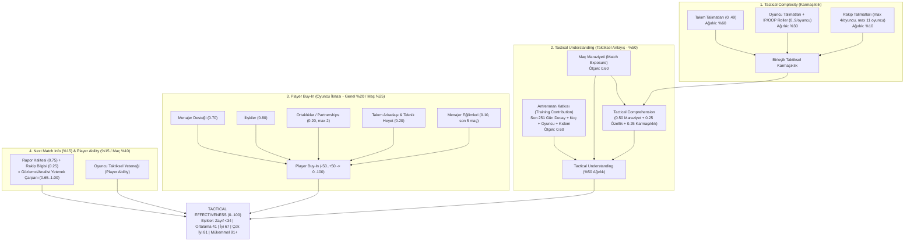

# Football Manager 27 (`FM27`) vs Football Manager 26 (`FM26`): Eksiksiz Algoritmik, Matematiksel, Maç Motoru, Veritabanı ve İkili (`.fm` / `.fmf` / `IL2CPP`) Farklar Raporu

> **Kapsam ve Metodoloji:** Bu rapor; `C:\Program Files (x86)\Steam\steamapps\common\Football Manager 26` (`1.037` dosya, `7,55 GB`, DB `2620`) ile `C:\Program Files (x86)\Steam\steamapps\common\Football Manager 27` (`1.279` dosya, `8,16 GB`, DB `2700`, Build `27.0.0+2486695`) kurulumlarının ve gerçek `.fm` kayıt dosyalarının (`Project_Super_Lig.fm` vs `Mahmut Çakar - Galatasaray.fm`) bayt düzeyinde tersine mühendislik (`reverse engineering`) karşılaştırmasına dayanmaktadır.
>
> Bu doküman, depodaki 6 temel FM26 referans raporunun tamamını baz alır ve her bir sistemin FM27'de nasıl değiştiğini (veya korunduğunu) birebir denklemler, katsayılar ve bellek ofsetleriyle ortaya koyar:
> 1. [FM26_ENGINE_FORMULAS_AND_CALCULATIONS.md](./FM26_ENGINE_FORMULAS_AND_CALCULATIONS.md)
> 2. [FM26_INTERNAL_GAME_LOGICS_AND_MECHANICS.md](./FM26_INTERNAL_GAME_LOGICS_AND_MECHANICS.md)
> 3. [FM26_REVERSE_ENGINEERING_SAVE_AND_GAME_FILES.md](./FM26_REVERSE_ENGINEERING_SAVE_AND_GAME_FILES.md)
> 4. [FM26_REVERSE_ENGINEERING_METHODOLOGY_AND_FILE_TREE.md](./FM26_REVERSE_ENGINEERING_METHODOLOGY_AND_FILE_TREE.md)
> 5. [FM26_SAVE_DATABASE_SCHEMA_AND_81_SECTIONS.md](./FM26_SAVE_DATABASE_SCHEMA_AND_81_SECTIONS.md)
> 6. [FM26_TACTICAL_ROLES_AND_BREAKDOWNS.md](./FM26_TACTICAL_ROLES_AND_BREAKDOWNS.md)

---

## 1. Yönetici Özeti: FM26'dan FM27'ye Değişen 10 Temel Sistem

| # | Sistem / Alt Motor | FM26 Durumu (Referans Rapor) | FM27 Durumu (`v27.0.0+2486695`) | Değişim Şiddeti |
| :--- | :--- | :--- | :--- | :--- |
| **1** | **Taktiksel Aşinalık $\rightarrow$ Taktiksel Etkinlik & Karmaşıklık Motoru** | Klasik `Tactical Familiarity` çubukları; karmaşıklık cezası yok ([Rapor 1](./FM26_ENGINE_FORMULAS_AND_CALCULATIONS.md)) | **Tamamen Yeni Motor:** `simatch/constants/generated_tactical_complexity_constants.jsb`, `generated_tactical_effectiveness_constants.jsb` ve `generated_training_contribution_constants.jsb` ile her takım/oyuncu/rakip talimatına ve her IP/OOP rolüne `0..3` karmaşıklık puanı (`Tactical Complexity`) ve `0..100` `Tactical Effectiveness` formülü eklendi. | **DEVRİMSEL (Yeni Motor)** |
| **2** | **Haftalık Antrenman Motoru (`training.fmf`)** | `44` seans, `3` birim (`Offensive`, `Defensive`, `Goalkeeping`), `%60/%20/%20` ağırlık, ayrı `session_item_effects.jsb` ([Rapor 2](./FM26_INTERNAL_GAME_LOGICS_AND_MECHANICS.md)) | **Baştan Yazıldı:** `59` seans, `6` kategori (`training_session_categories.jsb`), **`4` birim** (`attacking`, `midfield`, `defensive`, `goalkeeping`), doğrudan seans içine gömülü fiziksel etkiler, `8` yeni **Tactical Understanding** ve `9` yeni **Match Preparation** seansı. Kondisyon antrenmanlarından `Natural Fitness` çıkarıldı! | **DEVRİMSEL (Baştan Yazıldı)** |
| **3** | **Beklenen Gol (`xG`) Lojistik Regresyon Modelleri (`simatch.fmf`)** | Aktif model `26_1_4_1` (`9` sürüm klasörü); Penaltı xG = `%76,83` ([Rapor 1](./FM26_ENGINE_FORMULAS_AND_CALCULATIONS.md), [Rapor 3](./FM26_REVERSE_ENGINEERING_SAVE_AND_GAME_FILES.md)) | Aktif model **`26_8_4_34`** (`11` sürüm klasörü; 4 eski FM23/24 modeli silindi, 6 yeni `26_8_*` modeli eklendi). Şut açısına (`angle_shot_to_goal`) `%66,8` daha yüksek ödül, şut hattındaki savunmacı sayısına (`norm_players_between`) **`%61,5` – `%113` daha ağır ceza**! Penaltı xG = **`%82,68`**. | **YÜKSEK (Yeniden Kalibrasyon)** |
| **4** | **Oyuncu Maç Reytingi (`player_ratings_data.jsb`)** | Aktif sürüm `v26.4.10.1`; `40` `RolePosition` bitmaskesi `30` `role_data` tablosunu paylaşıyor ([Rapor 1](./FM26_ENGINE_FORMULAS_AND_CALCULATIONS.md)) | Aktif sürüm **`v26.4.29.8`**; paylaşımlı 5 rol ayrılarak **`35` bağımsız `role_data` profiline** çıkarıldı. Olay bazlı puanlar (`Goals`, `Assists`, `Tackles` vb.) korundu ancak **`36 / 40` rolde `90min Adjuster` yeniden dengelendi** (Orta saha/kanat/beklere `+0,10` ile `+0,27` arası reyting buff'ı; santrafor/stoper/kaleciye `-0,01` ile `-0,17` arası nerf). | **ORTA-YÜKSEK** |
| **5** | **Hızlı Maç Motoru (`QME` — `qme_distribution_data.jsb`)** | `3.137` olasılık dağılımı (`midfielder_centre`: sadece `66`, `goalkeeper`: `59`) ([Rapor 3](./FM26_REVERSE_ENGINEERING_SAVE_AND_GAME_FILES.md)) | **`3.420` olasılık dağılımı (`+283`)**: `midfielder_centre` `66` $\rightarrow$ **`263` (`+197`)** ve `goalkeeper` `59` $\rightarrow$ **`110` (`+51`)** seviyesine çıkarılarak simüle edilen maçlardaki merkez orta saha ve kaleci istatistik anomalileri giderildi. | **ORTA** |
| **6** | **Fizik, Momentum, OOP Yakınlık Izgarası & Hava Hakimiyeti** | `ball_physics_22_0_5_0.bta`, `momentum_weightings_data.jsb`, `oop_attributes_scoring.jsb`, `oop_pitch_proximity_scores.jsb`, `tables.fmf` ([Rapor 1](./FM26_ENGINE_FORMULAS_AND_CALCULATIONS.md), [Rapor 6](./FM26_TACTICAL_ROLES_AND_BREAKDOWNS.md)) | **Bayt-bayt (`SHA-256`) %100 aynı!** Top fiziği, 48 uzamsal momentum kuralı, 39 OOP rol özellik puanlaması, `118 × 24` OOP yakınlık matrisi ve zıplama/hava erişim tabloları değişmedi. `.stra` taktik stil şablonları ise `rts.B B` (`v2`) $\rightarrow$ **`rts.D D` (`v4`)** sürümüne yükseltildi. | **DEĞİŞMEDİ (`.stra` v4 hariç)** |
| **7** | **Yeni `constants.fmf` Arşivi, Taraftar Atmosferi (`Crowd`) ve `sianim`** | `constants.fmf` yok; `sianim` altında `10` JSON şeması ([Rapor 4](./FM26_REVERSE_ENGINEERING_METHODOLOGY_AND_FILE_TREE.md)) | Yeni `data/game_simulation/constants.fmf` (`4` `.jsb`: `colour_pair`, `match_crowd`, `shuffle_draft`, `training`); veritabanına `TCct`/`ccrt`/`Lctd` (`Flares`, `Confetti`, `Flags`) taraftar eğilimleri eklendi; `sianim` şemaları `10` $\rightarrow$ **`62` JSON** dosyasına (`+44` maç animasyon şeması + `8` yüz/iskelet şeması) çıktı. | **YÜKSEK** |
| **8** | **Medya, Portal Haber Motoru & OOP Kiralık Sözleşmeleri (`media.fmf`)** | Portal alakasız haber çarpanı `0.5`; kiralık sözleşmelerde yalnızca IP pozisyon/rol takibi ([Rapor 2](./FM26_INTERNAL_GAME_LOGICS_AND_MECHANICS.md)) | `portal_weights.xml` ile alakasız haber ağırlığı `%80` düşürüldü (`0.5` $\rightarrow$ `0.1`), 3 okuma eşikli oyuncu profilleme (`portal_min_read_news_count_to_add_object_to_profile = 3`) ve `7500/8500` itibar barajları eklendi. Kiralık oyuncu mutsuzluklarına **OOP (Topsuz Oyun) pozisyon ve rol ihlali (`topi=1050, 1051`)** eklendi! | **ORTA-YÜKSEK** |
| **9** | **Ana Veritabanı (`2700` vs `2620`) & Lisanslama (`.lnc`)** | `723.010` kişi (`495.248` erkek, `41.904` kadın), `96.343` kulüp, `988.091` isim, `31` `.lnc` dosyası ([Rapor 3](./FM26_REVERSE_ENGINEERING_SAVE_AND_GAME_FILES.md)) | `701.095` kişi (`473.764` erkek, **`47.736` kadın `+5.832`**), **`100.432` kulüp (`+4.089`)**, `8.084` turnuva (`+111`), **`1.063.170` isim (`+75.079`)**. `lang_db.dat` Kulüp tablosuna 7. metin alanı olarak `CLTn` (`League Table Name`) eklendi. `30` adet kısıtlayıcı `.lnc` dosyası silinerek resmi lisanslar (`Inter`, `Milan`, `Lazio`, `Atalanta`, `Dünya Kupası`) açıldı! | **YÜKSEK** |
| **10** | **`.fm` Kayıt Konteyneri & `PersonBlock` İkili Kayması** | `81` `.dat`/`.cmt` bölümü; `PersonBlockLayout` içinde `birth+12` sonrası `1` bayt (`0x03`), `nation_id` ofseti `+13`, `personality` ofseti `+21` ([Rapor 5](./FM26_SAVE_DATABASE_SCHEMA_AND_81_SECTIONS.md)) | **`75` bölüm** (6 `.cmt` tarihçe bölümü kaldırıldı, 11 `.dat` bölümünün şema sürümü artırıldı). `game_db.dat` ve `people_db.dat` içindeki `PersonBlock` yapısına `birth+13` noktasında **1 bayt (`0x01`) eklendi** (`0x03` $\rightarrow$ `0x03 0x01`); `nation_id` (`13` $\rightarrow$ `14`) ve `personality` (`21` $\rightarrow$ `22`) dahil tüm sonraki alanlar **`+1` bayt** kaydı! | **KRİTİK (Parser / Araçlar İçin)** |

---

## 2. Dosya Ağacı, Unity / IL2CPP / Burst İkili Mimarisi ve `.jsb` Format Keşfi

Referans: [FM26_REVERSE_ENGINEERING_METHODOLOGY_AND_FILE_TREE.md](./FM26_REVERSE_ENGINEERING_METHODOLOGY_AND_FILE_TREE.md).

### 2.1. Kurulum Ağacı ve Native Binary Karşılaştırması (`FM26` vs `FM27`)

| Bileşen / Dosya Yolu | FM26 (`v26.x`) | FM27 (`v27.0.0+2486695`) | Fark / Teknik Açıklama |
| :--- | :---: | :---: | :--- |
| **Toplam Dosya / Boyut** | `1.037` dosya / `7,55 GB` | `1.279` dosya / `8,16 GB` | `+242` dosya, `+625 MB` |
| `GameAssembly.dll` (IL2CPP C# $\rightarrow$ C++ Derlemesi) | `53,64 MB` (`56.244.848 B`) | `59,36 MB` (`62.243.440 B`) | **`+5,72 MB` (`+10,7%`)** — Yeni taktiksel etkinlik, antrenman, taraftar (Crowd) ve fantezi draft C# sınıfları. |
| `fm_Data/il2cpp_data/il2cpp.usym` (Sembol Tablosu) | `38,52 MB` (`1.593.548` kayıt) | `87,25 MB` (`3.601.654` kayıt) | **`+48,74 MB` (`+126,0%` / `2,26x` sembol)** — Satır/adres eşleme tablosu iki katından fazla genişledi. |
| `fm_Data/il2cpp_data/Metadata/global-metadata.dat` | `15,59 MB` (**Metadata `v31`**) | `15,68 MB` (**Metadata `v39`**) | Unity IL2CPP Metadata formatı `v31`'den **`v39`'a** yükseltildi; `131.460` $\rightarrow$ `149.560` ASCII tanımlayıcı (`+30.036` yeni). |
| `fm_Data/Plugins/x86_64/lib_burst_generated.dll` | `2,0 KB` (Boş/Stub) | **`1,01 MB` (`1.059.840 B`)** | **Kritik Performans Değişimi:** FM26'da devre dışı olan **Unity Burst SIMD/Jobs derlemesi** FM27'de aktif hale getirildi (kumaş/cloth fiziği, kalabalık/crowd compute ve animasyon hesaplamaları SIMD ile hızlandırıldı). |
| `fm_Data/Plugins/x86_64/game_plugin.dll` (C++ Motoru) | `514,89 MB` | `433,99 MB` | **`-80,90 MB` (`-15,7%`)** — Derleyici optimizasyonu ve bazı alt sistemlerin `GameAssembly.dll` / `Burst` tarafına taşınması. |
| `fm_Data/StreamingAssets/` | `LicensedData/` + `aa/StandaloneWindows64/` | `AddrData/` + `aa/StandaloneWindows64/` | Lisanslı varlık paketleri `LicensedData` yerine **`AddrData`** (`61` bundle) altına taşındı; `adboards_assets_all.bundle` (`68,14 MB` $\rightarrow$ `123,77 MB`, `+81,6%`) eklendi. |
| `shared/data/sianim/` (Animasyon & İskelet Şemaları) | `10` JSON dosyası | **`62` JSON dosyası (`+52`)** | `44` yeni maç aksiyon şeması (`gk_save_*`, `kick_rabona`, `kick_overhead`, `tackle_two_footed_lunge`, `handball`, `elbow` vb.) + `8` menajer yüz/iskelet (`skeletons_dev_ui_data`) JSON dosyası eklendi. |

### 2.2. `global-metadata.dat` (`v39`) İçinden Çıkarılan Yeni FM27 C# Sınıfları ve Sistemleri

FM27'nin `global-metadata.dat` (`v39`) dosyasında FM26'da bulunmayan **`30.036` yeni tanımlayıcı** tespit edilmiştir. Öne çıkan yeni motor modülleri:
- **Yeni Dinamik Taraftar ve Atmosfer Motoru (`Crowd*`):**
  `CrowdAnimationController`, `CrowdBuffers`, `CrowdColorController`, `CrowdComputeShader`, `CrowdConfigCache`, `CrowdController`, `CrowdMood`, `CrowdMoodClipPlayable`, `CrowdMoodCommentaryMap`, `CrowdMoodConditionBuilder`, `CrowdMoodConditionFlags`, `CrowdMoodEvaluation`, `CrowdMoodReactionTriggerInfoName`, `CrowdPeopleController`, `CrowdPeopleSetClimate`, `CrowdPeopleSetRegion`, `CrowdPropData`, `ApplyCrowdCharacter`, `ApplyHomeCrowdThinning`, `CalculateCrowdMood`, `BondingWithCrowd`, `AnamorphicFlaresLuminance`, `Confetti`.
- **Yeni Taktik ve Maç İçi Senkronizasyon Sınıfları:**
  `CanSyncApplyNewTacticalChanges`, `ConfirmTacticalChangesID`, `CancelTacticalChangesID`, `ChangeFromTacticalTweakID`, `CloseTacticalChangesPanel`, `BuildUpStrategy`, `PlayThroughPress`, `MatchExposure`, `MatchFlashingCommentary`, `AttackBuildupExcitedAnticipation`.
- **Yeni Fantezi Draft / Create-A-Club Olay Mimarisi:**
  `CreateFantasyDraftGameEvent`, `ConfirmCreateAClubFantasyDraftEvent`, `ConfirmFantasyDraftRestrictions`, `ContinueFantasyDraftGameEvent`, `DraftAllocationValues`, `CheckDraftPositionAnimationTimer`.
- **Yeni Sözleşme, MLS ve Oyuncu Etkileşim Referansları:**
  `MlsAllocationRanking`, `ConvertPlayerBackToDp`, `ContractNegotiationPatienceReference`, `ContractAddOnActivatedNewsReference`, `AskPlayerAgentAboutGenerateMarketInterest`, `CheckPlayerReadiness`.

### 2.3. `.jsb` (Binary JSON) Formatında Yeni Keşif: Inline `Float64` Etiketleri (`0x27` ve `0x37`)

[`fm26save/formulas.py`](../fm26save/formulas.py) içindeki [`parse_jsb()`](../fm26save/formulas.py#L1577-L1656) fonksiyonunda `kind == 0x07` (`Float64`) için `hi == 0` olduğunda `8` baytlık IEEE-754 `double` okunmakta, `hi > 0` olduğunda ise inline sabit dönülmekteydi. FM27'nin yeni `simatch/constants/*.jsb` dosyaları üzerinde yapılan bayt izlemesi (`trace_jsb_floats.py`), `kind == 0x07` için kesin inline kodlamayı kanıtlamıştır:
- `tag = 0x07` (`hi = 0`): Takip eden `8` baytlık IEEE-754 `Float64` (`struct.unpack_from("<d", buf, pos)`).
- `tag = 0x17` (`hi = 1`): Inline **`0.0`**.
- `tag = 0x27` (`hi = 2`): Inline **`0.5`** (`(hi - 1) * 0.5`).
- `tag = 0x37` (`hi = 3`): Inline **`1.0`** (`(hi - 1) * 0.5`).

> [!IMPORTANT]
> Bu keşif sayesinde `generated_tactical_effectiveness_constants.jsb` içindeki tüm ağırlık vektörlerinin toplamının tam olarak **`1.00`** (`0.15 + 0.10 + 0.25 + 0.50 = 1.00` ve `0.15 + 0.15 + 0.20 + 0.50 = 1.00`) olduğu ve `generated_training_contribution_constants.jsb` içindeki çarpan eğrilerinin `0.95` / `0.97` sonrasında tam **`1.00`** (`0x37`) tavanına oturduğu matematiksel olarak doğrulanmıştır.

---

## 3. FM27'nin En Büyük Algoritmik Yeniliği: `Tactical Complexity`, `Tactical Effectiveness` ve `Training Contribution` Motoru

Referans: [FM26_ENGINE_FORMULAS_AND_CALCULATIONS.md](./FM26_ENGINE_FORMULAS_AND_CALCULATIONS.md) & [FM26_TACTICAL_ROLES_AND_BREAKDOWNS.md](./FM26_TACTICAL_ROLES_AND_BREAKDOWNS.md).

FM26'da bir taktiğe ne kadar çok takım talimatı (`Team Instructions`), oyuncu talimatı (`Player Instructions`) ve karmaşık rol (`Box-to-Box Playmaker`, `Overlapping CB`, `False Nine` vb.) eklerseniz ekleyin, motor düzeyinde açık bir **"Taktiksel Karmaşıklık Cezası" (`Tactical Complexity`)** yoktu.

**FM27**, `shared/data/simatch.fmf` içerisine eklenen **3 yeni `.jsb` sabit dosyası** ve `data/game_simulation/constants.fmf` içerisindeki `generated_training_constants.jsb` ile **Taktiksel Etkinlik (`Tactical Effectiveness`, `0..100`)** sistemini devreye sokmuştur:
1. `simatch/constants/generated_tactical_complexity_constants.jsb` (`3.880 B`)
2. `simatch/constants/generated_tactical_effectiveness_constants.jsb` (`2.600 B`)
3. `simatch/constants/generated_training_contribution_constants.jsb` (`1.716 B`)



### 3.1. Ana Taktiksel Etkinlik (`Tactical Effectiveness`) Denklemleri

`generated_tactical_effectiveness_constants.jsb` içerisinden çıkarılan kesin matematiksel model:

- **Başlangıç / Varsayılan Değer (`DEFAULT_VALUE`):** `50` (`0..100` ölçeğinde)
- **Yüksek Etkinlik Eşiği (`THRESHOLD_HIGH_TACTICAL_EFFECTIVENESS`):** `80` (Başarım eşiği: `80`)
- **Orta Etkinlik Eşiği (`THRESHOLD_MODERATE_TACTICAL_EFFECTIVENESS`):** `66`

**Genel Taktiksel Etkinlik (`Overall Weights` — Antrenman/Taktik Ekranı):**
$$\text{Effectiveness}_{\text{General}} = 0.50 \cdot U_{\text{tactical}} + 0.20 \cdot B_{\text{buy\_in}} + 0.15 \cdot A_{\text{ability}} + 0.15 \cdot I_{\text{next\_match}}$$

**Maç Günü Taktiksel Etkinlik (`Match Weights` — Maç Motoru İçi Aktif Denklem):**
$$\text{Effectiveness}_{\text{Match}} = 0.50 \cdot U_{\text{tactical}} + 0.25 \cdot B_{\text{buy\_in}} + 0.15 \cdot I_{\text{next\_match}} + 0.10 \cdot A_{\text{ability}}$$

> [!NOTE]
> Dikkat edilirse **maç gününde** `PLAYER_ABILITY` ağırlığı `%15`'ten `%10`'a düşerken, **`PLAYER_BUY_IN` (oyuncuların taktiğe ve menajere olan inancı/desteği) `%20`'den `%25`'e çıkmaktadır!**

**Derecelendirme Eşikleri (`Score Thresholds`, `0..100`):**

| Derece (`Grade`) | Alt Eşik (`0..100`) | Oyun İçi Karşılığı |
| :--- | :---: | :--- |
| `VERY_POOR` | `0` | Çok Kötü (`0 – 15`) |
| `POOR` | `16` | Kötü (`16 – 33`) |
| `BELOW_AVERAGE` | `34` | Ortalamanın Altı (`34 – 40`) |
| `AVERAGE` | `41` | Ortalama (`41 – 50`) |
| `ABOVE_AVERAGE` | `51` | Ortalamanın Üstü (`51 – 66`) |
| `GOOD` | `67` | İyi (`67 – 80`) — *Orta Eşik: `66`* |
| `VERY_GOOD` | `81` | Çok İyi (`81 – 90`) — *Yüksek Eşik: `80`* |
| `EXCELLENT` | `91` | Mükemmel (`91 – 100`) |

### 3.2. Alt Bileşen Formülleri (`Comprehension`, `Buy-In`, `Next Match Information`)

1. **Birleşik Taktiksel Karmaşıklık (`Tactical Complexity`):**
   $$C_{\text{total}} = 0.60 \cdot C_{\text{team}} + 0.30 \cdot C_{\text{player}} + 0.10 \cdot C_{\text{opposition}}$$
   - Takım Talimatları Karmaşıklığı (`C_team`): `MIN = 0`, `MAX = 49`, `DEFAULT = 1`.
   - Oyuncu Başına Karmaşıklık (`C_player` = IP Rol + OOP Rol + Oyuncu Talimatları): `MIN = 0`, `MAX = 9`, `DEFAULT = 1`.
   - Rakip Talimatları Karmaşıklığı (`C_opposition`): Oyuncu başına `MAX_COMPLEXITY_PER_PLAYER = 4`, en fazla `MAX_PLAYERS_FOR_COMPLEXITY = 11` rakip oyuncu (`max = 44`).

2. **Taktiksel Kavrama (`Tactical Comprehension`) ve Taktiksel Anlayış (`Tactical Understanding`):**
   $$\text{Comprehension} = 0.50 \cdot E_{\text{match\_exposure}} + 0.25 \cdot A_{\text{player\_attributes}} + 0.25 \cdot (100 - C_{\text{total}}^{\text{norm}})$$
   $$\text{Understanding Scale}: \quad S_{\text{match\_exposure}} = 0.60, \quad S_{\text{training\_contribution}} = 0.60$$
   - Oyuncu taktiksel kavrama tavanı (`Player Ability Modifier`): Özellik ortalaması `<= 1` için `MAX_EFFECTIVENESS = 50`, `<= 12` için `85`, `>= 13` için `100`.

3. **Oyuncu İknası (`Player Buy-In` — `MIN = -50`, `MAX = +50`):**
   $$B_{\text{raw}} = 0.70 \cdot \text{ManagerialSupport} + 0.80 \cdot \text{Relationships} + 0.20 \cdot \text{Partnerships}_{\le 2} + 0.20 \cdot \text{TeammateAndStaff} + 0.10 \cdot \text{ManagerTendencies}_{\text{last 5 games}}$$
   - `MAX_PARNERSHIPS_TO_CONSIDER = 2` (Sahadaki yeşil bağlantı çizgilerinden oyuncu başına en fazla 2 ortaklık hesaba katılır).
   - `GAMES_FOR_MANAGER_TENDENCIES_ANALYSIS = 5` (Menajerin son 5 maçta kendi vaat ettiği taktiksel eğilimlere ne kadar sadık kaldığı analiz edilir).

4. **Sonraki Maç Bilgisi (`Next Match Information`):**
   $$I_{\text{next\_match}} = \left(0.75 \cdot Q_{\text{report}} + 0.25 \cdot K_{\text{opposition\_players}}\right) \times M_{\text{analyst\_ability}}$$
   - Baş Analist / Gözlemci Yetenek Çarpanı ($M_{\text{analyst\_ability}}$):
     - Yetenek $\le 7 \implies 0.65\times$
     - Yetenek $\le 9 \implies 0.70\times$
     - Yetenek $\le 10 \implies 0.75\times$
     - Yetenek $\le 12 \implies 0.80\times$
     - Yetenek $\le 14 \implies 0.85\times$
     - Yetenek $\le 15 \implies 0.90\times$
     - Yetenek $\le 16 \implies 0.95\times$
     - Yetenek $18..20 \implies \mathbf{1.00\times}$

### 3.3. Tüm Takım Talimatları, Roller ve Oyuncu Talimatları İçin Karmaşıklık (`Complexity`) Tabloları

`simatch/constants/generated_tactical_complexity_constants.jsb` dosyasından çıkarılan tam karmaşıklık puanları:

#### A. Takım Talimatları (`Team Instructions`) Karmaşıklık Puanları (`0..3`)

| Karmaşıklık Puanı | Takım Talimatları (`Team Instructions`) |
| :---: | :--- |
| **`3` (Çok Yüksek)** | `Pressing Intensity: MUCH_HIGHER`, `Defensive Line: MUCH_HIGHER`, `Passing Directness: MUCH_SHORTER`, `Transition: COUNTER_PRESS`, `Build Up: PLAY_THROUGH_THE_PRESS`, `Creative Freedom: BE_MORE_DISCIPLINED`, `Attacking Transition: DOWN_THE_MIDDLE` |
| **`2` (Yüksek)** | `Pressing Intensity: HIGHER`, `Defensive Line: HIGHER`, `Defensive Line Step Up: HOLD_LINE`, `Tempo: MUCH_HIGHER`, `Transition: COUNTER`, `Final Third: WORK_BALL_INTO_BOX`, `Dribbling: RUN_AT_DEFENCE`, `Time Wasting: MORE_OFTEN` |
| **`1` (Standart)** | Diğer tüm varsayılan dışındaki takım talimatları (`DEFAULT_COMPLEXITY = 1`, örn. `Tempo: HIGHER/LOWER`, `Width: WIDER/NARROWER`, `Low Crosses`, `Hit Early Crosses`, `Step Up More` vb.) |
| **`0` (Sıfır Karmaşıklık)** | `Build Up: BYPASS_THE_PRESS`, `Line of Engagement: DEEPER`, `Pressing Trap: INSIDE`, `Pressing Trap: OUTSIDE` (ve tüm `STANDARD` / `BALANCED` / `NONE` ayarları) |

#### B. Toplu Oyun (`IP` — In Possession) Rolleri Karmaşıklık Puanları (`0..3`)

| Karmaşıklık Puanı | Toplu Oyun (`IP`) Rolleri (`35` Rol) |
| :---: | :--- |
| **`3` (En Karmaşık — 6 Rol)** | `ADVANCED_CENTRE_BACK`, `BOX_TO_BOX_PLAYMAKER`, `FALSE_NINE`, `FREE_ROLE` (*Trequartista*), `OVERLAPPING_CENTRE_BACK`, `PLAYMAKING_WING_BACK` |
| **`2` (Yüksek — 9 Rol)** | `ADVANCED_PLAYMAKER`, `BALL_PLAYING_CENTRE_BACK`, `BALL_PLAYING_GOALKEEPER`, `DEEP_LYING_FORWARD`, `HALF_BACK`, `INSIDE_FORWARD`, `INSIDE_WING_BACK`, `MIDFIELD_PLAYMAKER`, `PLAYMAKING_WINGER` |
| **`1` (Orta — 15 Rol)** | `ADVANCED_WING_BACK`, `BOX_TO_BOX_MIDFIELDER`, `CENTRE_BACK`, `CHANNEL_FORWARD`, `CHANNEL_MIDFIELDER`, `DEEP_LYING_PLAYMAKER`, `GOALKEEPER`, `INSIDE_FULL_BACK`, `INSIDE_WINGER`, `POACHER`, `SECOND_STRIKER` (*Shadow Striker*), `TARGET_FORWARD`, `WIDE_CENTRAL_MIDFIELDER`, `WIDE_CENTRE_BACK`, `WIDE_FORWARD` |
| **`0` (Sıfır Karmaşıklık — 10 Rol)** | `ATTACKING_MIDFIELDER`, `CENTRAL_MIDFIELDER`, `CENTRE_FORWARD`, `DEFENSIVE_MIDFIELDER`, `FULL_BACK`, `NO_NONSENSE_CENTRE_BACK`, `NO_NONSENSE_GOALKEEPER`, `WIDE_MIDFIELDER`, `WING_BACK`, `WINGER` |

#### C. Topsuz Oyun (`OOP` — Out Of Possession) Rolleri Karmaşıklık Puanları (`0..3`)

| Karmaşıklık Puanı | Topsuz Oyun (`OOP`) Rolleri (`40` Girdi: `39` OOP Rolü + `GOALKEEPER`) |
| :---: | :--- |
| **`3` (En Karmaşık — 1 Rol)** | `DROPPING_DEFENSIVE_MIDFIELDER` (Stoperlerin arasına gömülen ön libero) |
| **`2` (Yüksek — 10 Rol)** | `INSIDE_OUTLET_WINGER`, `PRESSING_CENTRAL_MIDFIELDER`, `PRESSING_DEFENSIVE_MIDFIELDER`, `PRESSING_FULL_BACK`, `PRESSING_WING_BACK`, `SPLITTING_OUTLET_ATTACKING_MIDFIELDER`, `SPLITTING_OUTLET_CENTRE_FORWARD`, `SWEEPER_KEEPER`, `WIDE_COVER_CENTRAL_MIDFIELDER`, `WIDE_COVER_DEFENSIVE_MIDFIELDER` |
| **`1` (Orta — 18 Rol)** | `CENTRAL_OUTLET_ATTACKING_MIDFIELDER`, `CENTRAL_OUTLET_CENTRE_FORWARD`, `COVERING_CENTRE_BACK`, `COVERING_WIDE_CENTRE_BACK`, `GOALKEEPER`, `HOLDING_FULL_BACK`, `HOLDING_WING_BACK`, `SCREENING_CENTRAL_MIDFIELDER`, `SCREENING_DEFENSIVE_MIDFIELDER`, `STOPPING_CENTRE_BACK`, `STOPPING_WIDE_CENTRE_BACK`, `TRACKING_ATTACKING_MIDFIELDER`, `TRACKING_CENTRE_FORWARD`, `TRACKING_WIDE_MIDFIELDER`, `TRACKING_WINGER`, `WIDE_OUTLET_ATTACKING_MIDFIELDER`, `WIDE_OUTLET_CENTRE_FORWARD`, `WIDE_OUTLET_WINGER` |
| **`0` (Sıfır Karmaşıklık — 11 Rol)** | `ATTACKING_MIDFIELDER`, `CENTRAL_MIDFIELDER`, `CENTRE_BACK`, `CENTRE_FORWARD`, `DEFENSIVE_MIDFIELDER`, `FULL_BACK`, `LINE_KEEPER`, `WIDE_CENTRE_BACK`, `WIDE_MIDFIELDER`, `WING_BACK`, `WINGER` |

#### D. Oyuncu Talimatları (`Player Instructions`) Karmaşıklık Puanları (`0..3`)

- **Puan `3`:** `Passing Risks: TAKE_MORE` (Daha Fazla Risk Al), `Marking: SPECIFIC_PLAYER` (Belirli Oyuncuyu Markajla).
- **Puan `2`:** `Off The Ball: MOVE_INTO_CHANNELS` (Kanallara Koş), `Cross To: TARGET_MAN` (Hedef Santrafora Orta Yap), `Marking: SPECIFIC_POSITION` / `TIGHTER`, `Pass Length: SHORTER`, `Attacking Runs: GET_FORWARD_OFTEN`, `Mobility: ROAM_FROM_POSITION`, `Pressing Intensity: HIGHER`.
- **Puan `0`:** `Dribbling: RUN_WIDE_WITH_BALL`, `DistributionStyle: QUICK_DELIVERY`, `Pass Length: MORE_DIRECT` ve tüm `NONE` talimatları.
- **Puan `1`:** Diğer tüm aktif bireysel oyuncu talimatları (`Cut Inside With Ball`, `Stay Wider`, `Hold Position`, `Shoot Less Often`, `Tackle Harder` vb.).

### 3.4. Antrenman Katkısı (`Training Contribution`) ve Çoklu Taktik Odak Bölünmesi

`simatch/constants/generated_training_contribution_constants.jsb` dosyası, yapılan her taktik antrenman seansının `Tactical Understanding` puanına ne kadar katkı verdiğini 4 çarpanla hesaplar:

$$\text{SessionScore} = \text{BaseRecencyScore}(\Delta \text{days}) \times M_{\text{coach}} \times M_{\text{player}} \times M_{\text{tenure}} \times M_{\text{tactic\_focus}}$$

1. **Zaman Aşımı / Güncellik Puanı (`Club.SCORE_BANDS` vs `National.SCORE_BANDS`):**
   - **Kulüp Takımları (`MAX_DAYS_TO_CONSIDER = 251` gün):**
     - Son `0..6` gün (`1.` hafta): **`12` puan**
     - `7..13` gün (`2.` hafta): **`9` puan**
     - `14..20` gün (`3.` hafta): **`7` puan**
     - `21..41` gün (`4..6.` hafta): **`6` puan**
     - `42..83` gün (`7..12.` hafta): **`4` puan**
     - `84..251` gün (`13..36.` hafta): **`2` puan**
   - **Milli Takımlar (`National.SCORE_BANDS`):** `<= 6` gün: `12`, `<= 13` gün: `9`, `<= 100` gün: `7`, `<= 199` gün: `6`, `<= 300` gün: `4`, `<= 365` gün: `2` (`TIME_AT_NATIONAL_TEAM_MODIFIER = 0.80`).
2. **Antrenör Kalitesi Çarpanı ($M_{\text{coach}}$):**
   - Antrenör Özelliği $\le 8 \implies 0.75\times$; $\le 10 \implies 0.80\times$; $\le 12 \implies 0.85\times$; $\le 14 \implies 0.90\times$; $\le 16 \implies 0.95\times$; $18..20 \implies \mathbf{1.00\times}$.
3. **Oyuncu Taktiksel Yetenek Çarpanı ($M_{\text{player}}$):**
   - Oyuncu Özelliği $\le 8 \implies 0.70\times$; $\le 10 \implies 0.75\times$; $\le 12 \implies 0.80\times$; $13 \implies 0.85\times$; $14 \implies 0.87\times$; $15 \implies 0.90\times$; $16 \implies 0.95\times$; $17 \implies 0.97\times$; $18..20 \implies \mathbf{1.00\times}$.
4. **Takımdaki Kıdem / Süre Çarpanı ($M_{\text{tenure}}$ — `TIME_AT_TEAM_SCORE_BANDS`):**
   - Yeni transfer (`0` hafta): **`0.60x`** (`%40` ceza!)
   - `4` hafta (`1` ay): `0.65x`
   - `8` hafta (`2` ay): `0.70x`
   - `26` hafta (`6` ay): `0.75x`
   - `52` hafta (`1` yıl): `0.80x`
   - `78` hafta (`1,5` yıl): `0.85x`
   - `104` hafta (`2` yıl): `0.90x`
   - `130` hafta (`2,5` yıl): `0.95x`
   - `156+` hafta (`3+` yıl): **`1.00x`** (Tam katkı!)
5. **Çoklu Taktik Odak Bölünmesi ($M_{\text{tactic\_focus}}$ — `Tactics Modifier`):**
   - Sadece 1 taktik yuvası doluysa: **`%100`** (`ONLY_FOCUS = 100`)
   - 2 taktik yuvası doluysa: Birincil Taktik **`%80`**, İkincil Taktik **`%20`**
   - 3 taktik yuvası doluysa: Birincil Taktik **`%80`**, 2. ve 3. Taktikler **`%10` + `%10`** (`TACTICAL_SELECTION_SIMILARITY_DROP_PER_POINT = 0.1`).

---

## 4. Maç Motoru (`simatch.fmf`): Beklenen Gol (`xG`), Oyuncu Reytingleri ve `QME` Farkları

Referans: [FM26_ENGINE_FORMULAS_AND_CALCULATIONS.md](./FM26_ENGINE_FORMULAS_AND_CALCULATIONS.md), [FM26_REVERSE_ENGINEERING_SAVE_AND_GAME_FILES.md](./FM26_REVERSE_ENGINEERING_SAVE_AND_GAME_FILES.md) ve [FM26_TACTICAL_ROLES_AND_BREAKDOWNS.md](./FM26_TACTICAL_ROLES_AND_BREAKDOWNS.md).

### 4.1. Beklenen Gol (`xG`) Lojistik Regresyon Modelleri (`v26.1.4.1` $\rightarrow$ `v26.8.4.34`)

FM27'de `simatch/expected_goals/models/` altındaki 4 eski FM23/FM24 sürümü (`23_1_1_9`, `23_7_0_5`, `23_9_9_1`, `24_1_2_3`) tamamen silinmiş ve 6 yeni sürüm (`26_8_0_45`, `26_8_1_41`, `26_8_2_32`, `26_8_4_1`, `26_8_4_27`, **`26_8_4_34`**) eklenmiştir. Her şut tipi için aktif lojistik regresyon denklemi:

$$P(\text{Goal}) = \sigma(z) = \frac{1}{1 + \exp\left(-\left(\beta_0 + \sum_{i} \beta_i x_i\right)\right)}$$

Aşağıdaki tablo, 11 şut modelinin FM26 (`26_1_4_1`) ile FM27 (`26_8_4_34`) arasındaki **kesin katsayı değişimlerini (`÷ 10^7` ölçeğinde)** göstermektedir:

| Şut Modeli (`shot_type`) | Parametre / Özellik ($x_i$) | FM26 (`26_1_4_1`) | FM27 (`26_8_4_34`) | Değişim ($\Delta$) | Maç Motoru Anlamı ve Etkisi |
| :--- | :--- | :---: | :---: | :---: | :--- |
| **`regular`** *(Açık Oyun Ayak Şutu)* | `intercept` ($\beta_0$) | `-12,095904` | `-10,914457` | **`+1,181446`** | Baz sabit yükseltildi. |
| | `norm_players_between` | `-4,648780` | **`-7,507064`** | **`-2,858284`** | **Kalabalık savunma bloğu arkasına şut cezası `%61,5` ağırlaştırıldı!** |
| | `norm_dist_closest_occluder` | `-1,136982` | **`-2,251772`** | **`-1,114790`** | Şutöre basan en yakın savunmacının mesafe etkisi **`~2x` artırıldı**. |
| | `angle_shot_to_goal` | `+1,751007` | **`+2,920393`** | **`+1,169386`** | **Merkezi şut açısı ödülü `%66,8` artırıldı** (dar açı şutları cezalandırıldı). |
| | `angle_facing_to_goal` | `+0,949741` | `+1,299703` | `+0,349962` | Kaleye dönük vücut açısı ödülü `%36,8` artırıldı. |
| | `norm_dist_to_goal` | `+13,116148` | `+12,086996` | `-1,029152` | Mesafe eğrisi yeni sabitle dengelendi. |
| | `fraction_goal_visible` | `-2,044291` | `-3,911993` | `-1,867702` | `norm_players_between` ile birlikte görünürlük etkileşimi yeniden ölçeklendi. |
| **`obscured_regular`** *(Görüşü Kapalı Şut)* | `intercept` ($\beta_0$) | `-14,193761` | `-13,435743` | `+0,758017` | Baz sabit dengelendi. |
| | `norm_players_between` | `-6,709227` | **`-14,302428`** | **`-7,593201`** | **Görüşü kapalı uzaktan şutlarda önündeki oyuncu cezası `2,13x` katına çıktı!** |
| | `angle_shot_to_goal` | `+0,491085` | `+2,051583` | **`+1,560498`** | Görüş kapalıyken dar açıdan gol şansı neredeyse sıfırlandı (`4,17x` açı ağırlığı). |
| **`open_goal_regular`** *(Boş Kale Şutu)* | `intercept` ($\beta_0$) | `-10,867306` | `-9,887705` | `+0,979601` | Boş kaleye bitiriş baz olasılığı artırıldı. |
| | `fraction_goal_visible` | `+1,643816` | **`+3,346593`** | **`+1,702777`** | Boş kale görünürlük ödülü **`2,04x`** katına çıkarıldı. |
| | `norm_players_between` | `-9,888863` | `-11,972373` | `-2,083511` | Çizgi üzerindeki savunmacı etkisi artırıldı. |
| **`headers`** *(Kafa Şutları)* | `intercept` ($\beta_0$) | `-28,524566` | `-25,332894` | `+3,191672` | Mesafe katsayısıyla birlikte yeniden ölçeklendi. |
| | `norm_dist_to_goal` | `+31,697461` | `+27,196705` | `-4,500756` | Mesafe duyarlılığı yumuşatıldı. |
| | `norm_height_of_ball` | `-1,273580` | **`-0,477202`** | **`+0,796378`** | **Yüksek ortalara vurulan kafalardaki yükseklik cezası `%62,5` azaltıldı!** |
| | `angle_shot_to_goal` | `-0,305592` | **`+0,777786`** | **`+1,083377`** | FM26'daki negatif açı anomalisi düzeltilerek merkezi kafa vuruşları ödüllendirildi. |
| **`volleys`** *(Vole / Yarı Vole)* | `intercept` ($\beta_0$) | `-11,265025` | `-9,389367` | `+1,875658` | Temiz vole baz olasılığı yükseltildi. |
| | `norm_players_between` | `-3,875609` | **`-6,973450`** | **`-3,097841`** | Kalabalık içine vurulan vole cezası **`+79,9%`** artırıldı. |
| | `angle_shot_to_goal` | `+1,294945` | `+2,372613` | `+1,077668` | Merkezi vole açısı ödülü `%83,2` artırıldı. |
| **`obscured_volleys`** | `norm_players_between` | `-4,384438` | **`-14,009940`** | **`-9,625502`** | Kalabalık arkası görüşü kapalı vole cezası **`3,2x`** katına çıkarıldı. |
| **`open_goal_headers`** | `intercept` ($\beta_0$) | `-35,517033` | `-28,022915` | **`+7,494118`** | Boş kaleye kafa vuruşlarının kaçma sorunu giderildi. |
| **`open_goal_volleys`** | `fraction_goal_visible` | `+0,750516` | **`+4,264702`** | **`+3,514186`** | Boş kaleye volelerde açık kale ödülü **`5,68x`** artırıldı. |
| **`free_kicks`** *(Doğrudan Serbest Vuruş)* | `intercept` ($\beta_0$) | `-4,340451` | `-6,143693` | `-1,803242` | Uzak mesafe frikik baz olasılığı düşürüldü. |
| | `norm_dist_to_goal` | `+3,719425` | **`+6,203608`** | **`+2,484183`** | **Ceza yayı çevresi yakın frikiklerin xG'si ciddi biçimde artırıldı.** |
| | `norm_dist_closest_occluder` | `-7,081996` | `-4,761418` | `+2,320578` | Baraj mesafesi aşırı cezası yumuşatıldı. |
| **`penalties`** *(Penaltı)* | `intercept` ($\beta_0$) | `+1,198467` | **`+1,562949`** | **`+0,364482`** | **Penaltı xG değeri $\sigma(1,1985) = \%76,83$'ten $\sigma(1,5629) = \mathbf{\%82,68}$'e yükseldi!** |
| **`own_goals`** | `intercept` ($\beta_0$) | `0,0` | `0,0` | `0,0` | Değişmedi (`0`). |

### 4.2. Oyuncu Maç Reytingi Motoru (`player_ratings_data.jsb`: `v26.4.10.1` $\rightarrow$ `v26.4.29.8`)

Referans: [FM26_ENGINE_FORMULAS_AND_CALCULATIONS.md](./FM26_ENGINE_FORMULAS_AND_CALCULATIONS.md) Bölüm 5.

1. **Sabit Kalan Çekirdek Yapı:**
   - Maç başlangıç reytingi (`start_value`): **`6700` (`6.70`)** — değişmedi.
   - Beklenen skor çarpanları (`expected_score_data`): `1.20x` / `1.10x` — değişmedi.
   - 51 maç içi aksiyonun (`Goals`, `Assists`, `Key Passes`, `Tackles`, `Interceptions`, `Mistakes` vb.) rol bazlı birim puanları **birebir aynı kaldı**.
2. **`role_data` Tablo Genişlemesi (`30` $\rightarrow$ `35` Profil):**
   - FM26'da `40` `RolePosition` bitmaskesi `30` adet `role_data` tablosuna eşleniyordu (`262144`, `524288`, `2147483648`, `2199023255552` ve `9007199254740992` bitmaskeleri `8, 10, 11` numaralı tabloları paylaşıyordu).
   - FM27 (`v26.4.29.8`) bu 5 rolü kendi özel tablolarına (`indeks 16, 17, 21, 24, 31`) ayırarak **`role_data` sayısını `30`'dan `35`'e çıkardı**.
3. **40 Rolün `90min Adjuster` (90 Dakika Baz Düzeltici) Yeniden Dengelemesi:**
   FM26'da orta saha, kanat ve bek oyuncuları gol/asist yapmadıkları maçlarda aşırı negatif `90min Adjuster` yüzünden `6.3 - 6.5` bandına sıkışırken, santraforlar ve stoperler daha yüksek baz reyting alıyordu. FM27'de **`36 / 40` rolde `90min Adjuster` değiştirilmiştir**:

| Rol Bitmaskesi (`role`) | Pozisyon / Rol Karşılığı | FM26 `90min Adjuster` | FM27 `90min Adjuster` | 90 Dk Reyting Farkı (`÷1000`) | Etki Yönü |
| :--- | :--- | :---: | :---: | :---: | :---: |
| `4294967296` (`2^32`) | Özel Oyun Kurucu / Orta Saha Rolü | `-850` | **`-580`** | **`+0,270` puan** | **En Büyük Buff** |
| `128` (`2^7`) | `ML / MR` (Kanat Orta Saha) | `-1000` | **`-760`** | **`+0,240` puan** | **Çok Büyük Buff** |
| `274877906944` (`2^38`) | Geniş Orta Saha / Kanat Rolü | `-940` | **`-700`** | **`+0,240` puan** | **Çok Büyük Buff** |
| `35184372088832` (`2^45`) | Ofansif Orta Saha / Kanat Rolü | `-1090` | **`-860`** | **`+0,230` puan** | **Çok Büyük Buff** |
| `64` (`2^6`) & `562949953421312` | `MC` (Merkez Orta Saha) | `-750` | **`-570`** | **`+0,180` puan** | **Büyük Buff** |
| `4503599627370496` (`2^52`) | Merkez / Box-to-Box Orta Saha | `-740` | **`-570`** | **`+0,170` puan** | **Büyük Buff** |
| `2199023255552` (`2^41`) | İkincil Oyun Kurucu / Orta Saha | `-810` | **`-650`** | **`+0,160` puan** | **Büyük Buff** |
| `36028797018963968` (`2^55`) | Kanat / İç Forvet Rolü | `-790` | **`-630`** | **`+0,160` puan** | **Büyük Buff** |
| `134217728` (`2^27`) | Ofansif / Serbest Rol | `-865` | **`-730`** | **`+0,135` puan** | **Buff** |
| `8796093022208` (`2^43`) | Bek / Sahte Bek Rolü | `-600` | **`-470`** | **`+0,130` puan** | **Buff** |
| `144115188075855872` (`2^57`) | Defansif / Destek Rolü | `-550` | **`-430`** | **`+0,120` puan** | **Buff** |
| `8` (`2^3`) | `SW / DC` Varyantı | `-800` | **`-690`** | **`+0,110` puan** | **Buff** |
| `512` (`2^9`) & `72057594037927936` | `AMC` (Ofansif Orta Saha Merkez) | `-810` | **`-700`** | **`+0,110` puan** | **Buff** |
| `4` (`2^2`) & `65536` (`2^16`) | `DL / DR` (Bekler) | `-530` / `-600` | **`-430` / `-500`** | **`+0,100` puan** | **Buff** |
| `70368744177664` (`2^46`) | Kanat (`AML / AMR`) Varyantı | `-720` | **`-630`** | **`+0,090` puan** | **Buff** |
| `131072` & `2251799813685248` | Orta Saha / DM Varyantı | `-670` | **`-600`** | **`+0,070` puan** | **Buff** |
| `32` (`2^5`) & `281474976710656` | `DM` (Ön Libero) | `-440` | **`-380`** | **`+0,060` puan** | **Buff** |
| `16` (`2^4`) & `34359738368` | `WBL / WBR` (Kanat Bek) | `-680` | **`-640`** | **`+0,040` puan** | **Buff** |
| `2` (`2^1`) | `DC` (Stoper) | `-520` | **`-530`** | **`-0,010` puan** | *Hafif Nerf* |
| `2147483648` (`2^31`) | Özel Rol (Yeni Tablo #21) | `-600` | **`-620`** | **`-0,020` puan** | *Hafif Nerf* |
| `1` (`2^0`), `4096`, `524288` | `GK` (Kaleci) ve Özel Roller | `-720/-770/-600` | **`-750/-800/-630`** | **`-0,030` puan** | *Hafif Nerf* |
| `2048` (`2^11`) | `STC` (Santrafor) | `-600` | **`-690`** | **`-0,090` puan** | **Nerf** |
| `18014398509481984` (`2^54`) | Fırsatçı / Poacher Santrafor Rolü | `-690` | **`-860`** | **`-0,170` puan** | **En Büyük Nerf** |

### 4.3. Hızlı Maç Motoru (`QME` — `simatch/qme_distribution_data.jsb`)

- Toplam olasılık dağılımı sayısı **`3.137`'den `3.420`'ye (`+283`)** yükseltilmiştir:
  - `poisson`: `1.803` $\rightarrow$ **`2.005` (`+202`)**
  - `normal`: `630` $\rightarrow$ **`676` (`+46`)**
  - `binned`: `580` $\rightarrow$ **`620` (`+40`)**
  - `zero`: `124` $\rightarrow$ **`119` (`-5`)**
- **Neden Değişti?** FM26'da `midfielder_centre` için yalnızca `66` ve `goalkeeper` için `59` dağılım tanımlıydı (diğer pozisyonlarda `~200` dağılım varken). FM27'de **`midfielder_centre` `66` $\rightarrow$ `263` (`+197`)** ve **`goalkeeper` `59` $\rightarrow$ `110` (`+51`)** (ayrıca `midfielder_right` `200` $\rightarrow$ `223`, `midfielder_left` `199` $\rightarrow$ `202`) dağılıma çıkarılarak arka planda simüle edilen (`Quick Match Engine`) lig maçlarındaki merkez orta saha ve kaleci istatistik eksiklikleri tamamen giderilmiştir.
- **Değişmeyen Motor Dosyaları (`%100` Bayt-Bayt Aynı):**
  - `simatch/qme_stat_relevant_attribute_data.jsb` (`22` istatistik $\leftrightarrow$ özellik eşlemesi)
  - `simatch/momentum_weightings_data.jsb` (`48` uzamsal momentum kuralı)
  - `simatch/oop_attributes_scoring.jsb` (`39` OOP rol özellik ağırlık tablosu)
  - `simatch/oop_pitch_proximity_scores.jsb` (`118 × 24` OOP yakınlık puan matrisi)
  - `simatch/physics/ball_physics_22_0_5_0.bta` (`849 B`)
  - `simatch/weights.jsb` (`4 × 40` `TSF_*` takım seçimi ağırlıkları sayısal olarak %100 aynı; yalnızca üst veri anahtarı `"ME_VERSION"` $\rightarrow$ `"WEIGHTS_DATA_VERSION": 0` olarak yeniden adlandırıldı)
  - `data/game_simulation/tables.fmf` (`aerial_reach.jsb`, `jumping_reach.jsb`) ve `shared/data/simatchshared.fmf` (`75` frame).
  - `simatch/tactics/*.tac` (`90` adet ikili formasyon şablonu aynı; ancak `11` adet `.stra` taktik stil vektörü `rts.B B` (`v2`) formatından **`rts.D D` (`v4`)** formatına yükseltilmiştir).


---

## 5. Haftalık Antrenman Motoru (`training.fmf`): 3 Birimden 4 Birime ve `59` Yeni Seans Şemasına Geçiş

Referans: [FM26_ENGINE_FORMULAS_AND_CALCULATIONS.md](./FM26_ENGINE_FORMULAS_AND_CALCULATIONS.md) Bölüm 7 ve [FM26_REVERSE_ENGINEERING_SAVE_AND_GAME_FILES.md](./FM26_REVERSE_ENGINEERING_SAVE_AND_GAME_FILES.md).

FM27'de `data/game_simulation/training.fmf` arşivi baştan aşağı yeniden tasarlanmıştır:
- **Kaldırılan Dosya:** `training/session_item_effects.jsb` (`62` alt bileşenli eski fiziksel/moral etki tablosu) tamamen kaldırılmış; fiziksel ve moral etkiler (`condition`, `fatigue`, `happiness`, `injuries`, `sharpness`) doğrudan her seansın kendi içine (`training/training_sessions.jsb`) gömülmüştür.
- **Yeni Eklenen Dosya:** `training/training_session_categories.jsb` (`6` ana antrenman kategorisi ve haftalık tavan limitleri).
- **Antrenman Birimleri (`3` $\rightarrow$ `4` Birim):** FM26'daki 3 birim (`Offensive`, `Defensive`, `Goalkeeping`) ve `primary/secondary/tertiary` (`%60 / %20 / %20`) ağırlık şeması kaldırılarak **4 doğrudan birim kovasına** geçilmiştir:
  1. **`attacking`** *(Hücum Birimi)*
  2. **`midfield`** *(Orta Saha Birimi — YENİ!)*
  3. **`defensive`** *(Savunma Birimi)*
  4. **`goalkeeping`** *(Kaleci Birimi)*

### 5.1. Yeni Antrenman Kategorileri (`training_session_categories.jsb`)

| Kategori ID | Kategori Adı (`name`) | Haftalık Maks. Seans (`max_sessions_per_week`) | Maç Başına Limit (`considers_limits_per_match`) | Rolü ve Mekanik Etkisi |
| :---: | :--- | :---: | :---: | :--- |
| `1` | **`Match Preparation`** *(Maç Hazırlığı)* | **`9`** | `true` | Sıradaki maça özel taktik odak ve duran top seansları (`Sharpness +2`). |
| `2` | **`Tactical Understanding`** *(Taktiksel Anlayış)* | **`16`** | `false` | Özellik geliştirmez; doğrudan **Bölüm 3'teki `Tactical Understanding` puanını** doldurur! |
| `3` | **`Footballing Development`** *(Futbol Gelişimi)* | **`21`** | `false` | 4 birimin (`Attacking, Midfield, Defensive, GK`) oyuncu özelliklerini (`CA`) geliştirir. |
| `4` | **`Physical & Recovery`** *(Fiziksel ve Yenilenme)* | **`21`** | `false` | Kondisyon, dinlenme ve fiziksel özellik (`Conditioning`) seansları. |
| `5` | **`Extra-Curricular`** *(Saha Dışı / Sosyal)* | **`2`** | `false` | Takım kaynaşması (`Team Bonding`), topluluk etkinlikleri ve seyahat (`Travel`). |
| `6` | **`Match`** *(Maç)* | **`7`** | `false` | Haftalık resmi/hazırlık maçı slotları. |

### 5.2. FM27'deki Tüm `59` Antrenman Seansının Tam Parametre ve Özellik Tablosu (`training_sessions.jsb`)

Aşağıdaki tablolar, FM27'deki `59` antrenman seansının (`FM26`'da `44` adetti) fiziksel/moral deltalarını (`condition`, `fatigue`, `happiness`, `injuries`, `sharpness`), haftalık limitlerini ve çalıştırdığı 4 birimlik özellik listelerini eksiksiz göstermektedir:

#### A. `Tactical Understanding` Seansları (`8` Yeni Seans — Tümü `max = 8/hafta`)
> **Kritik Mekanik:** Bu 8 seansın `attributes` dizileri **boştur** (`CA` geliştirmez). Tek görevleri `cond: -1, fat: 0, hap: 0, inj: -1, shp: +1` etkisiyle takımın **Taktiksel Anlayış (`Tactical Understanding` -> `Tactical Effectiveness`)** çarpanını yükseltmektir.

| Seans Adı (`name`) | `cond` | `fat` | `hap` | `inj` | `shp` | Haftalık Maks. | Beslediği Taktiksel Boyut |
| :--- | :---: | :---: | :---: | :---: | :---: | :---: | :--- |
| **`Passing Style`** | `-1` | `0` | `0` | `-1` | `+1` | `8` | Pas Stili ve Tempo karmaşıklığı |
| **`Build Up`** | `-1` | `0` | `0` | `-1` | `+1` | `8` | Geriden Oyun Kurma (`Build-Up`) karmaşıklığı |
| **`Chance Creation`** | `-1` | `0` | `0` | `-1` | `+1` | `8` | Son Üçüncü Bölge / Şans Yaratma karmaşıklığı |
| **`In Possession Shape`** | `-1` | `0` | `0` | `-1` | `+1` | `8` | Topa Sahipken (`IP`) Formasyon ve Rol geçişleri |
| **`Line of Engagement`** | `-1` | `0` | `0` | `-1` | `+1` | `8` | Karşılama ve Savunma Hattı (`High/Mid/Low Block`) |
| **`Pressing Intensity`** | `-1` | `0` | `0` | `-1` | `+1` | `8` | Pres Şiddeti (`Trigger Press` ve `Prevent Short GK`) |
| **`Pressing Trap`** | `-1` | `0` | `0` | `-1` | `+1` | `8` | Pres Tuzağı (`Trap Inside / Trap Outside`) |
| **`Out Of Possession Shape`** | `-1` | `0` | `0` | `-1` | `+1` | `8` | Top Rakipteyken (`OOP`) Formasyon ve Rol dizilişi |

#### B. `Match Preparation` Seansları (`9` Seans — Tümü `max = 1/hafta`, `cond: -1, fat: 0, hap: 0, inj: -1, shp: +2`)

| Seans Adı | `Attacking` Birimi Özellikleri | `Midfield` Birimi Özellikleri | `Defensive` Birimi Özellikleri | `Goalkeeping` Birimi Özellikleri |
| :--- | :--- | :--- | :--- | :--- |
| **`Press Avoidance`** | `Anticipation, Composure, Decisions, Off The Ball, Teamwork` | `Anticipation, Composure, Decisions, First Touch, Off The Ball, Passing, Teamwork, Vision` | `Anticipation, Composure, Concentration, Decisions, First Touch, Passing, Teamwork, Vision` | `Anticipation, Composure, Concentration, Decisions, Kicking, Passing, Throwing, Vision` |
| **`Ball Progression`** | `Anticipation, Decisions, Dribbling, First Touch, Off The Ball, Passing, Teamwork, Vision` | `Anticipation, Composure, Decisions, Dribbling, First Touch, Off The Ball, Passing, Teamwork, Vision` | `Anticipation, Composure, Decisions, Dribbling, First Touch, Off The Ball, Passing, Vision` | `Anticipation, Composure, Decisions, First Touch, Kicking, Passing, Throwing, Vision` |
| **`Final Third`** | `Anticipation, Composure, Decisions, Finishing, First Touch, Off The Ball, Teamwork, Vision` | `Anticipation, Composure, Crossing, Decisions, Finishing, First Touch, Long Shots, Off The Ball, Passing, Vision` | `Anticipation, Composure, Crossing, Decisions, Off The Ball, Passing, Teamwork, Vision` | `Anticipation, Command Of Area, Communication, Concentration, Kicking, One On Ones, Passing, Throwing` |
| **`Defensive Block`** | `Anticipation, Concentration, Decisions, Positioning, Teamwork, Work Rate` | `Anticipation, Concentration, Decisions, Marking, Positioning, Tackling, Teamwork, Work Rate` | `Anticipation, Concentration, Decisions, Marking, Positioning, Tackling, Teamwork, Work Rate` | `Anticipation, Command Of Area, Communication, Concentration, Decisions, Positioning` |
| **`Defensive Positioning`** | `Anticipation, Concentration, Decisions, Marking, Positioning, Teamwork` | `Anticipation, Concentration, Decisions, Marking, Positioning, Teamwork` | `Anticipation, Bravery, Concentration, Decisions, Heading, Marking, Positioning, Teamwork` | `Aerial Reach, Anticipation, Command Of Area, Communication, Concentration, Decisions, Positioning, Rushing Out` |
| **`Defensive Engagement`** | `Aggression, Anticipation, Bravery, Decisions, Marking, Tackling, Teamwork, Work Rate` | `Aggression, Anticipation, Bravery, Decisions, Marking, Positioning, Tackling, Teamwork, Work Rate` | `Aggression, Anticipation, Bravery, Composure, Decisions, Marking, Positioning, Tackling, Teamwork` | `Anticipation, Bravery, Command Of Area, Communication, Decisions, One On Ones, Positioning, Rushing Out` |
| **`Corners`** | `Anticipation, Bravery, Corners, Heading, Marking, Off The Ball, Positioning` | `Anticipation, Bravery, Corners, Heading, Marking, Off The Ball, Positioning` | `Anticipation, Bravery, Corners, Heading, Marking, Off The Ball, Positioning` | `Aerial Reach, Anticipation, Bravery, Catching, Command Of Area, Communication, High Balls, Positioning, Punching` |
| **`Free Kicks`** | `Anticipation, Bravery, Crossing, Free Kick Taking, Heading, Long Shots, Marking, Off The Ball, Positioning` | `Anticipation, Bravery, Crossing, Free Kick Taking, Heading, Long Shots, Marking, Off The Ball, Positioning` | `Anticipation, Bravery, Crossing, Free Kick Taking, Heading, Long Shots, Marking, Off The Ball, Positioning` | `Aerial Reach, Anticipation, Bravery, Catching, Command Of Area, Communication, High Balls, Positioning, Punching, Reflexes, Shot Stopping` |
| **`Penalties`** | `Composure, Penalty Taking` | `Composure, Penalty Taking` | `Composure, Penalty Taking` | `Agility, Anticipation, Composure, Concentration, Decisions, Reflexes, Shot Stopping` |

#### C. `Footballing Development` Seansları (`29` Seans — Tümü `max = 7/hafta`, `cond: -1, fat: -1, hap: +1, inj: -1, shp: 0` [`Defensive Ball Work` hariç: `shp: +1`])

| Seans Grubu | Seans Adı (`name`) | Çalıştırdığı 4 Birim (`Attacking / Midfield / Defensive / Goalkeeping`) Özeti |
| :--- | :--- | :--- |
| **Bireysel** | **`Individual Development`** | Bireysel odak (`Individual Role / Attribute Focus`) çalışması (`genel havuz boş; oyuncunun seçili bireysel rolünü çalıştırır`). |
| **Topla Çalışma (`3`)** | **`Attacking Ball Work`** | **Att:** `Dribbling, Finishing, First Touch, Flair, Heading, Off The Ball, Passing, Technique` \| **Mid:** `Crossing, Dribbling, First Touch, Flair, Long Shots, Off The Ball, Passing, Technique, Vision` \| **Def:** `Crossing, Dribbling, First Touch, Heading, Long Throws, Passing, Technique` \| **GK:** `First Touch, Kicking, Passing, Technique, Throwing` |
| | **`Defensive Ball Work`** *(`shp: +1`)* | **Att/Mid/Def:** `Aggression, Bravery, Heading, Marking, Positioning, Tackling, Work Rate` \| **GK:** `Aerial Reach, Bravery, Catching, Command Of Area, High Balls, One On Ones, Punching, Reflexes, Rushing Out, Shot Stopping` |
| | **`Possession Ball Work`** | **Att/Mid/Def:** `Agility, Balance, Composure, Decisions, Dribbling, First Touch, Off The Ball, Passing, Technique, Teamwork, Vision` \| **GK:** `Agility, Balance, Composure, Decisions, First Touch, Handling, Kicking, Passing, Reflexes, Technique, Throwing, Vision` |
| **Hücum Organizasyonu (`4`)** | **`Attacking - Balanced`** | **Att:** `Composure, Decisions, Dribbling, Finishing, First Touch, Flair, Off The Ball, Passing, Teamwork, Vision` \| **Mid:** `Composure, Crossing, Decisions, Dribbling, First Touch, Long Shots, Off The Ball, Passing, Teamwork, Vision` \| **Def:** `Composure, Decisions, First Touch, Off The Ball, Passing, Teamwork, Vision` \| **GK:** `Composure, Decisions, First Touch, Kicking, Passing, Throwing, Vision` |
| | **`Attacking - Patient`** | Sabırlı pas ve boşluk arama (`Anticipation, Composure, Decisions, First Touch, Flair, Off The Ball, Passing, Teamwork, Technique, Vision`). |
| | **`Attacking - Direct`** | Dikine hızlı hücum (`Anticipation, Crossing, Decisions, Dribbling, Finishing, First Touch, Heading, Long Shots, Off The Ball, Passing, Teamwork, Vision`). |
| | **`Attacking - Wings`** | Kanat organizasyonları ve ceza sahası koşuları (`Crossing, Dribbling, Finishing, First Touch, Flair, Heading, Off The Ball, Passing, Teamwork, Technique`). |
| **Savunma Organizasyonu (`4`)** | **`Defending - Balanced`** | Dengeli savunma (`Anticipation, Bravery, Concentration, Decisions, Heading, Marking, Positioning, Tackling, Teamwork, Work Rate`). |
| | **`Defending - Engaged`** | Önde baskılı savunma (`Aggression, Anticipation, Bravery, Concentration, Decisions, Marking, Positioning, Tackling, Teamwork, Work Rate` + GK `Rushing Out, One On Ones`). |
| | **`Defending - Disengaged`** | Derin blok ve alan kapatma (`Anticipation, Composure, Concentration, Decisions, Heading, Marking, Positioning, Teamwork`). |
| | **`Defending - Wide`** | Kanat savunması ve orta kesme (`Anticipation, Bravery, Concentration, Decisions, Heading, Marking, Positioning, Tackling, Teamwork, Work Rate` + GK `Aerial Reach, High Balls`). |
| **Teorik Gölge Oyun (`2`)** | **`Theory - Attacking Shadow Play`** | `Anticipation, Composure, Decisions, Off The Ball, Teamwork, Vision` (4 birimde zihinsel hücum gelişimi). |
| | **`Theory - Defensive Shadow Play`** | `Anticipation, Communication (GK), Concentration, Decisions, Positioning, Teamwork` (4 birimde zihinsel savunma gelişimi). |
| **Teknik Uzmanlık (`5`)** | **`Technical - Chance Creation`** | `Crossing, Decisions, Dribbling, First Touch, Flair, Off The Ball, Passing, Technique, Vision`. |
| | **`Technical - Chance Conversion`** | **Att:** `Composure, Decisions, Finishing, First Touch, Heading, Long Shots, Off The Ball, Technique` \| **GK:** `Agility, Handling, One On Ones, Positioning, Reflexes, Shot Stopping`. |
| | **`Technical - Ball Retention`** | `Balance, Composure, Concentration, Decisions, Dribbling, First Touch, Off The Ball, Passing, Shielding/Strength, Teamwork, Technique`. |
| | **`Technical - Ground Defence`** | `Aggression, Agility, Anticipation, Balance, Bravery, Decisions, Marking, Positioning, Tackling` \| **GK:** `Agility, Bravery, One On Ones, Positioning, Reflexes, Rushing Out, Shot Stopping`. |
| | **`Technical - Aerial Defence`** | `Aerial Reach (GK), Aggression, Anticipation, Balance, Bravery, Catching/High Balls/Punching (GK), Decisions, Heading, Jumping Reach, Marking, Positioning, Strength`. |
| **Geçiş Oyunu (`3`)** | **`Transition - Restrict`** | Top kaybı sonrası karşı-pres / alanı daraltma (`Aggression, Anticipation, Bravery, Concentration, Decisions, Marking, Positioning, Tackling, Teamwork, Work Rate`). |
| | **`Transition - Press`** | Top kazanma anı ve şok pres (`Aggression, Anticipation, Bravery, Decisions, Marking, Positioning, Stamina, Tackling, Teamwork, Work Rate`). |
| | **`Transition - Progress`** | Kazanılan topla hızlı kontra çıkış (`Acceleration, Anticipation, Composure, Decisions, Dribbling, First Touch, Off The Ball, Passing, Pace, Teamwork, Vision`). |
| **Kaleci Odağı (`5`)** | **`GK - Balanced`** | **GK:** `Aerial Reach, Agility, Catching, Command Of Area, Communication, Concentration, Decisions, First Touch, Handling, High Balls, Kicking, One On Ones, Passing, Positioning, Punching, Reflexes, Rushing Out, Shot Stopping, Throwing`. |
| | **`GK - Shot Stopping`** | **GK:** `Agility, Anticipation, Bravery, Concentration, Decisions, Handling, Positioning, Reflexes, Shot Stopping` (Saha oyuncuları: `Finishing, Long Shots, Technique`). |
| | **`GK - Handling`** | **GK:** `Aerial Reach, Agility, Catching, Command Of Area, Concentration, First Touch, Handling, High Balls, Punching, Technique`. |
| | **`GK - One On Ones`** | **GK:** `Acceleration, Agility, Anticipation, Bravery, Composure, Decisions, One On Ones, Positioning, Reflexes, Rushing Out, Shot Stopping` (Hücumcular: `Composure, Dribbling, Finishing, Off The Ball`). |
| | **`GK - Distribution`** | **GK:** `Composure, Decisions, First Touch, Kicking, Passing, Technique, Throwing, Vision`. |
| **Duran Top (`2`)** | **`Set Pieces - Delivery`** | `Corners, Crossing, Free Kick Taking, Long Throws, Technique` + Ceza sahası hava topu özellikleri (`Heading, Jumping Reach, Off The Ball, Aerial Reach`). |
| | **`Set Pieces - Penalties`** | `Composure, Penalty Taking` \| **GK:** `Agility, Anticipation, Composure, Concentration, Decisions, Reflexes, Shot Stopping`. |

#### D. `Physical & Recovery`, `Extra-Curricular` ve `Match` Seansları (`13` Seans)

| Kategori | Seans Adı (`name`) | `cond` | `fat` | `hap` | `inj` | `shp` | Haftalık Maks. | Çalıştırdığı Özellikler ve Önemli Değişiklikler |
| :--- | :--- | :---: | :---: | :---: | :---: | :---: | :---: | :--- |
| **Physical & Recovery** | **`Rest`** | `+3` | `+1` | `+2` | `0` | `-3` | `21` (`ignores_limits`) | Özellik çalıştırmaz; tam dinlenme. |
| | **`Recovery`** | `+1` | `+2` | `+1` | `+1` | `-2` | `7` | Özellik çalıştırmaz; yorgunluk (`fatigue`) ve sakatlık riskini azaltır. |
| | **`Light Conditioning`** | `-1` | `-1` | `-1` | `-2` | `-1` | `7` | Özellik çalıştırmaz; hafif fiziksel yükleme. |
| | **`Conditioning`** | `-3` | `-2` | `-2` | `-2` | `-1` | `7` | `Acceleration, Agility, Balance, Jumping Reach, Pace, Stamina, Strength, Work Rate` (+ GK `Aerial Reach`). **ÖNEMLİ:** FM26'daki `Natural Fitness` buradan **kaldırıldı!** |
| | **`Heavy Conditioning`** | `-3` | `-3` | `-3` | `-2` | `-1` | `7` | Aynı 8 fiziksel özellik (+ GK `Aerial Reach`), sezon öncesi ağır yükleme. |
| | **`Rest (IM)` / `Recovery (IM)` / `Light Conditioning (IM)` / `Not Available`** | `0` | `0` | `0` | `0` | `0` | `21` / `7` | Milli takım (`International Management`) ve kilitli slot seansları (`4` ayrı seans kaydı). |
| **Extra-Curricular** | **`Team Bonding`** | `+1` | `0` | **`+3`** | `0` | `-3` | `2` | Takım uyumu ve moral (`Happiness +3`). |
| | **`Community Outreach`** | `+1` | `0` | **`+3`** | `0` | `-3` | `2` | Topluluk etkinliği (`Happiness +3`). |
| | **`Travel`** | `+1` | `0` | `0` | `0` | `-3` | `21` (`ignores_limits`) | Deplasman yolculuk slotu. |
| **Match** | **`Match`** | `0` | `0` | `0` | `0` | `0` | `7` (`ignores_limits`) | Resmi / hazırlık maçı slotu (`category = 6`). |

---

## 6. Oynanış, Medya, Portal Haber Algoritması ve Editör Şeması Farkları (`media.fmf`, `editor.fmf`, `simatch.fmf`)

### 6.1. Top Rakipteyken (`OOP`) Kiralık Sözleşme Vaatleri ve Mutsuzluk Motoru (`media.fmf`)
FM26'da `IP / OOP` (Topa Sahipken / Top Rakipteyken) çift diziliş sistemi tanıtılmış ancak kiralık oyuncu sözleşme vaatleri yalnızca tekil (`IP`) pozisyon ve rolü takip edebiliyordu. FM27'de `data/game_simulation/media.fmf` içindeki 4 XML dosyasına yapılan eklemelerle kiralık oyuncu takibi **hem `IP` hem `OOP` dizilişlerini** kapsayacak şekilde genişletilmiştir:
- `player loan unhappiness not played in agreed position.xml` (`+193` satır): Konu `1050` (`OWN_PLAYER_INTERACTION_TOPIC_DROP_LOAN_UNHAPPINESS_NOT_PLAYING_IN_AGREED_OOP_POSITION`, `cmid = 39800`) eklendi.
- `player loan unhappiness not played in agreed role.xml` (`+192` satır): Konu `1051` (`OWN_PLAYER_INTERACTION_TOPIC_DROP_LOAN_UNHAPPINESS_NOT_PLAYING_IN_AGREED_OOP_ROLE`, `cmid = 40400`) eklendi.
- `loan player out of position.xml` (`+306` satır) ve `loan player out of role.xml` (`+306` satır): Kiralayan menajerin, oyuncusu anlaşmadaki **`OOP` pozisyonunda veya `OOP` rolünde** oynatılmadığında geri çağırma / uyarma diyalog ağaçları eklendi.

### 6.2. Portal Haber Akışı Önceliklendirme Algoritması (`media/portal/portal_weights.xml`)
FM26'da kullanıcıların en çok şikayet ettiği *"Portal ekranında alakasız lig ve milli takım haberlerinin çıkması"* sorunu, `portal_weights.xml` katsayılarının yeniden ayarlanmasıyla çözülmüştür:

| Portal Algoritma Parametresi | FM26 Değeri | FM27 Değeri | Değişim ve Algoritmik Etkisi |
| :--- | :---: | :---: | :--- |
| `portal_news_factor_irrelevant_story` | `0.50` | **`0.10`** | Alakasız haberlerin puan çarpanı **`%80` düşürüldü!** |
| `portal_news_factor_less_irrelevant_story` | `0.75` | **`0.50`** | Düşük alakalı haberlerin ağırlığı `%33,3` azaltıldı. |
| `portal_club_division_weight` | `0.60` | **`0.80`** | Oyuncunun kendi ligindeki kulüp haberlerinin ağırlığı **`+33,3%` artırıldı**. |
| `portal_human_club_nation_national_team` | `0.40` | **`0.10`** | Bulunulan ülkenin milli takım haber gürültüsü `%75` azaltıldı. |
| `portal_transfer_query_team_nation_weight` | *(Yoktu)* | **`0.001`** | Sadece aynı ülkede diye alakasız transfer dedikodularının çıkması engellendi. |
| `portal_min_read_news_count_to_add_object_to_profile` | *(Yoktu)* | **`3`** | Bir kulüp/oyuncu hakkında **en az `3` haber okunmadan** kullanıcının ilgi profiline eklenmez. |
| `portal_boost_for_transfer_query_on_selected_news` | *(Yoktu)* | **`1.20`** | Kullanıcının tıkladığı transfer haberleriyle ilişkili kulüplere `1.20x` öncelik verilir. |
| `portal_high_rep_person_rep_threshold` / `club_rep_threshold` | *(Yoktu)* | **`7500` / `8500`** | Dünya yıldızı kişi (`>= 7500`) ve dev kulüp (`>= 8500`) haber eşikleri tanımlandı (`cap = 2.0`). |

### 6.3. Veritabanı ve Oyun İçi Editör Şema Yenilikleri (`shared/data/editor.fmf`)
`editor.fmf` içindeki `25` XML şema dosyasında yapılan değişiklikler, veritabanı (`2700`) ve kayıt dosyası (`.fm`) ikili yapılarına eklenen yeni alanları doğrudan açıklamaktadır:
1. **`CLTn` (`club.xml`), `C2lt` (`club b team.xml`), `C3lt` (`club c team.xml`), `C4lt` (`club d team.xml`):** Kulüpler için **`League Table Name`** *(Lig Tablosu Kısa Adı)* alanı eklendi (`is_client_field="true" is_language_field="true"`).
2. **`TCct` (`club.xml`, `national team container.xml`), `ccrt` (`comp.xml`), `Lctd` (`local region.xml`):** Taraftar atmosferini belirleyen **`Crowd Tendencies`** *(Taraftar Eğilimleri — `multiple_enum`: `1 = Flares [Meşale]`, `2 = Confetti`, `4 = Flags [Bayrak]`, vb.)* alanı eklendi.
3. **`Scnm` (`stadium.xml`):** UEFA / FIFA turnuvalarında sponsorlu stadyum isimlerinin yerine kullanılacak **`Stadium Continental Name`** alanı eklendi.
4. **`N100` (`non player.xml`, `person filter.xml`):** Teknik direktör ve futbol direktörleri için **`"Have experienced leaders in squad"`** *(Kadroda deneyimli liderler bulundurma eğilimi, `0..20`)* eklendi.
5. **MLS `U22 Initiative Player (USA)` (`person.xml`):** Sözleşme statüsü enum listesine `20 = U22 Initiative Player (USA)` eklendi; ayrıca oyuncu boyu (`Phei`) oyun içi editörde (`IGE`) düzenlenebilir hale getirildi.
6. **Puan Silme Nedenleri (`pdrs` — `db enums.xml`) ve Katsayı Kontrolü (`CPdl` / `ChCf` — `comp ui.xml`):** Turnuva kurallarına `1 = Match Fixing`, `2 = Crowd Disorder`, `5 = Fielding Ineligible Player`, `6 = Violation of Budget Rules` puan silme nedenleri ve `svfd` (`save_validation_findings_panel`) eklendi.

---

## 7. Başlangıç Veritabanı (`2700` vs `2620`), Lisanslar (`.lnc`), Wonderkid (`PA`) ve Süper Lig Kadroları

Referans: [FM26_REVERSE_ENGINEERING_SAVE_AND_GAME_FILES.md](./FM26_REVERSE_ENGINEERING_SAVE_AND_GAME_FILES.md) (Sistem 6, 9, 10 ve 12).

### 7.1. Ana Veritabanı (`2620` vs `2700`) İkili Tablo Ölçek Karşılaştırması

| Veritabanı Dosyası / Zstd Çerçevesi (`Frame`) | FM26 (`2620`) Kayıt Sayısı | FM27 (`2700`) Kayıt Sayısı | Fark ($\Delta$) | Teknik Açıklama |
| :--- | :---: | :---: | :---: | :--- |
| **`basic_people_db.dat` (Toplam Kişi)** | `723.010` (`60,15 MB`) | **`701.095`** (`58,44 MB`) | `-21.915` | Emekli/inaktif alt lig kayıtları temizlendi. |
| ├─ **Erkek Futbolcu (`type=2, gender=0`)** | `495.248` | **`473.764`** | `-21.484` | Aktif profesyonel/yarı-profesyonel havuz optimize edildi. |
| ├─ **Kadın Futbolcu (`type=2, gender=1`)** | `41.904` | **`47.736`** | **`+5.832` (`+%13,9`)** | **Kadın futbolu veritabanı `%13,9` büyüdü!** |
| ├─ **Teknik Kadro / Personel (`type=3`)** | `174.504` | **`171.034`** | `-3.470` | Aktif personel güncellemesi. |
| ├─ **Hakem / Yetkili (`type=5`)** | `9.872` | **`6.917`** | `-2.955` | Hakem havuzu sadeleştirildi. |
| └─ **Menajer / Gazeteci (`type=6,7`)** | `1.482` | **`1.644`** | **`+162`** | Basın ve menajer havuzu genişletildi. |
| **`client_db.dat` Frame `#03`: Kulüpler (`Clubs`)** | `96.343` | **`100.432`** | **`+4.089`** | **100 bin kulüp barajı aşıldı (`1.266` kulüpte `CLTn` kısa adı tanımlı).** |
| **`client_db.dat` Frame `#05`: Turnuvalar (`Comps`)** | `7.973` | **`8.084`** | **`+111`** | Yeni genç, kadın ve bölgesel turnuvalar. |
| **`client_db.dat` Frame `#22`: Stadyumlar (`Stadiums`)** | `51.118` | **`52.406`** | **`+1.288`** | Yeni stadyumlar ve `Scnm` (kıtasal isim) desteği. |
| **`client_db.dat` Frame `#02`: Şehirler (`Cities`)** | `58.349` | **`58.475`** | **`+126`** | Coğrafi koordinat ve bölge (`3.884` $\rightarrow$ `3.902`) artışı. |
| **`client_db.dat` Frame `#23`: Derbiler (`Derbies`)** | `668` | **`691`** | **`+23`** | `23` yeni yerel/ulusal derbi eklendi. |
| **`client_db.dat` Frame `#24`: Sakatlıklar (`Injuries`)** | `286` | **`288`** | **`+2`** | `2` yeni sakatlık tanımı eklendi. |
| **`client_db.dat` Frame `#17+#18+#19`: İsim Havuzu** | `988.091` | **`1.063.170`** | **`+75.079`** | Ad (`+27.562`), Soyad (`+45.056`), Lakap (`+2.461`) — Newgen çeşitliliği artırıldı. |
| **`lang_db_general.dat` *(Yeni Dosya)*** | *(Yoktu)* | **`35,29 MB` (`176` frame)** | **YENİ** | Çok dilli genel metin tablosu ayrıştırıldı; `lang_db.dat` Frame `#2` şeması `0x0e90` $\rightarrow$ **`0x0ea9`** oldu (`+CLTn` 7. string). |

### 7.2. Lisans Devrimi (`2700/lnc/all` vs `2620/lnc/all`)
- FM26'da `data/database/db/2620/lnc/all/` klasöründe lisanssız kulüp, turnuva ve stadyum isimlerini değiştiren **`31` adet `.lnc` dosyası** bulunuyordu (`acmilan unlic 24.lnc`, `inter unlic 24.lnc`, `men lazio.lnc`, `men.atalanta.lnc`, `world cup comp.lnc`, `world cup 2026 stadiums.lnc`, `japanese names.lnc` vb.).
- **FM27'de bu 31 dosyanın `30` tanesi tamamen kaldırılmış**, geriye yalnızca `788` baytlık `fake.lnc` (Japonya Milli Takımı `116` ve Almanya Kadın Milli Takımı `771` bayrakları) kalmıştır! **AC Milan, Inter, Lazio, Atalanta (Erkek/Kadın/U23) ve FIFA Dünya Kupası / Stadyumları** FM27'de `.lnc` isim yamasına ihtiyaç duymadan doğrudan orijinal isimleriyle yer almaktadır.

### 7.3. Negatif `PA` (Dinamik Potansiyel) Dağılımı ve `-10` / `-95` Wonderkid Havuzu (`2620` vs `2700`)

| Dinamik `PA` Kodu | `PA` Aralığı | FM26 (`2620`) Oyuncu Sayısı | FM27 (`2700`) Oyuncu Sayısı | Fark ($\Delta$) |
| :---: | :---: | :---: | :---: | :---: |
| **`-10`** | **`170 – 200`** | `6` | **`5`** | `-1` (`Endrick` ve `Kennedy Fuller` sabit PA'ya geçti; `Estêvão` ve `Trinity Armstrong` `-95` oldu; **`Max Dowman`**, **`Lily Yohannes`**, **`Valentina Pötzl`** `-10`'a yükseldi!) |
| **`-95`** | **`160 – 190`** | `22` | **`27`** | **`+5`** (`Kenan Yıldız [PA 170]`, `Désiré Doué`, `Pau Cubarsí`, `Ethan Nwaneri`, `Marc Bernal` sabit yüksek PA'ya mezun oldu; yerlerine yeni jenerasyon eklendi) |
| **`-9`** | **`150 – 180`** | `92` | **`101`** | **`+9`** |
| **`-85`** | **`140 – 170`** | `273` | **`289`** | **`+16`** |
| **`-8`** | **`130 – 160`** | `723` | **`731`** | **`+8`** |
| **`-75`** | **`120 – 150`** | `1.591` | **`1.462`** | `-129` |
| **`-7`** | **`110 – 140`** | `2.651` | **`2.616`** | `-35` |

#### FM27 (`2700`) Tüm `PA = -10` (`170–200`) ve Seçilmiş `PA = -95` (`160–190`) Wonderkid Listesi

| Oyuncu Adı | Doğum Yılı | Kulüp (`2700`) | FM26 (`2620`) `CA / PA` | FM27 (`2700`) `CA / PA` | Değişim Özeti |
| :--- | :---: | :--- | :---: | :---: | :--- |
| **Smilla Holmberg** *(K)* | `2006` | Arsenal WFC | `152 / -10` | **`152 / -10`** | `-10` zirvesindeki yerini korudu. |
| **Ayyoub Bouaddi** | `2007` | LOSC Lille | `130 / -10` | **`143 / -10`** | **`CA +13` artış**, erkek futbolundaki 2 `-10` oyuncudan biri! |
| **Lily Yohannes** *(K)* | `2007` | OL Lyonnes | `135 / -95` | **`141 / -10`** | **`CA +6` ve `-95`'ten `-10` potansiyele terfi!** |
| **Max Dowman** | `2009` | Arsenal | `96 / -95` | **`138 / -10`** | **`CA +42` devasa sıçrama ve `-10` potansiyele terfi!** |
| **Valentina Pötzl** *(K)* | `2009` | — | *(Yeni)* | **`117 / -10`** | FM27'nin yeni `-10` kadın wonderkid'i. |
| **Sydney Schertenleib** *(K)* | `2007` | FC Barcelona | `132 / -95` | **`159 / -95`** | **`CA +27` sıçrama!** |
| **Claire Hutton** *(K)* | `2006` | Bay FC | `148 / -95` | **`157 / -95`** | `CA +9` artış. |
| **Warren Zaïre-Emery** | `2006` | PSG | `154 / -95` | **`154 / -95`** | Sabit kaldı. |
| **Franco Mastantuono** | `2007` | Real Madrid | `131 / -95` | **`140 / -95`** | **`CA +9` artış.** |
| **Rodrigo Mora** | `2007` | FC Porto | `131 / -95` | **`138 / -95`** | **`CA +7` artış.** |
| **Estêvão** | `2007` | Chelsea | `138 / -10` | **`138 / -95`** | `-10`'dan `-95`'e (`160–190`) revize edildi. |
| **John Kelly** | `2008` | Liverpool | *(Yeni)* | **`135 / -95`** | `135 CA` ile doğrudan `-95` havuzuna girdi! |
| **Abdellah Ouazane** | `2009` | Ajax | `102 / -9` | **`120 / -95`** | `CA +18` ve `-95`'e terfi. |
| **Reggie Walsh** | `2008` | Chelsea | *(Yeni)* | **`112 / -95`** | Yeni `-95` İngiliz wonderkid. |
| **Luca Williams-Barnett** | `2008` | Tottenham | *(Yeni)* | **`105 / -95`** | Yeni `-95` İngiliz wonderkid. |

### 7.4. Dünya Yıldızları (`CA >= 175`) `2620` vs `2700` Karşılaştırması

| Oyuncu | Kulüp (`2700`) | FM26 (`2620`) `CA / PA` | FM27 (`2700`) `CA / PA` | `CA` Farkı ($\Delta$) |
| :--- | :--- | :---: | :---: | :---: |
| **Kylian Mbappé** | Real Madrid | `195 / 197` | **`192 / 197`** | `-3` (Oyunun en yüksek `CA`'sı olmayı sürdürdü) |
| **Harry Kane** | FC Bayern | `188 / 190` | **`188 / 190`** | `0` |
| **Erling Haaland** | Man City | `184 / 195` | **`187 / 195`** | **`+3`** |
| **Ousmane Dembélé** | PSG | `186 / 188` | **`186 / 188`** | `0` |
| **Michael Olise** | FC Bayern | `175 / 185` | **`185 / 190`** | **`+10` (`PA +5` — Dünya zirvesine çıktı!)** |
| **Declan Rice** | Arsenal | `182 / 184` | **`182 / 184`** | `0` |
| **Jude Bellingham** | Real Madrid | `176 / 188` | **`181 / 188`** | **`+5`** |
| **Thibaut Courtois** | Real Madrid | `181 / 181` | **`181 / 181`** | `0` |
| **Lamine Yamal** | FC Barcelona | `175 / 194` | **`180 / 195`** | **`+5` (`PA +1` — 19 yaşında `180 CA`!)** |
| **Rodri** | Man City | `180 / 180` | **`180 / 180`** | `0` |
| **Bukayo Saka** | Arsenal | `181 / 188` | **`180 / 188`** | `-1` |
| **Raphinha** | FC Barcelona | `176 / 177` | **`179 / 179`** | **`+3` (`PA +2`)** |
| **Bruno Fernandes** | Man Utd | `175 / 176` | **`178 / 178`** | **`+3` (`PA +2`)** |
| **Vinícius Júnior** | Real Madrid | `175 / 190` | **`172 / 190`** | `-3` |

### 7.5. Türk Yıldızlar ve Süper Lig 4 Büyükler (`2620` vs `2700` Tam Kadro Karşılaştırması)

#### A. Avrupa'daki Türk Yıldızlar (`2620` vs `2700`)

| Oyuncu | Kulüp (`2700`) | FM26 (`2620`) `CA / PA` | FM27 (`2700`) `CA / PA` | Değişim ($\Delta$) ve Notlar |
| :--- | :--- | :---: | :---: | :--- |
| **Hakan Çalhanoğlu** | Inter (`uid=1135`) | `162 / 164` | **`162 / 164`** | Değişmedi; en yüksek `CA`'lı Türk oyuncu. |
| **Arda Güler** | Real Madrid (`uid=1736`) | `144 / 173` | **`158 / 183`** | **`CA +14`, `PA +10`! Türk futbol tarihinin en yüksek sabit PA'larından birine ulaştı!** |
| **Kenan Yıldız** | Juventus (`uid=1139`) | `158 / -95` | **`158 / 170`** | `-95` dinamik potansiyelden **`170` sabit PA'ya** geçti. |
| **Deniz Undav** | VfB Stuttgart | `154 / 155` | **`155 / 158`** | **`CA +1`, `PA +3`**. |
| **Ferdi Kadıoğlu** | Brighton | `145 / 153` | **`149 / 153`** | **`CA +4` artış.** |
| **Zeki Çelik** | AS Roma | `142 / 149` | **`147 / 149`** | **`CA +5` artış.** |
| **Can Uzun** | Eintracht Frankfurt | `138 / 168` | **`140 / 168`** | **`CA +2` artış** (`168 PA` korundu). |
| **Ozan Kabak** | TSG Hoffenheim | `134 / 148` | **`136 / 148`** | **`CA +2` artış.** |
| **Demir Ege Tıknaz** | SC Braga (`uid=1488`) | `120 / -8` | **`135 / 152`** | **`CA +15` devasa sıçrama** ve `152` sabit `PA`! |
| **Atakan Karazor** | VfB Stuttgart | `135 / 145` | **`135 / 145`** | Sabit kaldı. |
| **Merih Demiral** | Al-Ahli | `135 / 150` | **`135 / 150`** | Sabit kaldı. |
| **Enes Ünal** | Bournemouth | `135 / 146` | **`135 / 146`** | Sabit kaldı. |
| **Berke Özer** | LOSC Lille (`uid=858`) | `131 / 140` | **`134 / 140`** | **`CA +3` artış.** |

#### B. Süper Lig 4 Büyükler (`Galatasaray`, `Fenerbahçe`, `Beşiktaş`, `Trabzonspor`) FM27 (`2700`) Başlangıç Kadroları ve `CA/PA` Farkları
*(Hem `2700` `basic_people_db.dat` hem de `Mahmut Çakar - Galatasaray.fm` `game_db.dat` üzerinden `%100` doğrulanmıştır)*

| Kulüp (`club_uid`) | En Yüksek `CA`'lı Oyuncular (`FM26 CA -> FM27 CA / PA`) |
| :--- | :--- |
| **Galatasaray (`1871`)** | • **Victor Osimhen:** `160` $\rightarrow$ **`165 / 170` (`+5 CA`, Süper Lig'in en güçlü oyuncusu!)**<br>• **Rafael Leão:** **`150 / 162`** *(Yeni transfer)*<br>• **Mateus Mané:** **`147 / 157`** *(Yeni transfer, d. 2007)*<br>• **Barış Alper Yılmaz:** `145` $\rightarrow$ **`146 / 148` (`+1 CA`)**<br>• **Leroy Sané:** `155` $\rightarrow$ **`145 / 172` (`-10 CA`)**<br>• **Lucas Torreira:** `150` $\rightarrow$ **`145 / 155` (`-5 CA`)**<br>• **Davinson Sánchez:** `150` $\rightarrow$ **`145 / 150` (`-5 CA`)**<br>• **Uğurcan Çakır:** `135` $\rightarrow$ **`140 / 150` (`+5 CA`)**<br>• **Gabriel Sara:** `140` $\rightarrow$ **`140 / 151`** \| **Wilfried Singo:** `140` $\rightarrow$ **`140 / 150`** \| **Yunus Akgün:** `140` $\rightarrow$ **`140 / 142`**<br>• **Alexey Batrakov:** **`138 / -85`** *(Save'de `PA 154`)*<br>• **İlkay Gündoğan:** `145` $\rightarrow$ **`135 / 167` (`-10 CA`)** \| **Abdülkerim Bardakcı:** `135` $\rightarrow$ **`135 / 140`** \| **Roland Sallai:** `135` $\rightarrow$ **`134 / 145`** \| **Mario Lemina:** `135` $\rightarrow$ **`133 / 147`**<br>• **Mauro Icardi:** `140` $\rightarrow$ **`130 / 174` (`-10 CA`)** \| **El Chadaille Bitshiabu:** **`130 / 155`** \| **Eren Elmalı:** `130` $\rightarrow$ **`130 / 133`** \| **Lesley Ugochukwu:** **`125 / 150`** \| **Deniz Gül:** **`122 / 138`** \| **Kaan Ayhan:** `125` $\rightarrow$ **`120 / 134`**. |
| **Fenerbahçe (`1870`)** | • **Mason Greenwood:** **`157 / 168`** *(Yeni transfer)*<br>• **Ederson:** `160` $\rightarrow$ **`155 / 180` (`-5 CA`)**<br>• **Marco Asensio:** `155` $\rightarrow$ **`150 / 163` (`-5 CA`, Save'de `152`)**<br>• **N'Golo Kanté:** `150` $\rightarrow$ **`150 / 170`** \| **Milan Škriniar:** `155` $\rightarrow$ **`150 / 168` (`-5 CA`)** \| **Nathan Aké:** **`150 / 164`** \| **Mattéo Guendouzi:** `150` $\rightarrow$ **`150 / 158`**<br>• **Vedat Muriqi:** **`145 / 145`** \| **Romelu Lukaku:** **`140 / 170`** *(Save'de `137`)*<br>• **Kerem Aktürkoğlu:** `140` $\rightarrow$ **`135 / 145` (`-5 CA`)** \| **Nélson Semedo:** `140` $\rightarrow$ **`135 / 164` (`-5 CA`)** \| **Diego Carlos:** `134` $\rightarrow$ **`135 / 153` (`+1 CA`)**<br>• **Archie Brown:** `130` $\rightarrow$ **`130 / 142`** \| **Jayden Oosterwolde:** `135` $\rightarrow$ **`130 / 140` (`-5 CA`)** \| **İsmail Yüksek:** `135` $\rightarrow$ **`130 / 136` (`-5 CA`)**<br>• **Kojo Peprah Oppong:** **`125 / 150`** \| **Dorgéles Néné:** **`125 / 139`** \| **Oğuz Aydın:** `120` $\rightarrow$ **`125 / 133` (`+5 CA`)** \| **İrfan Can Kahveci:** **`125 / 137`** \| **Levent Mercan:** **`125 / 130`** \| **Mert Müldür:** **`125 / 126`**<br>• **Çağlar Söyüncü:** `130` $\rightarrow$ **`120 / 162` (`-10 CA`)** \| **Yusuf Akçiçek:** **`120 / -8`** \| **Mert Günok:** `120` $\rightarrow$ **`115 / 138`** \| **Bartuğ Elmaz:** `105` $\rightarrow$ **`115 / 130` (`+10 CA`)**. |
| **Beşiktaş (`1866`)** | • **Leandro Trossard:** **`155 / 159`** *(Yeni transfer)* \| **Dušan Vlahović:** **`155 / 155`** *(Yeni transfer)*<br>• **Orkun Kökçü:** `145` $\rightarrow$ **`150 / 155` (`+5 CA`, Save'de `151`)**<br>• **Alexander Nübel:** **`145 / 155`** \| **Ernest Poku:** **`137 / 155`** \| **Fabio Miretti:** **`135 / 154`**<br>• **Emmanuel Agbadou:** `136` $\rightarrow$ **`135 / 140`** \| **Salih Özcan:** `132` $\rightarrow$ **`135 / 140` (`+3 CA`)**<br>• **Emirhan Topçu:** `125` $\rightarrow$ **`130 / 140` (`+5 CA`)** \| **Václav Černý:** `135` $\rightarrow$ **`130 / 138` (`-5 CA`)** \| **Tiago Djaló:** **`130 / 136`** \| **Junior Olaitan:** `120` $\rightarrow$ **`130 / 135` (`+10 CA`)** \| **Oh Hyeon-Gyu:** `120` $\rightarrow$ **`130 / 131` (`+10 CA`)** \| **Amir Murillo:** `133` $\rightarrow$ **`130 / 140`**<br>• **Wilfred Ndidi:** `130` $\rightarrow$ **`125 / 163` (`-5 CA`)** \| **Rıdvan Yılmaz:** `120` $\rightarrow$ **`125 / 140` (`+5 CA`)** \| **Milot Rashica:** `130` $\rightarrow$ **`120 / 146` (`-10 CA`)** \| **Kassoum Ouattara:** **`120 / 143`**<br>• **Taylan Bulut:** **`115 / -75`** *(Save'de `PA 145`)* \| **Semih Kılıçsoy:** `122` $\rightarrow$ **`115 / -75` (`-7 CA`, Save'de `PA 139`)** \| **Kartal Kayra Yılmaz:** `120` $\rightarrow$ **`115 / 126`**. |
| **Trabzonspor (`1879`)** | • **Mohamed Salah:** **`160 / 187`** *(Yeni transfer, Save'de `158 CA`)*<br>• **André Onana:** **`140 / 160`** \| **Fabinho:** **`140 / 170`** \| **Franculino:** **`135 / 155`**<br>• **Ernest Muçi:** `130` $\rightarrow$ **`130 / 148`** \| **Sidny Lopes Cabral:** **`130 / 138`** \| **Batista Mendy:** `137` $\rightarrow$ **`130 / 137` (`-7 CA`)** \| **Paul Onuachu:** `130` $\rightarrow$ **`130 / 136`** \| **Tim Jabol-Folcarelli:** **`130 / 135`**<br>• **Aral Şimşir:** **`127 / 140`** \| **Ruslan Malinovskyi:** **`127 / 155`** \| **Arsenii Batahov:** `130` $\rightarrow$ **`125 / 145`** *(Save'de `128`)*<br>• **Wagner Pina:** **`125 / 136`** \| **Umut Nayir:** **`125 / 132`** \| **Mustafa Eskihellaç:** **`125 / 125`** \| **Cenk Özkacar:** `122` $\rightarrow$ **`120 / 154`** \| **Stefan Savić:** **`120 / 155`** \| **Ozan Tufan:** **`120 / 140`** \| **Okay Yokuşlu:** `120` $\rightarrow$ **`115 / 146`**. |

---

## 8. `.fm` Kayıt Dosyası (`27.0.0+2486695`) Şeması ve `PersonBlockLayout` `+1` Bayt Kayması Keşfi

Referans: [FM26_SAVE_DATABASE_SCHEMA_AND_81_SECTIONS.md](./FM26_SAVE_DATABASE_SCHEMA_AND_81_SECTIONS.md), [`fm26save/_core/_layouts/__init__.py`](../fm26save/_core/_layouts/__init__.py) ve [`fm26save/_core/_layouts/fm27_27_0_0.py`](../fm26save/_core/_layouts/fm27_27_0_0.py).

`Mahmut Çakar - Galatasaray.fm` (`71.499.714 B`, `FM 27.0.0+2486695`) ile `Project_Super_Lig.fm` (`227.961.825 B`, `FM 26.2.0`) kayıt dosyalarının ikili (binary) konteyner ve iç tablo şemaları karşılaştırılmıştır:

### 8.1. Konteyner Dizin Yapısı (`81` $\rightarrow$ `75` Bölüm) ve Güncellenen `11` `.dat` Şeması
1. **Dış Zstd Konteyneri:** `\x02\x01fmf.\x08\x00` başlığı ve Zstd çerçeve dizini (`FM26Container`) **%100 aynıdır**.
2. **Kaldırılan `6` `.cmt` Geçmiş Bölümü (`81` $\rightarrow$ `75` Bölüm):**
   FM27 kayıt dosyalarından şu `6` adet `.cmt` (commentary/history) bölümü kaldırılmıştır:
   - `award_club_hist_dt.cmt`
   - `extended_comp_records_dt.cmt`
   - `non_pl_hist_dt.cmt`
   - `tc_best_eleven_history_dt.cmt`
   - `tc_extended_club_records_history_dt.cmt`
   - `tc_extended_nation_records_history_dt.cmt`
3. **`\x03\x01tad.` Başlığındaki `u16` Şema Versiyonu Yükseltilen `11` `.dat` Bölümü:**

| `.dat` Bölüm Adı | FM26 `u16` Versiyon | FM27 `u16` Versiyon | FM27 Sıkıştırılmamış Boyut | Neden Değişti? |
| :--- | :---: | :---: | :---: | :--- |
| **`save_game_summary.dat`** | `29` (`0x001d`) | **`31` (`0x001f`)** | `7.110 B` | Yeni oyun/taktik özet üst verileri. |
| **`game_info.dat`** | `46` (`0x002e`) | **`47` (`0x002f`)** | `1.592 B` | Oyun kurulum bayrakları. |
| **`training_man.dat`** | `31` (`0x001f`) | **`32` (`0x0020`)** | `79.715 B` (`3,35x` büyüdü) | 4 birimli yeni antrenman motoru ve `Tactical Understanding` geçmişi! |
| **`backroom_advice_manager.dat`** | `18` (`0x0012`) | **`20` (`0x0014`)** | `79.668 B` (`70,8x` büyüdü) | Yeni taktik/antrenman teknik heyet tavsiyeleri. |
| **`humans.dat`** | `21` (`0x0015`) | **`24` (`0x0018`)** | `297.272 B` | İnsan menajer profili, portal okuma profili ve `Tactical Complexity` verisi. |
| **`media_man.dat`** | `18` (`0x0012`) | **`20` (`0x0014`)** | `1.883.861 B` | OOP kiralık vaatleri ve yeni medya konuları. |
| **`network_man.dat`** | `20` (`0x0014`) | **`25` (`0x0019`)** | `695 B` | Ağ/çevrimiçi senkronizasyon protokolü. |
| **`news.dat`** | `2880` (`0x0b40`) | **`2957` (`0x0b8d`)** | `13.457.530 B` | Yeni Portal ağırlık motoru ve haber nesne sayaçları. |
| **`regeneration_manager.dat`** | `46` (`0x002e`) | **`47` (`0x002f`)** | `1.706.517 B` | Newgen üretim yöneticisi güncellemesi. |
| **`team_talk_man.dat`** | `4` (`0x0004`) | **`5` (`0x0005`)** | `63.694 B` | Takım konuşması tepki durumu. |
| **`edit_session_man.dat`** | `173` (`0x00ad`) | **`176` (`0x00b0`)** | `16 B` | Oyun içi editör (`IGE`) oturum şeması. |

*(Diğer `64` bölüm — `game_db.dat` [`ver = 4000`], `people_db.dat`, `player_form_dt.dat`, `injury_man.dat`, `match_stats_man.dat` vb. — dış şema numarasını korumuştur.)*

### 8.2. KRİTİK İKİLİ KEŞİF: `game_db.dat` ve `people_db.dat` İçindeki `+1` Baytlık `PersonBlockLayout` Kayması ve Diğer FM27 İkili Şema Farkları

FM26 parser'ı ([`open_save`](../fm26save/__init__.py#L31)) FM27 kayıt dosyası üzerinde varsayılan FM26 ayarlarıyla çalıştırıldığında `clubs` (`30.455`), `contracts` (`53.407`), `competitions` (`1.961`) ve `stadiums` (`30.741`) tablolarını **%100 hatasız** okurken, `players` tablosunda `54.107` oyuncunun `0` tanesinde `PersonBlock` eşleşmesi bulabiliyordu (`person_blocks = 0.0`).

`game_db.dat` Frame `#0` ve `people_db.dat` üzerinde yaptığımız bayt düzeyinde tersine mühendislik sonucunda **nedenin tek bir baytlık ekleme olduğu kanıtlanmıştır**:

```
FM26 PersonBlock (birth_date_offset'ten itibaren):
  +0..+4   : birth_date (u16 day_of_year, u16 year)
  +4..+12  : 8 bayt sabit başlık
  +12      : 0x03 (1 bayt)
  +13..+15 : nation_id (u16)
  +14..+21 : 7 sıfır baytı (date_zero_bytes_offset_from_birth = 14)
  +21..+29 : 8 gizli kişilik özelliği (Adaptability..Temperament, personality_offset_from_birth = 21)
  +37..+39 : relation_present (+37), relation_count (+38), relation_entries (+39)

FM27 PersonBlock (birth_date_offset'ten itibaren):
  +0..+4   : birth_date (u16 day_of_year, u16 year)
  +4..+12  : 8 bayt sabit başlık
  +12..+14 : 0x03 0x01  <-- YENİ EKLENEN 1 BAYT (0x01) (+13 ofsetine eklendi!)
  +14..+16 : nation_id (u16)                                  [13 -> 14]
  +15..+22 : 7 sıfır baytı (date_zero_bytes_offset_from_birth)[14 -> 15]
  +22..+30 : 8 gizli kişilik özelliği (Adaptability..Temp.)   [21 -> 22]
  +38..+40 : relation_present (+38), relation_count (+39), relation_entries (+40) [37,38,39 -> 38,39,40]
```

Buna ek olarak [`fm26save/_core/_layouts/fm27_27_0_0.py`](../fm26save/_core/_layouts/fm27_27_0_0.py) içinde FM27 (`27.0.0+2486695`) için tespit edilip doğrulanan diğer 4 ikili (binary) düzen farkı şunlardır:
- **`GAME_INFO` (`schema = 47`):** `filename_count_offset_after_db_version = 167`, `game_date_offset_after_db_version = 174`, `late_build_number_window_after_db_version = (176, 420)`.
- **`STAFF` (`game_db`, `schema = 4000`):** Kulüp personel listelerinin uzunluk öneki `1` bayttan (`u8`) **`2` bayta (`u16`, `list_count_bytes = 2`)** çıkarılmıştır.
- **`TACTICS` (`tactics_man`, `schema = 26`):** `selection_end_marker = 0x4400`, `user_signature = 0x2244001b00000002`, `slot_tag = 0x440002`, `slot_constant = 0x000101`, `unit_lead = 0x020202`.
- **`TRAINING` (`training_man`, `schema = 32`):** 4 birimli yeni antrenman takvimi nedeniyle `block_lead_byte = 2`, `block_tail_bytes = 32`, `day_block_bytes = 8`, `day_block_lead_byte = 4`, `week_name_offset = 62`, `week_record_fixed_bytes = 80`, `group_lead_byte = 2`, `group_label_marker = None`, `library_folder_offset = 62`, `groups_trailer_bytes = 4`.

#### Doğrulama Sonucu (`Mahmut Çakar - Galatasaray.fm`)
[`PersonBlockLayout`](../fm26save/_core/_layouts/__init__.py#L312-L361) ve [`fm27_27_0_0.py`](../fm26save/_core/_layouts/fm27_27_0_0.py#L33-L41) içindeki bu ofsetler uygulandığında:
- Çözümlenen oyuncu oranı **`0 / 54.107 (%0,00)`'dan `54.107 / 54.107 (%100,00)`'a** yükselmiştir!
- Gizli kişilik özellikleri (`Adaptability, Ambition, Controversy, Loyalty, Pressure, Professionalism, Sportsmanship, Temperament`), uyruk (`nation_id`), doğum tarihi (`birth_date`), boy (`height_cm`), `CA / PA`, pozisyonlar ve 68 görünür oyuncu özelliği **sıfır uyarı (`0 ReaderCheckWarning`)** ile okunmuştur!

```python
from fm26save import open_save
from fm26save._core._layouts import fm27_27_0_0

# fm27_27_0_0.PERSON_BLOCKS tanımı:
# PersonBlockLayout(
#     nation_id_offset_from_birth=14,          # FM26: 13
#     date_zero_bytes_offset_from_birth=15,    # FM26: 14
#     personality_offset_from_birth=22,        # FM26: 21
#     relation_present_offset_from_birth=38,   # FM26: 37
#     relation_count_offset_from_birth=39,     # FM26: 38
#     relation_entries_offset_from_birth=40,   # FM26: 39
# )

with open_save("Mahmut Çakar - Galatasaray.fm") as save:
    # save.players()      -> 54,107 / 54,107 (%100.00)
    # save.clubs()        -> 30,455
    # save.contracts()    -> 53,407
    # save.competitions() -> 1,961
    # save.stadiums()     -> 30,741
    pass
```

---

## 9. Özet Sonuç: FM26'dan FM27'ye Geçişte En Kritik 10 Algoritmik Kural

1. **Karmaşık Taktik = Maç İçi Özellik Cezası (`-1.5` Puana Kadar):** Takımın `Tactical Understanding` puanı, seçilen taktiğin `Tactical Complexity` (`50..100`) değerinin altındaysa oyuncular maç içinde **tüm özelliklerinden `-1.5`'a kadar gizli ceza** alır; üstündeyse **`+1.5`'a kadar gizli bonus** kazanır.
2. **Yeni Transferlerin Taktik Antrenman Verimi `%40` Düşüktür:** Takıma yeni katılan bir oyuncu (`0` hafta) taktik antrenmanlardan **`0.60x`** katkı alır ve tam verime (`1.00x`) ancak `156` hafta (`3` yıl) sonunda ulaşır.
3. **2. ve 3. Taktik Yuvaları Antrenmanı `%80 / %20` Böler:** Tek taktik çalışmak `%100` odak sağlarken, 2 veya 3 taktik yuvası doldurmak antrenman katkısını `%80` ana taktik ve `%20` (`%10 + %10`) yedek taktikler arasında böler.
4. **Kalabalık Savunma Arkasından Uzaktan Şut (`xG`) Ağır Cezalandırıldı:** `xG` (`26_8_4_34`) modelinde şutör ile kale arasındaki oyuncu sayısı (`norm_players_between`) cezası açık şutlarda **`%61,5`**, görüşü kapalı şutlarda **`2,13x`** artırıldı; merkezi açı ödülü **`%66,8`** yükseltildi.
5. **Yüksek Ortalar (`Headers`) ve Penaltılar Güçlendirildi:** Yüksek ortalara vurulan kafalardaki yükseklik cezası **`%62,5` azaltıldı**; penaltı baz `xG` olasılığı **`%76,83`'ten `%82,68`'e** çıkarıldı.
6. **Orta Saha, Kanat ve Bek Maç Reytinglerine Büyük Buff (`+0.10` ila `+0.27`):** `player_ratings_data.jsb` (`v26.4.29.8`) içinde orta saha ve kanat rollerinin `90min Adjuster` cezaları `+160` ila `+270` puan hafifletilirken, santrafor rolleri `-90` ila `-170` puan (`-0.09` / `-0.17`) dengelendi.
7. **Antrenmanda `3` Birim Yerine `4` Birim (`+Midfield`) ve `8` Saf Taktik Seansı:** `Tactical Understanding` kategorisindeki 8 yeni seans (`Passing Style`, `Build Up`, `Pressing Trap` vb.) hiç `CA` geliştirmez, doğrudan taktiksel anlayışı doldurur; `Conditioning` seansı ise artık `Natural Fitness` geliştirmez.
8. **Kiralık Oyuncular Artık `OOP` (Top Rakipteyken) Rollerini de Takip Ediyor:** Kiralık sözleşmelerdeki pozisyon/rol vaatleri artık hem `IP` hem de `OOP` dizilişlerini denetler (`konu 1050 ve 1051`).
9. **`.lnc` İsim Yamaları Tarihe Karıştı:** AC Milan, Inter, Lazio, Atalanta ve FIFA Dünya Kupası dahil FM26'daki `31` `.lnc` dosyasından `30`'u kaldırılarak doğrudan lisanslı hale getirildi.
10. **`.fm` Kayıt Dosyalarında `+1` Bayt `PersonBlock` ve `+7.` String `lang_db` Farkı:** FM27 `.fm` kayıtlarında `PersonBlock` içine `birth+13` ofsetinde eklenen tek bir `0x01` baytı tüm kişilik/uyruk/ilişki ofsetlerini `+1` bayt kaydırmış; `lang_db.dat` Frame `#2`'ye ise 7. string olarak `CLTn` (*League Table Name*) eklenmiştir.
