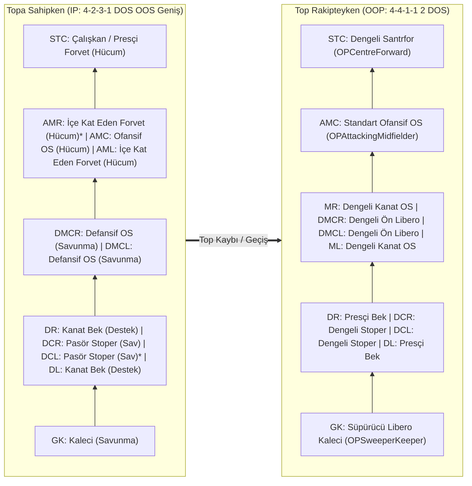

# GYR - BLACK PANTHER 4231 (FM26 & FM27): Mevki Bazlı Ağırlıklı Özellik (Attribute) ve Oyuncu Profili Rehberi

> **Kaynak Dosya:** `GYR - BLACK PANTHER 4231 FM26.fmf` / `tactics_man.dat`  
> **Matematiksel Puanlama Referansı:** [`fm26save/formulas.py`](../fm26save/formulas.py) (`TACTICAL_ROLE_DEFINITIONS`, `DUTY_ATTRIBUTE_DELTAS`, `OUT_OF_POSSESSION_ROLE_CATALOG`, `CA_POSITION_WEIGHTS_10`) ve [`FM27_VS_FM26_COMPLETE_DIFFERENCES_AND_ALGORITHMS_TR.md`](./FM27_VS_FM26_COMPLETE_DIFFERENCES_AND_ALGORITHMS_TR.md)

---

## 1. Taktik Kimlik Kartı ve Şekil Geçiş Mekaniği

| Parametre | Taktik İçi Değer | Açıklama |
| :--- | :--- | :--- |
| **Taktik Adı** | `GYR - BLACK PANTHER 4231` | Özel oyuncu talimatlarıyla güçlendirilmiş yüksek tempolu 4-2-3-1 |
| **Taktiksel Stil** | `Custom Gegenpress` (Özel Gegenpress) | Top kaybı anında şok pres, dikey ve hızlı hücum geçişleri |
| **Mentalite** | `Hücum Ağırlıklı` (`Attacking`, `6/7`) | Yüksek risk, hızlı top dolaşımı ve ceza sahasına çok oyunculu koşular |
| **Topa Sahipken (IP) Diziliş** | `4-2-3-1 DOS OOS Geniş` | `GK` – `DR, DCR, DCL, DL` – `DMCR, DMCL` – `AMR, AMC, AML` – `STC` |
| **Top Rakipteyken (OOP) Diziliş** | `4-4-1-1 (2 DOS)` | Kanat forvetler (`AMR/AML`) orta saha çizgisine (`MR/ML`) iner; `AMC` forvet arkasında pres yönlendiricisi olarak kalır |

> [!IMPORTANT]
> **Taktik Dosyasındaki Gizli Asimetriler (`tactics_man.dat` İkili Analizi):**
> Taktik sahada simetrik görünmesine rağmen **3 noktada özel oyuncu talimatı farkı** içerir ve bu farklar özellik ağırlıklarını doğrudan değiştirir:
> 1. **Sol Stoper (`DCL`) vs Sağ Stoper (`DCR`):** İkisi de `Pasör Stoper (Savunma)` olmasına rağmen, **Sol Stoper (`DCL`)** yuvasında ekstra top taşıma/genişlik talimatı (`bit 5`) açıktır. Bu nedenle `DCL` için **Pas (`Passing`), Soğukkanlılık (`Composure`), Vizyon (`Vision`), İlk Kontrol (`First Touch`) ve Top Sürme (`Dribbling`)** ağırlıkları `DCR`'ye göre daha yüksektir.
> 2. **Sağ Kanat (`AMR`) vs Sol Kanat (`AML`):** İkisi de `İçe Kat Eden Forvet (Hücum)` olmasına rağmen, **Sağ Kanat (`AMR`)** yuvasında ekstra yaratıcılık/dolaşım talimatı (`bit 14` + `first_bits=8`) tanımlıdır. Bu yüzden `AMR` "Oyun Kurucu Skorer Kanat" (`Pas + Vizyon` ağırlığı yüksek), `AML` ise "Saf Bitirici Kanat Forvet" (`Bitiricilik + Soğukkanlılık` ağırlığı yüksek) profilindedir.
> 3. **Çift Ön Libero (`DMCR` & `DMCL`):** Topa sahipken ikisi de `Defansif Orta Saha (Savunma)` rolündedir (bekler ve 4 hücumcu aynı anda çıktığı için merkezi emniyete alırlar), ancak topsuz oyunda agresif şok pres talimatı (`bit 23`) açıktır.

---

## 2. Matematiksel Ağırlıklandırma Metodolojisi ve 4 Önem Grubu

Bu rehberdeki her özelliğin ağırlık puanı (**`1.0 – 10.0`** ölçeğinde), oyun motorunun 4 farklı hesaplama katmanının birleştirilmesiyle elde edilmiştir:

$$W_{\text{Ham}} = \underbrace{W_{\text{IP}}}_{\text{Toplu Rol + Görev } (0..2)} + \underbrace{W_{\text{OOP}}}_{\text{Topsuz Rol } (0..2)} + \underbrace{W_{\text{Motor/CA}}}_{\text{Maç Motoru Etki } (0..2)} + \underbrace{W_{\text{Taktik}}}_{\text{Gegenpress + Özel Bitler } (0..2)}$$

Her mevki için özellikler tek bir "Birincil" torbasına yığılmak yerine, önem ve ağırlık katsayısına göre **4 kademeli gruba** ayrılmıştır:

| Grup Kodu | Grup Adı | Ağırlık Puanı (`10` Üzerinden) | Oyuncu Değerlendirme Payı | Tanım ve Transferdeki Anlamı |
| :--- | :--- | :---: | :---: | :--- |
| **🔥 GRUP 0** | **`S-Tier` — En Önemliler (Vazgeçilmez Elit Çekirdek)** | **`8.0 – 10.0`** (`~4x` Etkili) | **`%45`** | Hem `IP Key (2x)` hem `OOP Key (2x)` hem de maç motoru (`CA`) ağırlığında zirvede kesişen **4–5 mutlak kırmızı çizgi** özellik. Bunlardan biri düşükse oyuncu o mevkide aksar. |
| **⭐ GRUP 1** | **`A-Tier` — Birincil Anahtar Özellikler** | **`5.5 – 7.9`** (`~2.5x` Etkili) | **`%30`** | Rolün toplu (`IP`) veya topsuz (`OOP`) ayağında anahtar (`2x`) olan ve oyuncunun kalitesini/tavanını belirleyen temel özellikler. |
| **⚡ GRUP 2** | **`B+ Tier` — Taktiksel & Asimetrik Fark Yaratanlar** | **`3.5 – 5.4`** (`~1.5x` Etkili) | **`%15`** | `GYR Black Panther` özel oyuncu talimatlarını (`bit 5, 14, 19, 23`) ve şok pres / geçiş oyununu taşıyan özellikler. |
| **🧩 GRUP 3** | **`B-Tier` — İkincil / Tamamlayıcı Özellikler** | **`1.5 – 3.4`** (`1.0x` Etkili) | **`%10`** | Rol şablonunda `Preferable (1x)` olan, oyuncuyu iyi seviyeden elit seviyeye taşıyan destekleyici özellikler. |

---

## 3. Genel "Black Panther" DNA'sı (Tüm Saha Oyuncuları İçin Ortak Taban Ağırlıklar)

Hangi mevkide oynarsa oynasın, `Hücum Ağırlıklı (6/7)` + `Özel Gegenpress` temposunu 90 dakika kaldırabilmesi için **tüm 10 saha oyuncusunda** taban olarak aranan 6 temel özellik ve taktiksel ağırlıkları:

| Sıra | Özellik (TR / EN) | Kategori | Taktik Genel Ağırlığı | Neden Tüm Takım İçin Zorunlu? |
| :---: | :--- | :--- | :---: | :--- |
| **1** | **Hızlanma (`Acceleration`)** | Fiziksel | **`9.8 / 10`** | Maç motorunda tüm mevkilerde en yüksek etki katsayısına sahip fiziksel özellik; hem ilk 3 saniyelik şok pres hem dikey geçiş hücumlarında ilk adım üstünlüğü. |
| **2** | **Karar Alma (`Decisions`)** | Zihinsel | **`9.2 / 10`** | Yüksek tempoda topu ne zaman dikey oynayacağını, ne zaman tutup ne zaman pres yapacağını belirleyen ana zihinsel çarpan. |
| **3** | **Dayanıklılık (`Stamina`)** | Fiziksel | **`8.8 / 10`** | Hücum mentalitesi + Gegenpress temposunda 60. dakikadan sonra fiziksel ve zihinsel çöküş yaşamamak için şarttır. |
| **4** | **Çalışkanlık (`Work Rate`)** | Zihinsel | **`8.5 / 10`** | Oyuncunun topsuz oyunda pres ve geri koşu talimatlarını (`bit 23`) ne kadar yüksek eforla uygulayacağını belirler. |
| **5** | **Sezgi (`Anticipation`)** | Zihinsel | **`8.2 / 10`** | Rakibin pas kanallarını önceden okuyup sahipsiz/ikinci topları (`second balls`) toplamak için tüm bloklarda kritiktir. |
| **6** | **Takım Oyunu (`Teamwork`)** | Zihinsel | **`7.8 / 10`** | `4-2-3-1` $\leftrightarrow$ `4-4-1-1` geçişlerinde bloklar arası kopukluk yaşanmasını engeller ve talimat sadakatini sağlar. |

---

## 4. Mevki Bazlı Ağırlıklı Özellik ve Profil Analizi

---

### 4.1. KALECİ (`GK`)

- **Topa Sahipken (IP) Rolü:** `Kaleci - Savunma` (`Goalkeeper - Defend`) + *Özel dağıtım talimatı (`bit 6`)*
- **Top Rakipteyken (OOP) Rolü:** `Süpürücü Libero Kaleci` (`OPSweeperKeeper`)
- **Mevki Puanlama Denklemi:** $\text{Skor}_{\text{GK}} = 0.45 \cdot \text{Grup}_0 + 0.30 \cdot \text{Grup}_1 + 0.15 \cdot \text{Grup}_2 + 0.10 \cdot \text{Grup}_3$

#### Aranan Genel Oyuncu Profili
Top kalecideyken gereksiz çalım/uzun pas riskine girmeyen (`Goalkeeper - Defend`), ancak takım topu kaybettiğinde ve savunma çizgisi önde yakalandığında ceza sahası dışına kadar çıkıp atılan uzun topları süpüren (`OPSweeperKeeper`) **çevik, bire birde devleşen, yüksek karar kalitesine sahip modern süpürücü kaleci**.

| Önem Grubu ve Katman | Ağırlıklı Özellikler (`[Ağırlık / 10]` — Katman Kırılımı) |
| :--- | :--- |
| **🔥 GRUP 0 (`S-Tier`) — EN ÖNEMLİLER** *(Vazgeçilmez Elit Çekirdek — `%45` Pay)* | 1. **Refleksler (`Reflexes`) — `[10.0]`** *(IP: `2x` \| OOP: `1x` \| Motor CA: `7.8`)* — Çizgi ve yakın mesafe kurtarışlarının birincil belirleyicisi. 2. **Karar Alma (`Decisions`) — `[9.8]`** *(IP: `1x` \| OOP: `2x` \| Motor CA: `10.0`)* — Kaleden ne zaman çıkıp ne zaman çizgide kalacağını belirleyen en yüksek motor ağırlıklı özellik. 3. **Pozisyon Alma (`Positioning`) — `[9.5]`** *(IP: `2x` \| OOP: `2x` \| Motor CA: `4.2`)* — Hem toplu hem topsuz rolde `2x` anahtar olan şut açısı kapatma becerisi. 4. **Bire Bir (`One on Ones`) — `[9.1]`** *(IP: `1x` \| OOP: `2x` \| Taktik: `+1.0`)* — Önde kurulan savunma arkasına sarkan forvetlere karşı en hayati kurtarış özelliği. 5. **Çeviklik (`Agility`) — `[8.9]`** *(IP: `2x` \| OOP: `1x` \| Motor CA: `7.7`)* — Köşelere uzanma ve ikinci hamle hızı. |
| **⭐ GRUP 1 (`A-Tier`) — BİRİNCİL ANAHTAR** *(Rol Tavanını Belirleyenler — `%30` Pay)* | • **Konsantrasyon (`Concentration`) — `[7.8]`** *(IP: `2x` \| OOP: `1x` \| CA: `5.4`)* — Az şut gelen maçlarda 90. dakikada hata yapmamak için. • **Ceza Sahası Hakimiyeti (`Command of Area`) — `[7.6]`** *(IP: `2x` \| OOP: `1x` \| CA: `4.9`)* • **Sezgi (`Anticipation`) — `[7.0]`** *(IP: `1x` \| OOP: `2x`)* — Savunma arkasına atılacak ara pası erken okuma. • **Elle Kontrol (`Handling`) — `[6.9]`** *(IP: `2x` \| CA: `7.7`)* — Seken top (`rebound`) vermemek için. • **Hava Hakimiyeti (`Aerial Reach`) — `[6.2]`** *(IP: `2x` \| CA: `5.5`)* |
| **⚡ GRUP 2 (`B+ Tier`) — TAKTİKSEL & OOP** *(`OPSweeperKeeper` Süpürme Paketi — `%15` Pay)* | • **Ani Çıkış (`Rushing Out Tendency`) — `[6.4]`** *(OOP: `2x` \| Taktik: `+1.0`)* — Savunma arkası toplara tereddütsüz çıkış. • **Hızlanma (`Acceleration`) — `[6.1]`** *(OOP: `2x` \| CA: `5.9`)* — Ceza sahası dışına fırlama çabukluğu. • **Degaj (`Kicking`) — `[5.5]`** *(IP: `2x` \| CA: `4.3`)* & **İletişim (`Communication`) — `[5.3]`** *(IP: `2x` \| CA: `3.7`)* • **Hız (`Pace`) — `[4.4]`** *(OOP: `2x`)* |
| **🧩 GRUP 3 (`B-Tier`) — İKİNCİL / TAMAMLAYICI** *(Destekleyici Özellikler — `%10` Pay)* | • **Cesaret (`Bravery`) — `[3.4]`** *(CA: `5.1`)* • **Elle Oyuna Sokma (`Throwing`) — `[3.0]`** *(IP: `1x` \| Kontra başlatma)* • **Soğukkanlılık (`Composure`) — `[2.8]`** *(OOP: `1x`)* & **Pas (`Passing`) — `[2.2]`** *(Bit 6 dağıtım)* |

---

### 4.2. SAĞ BEK (`DR`) & SOL BEK (`DL`)

- **Topa Sahipken (IP) Rolü:** `Kanat Bek - Destek` (`Wing-Back - Support`) + *Özel talimatlar (`bits [0, 5]`, `first_bits=8`)*
- **Top Rakipteyken (OOP) Rolü:** `Presçi Bek` (`OPPressingFullBack`) + *Agresif pres talimatı (`bit 23`)*
- **Mevki Puanlama Denklemi:** $\text{Skor}_{\text{DR/DL}} = 0.45 \cdot \text{Grup}_0 + 0.30 \cdot \text{Grup}_1 + 0.15 \cdot \text{Grup}_2 + 0.10 \cdot \text{Grup}_3$

#### Aranan Genel Oyuncu Profili
Taktiğin fiziksel yükünü en çok çeken mevkidir. Önlerindeki kanat oyuncuları (`AMR/AML`) `İçe Kat Eden Forvet` olarak ceza sahasına girdiğinde tüm çizgiyi tek başına genişleten, dip çizgiye inip orta kesen; top kaybedildiğinde ise rakip kanat oyuncusuna anında şok pres yapan **yüksek ciğerli, patlayıcı atlet bek**.

| Önem Grubu ve Katman | Ağırlıklı Özellikler (`[Ağırlık / 10]` — Katman Kırılımı) |
| :--- | :--- |
| **🔥 GRUP 0 (`S-Tier`) — EN ÖNEMLİLER** *(Vazgeçilmez Elit Çekirdek — `%45` Pay)* | 1. **Hızlanma (`Acceleration`) — `[10.0]`** *(IP: `2x` \| OOP: `2x` \| Motor CA: `10.0`)* — Hem hücum bindirmesinde hem karşı preste en yüksek ağırlıklı özellik. 2. **Hız (`Pace`) — `[9.4]`** *(IP: `2x` \| OOP: `2x` \| Motor CA: `8.6`)* — 70 metrelik koridoru ileri-geri kapatma sürati. 3. **Dayanıklılık (`Stamina`) — `[9.1]`** *(IP: `2x` \| OOP: `2x` \| Motor CA: `7.1`)* — Çizgiyi tek başına kullandığı için 90 dakika düşmeyen kondisyon. 4. **Çalışkanlık (`Work Rate`) — `[8.3]`** *(IP: `2x` \| OOP: `2x` \| Taktik: `+1.0`)* — İleri çıktıktan sonra savunmaya geri koşu disiplini. 5. **Top Kapma (`Tackling`) — `[8.0]`** *(IP: `2x` \| OOP: `2x` \| Motor CA: `4.2`)* — Kanatta bire birde temiz müdahale. |
| **⭐ GRUP 1 (`A-Tier`) — BİRİNCİL ANAHTAR** *(Rol Tavanını Belirleyenler — `%30` Pay)* | • **Karar Alma (`Decisions`) — `[7.5]`** *(IP Support: `2x` \| OOP: `1x` \| CA: `8.0`)* • **Sezgi (`Anticipation`) — `[6.8]`** *(IP: `1x` \| OOP: `2x` \| CA: `4.2`)* — Rakip kanada atılan pası kesme. • **Markaj (`Marking`) — `[6.5]`** *(IP: `2x` \| OOP: `1x`)* • **Orta Yapma (`Crossing`) — `[6.2]`** *(IP: `2x` \| Taktik `bit 0,5`: `+0.8`)* — Çizgiye inip kesilen ortalar. • **Takım Oyunu (`Teamwork`) — `[5.9]`** *(IP: `2x` \| OOP: `1x`)* • **Top Sürme (`Dribbling`) — `[5.7]`** *(IP: `2x` \| Taktik `bit 5`: `+0.5`)* |
| **⚡ GRUP 2 (`B+ Tier`) — TAKTİKSEL & OOP** *(`OPPressingFullBack` + Bindirme Paketi — `%15` Pay)* | • **Çeviklik (`Agility`) — `[5.4]`** *(IP: `1x` \| OOP: `1x` \| CA: `7.3`)* — Çabuk yön değiştirme. • **Topsuz Alan (`Off the Ball`) — `[5.1]`** *(IP: `2x` \| `first_bits=8`)* — Bindirme zamanlaması. • **Agresiflik (`Aggression`) — `[4.8]`** *(OOP: `2x` \| `bit 23` şok pres)* & **Cesaret (`Bravery`) — `[4.2]`** *(OOP: `2x`)* • **Pas (`Passing`) — `[4.6]`** *(IP Support: `2x`)* • **Pozisyon Alma (`Positioning`) — `[4.3]`** *(IP: `1x` \| OOP: `1x` \| CA: `4.6`)* & **Konsantrasyon (`Concentration`) — `[4.3]`** |
| **🧩 GRUP 3 (`B-Tier`) — İKİNCİL / TAMAMLAYICI** *(Destekleyici Özellikler — `%10` Pay)* | • **Güç (`Strength`) — `[3.4]`** *(OOP: `1x` \| CA: `6.0`)* — Omuz omuza mücadele. • **İlk Kontrol (`First Touch`) — `[3.2]`** *(IP: `1x` \| CA: `3.9`)* • **Teknik (`Technique`) — `[2.6]`** *(IP: `1x`)* & **Denge (`Balance`) — `[2.2]`** *(IP: `1x`)* |
| **İdeal Ayak & Oyun Tarzları (`Traits`)** | • `DR` için **Sağ Ayak**, `DL` için **Sol Ayak** (`foot_pref = same_side`; çizgiyi genişletip orta açacakları için ters ayak `%6` verim düşürür). • *Önerilen Tarzlar:* `Gets Forward Whenever Possible` (Her Fırsatta İleri Çıkar), `Runs With Ball Down Right/Left` (Topu Sağdan/Soldan Sürer). |

---

### 4.3. SAĞ STOPER (`DCR`) & SOL STOPER (`DCL`) — *Asimetrik Ağırlıklı*

- **Topa Sahipken (IP) Rolü:** `Pasör Stoper - Savunma` (`Ball-Playing Defender - Defend`) *(Not: **`DCL`** yuvasında ekstra `bit 5` topla geniş çıkma/taşıma talimatı açıktır)*
- **Top Rakipteyken (OOP) Rolü:** `Dengeli Stoper` (`OPCentreBack`)
- **Mevki Puanlama Denklemi:** $\text{Skor}_{\text{DC}} = 0.45 \cdot \text{Grup}_0 + 0.30 \cdot \text{Grup}_1 + 0.15 \cdot \text{Grup}_2 + 0.10 \cdot \text{Grup}_3$

#### Aranan Genel Oyuncu Profili
Önde kurulan savunma hattında arkadaki 40 metrelik boşluğu hızıyla kapatabilen, hava toplarında ezilmeyen ve top kazanıldığında baskı altında panik yapmadan kanat forvetlere veya 10 numaraya dikey kilit pas çıkarabilen **hızlı ve ayağı temiz modern stoper ikilisi**.

| Önem Grubu ve Katman | Ağırlıklı Özellikler (`[DCR Ağırlığı / DCL Ağırlığı]` — Katman Kırılımı) |
| :--- | :--- |
| **🔥 GRUP 0 (`S-Tier`) — EN ÖNEMLİLER** *(Vazgeçilmez Elit Çekirdek — `%45` Pay)* | 1. **Pozisyon Alma (`Positioning`) — `[10.0 / 9.8]`** *(IP Defend: `2x` \| OOP: `2x` \| Motor CA: `8.1`)* — Savunma çizgisini ve ofsayt hizasını koruyan bir numaralı özellik. 2. **Zıplama (`Jumping Reach`) — `[9.6 / 9.6]`** *(IP: `2x` \| OOP: `2x` \| Motor CA: `6.0`)* — Hava hakimiyeti tablosunda (`tables.fmf`) fiziksel üstünlüğün anahtarı. 3. **Markaj (`Marking`) — `[9.0 / 9.0]`** *(IP: `2x` \| OOP: `2x` \| Motor CA: `8.2`)* & **Top Kapma (`Tackling`) — `[9.0 / 8.8]`** *(IP: `2x` \| OOP: `2x`)* 4. **Karar Alma (`Decisions`) — `[8.5 / 8.8]`** *(IP: `2x` \| OOP: `1x` \| Motor CA: `10.0`)* — Stoperde maç motorunun en yüksek CA ağırlıklı zihinsel özelliği. 5. **Hız (`Pace`) — `[8.2 / 8.2]`** *(IP: `1x` \| OOP: `1x` \| Yüksek Çizgi Taktik: `+1.5`)* — Yüksek savunma hattında savunma arkası koşuları yakalamak için mutlak zorunluluk. |
| **⭐ GRUP 1 (`A-Tier`) — BİRİNCİL ANAHTAR** *(Rol Tavanını Belirleyenler — `%30` Pay)* | • **Güç (`Strength`) — `[7.9 / 7.9]`** *(IP: `2x` \| OOP: `2x` \| CA: `5.6`)* — Santrforlarla fiziksel boğuşma. • **Kafa Vuruşu (`Heading`) — `[7.5 / 7.5]`** *(IP: `2x` \| OOP: `2x` \| CA: `4.2`)* • **Konsantrasyon (`Concentration`) — `[6.5 / 6.5]`** *(IP Defend: `2x` \| OOP: `1x`)* • **Pas (`Passing`) — `[5.8 / 7.4]`** *(IP: `2x` \| `DCL bit 5`: **`+1.2`**)* — *Sol stoperde (`DCL`) `7.4` ağırlıkla `A-Tier` üst sıraya çıkar!* • **Soğukkanlılık (`Composure`) — `[5.6 / 7.0]`** *(IP: `2x` \| `DCL bit 5`: **`+0.8`**)* — Ön alan baskısı altında topu kaybetmeme. |
| **⚡ GRUP 2 (`B+ Tier`) — TAKTİKSEL & `DCL` ASİMETRİSİ** *(Geniş Alan Savunması & Topla Çıkış — `%15` Pay)* | • **Hızlanma (`Acceleration`) — `[5.2 / 5.2]`** *(Motor CA: `5.0` \| Yüksek Çizgi: `+1.2`)* — İlk 5 metrede forvetten geri kalmama. • **Sezgi (`Anticipation`) — `[4.8 / 4.8]`** *(IP: `1x` \| OOP: `1x` \| CA: `4.3`)* & **Çeviklik (`Agility`) — `[4.5 / 4.5]`** *(CA: `5.2`)* • **Vizyon (`Vision`) — `[3.2 / 5.0]`** & **İlk Kontrol (`First Touch`) — `[3.4 / 4.8]`** & **Top Sürme (`Dribbling`) — `[2.2 / 4.5]`** *(Özellikle **`DCL` Sol Stoper** yuvasında topla çıkma talimatı `bit 5` açık olduğu için `DCL`'de kritik fark yaratır)*. |
| **🧩 GRUP 3 (`B-Tier`) — İKİNCİL / TAMAMLAYICI** *(Destekleyici Özellikler — `%10` Pay)* | • **Cesaret (`Bravery`) — `[3.4 / 3.4]`** *(IP: `1x` \| OOP: `1x`)* • **Agresiflik (`Aggression`) — `[2.6 / 2.6]`** *(IP: `1x`)* & **Teknik (`Technique`) — `[2.5 / 3.2]`** *(IP: `1x`)* |
| **İdeal Ayak & Oyun Tarzları (`Traits`)** | • **`DCR` için Sağ Ayak**, **`DCL` için Sol Ayak** (veya güçlü zayıf ayak `weak_foot >= 14`). `DCL` sol kenara doğru topla çıktığı için sol ayaklı olması pas kanallarını `%15` daha güvenli açar. • *Önerilen Tarzlar:* `Brings Ball Out Of Defence` (Topu Savunmadan Çıkarır — **yalnızca `DCL` için**), `Tries Long Range Passes` (Uzun Menzilli Paslar Dener). |

---

### 4.4. SAĞ VE SOL DEFANSİF ORTA SAHA (`DMCR` & `DMCL` — Çift Ön Libero)

- **Topa Sahipken (IP) Rolü:** `Defansif Orta Saha - Savunma` (`Defensive Midfielder - Defend`)
- **Top Rakipteyken (OOP) Rolü:** `Dengeli Ön Libero` (`OPDefensiveMidfielder`) + *Agresif Pres/Sıkıştırma talimatı (`bit 23`)*
- **Mevki Puanlama Denklemi:** $\text{Skor}_{\text{DM}} = 0.45 \cdot \text{Grup}_0 + 0.30 \cdot \text{Grup}_1 + 0.15 \cdot \text{Grup}_2 + 0.10 \cdot \text{Grup}_3$

#### Aranan Genel Oyuncu Profili
Bu taktikte hücuma aynı anda **6 oyuncu** (`DR`, `DL`, `AMR`, `AMC`, `AML`, `STC`) katıldığı için, iki ön libero (`DMCR` ve `DMCL`) takımın **emniyet sübabıdır (`Rest-Defense`)**. Topa sahipken pozisyonlarını kaybetmeyip dönen topları (`second balls`) süpüren ve oyunu basitçe yeniden kuran; top kaybedildiğinde ise merkezden hızla çıkacak rakip kontrataklarını daha başlamadan boğan **yüksek pozisyon bilgili, zeki ve agresif top kapıcı ikili**.

| Önem Grubu ve Katman | Ağırlıklı Özellikler (`[Ağırlık / 10]` — Katman Kırılımı) |
| :--- | :--- |
| **🔥 GRUP 0 (`S-Tier`) — EN ÖNEMLİLER** *(Vazgeçilmez Elit Çekirdek — `%45` Pay)* | 1. **Top Kapma (`Tackling`) — `[10.0]`** *(IP: `2x` \| OOP: `2x` \| Motor CA: `5.8` \| Taktik: `+1.0`)* — Merkezdeki ikili mücadeleleri kazanmanın birincil şartı. 2. **Pozisyon Alma (`Positioning`) — `[9.9]`** *(IP: `2x` \| OOP: `2x` \| Motor CA: `5.6` \| Taktik: `+1.0`)* — 6 oyuncu hücumdayken stoperlerin önündeki tehlike bölgesini kapatma. 3. **Sezgi (`Anticipation`) — `[9.6]`** *(IP: `2x` \| OOP: `2x` \| Motor CA: `4.7` \| Taktik: `+1.0`)* — Dönen topları ve rakip pas kanallarını herkesten önce okuma. 4. **Karar Alma (`Decisions`) — `[8.8]`** *(IP: `1x` \| OOP: `1x` \| Motor CA: `10.0`)* — Ön liberoda maç motorunun en yüksek ağırlıklı (`10.0`) özelliği; ne zaman basıp ne zaman alan tutacağını belirler. 5. **Markaj (`Marking`) — `[8.2]`** *(IP Defend: `2x` \| OOP: `2x` \| Motor CA: `5.0`)* — Rakip 10 numara ve iç koridor koşucularını kilitleme. |
| **⭐ GRUP 1 (`A-Tier`) — BİRİNCİL ANAHTAR** *(Rol Tavanını Belirleyenler — `%30` Pay)* | • **Konsantrasyon (`Concentration`) — `[7.6]`** *(IP: `2x` \| OOP: `2x`)* — 90 dakika geçiş hatası yapmama. • **Takım Oyunu (`Teamwork`) — `[7.4]`** *(IP: `2x` \| OOP: `2x`)* — Çift pivot uyumu ve disiplin. • **Çalışkanlık (`Work Rate`) — `[6.8]`** *(IP: `1x` \| OOP: `1x` \| Taktik `bit 23`: `+1.0`)* • **Dayanıklılık (`Stamina`) — `[6.5]`** *(IP: `1x` \| OOP: `1x` \| CA: `4.0` \| Taktik: `+0.8`)* • **Güç (`Strength`) — `[5.8]`** *(IP: `1x` \| OOP: `1x` \| CA: `5.9`)* |
| **⚡ GRUP 2 (`B+ Tier`) — TAKTİKSEL & ŞOK PRES** *(`bit 23` Pres + Oyun Kurulum Köprüsü — `%15` Pay)* | • **Hızlanma (`Acceleration`) — `[5.4]`** *(Motor CA: `6.7` \| `bit 23` şok pres: `+0.8`)* — Geniş merkezi kapatma çabukluğu. • **Agresiflik (`Aggression`) — `[5.1]`** *(IP: `1x` \| OOP: `1x` \| `bit 23`: `+0.8`)* • **Çeviklik (`Agility`) — `[4.6]`** *(Motor CA: `6.7`)* & **Hız (`Pace`) — `[4.2]`** *(Motor CA: `4.9`)* • **İlk Kontrol (`First Touch`) — `[4.4]`**, **Pas (`Passing`) — `[4.2]`**, **Soğukkanlılık (`Composure`) — `[4.0]`** *(Kazanılan topu pres altında 10 numaraya ve kanatlara temiz aktarmak için `13+` olmalı)*. |
| **🧩 GRUP 3 (`B-Tier`) — İKİNCİL / TAMAMLAYICI** *(Destekleyici Özellikler — `%10` Pay)* | • **Vizyon (`Vision`) — `[3.2]`** *(Motor CA: `3.8`)* • **Cesaret (`Bravery`) — `[2.8]`** & **Denge (`Balance`) — `[2.5]`** |
| **İkili Uyum İpucu & Kaçınılması Gerekenler** | • **İdeal Çift Pivot Kombinasyonu:** İki DOS'tan birinin (**Örn. `DMCL`**) **Pas, İlk Kontrol ve Vizyon** değerinin `14+` olması (oyun kurucu kesici), diğerinin (**Örn. `DMCR`**) **Hızlanma, Top Kapma ve Agresiflik** değerinin `15+` olması (geniş alan süpürücüsü) merkezi kusursuzlaştırır. • *Kaçınılması Gereken Tarz:* `Gets Forward Whenever Possible` (Her Fırsatta İleri Çıkar) — merkezi boşaltacağı için bu taktikte tehlikelidir. |

---

### 4.5. SAĞ VE SOL OFANSİF KANATLAR (`AMR` & `AML`) — *Asimetrik Ağırlıklı*

- **Topa Sahipken (IP) Rolü:** `İçe Kat Eden Forvet - Hücum` (`Inside Forward - Attack`) *(Not: **`AMR`**'de `bits [5, 8, 14, 18]` + `first_bits=8` yaratıcılık/pas riski talimatı; **`AML`**'de `bits [5, 8, 18]` saf skorer talimatı mevcuttur)*
- **Top Rakipteyken (OOP) Rolü:** `MR` ve `ML` hattına çekilerek `Dengeli Kanat Orta Saha` (`OPWideMidfielder`) + *Özel pres/daralma talimatları (`bits [21, 23, 25, 27]`)*
- **Mevki Puanlama Denklemi:** $\text{Skor}_{\text{AMR/AML}} = 0.45 \cdot \text{Grup}_0 + 0.30 \cdot \text{Grup}_1 + 0.15 \cdot \text{Grup}_2 + 0.10 \cdot \text{Grup}_3$

#### Aranan Genel Oyuncu Profili
Klasik çizgi kanadı değil, **ikinci ve üçüncü santrfor** gibi çalışan skorer kanat forvetlerdir. Topa sahipken beklerin (`DR/DL`) açtığı koridoru kullanarak iç koridora (`Half-Space`) devrilen, çalımla veya savunma arkası diyagonal koşularla doğrudan kaleye inip gol vuruşu yapan; top rakipteyken ise `4-4-1-1` dizilişini oluşturmak üzere orta saha çizgisine (`MR/ML`) inip kanat savunmasına yardım eden **patlayıcı, bitirici ters ayaklı kanatlar**.

| Önem Grubu ve Katman | Ağırlıklı Özellikler (`[AMR Ağırlığı / AML Ağırlığı]` — Katman Kırılımı) |
| :--- | :--- |
| **🔥 GRUP 0 (`S-Tier`) — EN ÖNEMLİLER** *(Vazgeçilmez Elit Çekirdek — `%45` Pay)* | 1. **Hızlanma (`Acceleration`) — `[10.0 / 10.0]`** *(IP: `2x` \| OOP: `1x` \| Motor CA: `10.0` \| Taktik: `+1.2`)* — İç koridora patlayıcı giriş ve savunma arkası koşuların mutlak birincisi. 2. **Hız (`Pace`) — `[9.9 / 9.9]`** *(IP: `2x` \| OOP: `1x` \| Motor CA: `9.8` \| Taktik: `+1.2`)* — Açık alanda bekleri ve stoperleri ekarte etme sürati. 3. **Top Sürme (`Dribbling`) — `[8.8 / 8.8]`** *(IP: `2x` \| Motor CA: `3.8` \| Taktik `bit 5`: `+1.0`)* — Kanattan merkeze bire birde adam eksilterek kat etme. 4. **Topsuz Alan (`Off the Ball`) — `[8.5 / 8.5]`** *(IP: `2x` \| Taktik `bit 18`: `+1.0`)* — Arka direğe ve stoper-bek arasına (`channel`) yapılan diyagonal gol koşuları. 5. **Bitiricilik (`Finishing`) — `[8.2 / 8.6]`** *(IP: `2x` \| FM27 xG `angle_shot_to_goal`: `+1.2`)* — Ceza sahasına girildiğinde skoru üretme (**`AML`'de saf golcü rolüyle daha da ağır basar**). |
| **⭐ GRUP 1 (`A-Tier`) — BİRİNCİL ANAHTAR** *(Rol Tavanını Belirleyenler — `%30` Pay)* | • **İlk Kontrol (`First Touch`) — `[7.8 / 7.8]`** *(IP: `2x` \| Motor CA: `4.0`)* — Hızla giderken topu önüne kusursuz alma. • **Çeviklik (`Agility`) — `[7.5 / 7.5]`** *(IP: `2x` \| Motor CA: `6.1`)* — Dar alanda seri bilek ve vücut çalımı. • **Dayanıklılık (`Stamina`) — `[7.2 / 7.2]`** *(IP: `1x` \| OOP `OPWideMid`: `2x` \| CA: `5.9`)* — `AMR/AML` $\leftrightarrow$ `MR/ML` mekik dokuma kondisyonu. • **Teknik (`Technique`) — `[6.6 / 6.6]`** *(IP: `2x`)* — Plase ve zor açılardan vuruş/pas kalitesi. • **Soğukkanlılık (`Composure`) — `[6.2 / 6.6]`** *(IP Attack: `1x` \| Taktik: `+0.8`)* & **Sezgi (`Anticipation`) — `[6.0 / 6.0]`** *(IP: `1x` \| OOP: `1x`)* |
| **⚡ GRUP 2 (`B+ Tier`) — TAKTİKSEL, `AMR` ASİMETRİSİ & OOP** *(`AMR` Oyun Kurucu + `4-4-1-1` Geri Dönüş — `%15` Pay)* | • **Pas (`Passing`) — `[5.4 / 3.6]`** & **Vizyon (`Vision`) — `[5.2 / 3.4]`** *(**`AMR` Sağ Kanat** yuvasında `bit 14` + `first_bits=8` yaratıcılık talimatı açık olduğu için `AMR`'de `B+ Tier` üst sıraya çıkar!)* • **Çalışkanlık (`Work Rate`) — `[5.0 / 5.0]`** & **Takım Oyunu (`Teamwork`) — `[4.6 / 4.6]`** *(OOP `OPWideMidfielder`: `2x` — top rakipteyken `MR/ML`'ye inip beke yardım etmek için)* • **Karar Alma (`Decisions`) — `[4.5 / 4.2]`** *(OOP: `1x` \| CA: `4.4`)* • **Pozisyon Alma (`Positioning`) — `[4.0 / 4.0]`** & **Top Kapma (`Tackling`) — `[3.8 / 3.8]`** *(OOP `OPWideMidfielder` savunma katkısı)*. |
| **🧩 GRUP 3 (`B-Tier`) — İKİNCİL / TAMAMLAYICI** *(Destekleyici Özellikler — `%10` Pay)* | • **Özel Yetenek (`Flair`) — `[3.4 / 3.4]`** *(IP: `1x`)* & **Denge (`Balance`) — `[3.2 / 3.2]`** *(IP: `1x`)* • **Uzaktan Şut (`Long Shots`) — `[3.0 / 3.0]`** *(IP: `1x` — Not: FM27 `v26.8.4.34` xG modelinde kalabalık arkası uzaktan şut cezası `%113` arttığı için ceza sahasına girip vurmak çok daha verimlidir)* • **Orta Yapma (`Crossing`) — `[2.8 / 2.8]`** *(CA: `3.8`)* & **Güç (`Strength`) — `[2.6 / 2.6]`** |
| **İdeal Ayak & Oyun Tarzları (`Traits`)** | • **`AMR` (Sağ Kanat) için Sol Ayak**, **`AML` (Sol Kanat) için Sağ Ayak** (`foot_pref = inverted`; içe kat edip kaleyi cepheden görmek FM27'nin `angle_shot_to_goal` (`+2.92`) xG ödülünü doğrudan tetikler). • *Önerilen Tarzlar:* `Cuts Inside From Both Wings` (Kanattan İçe Kat Eder), `Likes To Try To Beat Offside Trap` (Ofsayt Tuzaklarını Kırmayı Sever), `Places Shots` (Plase Şut Vurur). |

---

### 4.6. MERKEZ OFANSİF ORTA SAHA / 10 NUMARA (`AMC`)

- **Topa Sahipken (IP) Rolü:** `Ofansif Orta Saha - Hücum` (`Attacking Midfielder - Attack`) + *Özel dolaşım/risk talimatları (`bits [14, 19]`, `first_bits=8`)*
- **Top Rakipteyken (OOP) Rolü:** `Standart Ofansif Orta Saha` (`OPAttackingMidfielder`) + *Ön alan pres talimatları (`bits [21, 23]`)*
- **Mevki Puanlama Denklemi:** $\text{Skor}_{\text{AMC}} = 0.45 \cdot \text{Grup}_0 + 0.30 \cdot \text{Grup}_1 + 0.15 \cdot \text{Grup}_2 + 0.10 \cdot \text{Grup}_3$

#### Aranan Genel Oyuncu Profili
Takımın hücum beyni ve ceza sahası çevresindeki bağlantı noktasıdır. İki ön liberonun (`DMCR/DMCL`) savunmada kalmasıyla oluşan merkez boşlukta top alıp dönen (`bit 19` serbest dolaşım), üç hücumcuyu (`AMR`, `AML`, `STC`) savunma arkasına kaçıran (`bit 14` daha fazla risk al), aynı zamanda `Hücum` göreviyle ceza sahasına geç koşular atıp skor üreten **patlayıcı, vizyoner ve skorer 10 numara**.

| Önem Grubu ve Katman | Ağırlıklı Özellikler (`[Ağırlık / 10]` — Katman Kırılımı) |
| :--- | :--- |
| **🔥 GRUP 0 (`S-Tier`) — EN ÖNEMLİLER** *(Vazgeçilmez Elit Çekirdek — `%45` Pay)* | 1. **Hızlanma (`Acceleration`) — `[10.0]`** *(IP Attack: `2x` \| OOP: `2x` \| Motor CA: `10.0`)* — Rakip ön liberodan ilk adımda sıyrılma ve ön alan presini başlatma. 2. **Karar Alma (`Decisions`) — `[9.5]`** *(IP: `2x` \| OOP: `2x` \| Motor CA: `5.1` \| Taktik: `+1.0`)* — Şut mu, ara pası mı, çalım mı kararını saliseler içinde doğru verme. 3. **Topsuz Alan (`Off the Ball`) — `[9.0]`** *(IP: `2x` \| OOP: `1x` \| Taktik `bit 19` Roam: `+1.0`)* — Boş koridorları (`pockets`) bulup top isteme ve ceza sahasına sızma. 4. **Vizyon (`Vision`) — `[8.8]`** *(IP: `2x` \| Motor CA: `5.0` \| Taktik `bit 14`: `+1.2`)* & **Pas (`Passing`) — `[8.6]`** *(IP: `2x` \| Taktik `bit 14`: `+1.2`)* — Üç forveti (`AMR, AML, STC`) savunma arkasına kaçıran öldürücü ara paslar. 5. **İlk Kontrol (`First Touch`) — `[8.5]`** *(IP: `2x` \| Motor CA: `4.3` \| Taktik: `+1.0`)* — Kalabalık merkezde sırtı dönük topu tek dokunuşla yönlendirme. |
| **⭐ GRUP 1 (`A-Tier`) — BİRİNCİL ANAHTAR** *(Rol Tavanını Belirleyenler — `%30` Pay)* | • **Sezgi (`Anticipation`) — `[7.8]`** *(IP: `2x` \| OOP: `2x`)* — İkinci topları ve savunma hatalarını okuma. • **Top Sürme (`Dribbling`) — `[7.4]`** *(IP: `2x` \| Taktik: `+0.8`)* — Merkezden delici dripling. • **Teknik (`Technique`) — `[7.0]`** *(IP: `2x` \| Motor CA: `4.4`)* • **Hız (`Pace`) — `[6.6]`** *(IP Attack: `1x` \| OOP: `1x` \| Motor CA: `8.2`)* • **Çeviklik (`Agility`) — `[6.2]`** *(IP: `1x` \| OOP: `1x` \| Motor CA: `5.4`)* • **Özel Yetenek (`Flair`) — `[5.8]`** *(IP: `2x`)* |
| **⚡ GRUP 2 (`B+ Tier`) — TAKTİKSEL, SKOR & PRES** *(Ceza Sahası Girişleri + Ön Alan Presi — `%15` Pay)* | • **Soğukkanlılık (`Composure`) — `[5.4]`** *(IP Attack: `1x` \| Taktik: `+0.8`)* & **Bitiricilik (`Finishing`) — `[5.2]`** *(IP Attack: `1x` \| Taktik: `+0.8`)* — `Attack` görevinde ikinci forvet gibi ceza sahasına girdiği için skorerlik. • **Dayanıklılık (`Stamina`) — `[5.1]`** *(OOP: `2x` \| CA: `5.7`)* & **Çalışkanlık (`Work Rate`) — `[4.8]`** *(OOP: `2x` \| `bit 21, 23`)* & **Takım Oyunu (`Teamwork`) — `[4.5]`** *(OOP: `2x`)* — Rakip oyun kurucuya (`DM`) yapılan pres. • **Uzaktan Şut (`Long Shots`) — `[4.4]`** *(IP: `2x`)* |
| **🧩 GRUP 3 (`B-Tier`) — İKİNCİL / TAMAMLAYICI** *(Destekleyici Özellikler — `%10` Pay)* | • **Her İki Ayak (`Weak Foot`) — `[3.4]`** *(Motor CA: `7.8` — Merkezde her iki yöne dönebilmek için çift ayaklılık çok yüksek CA çarpanına sahiptir)* • **Denge (`Balance`) — `[3.0]`** & **Güç (`Strength`) — `[2.8]`** *(CA: `3.0`)* • **Top Kapma (`Tackling`) — `[2.2]`** *(OOP: `1x`)* |
| **Önerilen Oyun Tarzları (`Traits`)** | • `Tries Killer Balls Often` (Sık Sık Ara Pas Dener), `Moves Into Channels` (Kanallara Hareketlenir), `Arrives Late In Opponent's Area` (Rakip Ceza Sahasına Geç Girer). |

---

### 4.7. SANTRFOR (`STC`)

- **Topa Sahipken (IP) Rolü:** `Çalışkan / Presçi Forvet - Hücum` (`Pressing Forward - Attack`) + *`first_bits=8` (Kanal/Derin koşu)*
- **Top Rakipteyken (OOP) Rolü:** `Dengeli Santrfor` (`OPCentreForward`)
- **Mevki Puanlama Denklemi:** $\text{Skor}_{\text{STC}} = 0.45 \cdot \text{Grup}_0 + 0.30 \cdot \text{Grup}_1 + 0.15 \cdot \text{Grup}_2 + 0.10 \cdot \text{Grup}_3$

#### Aranan Genel Oyuncu Profili
Sadece ceza sahasında top bekleyen statik bir golcü değil; rakip stoperlere ilk saniyeden itibaren baskı kurup hata yaptıran, hem savunma arkasına atılan derin toplara patlayıcı koşu atabilen hem de karşı karşıya kaldığında soğukkanlılıkla işi bitiren **komple, atletik ve yırtıcı santrfor**.

| Önem Grubu ve Katman | Ağırlıklı Özellikler (`[Ağırlık / 10]` — Katman Kırılımı) |
| :--- | :--- |
| **🔥 GRUP 0 (`S-Tier`) — EN ÖNEMLİLER** *(Vazgeçilmez Elit Çekirdek — `%45` Pay)* | 1. **Hızlanma (`Acceleration`) — `[10.0]`** *(IP: `2x` \| OOP: `2x` \| Motor CA: `10.0` \| Taktik: `+1.2`)* — Hem savunma arkası koşularda hem stoperlere şok preste oyunun en yüksek ağırlıklı özelliği. 2. **Hız (`Pace`) — `[9.3]`** *(IP: `2x` \| OOP: `2x` \| Motor CA: `6.6` \| Taktik: `+1.2`)* — Savunma arkasına atılan dikey toplarda stoperlere yakalanmama. 3. **Topsuz Alan (`Off the Ball`) — `[9.0]`** *(IP Attack: `2x` \| OOP: `1x` \| Motor CA: `5.4` \| Taktik `first_bits=8`: `+1.5`)* — Stoperlerin kör noktasına ve kanallara yapılan koşular. 4. **Bitiricilik (`Finishing`) — `[8.8]`** *(IP: `1x` \| Motor CA: `7.5` \| Tek Santrfor Taktik: `+2.0`)* — Takımın uç noktası olduğu için yakalanan net pozisyonları gole çevirme. 5. **Sezgi (`Anticipation`) — `[8.4]`** *(IP: `2x` \| OOP: `2x` \| Motor CA: `4.0`)* — Kaleciden dönen topları, geri pas hatalarını ve ön direk ortalarını okuma. |
| **⭐ GRUP 1 (`A-Tier`) — BİRİNCİL ANAHTAR** *(Rol Tavanını Belirleyenler — `%30` Pay)* | • **Çalışkanlık (`Work Rate`) — `[7.8]`** *(IP: `2x` \| OOP: `2x` \| Taktik: `+0.8`)* & **Dayanıklılık (`Stamina`) — `[7.6]`** *(IP: `2x` \| OOP: `2x` \| CA: `5.2`)* — Presçi forvetin 90 dakika durmadan stoperleri rahatsız etmesi. • **Karar Alma (`Decisions`) — `[7.2]`** *(IP: `2x` \| OOP: `2x` \| CA: `3.7`)* • **Soğukkanlılık (`Composure`) — `[6.9]`** *(IP: `1x` \| Motor CA: `5.2` \| Taktik: `+1.2`)* — Kaleciyle bire birde panik yapmama. • **İlk Kontrol (`First Touch`) — `[6.5]`** *(IP: `1x` \| Motor CA: `5.0` \| Taktik: `+1.0`)* • **Takım Oyunu (`Teamwork`) — `[6.2]`** *(IP: `2x` \| OOP: `2x`)* |
| **⚡ GRUP 2 (`B+ Tier`) — TAKTİKSEL & FİZİKSEL BASKI** *(Stoper Yıpratma + Hava & Dripling — `%15` Pay)* | • **Güç (`Strength`) — `[5.4]`** *(IP: `1x` \| OOP: `1x` \| Motor CA: `5.6`)* — Stoperlerle sırtı dönük ve omuz omuza mücadele. • **Agresiflik (`Aggression`) — `[5.1]`** *(IP: `2x` \| OOP: `1x`)* & **Cesaret (`Bravery`) — `[5.1]`** *(IP: `2x` \| OOP: `1x`)* • **Top Sürme (`Dribbling`) — `[4.8]`** *(IP Attack: `2x` \| CA: `3.9`)* • **Zıplama (`Jumping Reach`) — `[4.5]`** *(Motor CA: `4.5`)* & **Kafa Vuruşu (`Heading`) — `[4.4]`** *(Motor CA: `4.8` — Beklerin ortalarını değerlendirmek ve FM27'de cezası `%62.5` azaltılan yüksek ortalardan gol bulmak için)*. |
| **🧩 GRUP 3 (`B-Tier`) — İKİNCİL / TAMAMLAYICI** *(Destekleyici Özellikler — `%10` Pay)* | • **Çeviklik (`Agility`) — `[3.4]`** *(IP: `1x` \| CA: `5.2`)* & **Denge (`Balance`) — `[3.0]`** *(IP: `1x`)* • **Teknik (`Technique`) — `[2.8]`** *(CA: `3.3`)* & **Konsantrasyon (`Concentration`) — `[2.5]`** *(IP: `1x`)* |
| **Önerilen Oyun Tarzları (`Traits`)** | • `Likes To Try To Beat Offside Trap` (Ofsayt Tuzaklarını Kırmayı Sever), `Moves Into Channels` (Kanallara Hareketlenir), `Places Shots` (Plase Şut Vurur). |

---

## 5. Hızlı Gözlemcilik (Scouting) ve Transfer Filtresi Özet Tablosu (3 Kademeli Ağırlıklı)

> [!TIP]
> **Oyun İçi Arama İpucu (`Oyuncu Arama -> Koşullar`):**
> Oyuncu veritabanında sütun başlığına tıklayarak sıralama yapmak yerine, önce **🔥 GRUP 0 (`En Önemliler` — 4/5 Özellik)** filtrelerini girip havuzu daraltın; ardından bütçenize ve lig seviyenize göre **⭐ GRUP 1 (`Birincil Anahtar`)** özelliklerini ekleyin.

| Mevki | Rol (IP / OOP) | 🔥 GRUP 0: En Önemliler (`S-Tier` Çekirdek — Ağırlık `8.0–10.0`) | ⭐ GRUP 1: Birincil Anahtar (`A-Tier` — Ağırlık `5.5–7.9`) | ⚡ GRUP 2 & 3: Taktiksel / Tamamlayıcı (`B+ / B-Tier`) |
| :--- | :--- | :--- | :--- | :--- |
| **GK** | `GK (Sav)` / `OPSweeperKeeper` | `Reflexes [10.0]`, `Decisions [9.8]`, `Positioning [9.5]`, `One on Ones [9.1]`, `Agility [8.9]` | `Concentration [7.8]`, `Command of Area [7.6]`, `Anticipation [7.0]`, `Handling [6.9]`, `Aerial Reach [6.2]` | `Rushing Out [6.4]`, `Acceleration [6.1]`, `Kicking [5.5]`, `Throwing [3.0]` |
| **DR / DL** | `WB (Des)` / `OPPressingFB` | `Acceleration [10.0]`, `Pace [9.4]`, `Stamina [9.1]`, `Work Rate [8.3]`, `Tackling [8.0]` | `Decisions [7.5]`, `Anticipation [6.8]`, `Marking [6.5]`, `Crossing [6.2]`, `Teamwork [5.9]`, `Dribbling [5.7]` | `Agility [5.4]`, `Off the Ball [5.1]`, `Aggression [4.8]`, `Passing [4.6]` |
| **DCR** *(Sağ)* | `BPD (Sav)` / `OPCentreBack` | `Positioning [10.0]`, `Jumping Reach [9.6]`, `Marking [9.0]`, `Tackling [9.0]`, `Decisions [8.5]`, `Pace [8.2]` | `Strength [7.9]`, `Heading [7.5]`, `Concentration [6.5]`, `Passing [5.8]`, `Composure [5.6]` | `Acceleration [5.2]`, `Anticipation [4.8]`, `Agility [4.5]`, `Bravery [3.4]` |
| **DCL** *(Sol*)* | `BPD (Sav)*` / `OPCentreBack` | `Positioning [9.8]`, `Jumping Reach [9.6]`, `Marking [9.0]`, `Tackling [8.8]`, `Decisions [8.8]`, `Pace [8.2]` | `Strength [7.9]`, `Heading [7.5]`, `Passing [7.4]*`, `Composure [7.0]*`, `Concentration [6.5]` | `Acceleration [5.2]`, `Vision [5.0]*`, `First Touch [4.8]*`, `Dribbling [4.5]*` |
| **DMCR / DMCL** | `DM (Sav)` / `OPDefensiveMid` | `Tackling [10.0]`, `Positioning [9.9]`, `Anticipation [9.6]`, `Decisions [8.8]`, `Marking [8.2]` | `Concentration [7.6]`, `Teamwork [7.4]`, `Work Rate [6.8]`, `Stamina [6.5]`, `Strength [5.8]` | `Acceleration [5.4]`, `Aggression [5.1]`, `First Touch [4.4]`, `Passing [4.2]` |
| **AMR** *(Sağ*)* | `IF (Hüc)*` / `OPWideMid` | `Acceleration [10.0]`, `Pace [9.9]`, `Dribbling [8.8]`, `Off the Ball [8.5]`, `Finishing [8.2]` | `First Touch [7.8]`, `Agility [7.5]`, `Stamina [7.2]`, `Technique [6.6]`, `Composure [6.2]` | `Passing [5.4]*`, `Vision [5.2]*`, `Work Rate [5.0]`, `Decisions [4.5]` |
| **AML** *(Sol)* | `IF (Hüc)` / `OPWideMid` | `Acceleration [10.0]`, `Pace [9.9]`, `Dribbling [8.8]`, `Finishing [8.6]`, `Off the Ball [8.5]` | `First Touch [7.8]`, `Agility [7.5]`, `Stamina [7.2]`, `Technique [6.6]`, `Composure [6.6]` | `Work Rate [5.0]`, `Teamwork [4.6]`, `Decisions [4.2]`, `Flair [3.4]` |
| **AMC** | `AM (Hüc)` / `OPAttackingMid` | `Acceleration [10.0]`, `Decisions [9.5]`, `Off the Ball [9.0]`, `Vision [8.8]`, `Passing [8.6]`, `First Touch [8.5]` | `Anticipation [7.8]`, `Dribbling [7.4]`, `Technique [7.0]`, `Pace [6.6]`, `Agility [6.2]`, `Flair [5.8]` | `Composure [5.4]`, `Finishing [5.2]`, `Stamina [5.1]`, `Work Rate [4.8]` |
| **STC** | `PF (Hüc)` / `OPCentreForward` | `Acceleration [10.0]`, `Pace [9.3]`, `Off the Ball [9.0]`, `Finishing [8.8]`, `Anticipation [8.4]` | `Work Rate [7.8]`, `Stamina [7.6]`, `Decisions [7.2]`, `Composure [6.9]`, `First Touch [6.5]`, `Teamwork [6.2]` | `Strength [5.4]`, `Aggression [5.1]`, `Dribbling [4.8]`, `Jumping Reach [4.5]` |

---

## 6. Lig Seviyesine Göre Minimum Özellik Barajları (Pratik Filtre Eşikleri)

Oyun içi filtrelerde (`Oyuncu Arama -> Koşullar`) takımınızın seviyesine göre yukarıdaki gruplara verebileceğiniz ideal **minimum sayısal barajlar**:

| Lig / Kulüp Seviyesi | 🔥 GRUP 0 (`En Önemliler`) Min. Eşik | ⭐ GRUP 1 (`Birincil Anahtar`) Min. Eşik | ⚡ GRUP 2 (`Taktiksel`) Min. Eşik | 🧩 GRUP 3 (`İkincil`) Min. Eşik |
| :--- | :---: | :---: | :---: | :---: |
| **Şampiyonlar Ligi / Elit (`CA 155+`)** | **`15 – 16+`** | **`14+`** | **`13+`** | **`12+`** |
| **Üst Düzey Lig / Süper Lig Şampiyonluk (`CA 135–154`)** | **`14+`** | **`13+`** | **`12+`** | **`11+`** |
| **Orta Sıra / Avrupa Kupası Hedefi (`CA 120–134`)** | **`13+`** | **`12+`** | **`11+`** | **`10+`** |
| **Alt Lig / Gelişim Odaklı (`CA < 120`)** | **`11 – 12+`** | **`10 – 11+`** | **`10+`** | **`9+`** |
